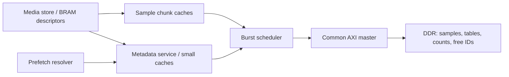

# DDR-backed media metadata and caches

Status: in progress on `proto/fpga-metadata-cache`; stage 1 baseline captured.
Investigated at `e0a91815` on `proto/fpga-native-sim-memory`.

## Goal and scope

Move view chunk-ID lists, per-chunk reference counts and the reusable chunk-ID
stack from capacity-sized on-chip RAM into DDR. Add small persistent metadata
caches/buffers, sharing one physical AXI DDR port with sample chunk traffic.
Wire this through standalone media, audio and the complete TP/SP/JP pipeline,
compare behavior with Rust, and repeat the coordinated 64-loop DRAMsim3 benchmark.

Keep view/range descriptors, logical loop records and small allocator counters
in BRAM/registers. Preserve separate mono views per channel and the compiler's
existing loop/view bindings. Keep Rust's logical storage model cache-independent.
This work does not add composite execution, a vendor DDR controller, CPU-coherent
shared memory, multiple outstanding AXI transactions or asynchronous garbage
collection. Existing bounded Reclaim commands remain available for cleanup.

## Immutable acceptance criteria

1. Integrated media operation stores all three large metadata structures in DDR
   and accesses them through the same synthesizable AXI port as sample chunks.
   No Python metadata executor or capacity-sized BRAM fallback supplies results.
2. Chunk-ID lists use compact allocated storage, not `VIEWS * SLOTS` reservations.
   Cache/stack-buffer BRAM is bounded by explicit parameters, independently of
   recording duration and physical slot count; descriptors scale with views.
3. Within configured capacities, statuses, samples, view contents, sharing,
   reference counts, free-ID order and committed loop behavior match Rust.
   Additional physical metadata-capacity refusals are explicit and preflighted.
4. Prefetch and demand share coherent metadata lookup. Appends, clear/remove,
   range creation, page reuse and sample-slot reuse cannot expose stale mappings
   or lose reference updates. Normal quantum boundaries do not flush caches.
5. Arbitration makes progress under contention and backpressure; accepted bursts
   route responses/errors to their owner. Fence covers sample and metadata writes;
   last-reference release still retires sample transfers before publishing reuse.
6. Native SV functional simulation and realistic DRAMsim3 both exercise the new
   path at 32-/64-bit AXI widths. Relevant diagnostic modes remain usable through
   adapters. Reset, fault containment and restore behavior are documented/tested.
7. Publish reproducible before/after DRAMsim3 measurements for the original
   64-loop workload, plus longer-table and mixed allocation/reuse workloads.
   Include processor completion times, metadata/cache/DDR costs and resources.
   No speedup or routed-clock guarantee is assumed; explain measured regressions.

## Architecture and design rules



- Media owns allocation and references; chunk memory continues to own samples,
  coherence and retirement. Keep their cache tags/replacement independent.
  Reuse transfer/RAM building blocks where useful.
- Refactor the existing sample adapter to expose physical burst requests before
  `axi_master`; arbitrate these with metadata bursts. Keep one burst outstanding,
  fixed AXI ID zero, at most 16 beats and no 4 KiB crossing. Preserve word packing.
  Hold ownership through RLAST/B completion and error drainage, not across a
  whole multi-burst chunk or metadata-to-sample dependency.
- Reserve receive space and a write-data source before issuing a burst. Give
  demand work and pressured writeback bounded service; prefetch is advisory and
  bulk work must not starve other clients. Define a testable arbitration policy.
- Define aligned, disjoint physical regions for samples, list pages/directories,
  reference counts and the free stack. Validate sizes, overflow and DDR capacity.
  Remove the current assumption that every memory request addresses sample bytes.
- Use paged chunk-ID vectors with roots/counts in view descriptors. Allocate
  pages/directories as needed, supporting bounded indexed lookup for seeks rather
  than walking from the list head. Keep directory caching small too. Specify the
  metadata-page allocator and reuse separately from the sample-slot free stack.
- Start with configurable 64-byte metadata cache lines. Share the table cache
  between foreground and prefetch, with stream-friendly placement/associativity.
  One line per 128 mono streams costs 8 KiB of data RAM; this is a sizing example,
  not a required implementation. Retain useful lines across quanta and combine
  duplicate pending reads where needed.
- Use a small coherent reference-count cache with buffered writes and serialized
  read/modify/write ownership. Counts remain indexed by physical chunk ID;
  ordinary playback does not access them. Do not duplicate counts in view lists.
- Buffer one or two blocks around the free stack's top; retain its count and the
  fresh-slot high-water counter on chip. Burst refill/spill and preserve LIFO order.
  Metadata stores/partial writes must preserve neighboring packed entries.
- All runtime/debug metadata accesses go through the same owner. Update/invalidate
  cached entries on mutation and reuse; forward dirty data before DDR writeback.
  An earlier hint never replaces the actual job's current mapping lookup.
- Publish descriptors only after their logical metadata updates are authoritative
  in the coherent service. Physical writeback can follow; a full media fence drains
  both services. Define page-reuse ordering, pending-fill cancellation/drain and
  coordinated reset. Do not claim crash recovery or rollback after a bus fault.
- Convert fixed-cycle metadata/configuration reads to request/response handshakes.
  Keep logical snapshot contents stable while allowing physical layout and debug
  address encoding to change. Fixture packing/unpacking stays outside execution.

## Implementation stages

Stages are sequential; each depends on the preceding stage's verification.

### 1. Establish the branch, baseline and physical contracts

- [x] Fetch upstream, inspect local work and create a dedicated implementation
  branch. Preserve the native-SV simulation work when selecting/merging the base;
  do not assume it has already reached `proto/fpga-rust-reference`.
- [x] Save the exact original `playback64` fixture, revision and DRAMsim3 timing
  JSON using the command below. Run one small record/play/reuse Rust comparison.
- [x] Freeze the burst-client handshake, address map, paged-vector format/index
  depth, cache parameters, metadata-page allocation and capacity-refusal rules.
  Cover every metadata user: media FSM, resolver, config, snapshots and restores.
- [x] Audit the existing 65,536-slot guard and address widths. Account for the
  reference case of 64 stereo loops, 30 s at 48 kHz: 5.76 million 32-frame chunks
  and 703.125 MiB of samples. The current DDR profile is only 512 MiB; distinguish
  architecture/address-sizing checks from that profile's physical capacity.
  A full-duration behavioral simulation is not required.
- [x] Verify layout arithmetic and limits, including metadata exhaustion before
  mutation. Record baseline resources and the selected arbitration/cache policy.

### 2. Add the common DDR burst transport

- [x] Separate sample burst preparation/packing from `axi_master`, introduce
  sample/metadata clients and a shared scheduler, and retain sample-only tops.
- [x] Implement owner tracking, fair demand/writeback service, advisory priority,
  errors and reset. Never wait for another client's request while retaining a grant.
- [x] Verify both widths with independent client scoreboards: mixed reads/writes,
  prolonged R/B and AW/W stalls, competing requests, multi-burst fairness, 4 KiB
  boundaries, errors and reset. Rerun the existing sample endpoint/chunk smokes.

### 3. Build compact DDR metadata storage

- [x] Implement paged lists, directory lookup/growth/release and a bounded metadata
  page allocator. Keep only descriptor roots/counts and small control on chip.
- [x] Add DDR-indexed reference and free-stack storage behind latency-tolerant
  interfaces. Preflight sample slots and metadata space before publishing growth;
  make refused allocation preserve logical state as required by Rust.
- [x] Provide logical metadata load/readback operations for tests and host config.
  Derive reference-count expectations independently from logical view ownership.
- [x] Verify empty/partial/multi-page lists, random ordinal access, directory/page
  boundaries, shared ranges, exhaustion, page release/reuse and address bounds.
  Test with small capacities so failures and reuse occur quickly.

### 4. Add persistent metadata caches and stack buffering

- [x] Implement shared table/directory caching, pending-fill handling and append
  updates; avoid deterministic conflicts among simultaneously active views.
- [x] Add the reference-count cache and free-stack top blocks, including dirty
  eviction, burst write combining, cross-block push/pop and fresh-slot allocation.
- [x] Implement coherent debug access, explicit drain/invalidation, late-error
  propagation and reset handling. Counters distinguish table/directory/count/stack
  traffic, hits/misses, fills, evictions and writebacks.
- [x] Verify dirty forwarding, repeated count updates, partial writes, duplicate
  prefetch/demand lookup, cache conflicts, cache smaller than working set, and
  mutations/page reuse during outstanding fills. Check cross-quantum reuse with
  no mutation avoids redundant DDR reads; do not promise hits after eviction.

### 5. Connect media, audio, full-loop execution and simulators

- [x] Replace metadata RAM accesses in `media_store` and
  `media_prefetch_resolver` with service handshakes; adapt host configuration.
  Preserve append/read/range/reclaim semantics and retirement-before-free ordering.
- [x] Extend Fence and fault containment across metadata caches, sample caches
  and accepted transfers. Preserve automatic BeginCapture and idle configuration interlocks.
  Use existing bounded Reclaim for incremental cleanup; retain command semantics.
- [x] Wire standalone media, media/audio and loop tops, generated AXI/direct tops,
  source lists, runners and the legacy word diagnostic path. Keep chunk-only and
  non-media tops working without an active metadata client.
- [x] Expand native-SV and Python/DRAMsim3 backing images and arena validation to
  cover all regions. Update initialization, restore, logical snapshot conversion
  and timeouts for variable latency; read actual RTL/DDR contents, not a shadow.
  Native mode must continue without Python per-cycle memory service or a DDR library.
- [x] Keep Rust's logical semantics and wire snapshots as the oracle. Add logical
  fixtures/trace instrumentation only where coverage needs them; do not emulate
  hardware caching in Rust or alter outcomes to match a faulty physical layout.
- [x] At each boundary run a small Rust comparison: standalone media, audio,
  then connected loops, followed by a realistic record/play/reuse smoke.

### 6. Validate end to end, synthesize and benchmark

- [ ] Run the relevant Rust/media, resolver, AXI, chunk, audio and full-loop
  regressions. Cover 32-/64-bit buses, normal/odd/minimum cache capacities, word
  diagnostics, stereo bindings, retained ranges, wrap, capture forwarding,
  clear/remove/reclaim and reuse in native and DRAMsim3 modes.
- [ ] Inject metadata fill/writeback, reference-update and stack refill/spill
  faults, including speculative reads and failures after buffered completion.
  Check sticky fault propagation, no further unsafe reuse, draining and coordinated
  reset/restore. Exercise contention and eventual completion under backpressure.
- [ ] Check generated wrappers and warning-clean lint. Run generic/ECP5 synthesis
  for affected blocks and the integrated top. Report LUT/FF/BRAM/DSP deltas with
  exact capacities; confirm larger slot/list capacities do not grow metadata BRAM
  as `SLOTS` or `VIEWS*SLOTS`. Exclude simulation RAM from synthesis manifests.
- [ ] Repeat the saved four-quantum 64-mono-loop benchmark with identical graph,
  seed, Q=32, chunk size 32, gains/mixes, read/write buffers, bus width, fabric
  clock and pinned DDR profile. Compare the fresh baseline with DDR metadata.
- [ ] Add a longer-table 64-loop replay with metadata exceeding cache capacity.
  Start positions around line/page boundaries, run through sequential reuse and
  eviction, and include nonresident seeks/wrap. The old 16-ID-per-view fixture
  alone fits one 64-byte table line and cannot establish streaming behavior.
- [ ] Add a 64-loop mixed playback/recording scenario exercising new-slot and
  free-stack allocation, shared references, and bounded release/reuse between
  quanta. Measure preparation/reclaim cost separately rather than hiding it.
- [ ] Compare measured per-quantum samples/state/jobs and final fenced media with
  Rust. Keep full intermediate snapshot comparisons in a separate verification
  replay or use passive observation: debug table walks and fences must not warm,
  flush or evict measured caches between quanta. State cold/warm conditions and
  retain sample-only baseline measurements under the same observation policy.
- [ ] Extend `execution-timing.json` with the reporting fields below; save cases,
  seeds, configurations, revisions and replay commands. Investigate cache thrash,
  transport starvation or exposed lookup latency before finalizing the results.
- [ ] Update architecture/protocol documentation and publish baseline/new timing,
  traffic and resource tables, including limitations and remaining bottlenecks.

### 7. Deliver, check CI and resolve review

- [ ] Commit each completed stage, push the implementation branch and open a PR
  targeting the FPGA branch, or update an explicitly designated existing PR.
- [ ] Extend FPGA CI with focused scheduler/cache tests and small native and
  realistic allocation/reuse pipeline smokes. Keep long benchmarks opt-in with
  stored reports; check CI and fix relevant failures until required checks pass.
- [ ] Check for automated review feedback; address actionable findings and repeat
  review/CI checks until the reviewer approves, if an automated reviewer is present.
- [ ] Update this plan with evidence and leave the PR ready for review. Do not
  autonomously merge it.

## Benchmark procedure and required reporting

Existing baseline command (from `fpga/loop_pipeline/README.md`):

```sh
python fpga/axi_memory/build_dramsim3.py
python fpga/loop_pipeline/simulate.py --media --config 8x8 --timing \
  --read-buffers 128 --write-buffers 4 --axi-data-width 64 \
  --memory-model dramsim3 --fabric-hz 100000000 \
  --output work/metadata-baseline
```

The existing graph has eight tracks of eight mono loops, 64 gains, 56 mixes,
eight outputs and 192 jobs per quantum. Published historical playback results
are 14,088 startup and 12,516 steady active cycles (140.88/125.16 us at 100 MHz);
rerun the selected base instead of treating those figures as the fresh baseline.
Preserve the original fixture as well as saving the new extended/mixed cases.

For each quantum report raw accepted-run-to-done cycles/time, active time,
host preparation separately, TP/SP/JP busy time, and completion timestamps relative
to run acceptance: TP Settle, SP done, JP done and final TP Finish/done.
Show overlapping memory activity separately; do not add overlap to processor totals.
Convert cycles using the configured fabric frequency and give headroom against
Q=32 at 48 kHz (666.67 us); these are assumed-clock behavioral estimates.

Report per-client AXI bursts/bytes, arbitration wait, sample demand-fill wait,
metadata lookup stalls, cache/stack counters and combined DRAMsim3 physical-bus
statistics. Separate useful metadata bytes from fetched/written line bytes.
Include final fence/native-drain cost and host simulation seconds separately
from active FPGA time. Preserve the native library/profile/revision provenance;
the direct functional backend cannot establish realistic DDR performance.

The reference 64-stereo/30-second sizing audit does not fit the current 512 MiB
DDR profile even before metadata. Keep the comparable timing runs within that
profile; any larger-capacity experiment must explicitly select/document a suitable
profile rather than silently changing the baseline memory configuration.

## Execution contract

- Keep the plan updated as work progresses and check off completed items.
- Commit each completed stage or meaningful milestone.
- Implementation steps may be revised when new evidence warrants it.
- Design rules may be revised for a documented, well-supported reason.
- Goals and acceptance criteria must not be changed without explicit user approval.

## Execution evidence and decisions

Upstream `e5c015be` was merged into the native-SV branch at `4b2fe897`. It removes
the host Preview/Commit/preflight protocol, uses Settle, automatically emits
BeginCapture, and makes processing faults fatal. Preparation and timing tasks
follow this new flow; the metadata goals/acceptance criteria are unchanged.
Generated native tops were refreshed to include the upstream interface changes.

The fresh AXI64/DRAMsim3 baseline has 13,955 startup and 12,383 steady clocks
(139.55/123.83 us at 100 MHz). Steady TP/SP/JP busy times are 873/1,152/10,353
clocks. The exact case/report are in `work/metadata-baseline-current/8x8/`.

Physical contracts: metadata lines/pages contain sixteen 32-bit words (64 bytes).
Aligned regions follow samples: reference counts, free IDs, then a metadata page
pool. Per-view roots index radix-16 trees whose depth is derived from SLOTS;
indexed lookup is bounded by that depth. Zero page IDs mark absent children.
The page pool has high-water allocation and a DDR-linked reusable-page list;
only roots, extents and allocator counters are on chip. Default pool capacity
is ceil(SLOTS/15) + 8*VIEWS + 16 pages, independently configurable. Growth checks
count additional radix nodes before mutation. Table/reference/stack caches are
separate; serial foreground ownership provides coherent read/modify/write.
The common endpoint arbitrates at complete AXI burst boundaries, round-robin
between sample and metadata clients, with one transaction outstanding.

Stage 2: all existing endpoint/adapter suites pass at both widths after the DMA
extraction. Shared two-client cache/transport tests pass AXI32/64 with 16-/64-word
lines, forcing multi-burst interleaving, dirty eviction, held responses, zeroing,
fences, cache hits, error propagation and coordinated reset. The small realistic
record/play/reuse regression passes after integrating upstream.

Stages 3/4: standalone paged metadata passes AXI32/64 with two table lines and
one reference/stack line, including exhaustion without mutation, random indexed
reads, dirty eviction, cross-block stack access, trim and page reuse, physical
readback and faults. Integrated small native media directed/random/protocol tests
match Rust after replacing the RAMs with the service. Debug table addresses now
pack view above SLOT_BITS and ordinal below it, avoiding hardware division for
odd capacities; logical snapshots retain their existing representation.

The table service also retains one leaf translation per view in bounded root RAM,
so sequential lookups reuse the leaf page without rereading every radix directory.
Explicit invalidation clears these translations; trim invalidates the affected
view. Small native media/audio and realistic standalone media comparisons pass.
The baseline default AXI32 top maps to 24,691 LUT4, 13,716 FF, 91 DP16KD and four
MULT18X18D; full counts are in `measurements/resources-baseline.json`.

Stage 5: native standalone media, media/audio and coordinated small-loop tests
pass, including fatal resource/bus errors, sticky silence, coordinated reset and
late writeback faults. Realistic standalone and connected default/small runs
also pass. Legacy scalar media remains usable through a second backing-port
adapter. The late-writeback test prepares reusable slots and hot allocator
metadata before pausing DDR: pausing cold metadata would intentionally block
allocation rather than isolate a completed capture. Its fault/silence/clock
assertions are retained. No Rust implementation changes were needed.
