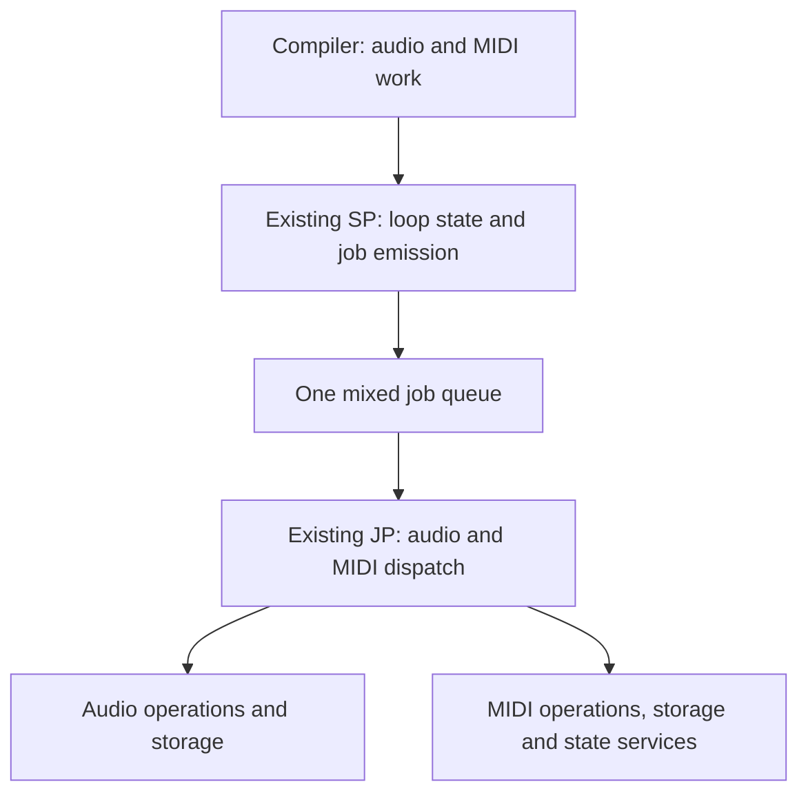

# MIDI through the shared state and job processors

Status: Rust and shared RTL implemented; final RTL checks and fresh Vivado measurements in progress.

## Goal and scope

Rebuild MIDI execution in the Rust FPGA reference around its existing compiled
program, state processor (SP), job queue and job processor (JP). Preserve the
current managed MIDI behavior and reuse the useful storage/state components.
The Rust result must remain a fast, idiomatic implementation suitable for CPU
execution. Keep RTL mappability in mind when choosing data structures, job
boundaries, algorithms and control flow. Document an efficient hardware mapping
without requiring the Rust code to mirror hardware blocks or clock-level steps.
After the complete Rust implementation passes its equivalence gate, implement
that architecture in RTL and publish new Vivado utilization and timing results.

The first four stages below implement the agreed Rust redesign. RTL work depends
on completion of all four. Work targets `feat/backend-replacement` through PR(s).
Ignore CI results and automated review feedback unless the user asks otherwise.

Investigated starting point: `0e26c783b2bd1662fd156483e5658cf8b795430d`.
The current Rust MIDI path is `Pipeline::process_midi_session` ->
`SessionObserver::quantum` -> `MidiSession::quantum`, outside JP execution.
The old RTL puts most orchestration in a separate `midi_runtime` controller.
The [existing Vivado study](docs/fpga/midi-vivado-7020.md) records its cost and
failed combined placement. Preserve that evidence unchanged.

Included: reference/compiler changes, explicit MIDI jobs, shared SP/JP execution,
storage/state/history/content operations, the corresponding RTL and testbench,
and reproducible hardware measurements. Application MIDI enablement, a new
control transport, codec/board deployment, new MIDI message families, arbitrary
seeks, overdub and voice merging are separate work. Do not expand the supported
message subset while changing the execution architecture.

## Immutable acceptance criteria

1. The existing SP executes a compiled program for audio and MIDI, updates the
   authoritative loop states, and emits distinct jobs into the existing queue.
   The same JP dispatches and executes both job families. No observer callback,
   autonomous MIDI loop scheduler, or opaque `RunMidiQuantum` job performs the
   actual orchestration outside that program.
2. Preserve supported recording, playback from the beginning, repeat/retrigger,
   stop cleanup, input history, grouped grabs, import/export/duplicate/replace/
   clear, channel ownership, incremental differences, restoration and recovery.
   Preserve event bytes, timestamps, silent duration, existing equal-time/global
   output order, known/unknown state distinctions, and supported note/pedal/
   controller/program/reset semantics. Existing unsupported operations stay
   explicitly unsupported.
3. Output state, activity, difference updates and playback/transition progress
   follow accepted output. Partial cleanup/restoration and destination recovery
   retain the current behavior, including suppression of overdue playback and
   restart at a valid loop beginning. MIDI capacity/refusal remains distinct from
   fatal pipeline faults; preserve their different effects on audio.
4. Retain shared event blocks/views, immutable starting snapshots, generation
   checks, independently pinned exports and bounded retirement. Transfers can
   progress while processing continues. Grouped content publication updates all
   target bindings and SP metadata atomically at one quantum boundary.
5. Prepared processing, publication, grabs and cleanup perform no heap allocation
   or unbounded destruction. Support the existing 128-binding Rust capacity
   case, at least 8,192 short events per sequence, and the 3,000-event recording
   scenario with continuing history and separately provisioned headroom.
   Simultaneous grabs into all 128 bindings remain an optional measurement.
6. Preserve audio samples, loop timing, callback partitioning, synchronization,
   program replacement/state retention and fault behavior. Mixed execution must
   work through compiled images, rather than only manually assembled job tests.
7. The later RTL implements the same job architecture through the existing SP
   and JP and matches the redesigned Rust reference. Large MIDI data/state live
   in DDR, with no MIDI cache in this milestone; small bounded queues, working
   data and primary context tables may live on chip.
8. Publish fresh Vivado 2021.1 synthesis and placement/routing attempts for the
   specified Zynq-7020 profile at 100 and 150 MHz, with auditable utilization and
   timing comparisons. Report failures as failures and distinguish unplaced
   estimates from routed timing. Physical qualification requires successful
   routing and passing setup/hold checks; a functional test pass cannot replace
   those checks. Meeting either clock is an engineering objective, not an
   additional assumed acceptance threshold for this requested measurement task.
9. The Rust implementation remains practical for fast native execution. Hardware
   mapping considerations must not impose a simulated shared arithmetic unit,
   register-transfer structure or per-clock stepping on ordinary Rust functions.
   Review software work and overhead alongside the proposed hardware mapping.

## Design rules

### Efficient Rust with a documented RTL mapping

Use ordinary Rust functions, control flow and efficient data access within the
shared SP/JP architecture. The hardware-mapping review should guide algorithm
and interface choices while preserving a useful, fast software implementation.

- Retain finite prepared storage, explicit indices and bounded work. Document
  value ranges and overflow behavior, using suitable Rust integer types. These
  bounds guide hardware widths later; musical timestamps remain 64-bit.
- Explain persistent/temporary storage, access patterns and dependencies, with
  a plausible bounded hardware implementation. The Rust code need not simulate
  memory ports or individual reads and writes as clock-level operations.
- Review arithmetic-heavy functions and control flow for repeated wide
  calculations, large selection networks or excessive hardware state. Identify
  opportunities to factor calculations, use known bounds or divide work into
  efficient hardware steps. Arithmetic sharing and pipelining are RTL mapping
  choices, not a requirement to centralize arithmetic in the Rust implementation.
- Preserve explicit progress and acceptance/backpressure rules where operations
  actually need to resume. Use direct computation for ordinary bounded work;
  avoid extra software state machines or tiny execution steps solely to imitate
  how hardware might eventually perform it.

For example, a Rust function may directly calculate `base + index * stride`.
Its mapping review can propose an efficient address calculator or pipeline for
RTL without turning that function into a hardware simulator. Reuse calculations
in Rust when that also benefits its clarity or CPU performance.

Review both software efficiency and hardware mappability as jobs/services are
introduced. Resolve algorithmic or interface obstacles before the RTL port;
leave hardware-specific register placement and resource sharing to that port.

### One compiled execution path

- Generalize the compiler's current `audio_pass` into a work pass containing
  both signal types. Extend logical operations, Rust lowering, stable state
  bindings, resource accounting and program loading. Keep the sync pass as the
  single owner of musical loop evolution. Do not enable unrelated app profiles.
- SP's MIDI instructions derive work from settled loop state and compiled
  bindings. Add only small per-channel scheduling fields where necessary, such
  as previously scheduled mode/content revision and restart intent. Full
  instrument state and acknowledged execution progress belong outside SP's
  ordinary loop record. Do not maintain a second advancing musical cursor.
- JP services see explicit job operands and execution data. They do not scan SP
  loop states to rediscover which work should run. Private MIDI helpers are
  allowed; they must not form another whole-session execution engine.
- A job describes a bounded operation or stream window, not one job per event.
  Candidate operations include input/history observation, begin/finish capture,
  append, read-until-timestamp, merge, restore/cleanup, output and maintenance.
  Names/packing can change after investigation; their responsibilities must stay
  explicit. Account for the worst admitted job count before SP advances state.
- Keep SP scheduling intent separate from JP completion. Publish small,
  generation-checked readiness/progress results at the quantum boundary so the
  next compiled pass can request resumable work. Enqueuing a job must not mark
  capture, restoration or cleanup as successfully finished.
- Use stable channel/result slots for job dependencies. SP emits a whole quantum
  before JP drains it: finishing a recording must make the resulting view
  available to a following playback job in that same quantum, without baking a
  stale view handle into the queued work.

### Storage and state ownership

| Owner | Information |
| --- | --- |
| SP | Loop mode, position, length, plans/revisions; compiled channel references and small scheduling fields. |
| JP MIDI execution data | Recording writer, active pinned view, event cursor, per-loop activity, transition progress, readiness/incomplete/recovery status. |
| Input/output state services used by JP | Observed input state, accepted destination state, history/checkpoints and incremental comparison maps. |
| MIDI content store | Event blocks, chronological range views, immutable starting snapshots, generations, references and deferred retirement. |

Initially reuse `ContentStore`, `Interpreter`, `DifferenceService`,
`StateTransition` and the useful history algorithms. Refactor their ownership
and APIs where needed; do not preserve `MidiSession::quantum` as the new engine.
Keep one event-block ownership level and one content view per MIDI data channel.
Audio buffers and MIDI event streams retain distinct types. Do not force their
payloads into one storage format merely to share code.

Mutable observations and immutable starting state remain separate. Maintain
comparisons when state changes; ready playback must not scan every state field
again at each loop start. Shared snapshots/comparisons keep their generation and
lifetime rules. Reserve admitted capture/history capacity before background
operations consume remaining pools.

### Ordering, edits and bounded work

- Pin recording-start state before messages at that start timestamp are applied.
  Later capture jobs use that pinned state even if input/history processing has
  already advanced to the end of the quantum.
- Make cleanup, ownership handoff, restoration and playback ordering explicit
  in compiled work. In particular, finish old-owner cleanup before new-owner
  restoration. Preserve established-owner priority and ownership retained during
  partial cleanup. Match the existing cross-destination transcript ordering too.
- Merge chronological streams using bounded cursors/head records. Carry source
  identity through merges so accepted messages update the correct loop's activity.
  Ordering keys follow logical stream identity, not relocated RAM addresses.
  Reading or selecting a candidate does not commit accepted playback progress.
  Avoid sorting/copying an entire recording on every quantum.
- Stage content edits through prepared, generation-checked transactions. Reserve
  resources and validate all targets before publishing binding changes together
  with SP length/revision/reset updates at a completed quantum boundary. Storage
  services must not independently mutate musical loop state.
- Large transfers, comparison preparation and retirement have explicit bounded
  work and resumable progress. Background work cannot monopolize the common JP.
  A resumable internal operation is not permission to emit time-critical playback
  late in a later quantum; preserve existing refusal/recovery behavior.
- Keep safe Rust, `no_std` + `alloc`, finite prepared pools and explicit indices.
  Keep its processing paths efficient for native execution. Document work bounds,
  data dependencies and value ranges so the later RTL port can choose efficient
  arithmetic and storage. Preserve 64-bit musical time and validated index bounds.

## Staged implementation

### 1. Freeze behavior and define the execution contracts

- [x] Establish an isolated branch/worktree from the appropriate current
  `feat/backend-replacement` base with the reusable Rust components present.
  Record source revisions and retain the old standalone RTL as historical
  comparison material, without making its controller a dependency of the new
  architecture. Plan separate Rust and RTL PRs if that improves reviewability.
- [x] Preserve the current MIDI session implementation as a test-only behavioral
  oracle during migration. Keep independent MIDI state/pedal tests and native
  loop-resolver comparisons; do not change expectations to bless new behavior.
- [x] Specify the mixed instruction/job contract, stream/context/result slots,
  publication boundary, ownership lifetimes and recoverable/fatal error results.
  Describe the per-quantum ordering and recording-to-playback dependency.
- [x] Establish baseline audio outputs, MIDI transcripts/state/status, storage
  ownership outcomes and traces for representative mixed sessions. Record queue,
  stream, pool and working-memory limits separately from CPU elapsed times.

Verification: run the relevant existing reference/compiler suites once; add
focused contract tests for job ordering, resource preflight and result-slot
handoff. Review that the design has one musical clock and one execution queue.

### 2. Build the minimal mixed compiler/SP/JP path

- [x] Extend compiler operations, stable bindings/initializers and limits for
  MIDI channels, input/output streams and execution slots. Lower them through
  `RustTarget`. Unsupported targets explicitly reject the new operations until
  implemented; no automatic app capability enablement.
- [x] Extend SP's instruction execution to update the small MIDI scheduling
  fields and emit begin/finish capture, append and playback work from the
  compiled program. Use the existing settled render state and sync decisions.
- [x] Extend the existing `Job` enum, queue and `JobProcessor` dispatcher with
  small MIDI operations and prepared stream/result storage. Connect the reusable
  event store. The ordinary execution loop must process both job families.
- [x] Demonstrate record, stop, play and repeat alongside audio through a compiled
  image. Include silence, multiple loops, same-quantum finish/start dependencies,
  timestamp boundaries and stable merge ordering. This is an intermediate slice;
  it is not the final managed-MIDI behavior gate.

Verification: inspect exact SP job traces; compare audio samples and basic MIDI
records/transcripts. Test queue exhaustion before state advancement, retained
bindings during image replacement, and incompatible-target rejection. Assert
that success comes through JP execution rather than the legacy observer path.

### 3. Port the complete managed behavior onto explicit jobs

- [x] Integrate the reused interpreter, incremental comparisons and ordered
  restoration/cleanup as JP operations, with accepted-output progress and
  per-loop activity. Keep targets immutable and output state shared by destination.
- [x] Integrate input observation, rolling history/checkpoints, pinned start-state
  seeds, recording limits/completion and shared range playback. Preserve exact
  start-frame inclusion/exclusion and bounded checkpoint replay.
- [x] Integrate channel ownership, cleanup-before-handoff, stable output merging,
  refusal/recovery, partial transitions, incomplete recordings and fatal pipeline
  behavior. MIDI-specific failures must not accidentally abort ordinary audio.
- [x] Route grab/duplicate/clear/replace and import/export preparation/publication
  through the new binding/transaction model. Keep coherent pinned exports,
  atomic groups, capture reservations and budgeted background work/retirement.

Verification: migrate feature scenarios in small groups and compare with the
frozen oracle, including bytes, offsets, tie order, accepted state, activity,
readiness/errors and ownership. Exercise controller/pedal/reset edge cases,
refusals, stale handles, capacity exhaustion and edits during mixed playback.

### 4. Complete the Rust replacement and pass its gate

- [x] Remove MIDI execution from `SessionObserver` and the production standalone
  session loop. A compatibility API may forward to prepared resources and the
  normal pipeline; it must not preserve a second execution path.
- [x] Complete compiler graph/fixture coverage for supported audio-plus-MIDI
  routing and program loading. Verify the same JP handles real mixed job traces
  and that continuing state survives relocation, replacement and slot reuse.
- [x] Compare all existing managed-MIDI scenarios with the oracle, plus multi-loop/
  multi-output, all supported quanta, callback partitioning, history rollover,
  content operations, failure recovery and exact audio output. Exercise the
  128-binding/3,000-event workload, configured limits and allocation guards.
- [x] Document the new program/job semantics, ownership, API changes, capacities
  and work bounds. Make CPU profiling descriptive only; no cloud wall-clock or
  simultaneous-128-grab pass threshold. Finish the Rust PR/milestone.
- [x] Review RTL mappability of the completed Rust design: record each job's
  bounded work, storage/access needs, arithmetic ranges and plausible hardware
  implementation. Identify risks of excessive hardware state or duplicated
  calculations without requiring Rust to implement hardware blocks. Review
  algorithmic work, copies and dispatch overhead; make a small representative
  before/after CPU measurement and investigate clear regressions, keeping cloud
  timings descriptive rather than a strict pass threshold.

Verification gate: complete reference/compiler tests, affected loading/transport/
reference-host tests, audio regressions, formatting, warning-denying builds and
required test-policy checks, plus the documented RTL-mappability review above.
Start broader local workspace checks at this milestone according to repository
guidance, recording unrelated environment blockers. They may continue alongside
the RTL work after the focused Rust gate above passes; finish/reconcile their
results before final delivery.
**Do not start the RTL rebuild before this gate is satisfied.**

### 5. Rebuild RTL through the existing SP and JP

- [ ] Extend packed compiler lowering and the existing RTL SP instruction/job
  interfaces for the agreed operations. Integrate with SP-owned loop execution,
  the common job queue and the existing JP dispatcher. Exercise compiled programs;
  external settled-record fixtures alone are insufficient integration proof.
- [ ] Implement the MIDI job operations and reusable storage/state services behind
  JP. Replace the standalone `midi_runtime` orchestration in the new production
  composition. Keep audio's current sample/metadata caches; MIDI remains cache-less.
- [ ] Map large events, snapshots, states and scalable metadata to DDR. Budget
  small queues and primary context/working memory explicitly. Choose arithmetic
  reuse, pipeline stages and limited parallelism according to area, timing and
  throughput needs. Avoid mechanically duplicating every software calculation
  into a wide circuit, or mechanically serializing all calculations through one
  unit. Validate bounds before narrowing indices; keep musical timestamps intact.
- [ ] Provide ordered, backpressured memory/output interfaces and explicit audio/
  MIDI memory arbitration. Preserve coherent ownership and fence behavior across
  jobs, content publication and program replacement. Check AXI32/64 where supported.
- [ ] Adapt the RTL testbench to run the same compiled images against the new Rust
  model. Preserve the old scenarios until replacement coverage is demonstrated;
  retire obsolete runtime-command drivers only with an explicit coverage mapping.
- [ ] Obtain quick mapped-resource estimates after the first useful MIDI job
  slice and after major additions. Track controller logic, registers, control
  groups and inferred RAM. Investigate unexpectedly large growth before carrying
  the complete feature set forward; no opaque whole-session worker in JP.

Verification: differential SP job/state traces, full shared-JP audio samples and
MIDI output/state, delayed memory, command/output stalls, partial refusals, bounds,
capacity, stale generations, edits, reset/faults and live loading. Run warning-clean
lint, synthesis/latch/RAM checks and the relevant retained RTL component gates.

### 6. Run and report the new Vivado measurements

- [ ] Preserve the previous study's source hashes, reports and failures unchanged.
  Extend its preparation flow for the shared architecture. Pin every measured
  revision, configuration, context, constraints and tool/image provenance.
- [ ] Run fresh audio-only and shared-SP/JP audio-plus-MIDI synthesis and
  placement/routing attempts with public Docker-sourced **Vivado 2021.1**, using
  the original vendor payload and the recorded matching runtime. Use
  **`xc7z020clg484-1`**, **100 and 150 MHz**, 0.2 ns uncertainty and comparable
  implementation settings. Check interface liveness and constrained timing paths.
- [ ] Keep the session at **64 loops, each with two audio channels and one MIDI data channel**, **48 kHz**,
  approximately **30 seconds/channel**, **audio chunks 32**, **quantum 32**,
  **64-bit AXI**, two audio inputs/outputs and one MIDI input/eight destinations.
  Preserve sequence capacity of 8,192 events, 256-event blocks and equivalent
  pool/headroom provisioning. Keep audio cache and program/queue/buffer limits
  comparable to the recorded profile; explain any unavoidable architectural change.
- [ ] Use an audio-only baseline that genuinely excludes MIDI hardware. Compare
  the new increment with the old standalone MIDI implementation, rerunning old
  profiles if changed conditions would otherwise make that comparison misleading.
  Do not reduce loop count, duration, capacities or features to obtain a better
  fit. Count shared-processor changes and measurement-wrapper overhead explicitly.
- [ ] Report optimized and, where available, routed LUT/register/BRAM/DSP/slice
  utilization, control groups/headroom, setup WNS/TNS/failing endpoints, hold
  WHS/THS, route status and DRC results. Attribute critical paths and separate
  pre-existing audio limits from new MIDI/shared-execution limits. Unplaced
  estimates and failed attempts must be clearly labeled.
- [ ] Investigate avoidable resource/timing growth in the new implementation and
  make targeted improvements within the agreed design. Publish the achieved
  results and any unresolved fit/timing limitations without inventing successful
  timing or expanding into unrelated audio/board work to close a clock target.
  Include a concise before/after report with figures and retained raw evidence.

Measurement notes: the previous profile needs about **724.5 MiB** for payload and
metadata, before caller/OS/application memory. Provision at least **1 GiB DDR**;
a 512 MiB board cannot hold it. The fabric build does not certify such a board's
memory capacity. Compact incremental MIDI logic and useful integration headroom
are design objectives; report the actual outcome without an invented utilization
percentage gate. Clock closure does not prove per-quantum throughput. Record
representative execution work with realistic DDR/output pressure, without making
cloud CPU timings or 128 simultaneous grabs into acceptance thresholds.

### 7. Final end-to-end validation and delivery

- [ ] Run full local reference/compiler and affected RTL regression suites on the
  final implementation. Trace compiled mixed programs from SP loop updates through
  the common queue/JP to audio samples, MIDI messages and persistent state.
  Recheck loading, history grabs, staged transfers, ownership, refusal and faults.
- [ ] Verify final evidence matches the committed source and actual configuration.
  Summarize required workload support, memory accounting, hardware fit/timing and
  remaining integration boundaries. Preserve the distinction between functional
  completion and a physically timing-qualified deployment.
- [ ] Update reference, compiler, RTL, testbench and measurement documentation;
  mark this plan accurately. Commit/push meaningful milestones and open/update
  PR(s) targeting `feat/backend-replacement`, with clear dependency handling if
  the Rust and RTL changes use separate PRs. Report links and local validation.
  Do not merge autonomously; ignore CI/review feedback unless requested.

## Testing strategy

Use focused contract and feature comparisons while iterating, then the complete
Rust gate before RTL, focused Rust/RTL differential checks while porting, and a
final full affected-suite gate. Reuse deterministic fixtures, independent state/
resolver oracles and existing allocation guards. Validate job traces as well as
outputs so a hidden old controller cannot satisfy equivalence tests. Use early
resource estimates to catch structural mistakes, then fresh Vivado measurements
for the final hardware conclusions. Include the representative Rust CPU check
at the Rust gate, together with allocation, copy and work accounting. Broaden/
repeat checks when changes or failures justify it; avoid repetitive full runs
and speculative profiling.

## Execution contract

- Keep the plan updated as work progresses and check off completed items.
- Commit each completed stage or meaningful milestone.
- Implementation steps may be revised when new evidence warrants it.
- Design rules may be revised for a documented, well-supported reason.
- Goals and acceptance criteria must not be changed without explicit user approval.
- User override of the plan template: do not inspect, wait for, or act on CI results
  or automated review feedback unless asked. Local validation above remains required.
- Publish reviewable PR(s) against `feat/backend-replacement`; no autonomous merge.

## Execution notes

- Work branch: `feat/fpga-midi-shared-jobs`, starting at `0e26c783`. The fetched
  target remains `147c2457`; this branch retains the storage and prior RTL changes
  required by this plan. PR dependency/base handling will be made explicit.
- Frozen test-only session/control oracle copied before execution changes.
- Stage 1: frozen test-only oracle, local reference/compiler baseline pass;
  execution contract in [midi-shared-jobs.md](docs/fpga/midi-shared-jobs.md).
  Base is the previously measured RTL branch, which contains the reusable Rust
  work; origin backend is still `147c2457`. PR dependency handling remains explicit.
- Stages 2–3: compiled mixed work pass and explicit MIDI jobs are implemented;
  the production observer/standalone quantum scheduler is removed. Existing
  reference/compiler suites pass with all features, including the 128-binding
  dense/storage/allocation scenarios. Frozen-oracle comparisons cover all five
  quanta, pedals, cross-destination ordering and partial output. Real compiled
  image replacement retains active MIDI capture. Targeted host/protocol/transport
  tests and the warning-denying workspace build pass. Broader workspace tests
  are running before the Rust gate is closed.
- The compiler exposes explicit `with_midi` context bindings on an audio graph's
  logical program; general application MIDI strip/bus graph wiring stays outside
  scope. This gives compiled mixed images without enabling unrelated app profiles.
- Stage 4 verification sequencing: the complete all-feature reference/compiler
  gate, affected host/transport suites, warning-denying workspace build and
  documented mapping review pass. The 3,503-case broader local workspace run
  takes substantially longer and runs in the background; its results must be
  reconciled before final delivery. This changes verification sequencing only,
  not Rust/RTL functional acceptance or the required local checks.
- Stage 4 Rust gate passed: final focused reference/compiler, loading, transport,
  mixed image and oracle tests; full all-feature reference/compiler suite before
  the final inactive-job optimization; no-heap capacity/history/content scenarios;
  targeted host/protocol/transport tests; warning-denying workspace build; format
  and test-attribute policy. Mapping/software-cost review is documented. The
  final local workspace suite continues in the background and will be reported.
- Stage 5: shared SP/JP RTL and connected word/dual-AXI tops are implemented.
  The compiled trace/sample/state test passes all five quanta, including partial
  output, atomic publication fences and fatal audio recovery. All 16 retained
  service scenarios pass; context-unbind/export lifetime and zero-bound-loop
  history scenarios were added. Audio/compiler/loading tests pass; the DDR audio
  gate passed after provisioning its documented DRAMsim3 dependency.
- Hardware publication uses an explicit completed-boundary fence: the embedding
  validates/publishes SP loop metadata through its existing configuration port,
  then acknowledges before MIDI completion/next quantum. This keeps application
  transport enablement out of scope while preventing mismatched content/lengths.
- Work review eliminated full 16-channel activity copies for single-channel owners
  and unnecessary clearing of inactive activity, retaining observable semantics.
  Bounded address operands/offsets are narrowed only in RTL; Rust remains direct.
- Broad local workspace check: 3,487/3,503 passed; 16 failed and 11 skipped. Twelve
  app startup capacity failures are represented by the untouched baseline's same
  Runtime(Capacity) failure. Three of four host/timeout failures pass in isolation;
  the launcher-recovery test remains blocked outside the changed reference path.
  These are local results, not CI feedback.
