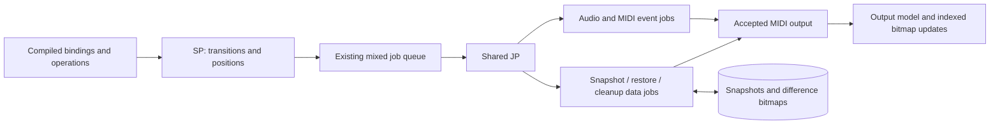

# Limited MIDI state tracking and restoration

Status: in progress. Implementation branch: `feat/midi-expression-state`; base `cc410f27`.

Implement reasonable, musically useful performance-state tracking and restoration
in the Rust FPGA reference first, then port its behaviour to RTL, then measure
the result. The detailed requirements below are a starting point, not a fixed
MIDI-conformance checklist. Use immutable starting snapshots, incrementally
maintained difference bitmaps, and an ordered restoration routine. Preserve the
existing shared state processor (SP), job processor (JP),
event blocks/views, and event-only mode.

Work targets `feat/backend-replacement` through a new PR or staged PRs. The prior
work was squash-merged in PR #1022 as `cc410f27`; this investigation uses its
pre-squash equivalent, `3a361923`, in the existing worktree. Preserve unrelated
dirty documentation and measurements. **CI and GitHub review handling are outside
this plan. Do not merge a PR autonomously.**

## Core goal and implementation discretion

The core idea is to restore MIDI **musical expression state to a reasonable
degree**, so the looper remains useful and responsive when played. Perfect
reconstruction of instrument state, every pedal corner case, or a theoretically
smallest restoration sequence is not the objective.

The implementer has explicit latitude to adjust detailed functional requirements
when they materially affect CPU cost, callback latency, memory use, FPGA resources,
or achievable clock timing. This includes simplifying difficult note/pedal cases,
limiting controller or pressure coverage, revising seek/state reconstruction,
and tuning capacities or policies. Preserve useful everyday note, modulation,
pitch, and pedal behaviour, including a reasonable sostenuto implementation;
do not quietly remove the main musical purpose to obtain better measurements.

For each meaningful adjustment, record the original expectation, the chosen
behaviour, its musical limitations, and the performance/resource reason. Clear
algorithmic or hardware analysis is sufficient where appropriate; do not require
an elaborate profiling exercise for every decision. Update the plan, scope table,
tests, and benchmarks to agree. These adjustments are already authorized and do
not require separate user approval within this mandate.

The stable acceptance criteria are:

- Deliver useful expression-state restoration in both Rust and RTL through the
  existing compiled SP/shared-JP architecture and incremental bitmap approach.
- Keep the Rust implementation practical as fast software and the RTL mapping
  reasonable; preserve the existing audio and raw MIDI event functionality.
- Keep accepted-output accounting, memory/generation safety, prepared callback
  allocation guarantees, explicit capacity failures, and honest fault handling.
- Make both implementations correct for the same **documented chosen model**.
  Simplifications must be explicit and tested, not accidental wrong-state bugs.
- Measure and report the actual supported scope and costs, including limitations.
  CI and GitHub review handling remain excluded.

## Adjustable initial functional baseline and targets

Use the following as the initial implementation scope. Detailed coverage and
targets may change under the discretion above; they are not individually immutable
acceptance gates. The stable criteria still apply to any such change.

1. Restore performance state: notes and attack velocities, key-down versus
   pedal-held notes, sostenuto capture membership, pitch bend, channel pressure,
   polyphonic pressure, and CC **1, 2, 4, 11, 64, 66, 67, 74** by default.
   Keep full 14-bit pitch bend and actual 7-bit controller values. Initially model
   pedal holding using the conventional on/off threshold; do not simulate piano
   resonance, half-pedal decay, or voice envelopes.
2. Allow a prepared, bounded ordinary-controller selection per output/instrument.
   CC7/volume, CC10/pan, and custom performance CCs require explicit opt-in.
   Exclude automatic bank/program restoration, RPN/NRPN/data-entry interpretation,
   tuning/bend-range configuration, paired high-resolution CC interpretation,
   SysEx/device setup, and new voice-allocation or MPE configuration machinery.
   Patches and instrument configuration are assumed stable for restoration.
3. Continue recording/replaying the currently supported complete short messages
   unchanged. Recognize Note On velocity zero and the managed-state consequences
   of All Notes Off, All Sound Off, Reset Controllers, system reset, and channel
   modes that release notes. These commands are not persistent controller values
   to snapshot and replay automatically. Do not add automatic panic/reset dumps.
4. Starting snapshots describe the complete managed state within the binding's
   scope, including known/unknown values. Maintain an independent mutable diff
   for each live target-snapshot/output/channel-policy binding. After accepted
   output, its bits must equal a fresh comparison with the current output state.
   Never invent a correction for an unknown snapshot value.
5. SP owns loop time and transition decisions. The compiled program submits
   explicit state-data, restore, and cleanup jobs to the same JP as audio/events.
   No separate MIDI scheduler, interpreter, observer-driven runtime, or opaque
   whole-quantum MIDI service is introduced.
6. Support recording-start snapshots, play/retrigger/repeat, stop cleanup, seeks,
   and existing import/export/range/duplicate/replace/clear operations with correct
   state metadata. Restore a nonzero position's derived state, not blindly the
   original starting snapshot. Preserve silent duration and raw event ordering.
7. Avoid unnecessary corrections under the documented note/pedal model: matching
   known controls produce no message; matching notes continue. Explicit retriggers restart the event cursor; recorded
   Note On messages retain their normal attack behaviour. Reconstruct affected pedal groups when necessary. Restore ordering
   should reach the known target state without a full-snapshot replay or avoidable
   unrelated-note restarts. Document any deliberately approximate pedal/note
   behaviour and its reason. Do not pursue a general synthesizer-state optimizer.
8. State changes follow accepted messages, including generated corrections. An
   accepted prefix remains reflected after refusal. Preserve the current pipeline
   fault model and invalid-quantum handling; do not add automatic recovery or a
   cross-quantum catch-up scheduler. Ready/valid stalls preserve execution progress.
9. Preserve current audio, event storage, routing/merging, supported quantum sizes,
   callback offsets, loading, and generation checks. Prepared callback processing
   performs no heap allocation or unbounded destruction. Retain finite capacity
   errors and best-effort execution without a 256-message or state-iterator quota.
10. Prepare a functional 128-loop configuration, at least 8 outputs, 8,192 events
    per sequence, and capacity for 128 × 8 snapshot/output comparisons when routed
    that way. Connection/channel masks restrict actual visits. Provision separate
    snapshot/export/retake headroom. Simultaneous 128-loop restores or grabs are
    not mandatory performance targets; history/grab integration remains excluded.
11. RTL matches the finished Rust model, using DDR for bulk state/snapshots/diffs
    and only demonstrably small bounded tables/working data in BRAM/registers.
    Keep MIDI cache-less apart from explicit working data; audio caches remain.
12. Publish checked Rust and RTL benchmarks, including the six 64-loop audio/MIDI
    memory cases and measurements that actually exercise state restoration and
    tracker fan-out. Report resources and clock timing at 100/150 MHz. Results are
    evidence, not an invented latency gate or a requirement to repair unrelated
    pre-existing physical timing failures.

## Design rules

### Ownership and storage

| Owner | State it owns |
| --- | --- |
| SP loop record | Mode, position, sync, and small transition/restore indications. |
| Logical input/capture stream | Evolving performance state before recording begins; stable identity independent of transient buffer IDs. |
| Stored view/content | Immutable starting snapshot reference, scope/policy identity, and event blocks. |
| MIDI playback context | Small reader/owner identity and activity needed for continuation and targeted cleanup. |
| Engine output state | One authoritative current state per destination/channel, advanced only after acceptance. |
| Difference service | Prepared comparison slots and bitmaps keyed by target generation, destination, channel scope, and controller policy. |
| Active restore job | Phase/key cursor and bounded temporary state; no persistent precompiled message list per tracker. |

Snapshots can be shared by immutable content and pinned exports; diffs remain
specific to their output/scope. Allocate pools up front with explicit IDs and
generations. A completed view and its snapshot publish together. Reclaim snapshot
references alongside existing bounded content retirement; avoid clearing/copying
all state on every release or ordinary quantum.
One comparison covers its configured channel mask; channel membership indexes
that comparison rather than silently multiplying its allocated tracker slots.

Capture the state **immediately before** the first recorded event. Track sources
even while a loop is stopped, so a note or pedal held before Record is represented.
For merged sources, use an explicit stable capture-stream context and actual
merged event order; seed only unambiguous known source state or a supplied seed.
Unobserved/conflicting initial values stay unknown. Do not borrow a physical
output's state or identify a persistent source by a reusable scratch-buffer slot.
Deduplicate observation of a shared source rather than reprocessing it per loop.

An imported view carries a supplied managed starting snapshot or an explicitly
unknown one. Duplication shares it. A range starting later derives a new origin
snapshot by applying the source prefix. Seeks similarly derive a temporary target
from the start snapshot and events strictly before the seek position, preserving
same-time event ordering. Do prefix work only on those operations, not every
playback quantum. Slow preparation uses bounded control transfers and publication
fences; it must not mutate live snapshots.

### Incremental differences and ordered restoration

- Give fields/keys fixed indices. A controller update compares only its affected
  fields against relevant snapshots and updates the addressed bits. Use dirty-word
  summaries/counts to find nonempty regions. Do not compare the entire state or
  scan all possible controllers each callback.
- Index active comparisons by **output and channel**, with prepared masks/lists.
  Do not fetch/filter every snapshot/output directory entry for every message.
  Pedal/reset effects visit affected active keys/groups, rather than every loop's
  entire state. Semantic note/hold differences count even when pedal values match.
- Keep known/unknown masks, dirty flags, owner activity, and restoration progress
  distinct. A difference bit describes state, not a promise that one MIDI packet
  repairs it. Changing controller policy invalidates/rebuilds affected comparisons;
  newly selected fields are not retroactively known in old snapshots.
- Use deterministic phases: necessary targeted cleanup; ordinary controls/pitch;
  reconstruction of sostenuto-captured notes and pedal holds; remaining notes and
  required releases; per-note pressure after recreated notes. Exact pedal handoffs
  are determined from current and desired state, not a numeric CC sort.
- Avoid copying a whole target or building a whole restoration-message list for
  ordinary restores. Read required fields/groups and emit incrementally. Complex
  pedal groups may inspect their bounded channel key sets; document that cost.
- Update current output state and every affected tracker after each accepted
  generated message too. Do not prematurely clear a tracker or repeatedly restart
  enumeration as its bits change. Any batching must settle before another job can
  restore from the affected comparison.

State is channel-wide. Bindings sharing a destination/channel observe the same
accepted stream; ordered writes determine its current values. Keep targeted
playback-owner cleanup, but do not promise independent pedals or independent
synthesizer voices for overlapping owners on the same channel/key. Document the
continuation/retrigger/cleanup policy and test shared-channel effects explicitly.
Unrelated outputs/channels must remain untouched; independent articulation uses
separate channels. Do not introduce a voice-merging engine to hide that limitation.

### One execution path, efficient Rust, and a plausible RTL port

Extend compiler bindings with explicit capture-state sources, playback owners,
destinations, scopes, and prepared resource IDs. SP must not rediscover routing;
JP must not reinterpret modes or calculate a second loop clock. Preserve capture
finish-before-playback ordering. Place cleanup/restoration before affected normal
events at the same boundary, and preserve correction-group order through routing.
Do not feed those groups through a merge that reorders their semantic phases.

Use normal Rust functions, fixed-index arrays/bitsets, and bulk copies where useful.
Do not turn Rust into simulated hardware blocks or a clock-step interpreter.
Document each pool's size, access pattern, finite worst case, and hardware mapping.
Factor repeated wide arithmetic and review RTL address pipelines/selection logic;
arithmetic sharing is an RTL choice, not a mandatory Rust shared-ALU abstraction.

Keep snapshots, output/source state, owner activity, and bulk diff words in DDR in
RTL. Small connection directories, summaries, and progress records are candidates
for on-chip storage only after sizing them for the configured fan-out. State job
operands must represent comparison capacities independently of existing 8-bit
playback buffer/cursor operands. Version new state/control memory formats and
reject incompatible images. A software test pass does not establish FPGA timing.

## Implementation stages

### 1. Establish the branch, contracts, fixtures, and baseline

- [x] Fetch `feat/backend-replacement`; start a fresh work branch/worktree from
  the merged base, preserving unrelated work. Carry this plan into that worktree
  and commit it there; record the source revision.
- [x] Specify the reduced field layout, seeds/unknowns, reset effects, ordinary-CC
  policy, note continuation/retrigger, shared-channel cleanup, source observation,
  snapshot origins, and same-time restore/event precedence. Keep exclusions above.
  Only CC64/66 participate in holding/capturing notes; CC67 is a sound control.
- [x] Review the initial baseline for disproportionate cost. Record justified
  simplifications and the resulting supported-state contract before writing its
  acceptance fixtures; revisit it when Rust or RTL evidence warrants a change.
- [x] Turn the discussion scenarios into a small fixture table: wobble/return,
  dirty-bit stability with changing note repairs, sustain insertion, sostenuto
  capture membership, pedal handoffs, pressure, resets, shared-output cascades,
  and interrupted restoration. Give expected packets for representative cases.
- [x] Preserve/verify the current event-only tests and benchmark artifacts. Reuse
  the existing physical baseline only after checking source/configuration hashes.

Verification: a reviewable semantic/layout document and independent receiver-model
fixtures. Existing APIs are confirmed from `midi/{content,memory,buffers}.rs`,
`jobs/midi.rs`, `state.rs`, and the RTL protocol. Archived state tests,
`rt_runtime::midi_state`, and `shoop_loops::midi_restore` are semantic references,
not architectural starting points to resurrect wholesale.

### 2. Build the Rust state, snapshot, and bitmap components

- [x] Add the reduced state interpreter, explicit known masks, prepared snapshot
  pool, output/source states, relevant-comparison directory, and direct-index
  difference maps with summaries. Keep the event-only configuration available.
- [x] Report affected fields/groups from each state update. Handle the chosen
  model's notes/velocities, pressure, pedal edges/capture, and reset effects.
- [x] Add view/snapshot lifecycle, import/export metadata, range-origin derivation,
  and generation/refcount rules; preserve independent exports through retakes.
- [x] Implement the phased bitmap-driven restore/cleanup routines with accepted-
  prefix progress and no persistent restoration-message sequence.

Verification: focused unit tests for the chosen model first, then randomized
incremental-map comparisons against a fresh full comparison (test oracle only).
Apply emitted corrections to
an independent receiver model and check target state plus exact minimal ordinary
corrections. Add no-heap tests and stale-handle/configured-capacity tests; exercise
the 128-loop/pair-pool target or document a justified revised capacity. Test unknown
seeds, non-default starting values, and pedal-held
notes rather than relying on reset-default controller-only fixtures.

### 3. Integrate Rust through compiled SP/JP jobs and pass the Rust gate

- [x] Extend typed jobs, compiler/targets, bindings, job-budget calculations,
  preparation validation, and image-switch guards for state resources. Validate
  MIDI resources independently of audio counts; preserve full owner generations.
- [x] Track each source once; take recording-start snapshots before frame-zero
  events. Publish content/snapshot pairs together through the existing fence.
- [x] Emit restore/cleanup work from actual SP transitions: play, explicit
  retrigger, wrap, seek, stop, play-to-record, clear, replacement, and route changes.
  Derive nonzero seek targets once. Preserve capture-finish ordering and callback
  partitioning; do not add a per-quantum MIDI service pass.
- [x] Route every accepted ordinary/corrective output through one state-update
  path. Rejected packets leave that path untouched; failure retains the existing
  latched-fault/invalid-quantum contract. Preserve progress across output stalls.
- [x] Document Rust work/memory bounds and the hardware-mapping review before RTL.

Verification: compiled MIDI-only and mixed programs, exact job/packet ordering,
all supported quantum sizes, multiple outputs/channel masks, same-channel writers,
seek/range/duplicate/retake/switch cases, callback heap guards, refusal at each pedal
phase, and unaffected audio/event-only regressions. Run reference/compiler suites
and warning-denying builds. **All Rust checks for the documented chosen model must
pass before RTL state functionality starts.** If later RTL evidence motivates a
scope adjustment, revise the model and Rust fixtures and revalidate before
continuing the port. Do not unretire excluded bank/parameter/history tests.

### 4. Port state storage and data jobs to RTL

- [x] Freeze/version the job/control/DDR layout from the working Rust contract;
  size state/snapshot/comparison pools and small on-chip summaries explicitly.
- [x] Extend existing SP and common JP dispatch and MIDI functional units. Use
  direct state-memory operations, indexed tracker visits, dirty-word traversal,
  and phased restore/cleanup controllers; add no programmable MIDI processor.
- [x] Implement snapshot capture, prefix-derived targets, lifecycle/publication,
  and accepted-output updates. Prefer batched/sequential transfers where useful.
  Pipeline address calculations and avoid copying/resetting large per-loop tables
  during quiet playback. Keep input validation ahead of SP admission.
- [x] Extend generated wrappers and low-level control transfers for state seeds,
  snapshots, policy, and capacity validation. Keep application frontend/host MIDI
  enablement and a general MIDI DDR cache outside this scope.

Verification: small component tests against the completed Rust state model, real
DDR handshakes, publication/generation checks, memory errors, and stable ready/valid
packets. Review inferred RAM, address widths, reset fan-out, arithmetic, and work
per accepted event before scaling to the session profile.

### 5. Pass connected Rust/RTL equivalence and regression gates

- [ ] Run the same semantic fixtures through compiled SP/JP programs in both
  implementations; compare jobs, ordinary/corrective MIDI, final managed states,
  diff maps, loop state, audio samples, and fault outcomes.
- [ ] Cover AXI32/64, ideal/delayed memory, stalls/refusal during reconstruction,
  resets, policy changes, stale IDs, publication, retained exports, and seek/range
  state derivation. Compare every accepted prefix after injected failures.
- [ ] Demonstrate no visits to unrelated output/channel trackers, no quiet-quantum
  whole-state comparisons, and no callback allocation. Preserve dense event/block
  traversal and merge tests without adding a message cap.

Verification: targeted components while iterating; one complete affected native
reference/compiler/RTL/MIDI/audio/loading/sync regression pass at the milestone.
Generated-source checks, formatting, warning-denying builds, test-attribute and
testbench coverage policies are local gates. Explain any unavailable local gate;
do not substitute external automation for these tests.

### 6. Measure CPU, RTL execution, resources, and clock timing

- [ ] Extend the current checked benchmark, retaining the 64-loop, stereo where
  applicable, 30-second/3,000-CC-event-per-loop, 48 kHz, chunk-32/quantum-32 profile.
  Measure audio+MIDI, audio-only, and MIDI-only with state enabled and an event-only
  control. Seed physical/model state consistently outside the timer.
- [ ] Measure optimized Rust-reference callback times with outputs validated
  outside the timer; report median, tail, and samples with host details. A matching
  production-backend run is optional context, not a required integration rewrite.
- [ ] Run the six RTL cases with ideal zero-added-delay memory and the existing
  seven-clock native-service model, preserving AXI overhead. Report clocks and
  microseconds at nominal 100 MHz; do not label the delayed model a board-level
  DDR simulation or hide independent-port arbitration assumptions.
- [ ] Separate steady tracking, cold/warm play starts, wraps/retriggers, stop
  cleanup, and seeks. Include non-default controls and pressed/pedal-held notes
  that require actual correction; the old sparse CC-only workload alone is not
  a restoration benchmark. Include note/pedal and distinct-field bursts.
- [ ] Measure 1/8/64/128 relevant trackers where supported, recording any justified
  capacity changes, and measure shared-output restoration cascades.
  Count a few useful quantities: visited trackers, compared fields/dirty words,
  emitted corrections, prefix events, and memory requests. Include maintenance
  caused by emitted corrections in the full-quantum timer. Avoid an elaborate
  profiling subsystem or strict cloud-server CPU timing thresholds.
- [ ] Build the matched 64-loop profile using the public-image Vivado 2021.1
  toolchain for `xc7z020clg484-1` at 100 and 150 MHz. Compare utilization and
  routed setup/hold timing against the verified event-only baseline; retain raw
  reports/configuration/tool hashes and separate MIDI paths from whole-design
  bottlenecks. Report failed timing/routing honestly; no unrelated timing-closure
  project is required to complete this measurement stage.

Verification: every timed quantum matches Rust/receiver expectations and audio;
check startup, 16 warmup and at least 16 steady quanta for the familiar matrix,
then the extra transition/fan-out cases. Nominal quantum budget is 666.7 microseconds.
Report misses, capacity limits and sparse-workload limitations without changing
functional goals or inventing a 128-simultaneous-operation deadline requirement.

### 7. Final end-to-end validation, documentation, and delivery

- [ ] Run a scripted compiled session through both engines: observe held input,
  record, change output state, play, repeat, seek, duplicate/range/replace, stop,
  and retake; verify snapshots/trackers, correction order, audio, and reclamation.
  Include multiple destinations and a shared-channel case under its stated policy.
- [ ] Repeat only checks affected by final fixes. Check format, generated files,
  warning-denying builds and local policies; summarize tested and untested scope.
- [ ] Update Rust/RTL architecture, protocol/layout, supported-state policy, and
  benchmark documentation with a storage/ownership figure and clear before/after
  results. Keep historical evidence intact and label it by implementation.
- [ ] Commit remaining milestones, push, and create/update PR(s) targeting
  `feat/backend-replacement`. Describe functionality, local evidence, performance,
  and physical timing limits. Stop at reviewable delivery; do not merge.

## Execution contract

- Keep the plan updated as work progresses and check off completed items.
- Commit each completed stage or meaningful milestone.
- Implementation steps may be revised when new evidence warrants it.
- Design rules may be revised for a documented, well-supported reason.
- Preserve the core musical-expression goal and stable acceptance criteria;
  changing those requires explicit user approval.
- The user has already authorized performance-driven changes to detailed functional
  requirements and targets. Exercise that discretion without repeated approval
  requests, and document the resulting scope, reasons, tests, and measurements.

## Scope/performance trade-off log

- Initial implementation decision: direct-input capture contexts are observed once;
  merged captures use supplied or unknown initial context rather than a new
  graph-wide state-propagation pass. Complex pedal repairs conservatively rebuild
  the affected channel, which can reattack otherwise matching notes in that channel.
  Ordinary control changes and pressure-only repairs do not rebuild voices. These
  choices bound implementation complexity without dropping sustain/sostenuto.
- Planning clarification: the detailed baseline is adjustable to achieve reasonable
  musical behaviour and performance. No individual feature is deferred by this
  clarification alone; implementation decisions must be recorded here as they occur.

## Starting references

- [Rust MIDI architecture](src/rust/rt_fpga_reference/src/midi/README.md),
  [state/job emission](src/rust/rt_fpga_reference/src/state.rs),
  [current MIDI jobs](src/rust/rt_fpga_reference/src/jobs/midi.rs).
- [RTL architecture](fpga/midi/README.md) and [current protocol](fpga/midi/PROTOCOL.md).
- [Archived difference tests](src/rust/rt_fpga_reference/tests/retired_midi/midi_difference.rs)
  and [production restoration reference](src/rust/shoop_loops/src/midi_restore.rs).
- [Event-only 64-loop results](docs/fpga/midi-data-jobs-benchmarks.md) and
  [Vivado evidence](docs/fpga/midi-data-jobs.md).

## Rust gate evidence

- State interpreter, prepared snapshots, bitmap service and compiled SP/JP jobs
  implemented. Core semantic fixtures, randomized fresh-comparison oracle, an
  independent receiver, 128-loop no-heap checks, and full reference/compiler
  all-feature suites pass locally with warnings denied.
- State binding changes across live image switches are explicitly refused; re-prepare
  at a stopped boundary instead. This bounds lifecycle work and avoids silent routing
  changes. Prefix seeks are best effort and linear only at the discontinuity.

- Hardware-mapping refinement: continuation does not claim matching starting notes
  for stop cleanup. Only accepted messages create owner activity. This avoids a
  full key scan during an otherwise single-controller restore, and preserves live
  matching notes on stop. Revalidated the Rust suites before continuing this port.

- RTL cleanup refinement: keep a bounded activity count/channel summary on chip.
  This skips owners/channels with no owned notes or hold pedals, avoiding DDR
  scans on ordinary CC-only stops. Bulk activity and difference words remain DDR.
- Local harness repair: Vivado's container runner needs a writable home directory;
  mount an isolated build-local directory. The untouched vendor image/tool files
  and device/clock constraints remain the same. Full native testing also reuses
  the already-built local DRAMsim3 shim through an ignored work-directory link.

- Continuation policy: explicit retrigger restarts recorded events and restores
  differences; it does not force an off/on for a matching starting note. This
  preserves held expression across repeats and avoids unnecessary repair traffic.
- Invalid/stale seek handles are validated before borrowing scratch storage, so
  rejection cannot destroy a prepared target or allocate on the next seek.
- Snapshot seeds are sealed when attached to a recording, including empty takes.
- The first state-enabled Vivado trial (79b4b9b9) reached 47,534 LUTs post-opt but
  failed placement (packing/control-set overhead). Replaced inferred multiport
  tables with explicit single-write/synchronous-read BRAM ports; kept bulk DDR
  storage and the Rust behaviour. Final builds use that mapped revision.
