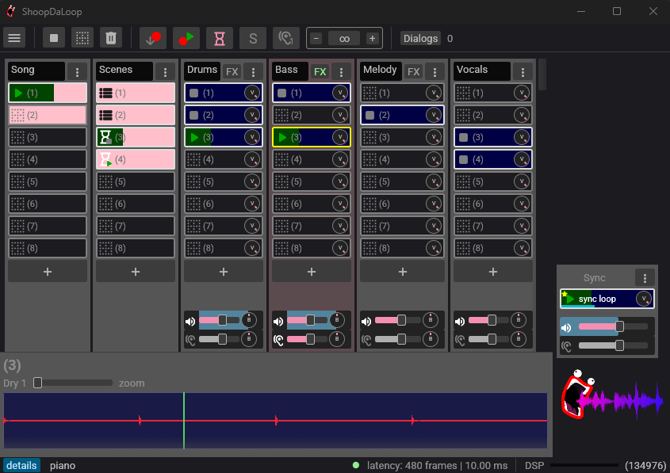

[](https://github.com/SanderVocke/shoopdaloop/actions/workflows/build_and_test.yml)
[](https://github.com/SanderVocke/shoopdaloop/actions/workflows/docs.yml)

# ShoopDaLoop — Limitless Looping

ShoopDaLoop is a playful cross-platform live-looping application for audio and MIDI. It organizes loops into a track grid and supports free-form jamming, controller-driven workflows, and prepared performances.

Releases before 1.0 remain development releases: I wouldn't recommend relying on them in a performance, but if you do, test thoroughly beforehand.

[User and developer documentation](https://sandervocke.github.io/shoopdaloop/) is published from this repository.

## Current features

The RT session engine is now the sole production stack. It supports core audio/MIDI
looping, sync, tracks, routes, musical selection/targeting, controls and client-side
Lua. Native socket hosts keep playback and recording running when a UI exits or
crashes; a replacement UI can attach to the live session.

Full feature parity is the next workstream. Session content save/load, FX/synths,
composites, grab, dry/wet processing and other temporary gaps are explicitly tracked
in the [feature parity ledger](docs/native_session_recovery/feature-parity.md), with
preserved UI/code, reference tests and completion criteria. Existing feature UI and
configuration are retained for restoration; unavailable operations are refused.

## Screenshot



## Run from source

```sh
# Native application with CPAL+midir.
cargo build -p shoopdaloop -p shoop_host
cargo run -p shoopdaloop

# Dummy-driver build without CPAL or Rodio.
cargo run -p shoopdaloop --no-default-features
```

For browser development:

```sh
rustup target add wasm32-unknown-unknown
cargo install --locked trunk --version 0.21.14
cd src/rust/shoopdaloop
trunk serve --open
```

See [INSTALL.md](INSTALL.md) for prerequisites and artifact details. The application-specific [technical README](src/rust/shoopdaloop/README.md) documents settings, drivers, browser permissions, files, CI, and verification workflows.

## Builds and platforms

The main workflow builds Linux x86_64, Windows x86_64, macOS arm64, and WebAssembly in debug and release. Native outputs are unsigned application archives. Web outputs include a complete hosted bundle and a self-contained HTML file with embedded built-ins and RT worklet. Browser media and MIDI access depend on browser support, permissions, secure-context policy, and device availability.

## Development planning and architecture

- [PLAN.md](PLAN.md): workstreams, approved scope, acceptance criteria and remaining work.
- [ARCHITECTURE.md](ARCHITECTURE.md): implemented stack, governing contracts and clearly labelled proposals.
- [VALIDATION.md](VALIDATION.md): actual source-scoped results, retained failures and verification debt.
- [Historical documents](docs/history/README.md): retired plans/designs, readable snapshots and the exact-original archive.

These describe development work, not a claim that the production application has
migrated to the portable runtime/loop/service stack. Public library guides and
application operating instructions remain separate.

## License and credits

Copyright © Sander Vocke (2023–present) and other credited contributors. See [LICENSE](LICENSE).

ShoopDaLoop is made possible by Rust, egui/eframe, JACK, CPAL, midir, libsndfile-compatible tooling, Carla, omniLua, Perfetto, and many other open-source projects represented in `Cargo.lock`. Native archives include the pinned GPL-2.0-or-later Carla runtime and its corresponding-source information.
