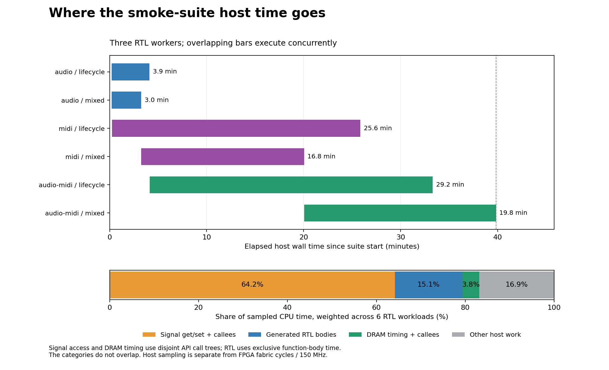

# Smoke-suite host runtime — 2026-11-21

[Five-page performance PDF](report.pdf) · [Raw measurements and exported CPU profiles](results.tar.gz) · [All 27 case timings](runtime.md)

The complete three-media smoke suite took **39:51**
(2,390.996 seconds) from suite setup through report generation.
It used three RTL workers, a warm build/model cache, and four CPU cores of quota
on the recorded host. Source: `ce354fb10c2895b7013ea0d2cd4979adec4733a1`. GNU gprofng sampled RTL
CPU stacks every 20 ms; host timers also measured preparation and callback phases.
Sampling adds host overhead. These wall times describe this instrumented run.

| Suite phase, without overlap | Wall seconds | Share of total |
| --- | ---: | ---: |
| Setup and provenance | 0.149 | 0.006% |
| Warm Cargo build check | 0.338 | 0.014% |
| All CPU/reference cases, serial | 12.449 | 0.521% |
| All RTL cases, three workers | 2,376.700 | 99.402% |
| Statistics, CSV and five-page PDF | 1.336 | 0.056% |
| Other orchestration | 0.024 | 0.001% |
| **Total** | **2,390.996** | **100%** |



The six completed RTL tasks used 98.30 aggregate child wall minutes and
98.21 sampled CPU minutes. Their execution overlaps. The last
worker's sequence, inferred from consecutive task intervals, was:

audio/mixed (3:02) → midi/mixed (16:48) → audio-midi/mixed (19:47).

This sequence explains the final single-worker tail. Adding the individual child
durations would overstate the suite's elapsed time.

| RTL case | Child wall m:ss | Prepare s | Simulation loop s | Observe / output-check s | Finalize / teardown s | Other s | Timed FPGA fabric s |
| --- | ---: | ---: | ---: | ---: | ---: | ---: | ---: |
| audio / lifecycle | 3:54 | 1.289 | 230.739 | 0.224 | 0.078 | 1.213 | 0.103126 |
| audio / mixed | 3:02 | 1.281 | 179.290 | 0.171 | 0.079 | 1.007 | 0.080042 |
| audio-midi / lifecycle | 29:11 | 1.133 | 1,745.404 | 0.216 | 2.768 | 1.502 | 0.800670 |
| audio-midi / mixed | 19:47 | 0.996 | 1,183.248 | 0.166 | 1.310 | 1.364 | 0.541757 |
| midi / lifecycle | 25:37 | 0.903 | 1,532.702 | 0.192 | 2.162 | 0.788 | 0.710416 |
| midi / mixed | 16:48 | 0.962 | 1,004.562 | 0.152 | 1.560 | 0.467 | 0.470703 |

The simulation loop includes the generated model, pin access, AXI responders,
per-cycle protocol monitors and DRAM timing. Other time includes command
configuration, input upload, endpoint servicing, metadata/JSON and profiler
startup/export. Post-callback output checking and passive snapshot observation
are separate from the per-cycle protocol monitors.

The timed callbacks represent **2.706714 seconds of FPGA execution** at an
assumed 150 MHz, across six distinct workloads. This is simulation-world
`fabric_cycles / 150,000,000`; it is separate from the host seconds above.

| Share of sampled RTL-process CPU, weighted across all six workloads | CPU share |
| --- | ---: |
| `Model::get` / `Model::set`, including lookup/hash/comparison callees | 64.19% |
| Generated Verilator RTL function bodies | 15.15% |
| DRAM timing `advance` / `submit` / `ready`, including callees | 3.81% |
| Other simulation drivers, formatting, allocation, bookkeeping and system work | 16.85% |

These categories do not overlap. Signal and DRAM API times include their callees;
generated RTL uses exclusive function-body time. The signal API repeatedly
resolves names through the wrapper's ordered maps and the dynamic binding's hash
map. The current host bottleneck is signal-access glue. Caching bound signal
handles or batching access is a prospective optimization; no such optimization
was applied to this run.

Overlapping diagnostics: AXI driver `drive`/`sample` call trees account for
51.69% of sampled CPU, and the
ready/valid, exclusion and bounds monitors account for
10.18%. Much of their time
is already in signal access. Do not add these percentages to the table above.

All 27 slots are accounted for: **15 completed, 12 explicitly unsupported, none
failed**. All 8,863 callbacks and 851,968 MIDI messages passed validation.
Every one of the **1,590 RTL callback cycle/traffic/stage records is identical**
to the preceding captured matrix, excluding host elapsed time. Fixture hashes,
command events, coverage, MIDI-only zero-audio traffic, shared clock ratios and
idle/zero-drain finalization also passed. The hardware fixture remains 64 loops,
Q=32, stereo where audio is enabled, 32-frame chunks / 32-chunk audio blocks and
one shared Z-turn V2 DDR3-1066 x32 timing controller. Native CPU immediate-endpoint
MIDI, FPGA history grabs, and MIDI history grabs remain explicitly unsupported.

Reproduce with the simulation prerequisites and GNU gprofng installed:

```sh
python3 scripts/benchmark_rt.py --preset smoke --rtl-jobs 3 --profile-rtl --output work/rt-profiled
```

`--host-profile` alone records phase timers without native CPU sampling. All new
campaigns retain overall phase and child timing even when both flags are omitted.

Regenerate reports from the bundle, without running backends or needing gprofng:

```sh
mkdir -p work/rt-runtime-published
tar -xzf benchmarks/rt-smoke-runtime-20261121/results.tar.gz -C work/rt-runtime-published
python3 scripts/benchmark_rt.py --report-only --output work/rt-runtime-published
python3 benchmarks/rt-smoke-runtime-20261121/analyze.py work/rt-runtime-published
```

Matplotlib is required for plotting. The archive includes all run JSON, host phase
sidecars, summary/CSV, runtime counters, verification and exported sampled-function
tables. Native `.er` experiments and archived executables remain in the workspace;
the exported tables suffice to reproduce the CPU summary and chart.

Archive SHA256: `f2ead49e8a8644d8aca1325d8d58eee5258452562fa3849bbeb88c16bb961af6`.
