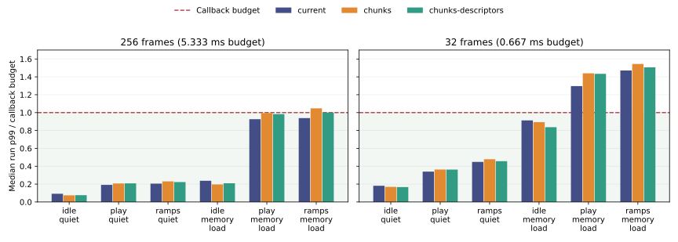

# Pi 4 hardware benchmark results

The Pi confirms the local conclusion: **much less instrumented resource copying,
but no general callback-time or worst-case improvement**. Idle and continued
grabbing improve; ordinary playback regresses. Under continuous other-core memory
copying at 256 frames, current has **0 deadline overruns**, chunks **682**, and
descriptors **64** in the selected playback/ramp windows. At 32 frames all three
fail the budget in most loaded active callbacks.

Shared-grab loop wraps cause repeatable ~6 ms callbacks in every variant, and
saturated 32-frame runs exhibit ~50 ms stalls approximately once per second.
The subsequent [targeted profiles](PI_PROFILING.md) confirm RT bandwidth throttling
as the cause of the long off-CPU pauses, identify substantial common MIDI/state
work, and show modestly lower memory-pressure cycles/refills for the experiments.
Those separate captures qualify the explanation of these timings; they do not
replace this repeated timing comparison.

## Evidence and conditions

The [operator's upload](https://github.com/SanderVocke/shoopdaloop/pull/959#issuecomment-6726522670)
provides the original ZIP and [operator report](results/pi4-2026-11-08/operator-report.md).
We independently downloaded it, checked its supplied SHA-256, unpacked it, and
replayed all callback/app/media checks against both per-run and matrix summaries.
The archived build manifest is byte-identical to the delivered bundle; recorded
host/launcher hashes match it in all six matrices.

- **225 runs / 1,388,187 selected callbacks**: 216 timed runs plus nine smoke runs.
  Each variant has 75 runs / 462,729 callbacks. Mode order rotates over three
  repetitions; smoke has one repetition.
- Matrices: 27 timing + 54 interference runs at each of 256 and 32 frames,
  54 looping runs at 256 frames, and nine smoke runs.
- Raspberry Pi 4 Model B Rev 1.4, Cortex-A72, kernel `6.1.21-v8+`. Captured governor
  is `performance`, frequency 1.5 GHz, allowed cpuset CPUs 0–2, and kernel isolated
  CPU list empty. Per-run records confirm render affinity CPU 1; host/client/writer
  threads start on CPU 0 and synthetic interference uses CPU 2.
- All 216 timed runs record **SCHED_FIFO/80** for rendering. Smoke records
  SCHED_OTHER/0. The operator reports ordinary **PREEMPT**, not PREEMPT_RT. FIFO
  priority and thread affinity do not imply an RT kernel or kernel-level isolation.
- The operator reports Bookworm **armhf userspace with a private ARM64 glibc 2.36
  runtime**, and post-test 42.3 C / firmware throttle status `0x0`. These facts are
  operator-supplied; the archive independently identifies the unchanged ARM64
  binaries, glibc 2.36 platform, affinities and scheduling. No thermal time series
  or Python/userspace bitness measurement is included.
- Binary source `d40bfdaa`; bundle helpers `5c5009cc`; upstream `888bd8a6`, including
  Pi optimization PR #958. Cortex-A72 release build with AES/SHA CPU extensions
  disabled, default JACK/CPAL/FX/synth features plus `testing`; normal dummy host
  and socket app stack. Runtime libraries and source/build hashes are recorded.
- Stereo 48 kHz, quantum 32, four prepared track slots / sixteen loop slots,
  default 30-second histories, nominal 16 MiB loop budget. Effects and device MIDI
  are off in all measured modes; internal empty MIDI work remains.
- Timing/interference runs use **31-second warmups and ten seconds of selected
  audio callbacks**: 1,875 callbacks at 256 frames or 15,000 at 32 frames. Looping
  uses 0.5-second warmups and 384 callbacks; smoke uses 64 callbacks.

There are zero recorder drops, selected-window render faults or incomplete
captures in the validated evidence. Scenario modes, positive control activity,
nonempty finite stereo sample readbacks, callback identity and frame continuity
all pass. These app checks complement the earlier deterministic sample-equivalence
tests; live recording lengths and control arrival can differ between runs.

CFS `nr_throttled` counters remain zero. The `cpu.max`/memory-limit files and the
RT bandwidth limits were not captured in this original timing archive. CFS
counters do not rule out RT bandwidth throttling. Pi call-stack profiles, PMU
counters and RT settings are available in the [separate follow-up](PI_PROFILING.md).

## Steady callback timing

Triples are **current / chunks / chunks-descriptors**. Times are microseconds.
P50/p99 columns are medians of the three per-run percentiles; maxima retain every
selected callback. Overrun counts sum all three runs. The budgets are **5,333.3 us**
and **666.7 us**, respectively. These observed maxima are not WCET bounds.

| Buffer / scenario | Median run p50 | Median run p99 | Largest callback |
| --- | ---: | ---: | ---: |
| 256 / idle | 395.1 / 328.3 / 330.0 | 491.1 / 397.4 / 407.6 | 548.9 / 436.2 / 481.2 |
| 256 / play | 885.3 / 936.1 / 939.3 | 1020.6 / 1105.1 / 1109.6 | 1160.5 / 1200.4 / 1202.5 |
| 256 / ramps | 972.7 / 1037.1 / 1012.9 | 1096.3 / 1229.0 / 1188.2 | 1204.8 / 1342.4 / 1325.7 |
| 32 / idle | 68.8 / 61.4 / 60.4 | 120.7 / 112.9 / 111.0 | 229.8 / 203.7 / 229.9 |
| 32 / play | 134.2 / 142.1 / 143.0 | 226.4 / 241.9 / 241.6 | 356.6 / 367.1 / 433.6 |
| 32 / ramps | 157.4 / 170.0 / 160.4 | 299.1 / 318.8 / 304.2 | 448.5 / 418.4 / 443.8 |

No unloaded steady or periodic-interference window has a deadline overrun.
Unloaded idle medians improve by roughly 11–17%; playback medians regress by about
6%. Descriptors improve ramps relative to ordinary chunks, but remain about 2–4%
slower than current at the two buffer sizes.

## Other-core activity

The periodic worker allocates/scans/sorts 30,000 integers once per second. It has
no overruns here, so it does not reproduce the original htop-triggered failures.
The memory worker continuously copies a 64 MiB source into a separate 64 MiB
target, deliberately applying strong cache/memory pressure from CPU 2.

| Periodic load / buffer / scenario | Median run p99 | Largest callback |
| --- | ---: | ---: |
| 256 / idle | 538.1 / 471.4 / 457.4 | 778.4 / 586.5 / 707.1 |
| 256 / play | 1115.3 / 1153.2 / 1172.0 | 1565.3 / 1478.5 / 1551.2 |
| 256 / ramps | 1167.7 / 1261.9 / 1231.5 | 1538.1 / 1596.2 / 1624.4 |
| 32 / idle | 142.4 / 132.8 / 127.1 | 352.5 / 326.1 / 285.7 |
| 32 / play | 257.0 / 267.4 / 259.3 | 612.2 / 517.5 / 494.1 |
| 32 / ramps | 315.4 / 315.3 / 323.5 | 629.2 / 565.9 / 540.4 |

| Continuous memory copies / buffer / scenario | Median run p50 | Median run p99 | Largest callback | Overruns |
| --- | ---: | ---: | ---: | ---: |
| 256 / idle | 1101.9 / 914.9 / 913.5 | 1266.2 / 1047.5 / 1116.6 | 1553.0 / 1161.9 / 1286.0 | 0 / 0 / 0 |
| 256 / play | 4638.6 / 4599.8 / 4554.2 | 4940.1 / 5307.3 / 5241.3 | 5040.4 / 5669.4 / 5453.2 | 0 / 113 / 15 |
| 256 / ramps | 4649.3 / 4847.3 / 4589.7 | 5005.9 / 5586.7 / 5331.6 | 5237.9 / 5719.8 / 5601.6 | 0 / 569 / 49 |
| 32 / idle | 506.9 / 471.2 / 471.0 | 608.4 / 595.7 / 558.0 | 770.5 / 736.8 / 727.9 | 61 / 25 / 3 |
| 32 / play | 690.9 / 707.5 / 714.3 | 864.6 / 959.8 / 956.0 | 53291.0 / 53025.3 / 53277.0 | 36089 / 40129 / 42481 |
| 32 / ramps | 702.2 / 731.8 / 714.7 | 980.8 / 1029.5 / 1004.1 | 53045.5 / 53195.1 / 53201.7 | 40353 / 44065 / 42868 |

Each 256-frame row has 5,625 callbacks per mode; each 32-frame row has 45,000.
At 256 frames, loaded play/ramps have 0 / 682 / 64 overruns across 11,250 callbacks
per mode: descriptors substantially reduce the plain-chunk failures, but current
has the best observed deadline behavior in these cases.

At 32 frames, combined loaded play/ramps overrun rates are **84.94% / 93.55% /
94.83%** across 90,000 callbacks per mode. Their ordinary median callbacks already
exceed 666.7 us; this result is not explained solely by rare long stalls. Loaded
idle improves: 61 / 25 / 3 overruns, with rates 0.136% / 0.056% / 0.007%.



The chart shows median run p99, not maxima or a WCET guarantee. For example,
loaded idle p99 remains below budget while a small number of callbacks overrun.

## Looping and grabbing

These 256-frame runs use the shorter capture window to stay within the test
budget. Silent and signal recordings remain separate in our summaries.

| Scenario | Median run p50 | Median run p99 | Largest callback | Overruns |
| --- | ---: | ---: | ---: | ---: |
| record (silence) | 857.9 / 821.3 / 824.7 | 977.0 / 944.0 / 928.2 | 1019.8 / 985.9 / 1006.1 | 0 / 0 / 0 |
| record (signal) | 865.7 / 824.2 / 835.0 | 979.6 / 929.2 / 935.0 | 1009.1 / 965.5 / 1000.7 | 0 / 0 / 0 |
| record-play | 950.9 / 996.3 / 979.4 | 1088.8 / 1129.3 / 1133.4 | 1146.0 / 1221.2 / 1196.8 | 0 / 0 / 0 |
| shared grabs | 950.1 / 939.5 / 932.0 | 6215.3 / 6325.1 / 6354.5 | 6273.7 / 6557.8 / 6462.8 | 54 / 55 / 55 |
| grab-and-continue | 1183.8 / 1070.7 / 1071.4 | 1322.3 / 1224.2 / 1232.2 | 1371.9 / 1320.3 / 1316.7 | 0 / 0 / 0 |
| track churn | 884.0 / 854.2 / 850.2 | 1226.9 / 1946.3 / 1766.1 | 1359.0 / 6926.6 / 6537.5 | 0 / 3 / 3 |

Recording medians improve by a few percent, and grab-and-continue by about 9.5%.
Simultaneous recording/playback remains slower in the experimental modes. Churn
has a slightly better median but worse tails, including experimental overruns.

### A repeatable loop-boundary cost

All **164 shared-case deadline overruns** occur in the callbacks starting **32
frames before a common playback wrap**. Across the nine runs, every one of the
155 consecutive peak gaps equals that run's loop length: 5,376 or 5,632 frames
(112 or 117.3 ms). We checked phase against the setup snapshot's loop position
and processed-frame anchor, as well as checking the peak spacing.

This is a workload-linked periodic cost shared by all renderers. In the current
path, instrumented resource-copy bytes at those peaks equal the typical callback;
reference variants do additional adapter materialization but still copy much
less resource audio than current. Graph-node counts do not increase at the peaks.
These counters do not identify the costly function; profiling the boundary path
is a more specific next experiment than attributing the spikes to bulk copying.
The small 54 / 55 / 55 count differences reflect slightly different live loop
lengths/phases and should not be read as a performance ranking.

### The ~50 ms stalls: subsequently confirmed RT throttling

Loaded 32-frame play/ramps contain **202 callbacks of at least 20 ms**, commonly
around 49 or 53 ms. Using the dummy driver's deadline-increment/reset rules and
its elapsed/lateness columns, 180 of 184 successive stall gaps reconstruct to
approximately 0.9–1.1 seconds; the others are roughly multiples. Reconstruction
omits post-timer bookkeeping and is approximate, with a median around 0.99 s.

That pattern under near-continuous FIFO rendering is consistent with a familiar
RT bandwidth configuration: 950 ms allowed per 1,000 ms period, leaving roughly
50 ms when a runnable RT thread is throttled. Those settings were not recorded
in this timing archive, so the original analysis treated this as a hypothesis.
The [follow-up settings and scheduler traces](PI_PROFILING.md) now confirm it:
the global allowance is 950/1,000 ms, and runnable rendering resumes after
48–53 ms gaps at one-second replenishment boundaries. These maxima are not
50 ms executions inside one renderer function. The original operator report's
attribution of the entire 53 ms maximum to memory saturation was too strong.

The wall-clock callback timer includes off-CPU delays. CFS throttling counters
cannot resolve this question. The updated harness now records
`sched_rt_period_us` and `sched_rt_runtime_us` read-only for future runs; it changes
neither setting. The follow-up scheduler trace separates CPU work from these
pauses. Removing the 202 long stalls would still leave the ordinary loaded
medians and the overwhelming majority of overruns unresolved. The 32-frame
maxima and overrun rankings describe service under the RT cap, not engine WCET.

## Copy work, metadata and comparison with the Xeon

| Case / 256 frames | Resource-copy KiB/callback | Index nodes allocated / callback | Host RSS MiB |
| --- | ---: | ---: | ---: |
| steady idle | 66.00 / 2.00 / 2.00 | 136.0 / 168.0 / 168.0 | 419.7 / 588.5 / 588.5 |
| steady playback | 148.00 / 4.23 / 4.23 | 272.0 / 336.0 / 336.0 | 420.6 / 590.2 / 590.2 |
| grab-and-continue | 400.00 / 4.12 / 4.12 | 816.0 / 1008.0 / 1008.0 | 419.6 / 588.5 / 588.5 |

The instrumented resource-copy reduction reproduces: **33x idle, about 35x
playback, about 97x grab-and-continue**. The footprint also reproduces: around
**420 MiB current versus 590 MiB experimental**, with more index allocation and
reclamation. Warm playback allocates/reclaims 336 / 336 nodes per callback in the
chunk modes versus 272 / 270 in current. The prototype retains the generic binary
persistent index; separate history arenas and index specialization remain absent.

The counters exclude substantial metadata and sample work, including some graph
materialization, meter scans and comparisons. Timings include the delivered
prototype's software-accounting overhead; graph-work counters are more extensive
in the reference path. Low counted copy volume therefore
does not establish low total memory traffic or a small cache working set. The
persistent index/reference overhead and larger working set remain plausible
reasons for the missing general speedup. The sensitivity may involve dependent
cache-miss/memory latency as well as aggregate bandwidth. The
[subsequent PMU captures](PI_PROFILING.md) confirm severe memory-stall sensitivity
but show lower L2 refill counts for the experimental paths, despite their larger
RSS. Larger RSS therefore does not establish increased cache refills or explain
the playback regression by itself. The new small throughput differences are
directional, with one capture per case and nominal-frame normalization.

The [local Xeon rerun](PROFILING.md) showed idle 74.7 / 60.4 / 61.2 us, playback
176.6 / 189.2 / 190.5 us and ramps 171.5 / 208.7 / 195.3 us at 256 frames. The Pi's
relative median ranking is similar, with smaller ramp penalties. This agreement
persists despite the longer, full-history windows and different architecture.
There is **no reversal of the main conclusion**. The Pi adds much clearer evidence
of memory-pressure deadline failures and deterministic loop-boundary spikes.

Production Rust source is unchanged between the local `df4ba416` build and Pi
`d40bfdaa`; the intervening Rust changes are recovery tests, plus a browser smoke
fixture. Build target/flags, native libraries, kernel and scheduling differ.
Local tests pinned all host/client threads together on one Xeon CPU under
SCHED_OTHER and usually used 0.5-second warmups / 2.048-second windows; the Pi
separates rendering, uses FIFO/80 and much longer windows. Absolute times and
observed maxima are therefore not a controlled architecture-only comparison.
This dataset does not reproduce the original PREEMPT_RT/core-isolated Pi
configuration; no three-variant comparison in that configuration is included.

The useful next targets are reducing reference/index footprint and repeated
lookup/ownership work and common loop-boundary work. The follow-up Pi profiles
measure MIDI/history at 26–29% of shared-playback sampled CPU time, making empty
MIDI state/history paths a concrete common target. The prior Xeon function shares
cannot be assumed to be the Pi's function shares. Payload sharing and deferred
gains alone have not delivered the desired worst-case improvement in this prototype.

## Replaying and auditing

The [manifest](results/pi4-2026-11-08/manifest.json) records the original ZIP URL
and SHA-256, delivered build identity, all original member hashes, recompressed
archive and derived-artifact hashes. The [raw archive](results/pi4-2026-11-08/evidence.tar.xz)
preserves **all 1,621 members byte for byte**, including warmup callbacks; no
outliers are removed. It is recompressed from the 73.7 MiB ZIP to about 43.5 MiB.
The [group CSV](results/pi4-2026-11-08/groups.csv), six matrix CSV copies (LF line endings),
[validation](results/pi4-2026-11-08/validation.json) and
[diagnostics](results/pi4-2026-11-08/diagnostics.json) are independently accessible.
Connection profiles and raw perf stack dumps were not in the supplied evidence.

From the repository root:

```sh
mkdir -p work/pi4-replay
tar -xJf docs/design/chunks/results/pi4-2026-11-08/evidence.tar.xz -C work/pi4-replay
python3 scripts/analyze_audio_chunk_results.py --input work/pi4-replay \
  --manifest docs/design/chunks/results/pi4-2026-11-08/manifest.json \
  --output work/pi4-replayed --diagnostics
# Optional chart regeneration requires matplotlib.
python3 scripts/analyze_audio_chunk_results.py --input work/pi4-replay \
  --manifest docs/design/chunks/results/pi4-2026-11-08/manifest.json \
  --output work/pi4-replayed --diagnostics --plot work/pi4-replayed/budget-p99.svg
```

The analyzer replays the existing app/callback checks without rewriting input
summaries, compares original per-run and matrix statistics, verifies captured
scheduling and build identity, and produces grouped tables and timing diagnostics.
The artifact/member SHA-256 values allow checking the exact input before replay.
This import changes no rendering implementation; no new Rust test/build run is
needed for the documentation, read-only metadata and offline-analysis changes.
