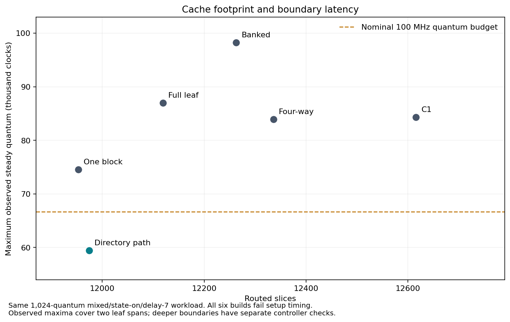

# Zynq 7020 area experiment evidence

Execute [the experiment plan](../../area-experiments-plan.md) sequentially.
The immutable implementation control is
`f218087511dc28e72a436ec825445f32a722b5e9`; the primary profile is the
[64-loop compiled profile](../midi-expression-state/compiled-profile.json).

Current status: stages 0–3 are complete. C3 combines serial RAM occupancy,
directory-path caching, and saved address-context reuse. It saves 6,573 LUTs and
1,273 routed slices against B0, adding half a BRAM tile. Every physical stage of
its repeat matches exactly. Earlier bookkeeping and bounded-frame trials remain
unselected tradeoffs. Stage 4 shares arithmetic next. Timing still fails at
100 MHz. See `ledger.json` for source, scope, checks and artifact hashes.

| B0 routed control | Archived | Fresh |
| --- | ---: | ---: |
| LUTs | 41,980 | 41,980 |
| Slices | 13,205 | 13,205 |
| Registers | 33,441 | 33,441 |
| BRAM tiles | 77.5 | 77.5 |
| DSPs | 4 | 4 |
| CARRY4 | 5,491 | 5,491 |
| Setup slack ns | -5.429 | -5.429 |
| Hold slack ns | +0.008 | +0.008 |

The negative setup slack remains a timing failure. Raw reports are in `b0-100/`;
`b0-100-summary.json` also verifies the mixed workload's RTL source hashes.
The optimized simulator reproduces every original mixed per-quantum result and
cache counter, reducing measured wall time from 440.97 to 361.20 seconds.

The SP and JP/audio standalone checks pass. Unchanged B0 media lint reports
unnamed population-count generate blocks and an unused validity bitmap when
view reuse is disabled; the incremental replacement resolves these warnings.
The [workload matrix](workload-matrix.md) maps directed regression and boundary
coverage to experiment families. Raw callback controls are in `b0-matrix/`.
Descriptor-statistics controls cover repeated writes, sparse restore, reset with
stale RAM, and full occupancy at 1/7/512/513 views. B0 diagnostic reads take six
clocks. Metadata and ownership tests pass, including DRAMsim3.

Prepare a committed or explicitly hashed working-tree candidate:

```sh
python3 fpga/synthesis/midi_shared_jobs.py --revision REVISION --mhz 100 \
  --stage opt --profile docs/fpga/measurements/midi-expression-state/compiled-profile.json \
  --output EMPTY_BUILD_DIRECTORY
```

`--stage` selects `synth`, `opt`, `place`, or `route` (default). `--param NAME=INTEGER`
selects a declared top parameter and records the override. `--working-tree`
snapshots current sources, including new RTL files. Lower clock targets use the
same constraint generator. All input snapshots have SHA-256 manifests; completed
build directories are never reused for a different candidate.

Run `run_midi_container.sh` with the documented tool directory/runtime image, or
run `vivado -mode batch -source run.tcl` in the prepared directory. Preserve
optimized/routed checkpoints for controls and selected candidates by setting
`MIDI_SAVE_CHECKPOINTS=1` when using the container runner.

After a successful screen, resume its saved checkpoint into a new directory:

```sh
python3 fpga/synthesis/area_resume.py --build SCREEN_DIRECTORY \
  --output NEW_ROUTE_DIRECTORY --stage route
```

The resume path checks source and context manifests, requires the same flow,
and records the parent checkpoint hash. It retains the earlier stage reports.
Changed HDL, constraints, or implementation settings require a fresh screen.

Build the checked benchmark and run the fixed workload matrix:

```sh
cargo build --release --locked -p rt_fpga_testbench --features sim --example midi_data_quantum_64
python3 fpga/synthesis/area_benchmarks.py \
  --binary target/release/examples/midi_data_quantum_64 --output NEW_RESULT_DIRECTORY
```

Use `--case mixed-on-delay7` for the first smoke measurement. The full matrix
contains audio/MIDI/mixed workloads, tracking off/on, and DDR delays 0/7. Cold
start, 16 warmup quanta, and steady samples remain separate. `--quanta` extends
the measured steady interval. Directed ownership and musical-transition tests
remain separate from this playback fixture.

`SHOOP_FPGA_SOURCE_ROOT=/absolute/snapshot/root` selects an immutable source
tree for simulation through the same selector used by the RTL library. Include
the required FPGA test adapters in that tree. Generated simulation files go in
its `work/` directory, so use a separate simulation snapshot rather than the
manifested physical-build `source/` directory. The default remains the repository
tree. This permits a B0 harness control alongside the current candidate without
changing either run's RTL inputs.

`--parameters FILE.json` supplies explicit benchmark parameters, with string
values such as `{"TABLE_LINES":"64"}`. Physical geometry changes also require a
matching driver/reference fixture. Each output records source hashes, model
parameters, tool/revision identity, and per-quantum traffic/cycles. The matrix
manifest also hashes the frozen executable and preserves failed-run logs.

Collect area and callback evidence:

```sh
python3 fpga/synthesis/area_results.py --build BUILD_DIRECTORY --label LABEL \
  --benchmark CALLBACK_JSON --output NEW_SUMMARY_JSON
```

Add `--control CONTROL_SUMMARY_JSON` for resource deltas. The collector verifies
snapshot manifests and simulator source hashes, lists simulation/implementation
parameter differences, and rejects comparisons at different clocks/parts.
Missing routed slices remain null. Setup/hold success is separate from complete
DRC, constraint coverage, and board qualification. Original per-quantum samples
and raw reports remain the source of truth for the compact summary.

Retain a completed build as a compact source/report archive and summary:

```sh
python3 fpga/synthesis/area_archive.py --build BUILD_DIRECTORY --label LABEL \
  --benchmark CALLBACK_JSON --control CONTROL_SUMMARY_JSON \
  --output-directory docs/fpga/measurements/area-experiments
```

Each archive has a member-by-member SHA-256 manifest. Checkpoints stay in the
local build directory with their sizes and hashes recorded separately; they are
not uploaded with the source/report archive. The archive round-trip was checked
against all four B0 implementation stages.

Runner checks:

```sh
PYTHONPATH=fpga/synthesis python3 -m unittest fpga/synthesis/test_area_experiments.py
```

## Stage 1 measurements

| Routed 100 MHz result | B0 | Incremental count | Serial RAM count |
| --- | ---: | ---: | ---: |
| LUTs | 41,980 | 39,940 | 39,399 |
| Slices | 13,205 | 13,016 | 12,616 |
| Registers | 33,441 | 33,456 | 32,987 |
| CARRY4 | 5,491 | 3,965 | 3,958 |
| Control sets | 2,215 | 1,672 | 1,494 |
| Setup slack ns | -5.429 | -3.995 | -4.157 |
| Hold slack ns | +0.008 | +0.005 | +0.005 |
| Diagnostic read, clocks | 6 | 6 | 519 |
| Reset admission, clocks | 2 | 2 | 513 |

BRAM remains 77.5 tiles and DSP use remains four. All 33 mixed/on/delay7
measurement rows, including cycles and traffic, are identical: cold start
110,356 clocks, steady median/max 54,146/54,753. Diagnostic and reset measurements use 512 views with reuse enabled.
Reset timing includes one asserted reset clock and the readiness wait; diagnostic
timing covers the driver call including admission and response cleanup. The
serial count scans all configured entries, including sparse raw restores beyond
the issued-view high-water mark. Reuse-disabled counts keep their issued-view
semantics and six-clock reads. These cycle counts do not qualify 100 MHz operation because setup timing
fails. There are zero routing or DRC errors, 18 DRC warnings, and zero
unconstrained internal endpoints in the registered OOC context. The warnings
cover DSP pipelining and the OOC boundary/absent PS7. Board DDR and I/O remain
outside this context.

The original combinatorial population-count path disappears. Metadata node
arithmetic is now the worst routed path (18 CARRY4 plus two LUT3 levels).
The serial count saves 2,581 LUTs, 589 slices, and 454 registers versus B0; it
uses 400 fewer slices than the incremental candidate. Accept its longer diagnostic
and initialization latency because callback measurements are unchanged. The
serial candidate is selected as C1: its repeat reproduces every reported stage
resource, timing, and control-set metric exactly.
Deferred cleanup, fault, reset, and preemption regressions pass, including
DRAMsim3. The optimized and
routed raw archives preserve separate report stages and source/checkpoint hashes.

## Stage 2 measurements

All siblings compare with C1, the selected serial-count implementation. The
four-way, banked and full-leaf measurements are complete. The current-block
alternative and generated-hint policies remain before selection.

| Routed 100 MHz result | C1 | Four-way | Banked | Full leaf | Current block |
| --- | ---: | ---: | ---: | ---: | ---: |
| LUTs | 39,399 | 36,656 | 36,470 | 36,168 | 35,152 |
| Slices | 12,616 | 12,336 | 12,263 | 12,119 | 11,953 |
| Registers | 32,987 | 28,737 | 28,801 | 28,975 | 28,511 |
| CARRY4 | 3,958 | 3,352 | 3,369 | 3,382 | 3,341 |
| Control sets | 1,494 | 1,406 | 1,434 | 1,444 | 1,319 |
| BRAM tiles | 77.5 | 77.5 | 77.5 | 83 | 77 |
| Setup slack ns | -4.157 | -4.744 | -3.950 | -3.799 | -3.665 |
| Hold slack ns | +0.005 | +0.015 | +0.041 | +0.046 | +0.006 |
| Playback-start mixed/on/delay7 clocks | 110,356 | 110,572 | 116,057 | 110,168 | 97,951 |
| 1,024-quantum steady median clocks | 54,146 | 54,146 | 56,066 | 52,994 | 52,994 |
| 1,024-quantum steady maximum clocks | 84,284 | 83,891 | 98,244 | 86,955 | 74,575 |

The four-way cache reduces the main tag lookup from 128 comparisons to four,
using synchronous tag RAM. Read hits still take six clocks in the standalone
fixture. Five competing lines in one set now cause evictions, independently
checked against an array oracle; final fenced memory remains exact. Metadata,
ownership, deferred cleanup and media regressions pass, including DRAMsim3 and
legacy scalar memory.

The long connected fixture reaches frames 16,384 and 32,768. Those leaf crossings
cost 84,284/83,711 clocks with C1 and 83,891/83,257 with four-way tags. Both exceed
the nominal 66,666.7-clock callback budget at 100 MHz, and both fail physical
setup timing. The short fixture alone hides these boundary costs. Raw long-run
samples are retained in `c1-extended-100-raw.tar.gz` and
`s2-fourway-extended-100-raw.tar.gz`; summaries and retention manifests identify
their sources and hashes.

The banked alternative retains all 128 fully associative entries while comparing
eight tags at a time. Independent sequential, strided and dirty-conflict traces
on AXI32/64 match C1's 261 misses exactly. Read hits range from six to 36 clocks
(median 20 in this unit workload); cold fills add 30 clocks. All metadata tests
pass. The routed banked result uses 36,470 LUTs, 28,801 registers and 12,263
slices, with 3,369 CARRY4s and 1,434 control sets. BRAM and DSP use stay at
77.5 and four. Setup/hold slack is -3.950/+0.041 ns: timing still fails.
This is 2,929 fewer LUTs and 353 fewer slices than C1, and 73 fewer slices than
the four-way route. Compare that small slice difference with the complete
connected latency and boundary costs before selecting or repeating a winner.
The complete long run passes all 1,041 rows: steady median/max is
56,066/98,244 clocks, versus C1's 54,146/84,284. The frame-32,768 crossing costs
97,699 clocks versus 83,711. Connected steady table misses are 1,724 versus
1,698; traffic differs on five rows as lookup timing changes interleaving.
Cold start costs 116,057 clocks (+5,701), despite 97 fewer cold audio reads.
Reject this banked variant for the default: its 73-slice advantage over four-way
comes with greater ordinary and boundary latency. Retain it as a measured
full-associativity tradeoff. `s2-banked-extended-100-*` retains physical reports
and every long-run sample. The full-leaf and current-block alternatives follow.


The full-leaf variant extends each private roots-RAM entry from 128 to 640 bits
and caches sixteen table words per view. Its effective directory cache is eight
lines, explicitly capped even with the top-level TABLE_LINES budget of 128.
Existing leaf-valid lifetimes guard reads; writes update the cache, and
trim/detach/reset/global invalidation disable it. Hot whole-controller reads take
six clocks versus 15 with C1. Strided AXI64 unit reads that change leaf take 247
clocks versus 30 median with C1; the independent map verifies data and lifetime
semantics across those paths.

Full metadata, ownership, deferred-cleanup and media regressions pass, including
DRAMsim3 and scalar legacy paths. All 1,041 connected rows pass. Ordinary steady
cost falls 1,152 clocks, but the two leaf crossings cost 86,955/86,382 versus
C1's 84,284/83,711. Steady table misses fall from 1,698 to 1,280. Keep this candidate
on the shortlist pending the current-block sibling. It has the best measured
area so far, with 5.5 extra BRAM tiles and worse strided/boundary latency. Setup
still fails; repeat before selecting a small physical winner.

Playback-start metrics exclude preparation. The full-leaf start row has five
metadata writebacks versus 128 with C1; its smaller directory cache evicts dirty
lines during preparation. The 188-clock start improvement does not measure
complete preparation or boot time. `s2-leaf-extended-100-*` retains all physical
reports and long-run samples; unit archives retain the controller traces.

The read-only checkpoint taxonomy in `carry-taxonomy-c1-leaf-summary.json`
attributes 640 CARRY4s to C1's main metadata cache and 40 to the full-leaf design's
eight-line directory cache. Other C1 direct owners include MIDI content 628,
MIDI orchestration 452, media_store 496 and media_metadata 282. These are disjoint
primitive-owner counts, unlike overlapping hierarchical slice counts. They
identify targets for the following width and arithmetic-sharing experiments.


The current-block cache extends each roots-RAM entry to 192 bits, caching one
block value and ordinal per view. It keeps the same validity lifetime and an
eight-line shared directory cache. All metadata, ownership, deferred-cleanup and
media tests pass, including DRAMsim3 and scalar legacy modes. All 1,041 connected
rows agree with the original logical oracles. The two leaf crossings cost
74,575/74,002 clocks, versus C1's 84,284/83,711. BRAM drops by half a tile.

The smaller directory cache increases steady table misses to 5,120 from 1,698;
traffic differs on 35 rows. Most block-crossing work overlaps JP execution, so
the observed median improves despite that extra traffic. Standalone strided
AXI64 reads take 135 clocks versus C1's 30; hot repeated-block reads take six
versus 15. Playback-start still excludes preparation and begins with five dirty
writebacks versus C1's 128. Do not treat its measured start reduction as a total
preparation or boot saving.

Keep current-block on the shortlist pending the directory-path and generated-
hint siblings. It improves the measured area, BRAM, ordinary and leaf-boundary
costs relative to C1; setup timing and nominal leaf deadlines still fail.
The next directory-path trial reuses the existing traversal register bank and
retains middle-directory pages per view. Deeper parent crossings need directed
checks: the long connected interval alone establishes no universal bound.


The directory-path sibling retains three middle-page pointers per view in a
288-bit roots row, reusing traversal state and the original invalidation lifetime.
All five metadata tests and ownership/deferred/media regressions pass, including
DRAMsim3. The 1,041 connected rows preserve every logical oracle. Its 35,489 LUTs,
11,974 slices, 28,681 FFs, 78 BRAMs, four DSPs and 3,343 CARRY4s save 3,910 LUTs
and 642 slices versus C1. It costs 337 LUTs, 21 slices and one BRAM versus basic
current-block. Setup slack -3.881 ns remains a failure; hold slack is +0.043 ns.

Ordinary median is 52,994 clocks; the maximum is 59,446, versus 74,575 for basic
current-block and 84,284 for C1. Nominal 100 MHz arithmetic places these observed
steady samples within the quantum budget, but neither physical timing nor every
higher-level boundary is qualified. Playback-start is 88,446 clocks and still
excludes preparation; cold traffic is 694 reads/eight writes versus C1's
1,248/128. Preparation and deferred dirty work must not be called a boot saving.

Independent four-view fixtures cross ordinals 255/256, 4095/4096 and 65535/65536,
trim/regrow deep branches, detach/reuse IDs and reclaim stale trees. Both AXI
widths agree with the logical map, including opaque high-bit values. These
fixtures expose costs: AXI64 alternating reads have median179 clocks versus C1's
46; selected deep reclamation reads take371/449 versus59. They establish behavior
and controller latency, not full128-channel high-boundary deadline guarantees.
See `s2-path-extended-100-*`, `s2-path-translation-unit-*` and
`s2-path-directory-unit-*`; hints and a repeated winning physical run remain.


All five cache siblings and C1 now pass the same 1,282-row public storage
operation fixture at primary capacity. It measures 128 captures, offset exports,
clear/retake, retained readback, and two bounded reclamation drains.
[Operation costs](cache-store-operations.md) retain slower results as well as
improvements, alongside every command, sample result and AXI counter. These
ideal-memory controller clocks complement connected playback and the delayed/
DRAMsim3 regressions; they are not full callback or board timing qualifications.

The hint policy's canonical default reproduces all 33 original callback rows
and passes all eight protocol cases. Every optimized resource count matches C1
exactly; pre-route setup slack differs by 0.001 ns. Late-only hints preserve
normal data but fail a first-buffer publication assertion after an injected
second-view fault in three AXI memory modes. They also add 4,634 clocks to the
start and 5,170 to the first warm quantum; the remaining short rows are unchanged.
The original policy stays default, and failed variants remain experiment results.
See [policy contract and status](hint-policy.md); no-hint and area screens remain.




[Exportable PDF](cache-tradeoffs.pdf). The plot uses the same 1,024 steady
quanta for every point; B0 has no matching long run and is excluded. All six
physical builds fail setup timing. One-block and directory-path remain the
area/latency alternatives; BRAM and adversarial/maintenance costs remain in the
tables and raw reports.


Before width changes, `24d767e7` adds minimum/odd/primary-count metadata input
controls. C1 and path return identical results on all 187 requests per AXI
width, including malformed raw DDR retirement counts. The expanded six-test
metadata suite passes. `86af343f` adds standalone MIDI full-pool/retirement
controls at 1/3/5 views and 1/3-event capacities, checking 564 transactions over
three generation/queue wraps against the independent ContentStore. High frame
bits, poisoned accepted command inputs, held outputs, refusals, generation
overflow, faults and reset are included. These are baselines, not area wins.

Compact per-opcode/error statistics are regenerated from the retained raw
samples by `compact_unit_summaries.py`. Every original request and result stays
in the verified archives; compacting a summary does not discard raw evidence.


Stage 2 is complete. The full-flow path repeat reproduces the original
checkpoint-resumed run exactly at all four stages: resources, timing and control
sets. The expanded six-test path metadata suite passes in 217.75 seconds.
C2 selects this cache and keeps original generated hints. Against B0, the
combined implementation saves 6,491 LUTs, 1,231 slices, 4,760 FFs and 2,148 CARRY4s;
it adds half a BRAM tile. Routed setup slack remains -3.881 ns.

The one-block alternative saves another 21 slices, 337 LUTs and one BRAM, but
its observed maximum is 15,129 clocks higher. C2 favors the primary sequential
playback workload while retaining all strided, deep retirement and operation
regressions/costs in the comparison. This selection establishes the control for
Stage 3; it does not complete the remaining architectural or precision trials.


The first Stage 3 audio bookkeeping trial is complete and rejected for the
default. Every one of 33 callback rows, 1,282 public storage rows and 187 boundary
rows per AXI width matches C2 exactly, including cycles and traffic. Full
metadata, ownership, media and deferred regressions pass. It saves 115 LUTs/28
FFs/22 carries at optimization, but after routing saves only 97 LUTs/four FFs
and uses **100 more slices** and 25 more physical control sets. Setup slack
improves from -3.881 to -3.610 ns and still fails.

This small type change illustrates the packing constraint: logical control sets
fall by one while physical control groups increase. C2 remains the default;
the MIDI width sibling starts from C2, without inheriting this rejected trial.
See `s3-audio-100-*` for full reports and matching operation/callback samples.

The MIDI width sibling `f28096cb` passes all 10,311 standalone boundary requests
with identical responses, clocks and memory traffic, including minimum/odd pools
and primary 256-view/128-retirement indices. Full 16-test MIDI regression passes
in 527.04 seconds. Its 33 mixed/state-on/delay7 callback rows exactly match the
same prefix of C2's extended run. Optimization saves 363 LUTs, 146 FFs and 59
CARRY4s, with unchanged memory/DSP/control-set counts. Routing saves 286 LUTs, 106 FFs and 59 CARRY4s but uses **130 more slices**
and 156 more physical control sets. Setup slack worsens from -3.881 to -3.945 ns
and still fails; hold slack remains positive at +0.003 ns. This candidate is
also rejected for the default. C2 remains selected. The critical path still
runs through audio metadata node-count arithmetic. See `s3-midi-100-*` for
physical reports and exact callback/source evidence.

The optional local audio frame family (`3e47163d`) is complete. Its 64-bit default
preserves all measured behavior, and all original media/ownership/deferred tests
pass. The 21-bit configuration caps a view at 2,097,151 frames (43.69 seconds),
preserving the unchanged 30-second profile. All 1,282 operation rows and 33
connected callback rows match C2 at both widths; explicit duration, overflow,
poisoned input, invalid configuration, wrapping, retained slices, faults and reset
pass 21 configuration cases across AXI32/64 and all four memory models.

| Routed configuration | LUTs | FFs | Slices | BRAM | CARRY4 | Control sets | Setup slack ns |
| --- | ---: | ---: | ---: | ---: | ---: | ---: | ---: |
| Selected C2 | 35,489 | 28,681 | 11,974 | 78 | 3,343 | 1,256 | -3.881 |
| Frame framework, 64 bits | 35,418 | 28,683 | 12,228 | 78 | 3,341 | 1,434 | -4.120 |
| Frame framework, 21 bits | 35,155 | 28,343 | 12,044 | 77.5 | 3,286 | 1,354 | -3.750 |

The narrowed configuration saves 184 slices against its same-source 64-bit
control, but uses 70 more than C2. Both configurations remain unselected; the
21-bit version is a recorded LUT/register/BRAM tradeoff with a duration limit.
Do not attribute the framework's mapping changes to frame narrowing. All three
setup results fail timing. Source, parameters, raw per-request/per-quantum rows
and reports are retained in `s3-local-frames*` archives and on
`area/s3-local-frames`; the selected production branch retains C2 RTL.

A read-only C2 checkpoint query also found 37 RAM32X1D primitives for saved path
addresses and zero FFs for that array. Existing path pages use 160 FFs; only 72
FFs remain under the copied root-data name after optimization. Both validity
vectors retain 512 FFs each. These are mapped facts, not savings estimates; the
next state-reuse trials must include reconstruction/read-port costs.
See `c2-register-groups.*` for exact scope and checkpoint/EDIF hashes.

The saved relative-address/path-context candidate (`fe2184ea`) is selected as C3.
It replaces the mapped dual-read path-address RAM with page/index context and a
reconstruction datapath. Both AXI widths match all 187 boundary and 207 deep
rows, including cycles/cache traffic; all 1,282 public storage rows and 33
connected rows match C2 exactly. Full metadata/media/ownership/deferred tests
pass, as do all 16 MIDI and two new descriptor/relocation controls.

C3 routes to **35,407 LUTs, 28,714 FFs, 11,932 slices, 78 BRAM tiles, four DSPs,
3,356 CARRY4s and 1,321 physical control sets**. Against C2 that saves 82 LUTs
and 42 slices, costing 33 FFs, 13 carries and 65 physical control sets. Setup
slack is -3.865 ns and hold slack +0.039 ns. The full-flow repeat reproduces
all four stages exactly. Its ordinary short-run steady median is 52,994 clocks,
maximum 53,617; cold playback is 88,446. C3's completed extended run reproduces all 1,041 C2 rows exactly: 1,024 steady
quanta have median 52,994 and maximum 59,446 clocks across two leaf spans.
See `c3-extended-100-*`; these are not board timing claims.

Before subsequent MIDI address/staging trials, new original-RTL controls preserve
opaque reserved descriptor words through updates, clear them on reuse, and check
high/wrapping 64-bit arena bases. All 54 zero-base request rows reproduce the
original memory agent exactly; all 108 relocated rows match their zero-base
counterparts. This qualifies the standalone word interface, not board mappings.
See `c2-midi-reserved*` and `c2-midi-relocated*` raw archives.

Stage 4's first trial (`7d2d7cd7`) shares the MIDI store's region/index address
arithmetic through one 64-bit unit. All 10,311 raw storage, 54 reserved-word and
108 high/wrapping-base rows preserve replies and transfer counts. All 33 mixed
callback rows preserve non-cycle fields. Steady median rises by 264 clocks
(52,994 to 53,258), maximum by 330; cold start rises by 4,299 to 92,745.
Optimization saves 117 LUTs, 151 CARRY4s and 92 F7/F8 muxes, but adds 130 FFs
and three control sets, against C3. Memory/DSP counts stay unchanged. All 23 affected MIDI/expression/reserved tests pass. The first route uses
35,299 LUTs, 28,888 FFs, 11,878 slices, 78 BRAM tiles, four DSPs and 3,205
CARRY4s. Against C3 that saves 108 LUTs and 54 slices, costing 174 FFs and
44 control sets. Setup slack is -3.668 ns; hold is +0.006 ns. Timing fails.
The full physical repeat and extended callback comparison are running before
selecting this small physical win; C3 remains selected. See
`s4-midi-address-performance.json` and the retained unit/physical archives.

A separate original-RTL validity control is ready for Stage 5. Across AXI32/64
and 1/5/512 views it retains 8,988 request rows with 512 completed invalidations
per geometry, a view left untouched for 256 invalidations that must reload, high
invalid trim IDs, rewrites, held replies and randomized AXI stalls. Reset five
clocks after an accepted invalidation discards all old extents despite stale
RAM. The direct Instant memory adapter is used; this is not a fixed-latency DDR
measurement. All six cases pass on C3 in 69.21 seconds. Existing fixtures are
unchanged; no Stage 5 implementation has been applied.

The shared MIDI-store address trial is selected as **C4** (`7d2d7cd7`) after
an exact four-stage physical repeat and all 23 affected tests. All 1,041 extended
mixed callback rows match C3 in every non-cycle field. Across 1,024 steady
quanta the median is 53,258 clocks and the maximum 59,776, versus C3's
52,994/59,446. Cold start is 92,745 versus 88,446. All 40 musical transition rows
retain exact outputs, state work and traffic counts; MIDI steady median rises
1.56%, while prefix restoration rises from 365,340 to 410,865 clocks (12.46%).
C3 remains the faster alternative. Both builds fail physical setup timing, and
both prefix-restoration measurements exceed the nominal 100 MHz Q32 budget.

C4 uses **35,299 LUTs, 28,888 FFs, 11,878 slices, 78 BRAM tiles, four DSPs and
3,205 CARRY4s**. Its setup/hold slack is -3.668/+0.006 ns, with no routing
errors. Against B0 it saves 6,681 LUTs, 1,327 slices, 4,553 FFs and 2,286 carries;
these are measured cumulative savings. The selected small area gain costs
174 FFs and 44 physical control sets against C3. The limiting path still runs
through audio metadata node counting. The remaining Stage 4 arithmetic siblings
have not yet been measured.

The separate MIDI scratch/input-record address unit (`1c73f3fa`) is rejected at
optimization screening. Against C4 it adds 254 LUTs, 28 FFs, 105 F7 muxes, two
F8 muxes and two control sets to remove 32 carries; BRAM/DSP counts are unchanged.
The explicit operand and staging muxes outweigh the shared arithmetic. All 33
mixed and 40 musical rows match C4 in non-cycle fields, but mixed steady median
rises by 72 clocks and cold by 90; musical prefix restoration adds 72 clocks.
All 23 affected tests pass: 16 MIDI, five expression and two descriptor/relocation
checks, including supported quanta and both AXI widths.
Routed slices are unavailable because the candidate is rejected at screening.
C4 remains selected; see `s4-midi-scratch-opt-*` and its performance summary.

The shared audio metadata relative-address unit (`93843695`) remains unselected.
All 11 deferred/media/metadata/validity/ownership tests pass, including both AXI
widths, DRAMsim3 and legacy memory. The initial missing simulator-library path
was repaired without changing RTL, tests, memory settings or clocks; both logs
and runtime hashes are retained. All 187 boundary rows per width, 207 deep rows
per width and 1,282 public-store rows preserve non-cycle fields against C4's
identical-audio C3 controls. Deep setup adds 93,444 clocks; the public-store
fixture adds 21,309. Mixed steady median stays 53,258; worst short quantum adds
one clock. Cold is 75 clocks faster, but adds 56 AXI reads/448 native reads.

Routing uses **35,231 LUTs, 28,909 FFs, 11,934 slices, 78 BRAM tiles, four DSPs
and 3,172 carries**. Against C4, 68 fewer LUTs and 33 fewer carries cost 56 more
slices, 21 more FFs, 86 more control sets and 175 more F7/F8 muxes. Setup/hold
slack is -3.939/+0.030 ns; setup still fails. The extra mux/packing and cold
traffic costs outweigh the small LUT gain. C4 remains selected; no physical
repeat is needed for this unselected tradeoff.

The iterative metadata node/capacity unit (`0e624700`) passes all 11 affected
regressions, both-width boundary/deep controls and all 1,282 public-store rows.
All 33 short mixed callback rows match C4 exactly, including clocks and traffic.
The deep 77,828-write setup grows from 1.810 to 3.523 million clocks on AXI64;
the 207 requests after setup add only 46 clocks. Public-store operations add
14,074 clocks in total. No public capacity, precision or ownership change.

Its first route uses **35,207 LUTs, 28,847 FFs, 11,772 slices, 78 BRAM tiles,
four DSPs and 3,094 carries**: 92 fewer LUTs, 106 fewer slices, 41 fewer FFs and
111 fewer carries than C4, at a cost of 108 more physical control sets. Setup
slack improves from -3.668 to **-0.130 ns**, with +0.006 ns hold; setup still
fails. The node-count critical path is removed; the next limiter is MIDI
job_reg[68] to store_arg0_reg[3]/CE. A clean source-through-route repeat and
1,024-quantum callback run are in progress before selection. See
`s4-iterative-capacity-100-*` and its retained unit/regression archives.
