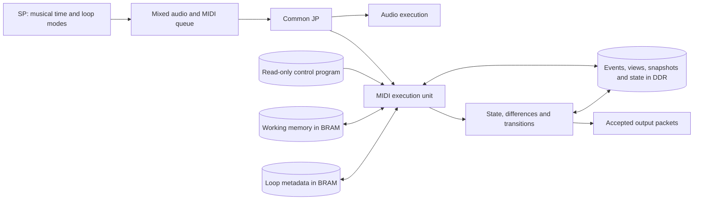

# Compact MIDI job execution

The shared state processor (SP), mixed job queue and job processor (JP) keep their
existing responsibilities. MIDI job control and content management now execute a
small read-only program on one shared arithmetic unit. This replaces many wide
working registers and separate address calculators. The Rust reference remains
ordinary Rust and supplies the expected behavior in the conformance tests.



This is an implementation of the individual MIDI jobs, including their internal
storage operations. It cannot read SP's loop tables or choose the next loop mode.
It accepts the same job/control operands and returns the same results. There is
no MIDI job that takes over scheduling an entire quantum.

## What stays in memory

Recorded events, shared views, block references, snapshots, input/output state,
history, comparison maps and retirement records retain their DDR formats. MIDI
has no DDR cache. The finite descriptor table for loops remains primary BRAM.
The head table used to merge playback events also stays in BRAM.

The instruction ROM and two copies of a small working memory are new. Both
working-memory copies receive the same writes; separate read ports supply two
operands to the arithmetic unit. These hold one execution's temporary values,
not an instrument state per loop. Reset clears this memory sequentially, then
loads shared constants. Command admission waits for this bounded bootstrap.

Only one loop descriptor is selected at a time. Reading a field uses primary
BRAM unless the current job has staged a replacement. A 32-bit bitmap identifies
staged fields. Committing a descriptor writes just those fields. Selecting
another descriptor discards uncommitted changes, preserving the validation and
publication behavior of the job algorithms. These temporary values are separate
from the incremental MIDI state-difference bitmaps stored in DDR.

A small packed header beside each descriptor holds its loop identity and status
flags. Descriptor commits update both representations together. The hardware uses
this header to finish common idle bookkeeping and inapplicable ownership claims
quickly. Other cases continue through the control program. A pinned playback
cursor also retains its immutable sequence's event count, so an empty sequence or
an exhausted cursor needs no repeated DDR descriptor lookup.

## Work performed by the hardware

Most instructions take three clocks: fetch the instruction, read operands, then
execute it. The instruction is registered alongside the operand read, keeping
the ROM lookup separate from the arithmetic/write path. Global prepared/running
flags have explicit one-bit updates rather than observing the working memory's
general write-data selector. One bounded 32-by-32 multiplier computes addresses; musical time,
durations and address additions remain 64-bit. The compiler rejects multiplication
operands that it cannot establish fit 32 bits. A shared serial divider handles
64-bit numerators with divisors of at most 32 bits. Constant expressions are
evaluated when building the FPGA image; literal powers of two become shifts or
masks in the control program.

Bulk transfers run as short hardware loops. They copy/clear DDR words, initialize
a state snapshot, or move a history descriptor between DDR and working memory.
They wait for every memory acknowledgement and preserve backpressure and fault
handling. This avoids executing arithmetic instructions for every copied word.
Descriptor selection and commit similarly have direct BRAM operations rather
than converting a descriptor index into a pretend DDR address and decoding it
back into a BRAM index.

Playback-head selection walks the BRAM table directly, taking three clocks per
candidate and preserving the ordering by timestamp and then context. This keeps
the small linear search economical in both logic and execution time.

The ROM uses explicit 2,048-word banks with synchronous reads. This matters:
Vivado 2021.1 sometimes converts the larger combined ROM into LUTs despite its
memory attribute. The banked form reliably infers BRAM. An optional request
register in the word-to-AXI adapter is enabled for MIDI. It captures the address
and arena configuration before checking bounds, separating the state engines'
address calculation from the adapter's range checks.

The existing state interpreter, incremental comparison and ordered transition
engines remain dedicated hardware. The execution unit waits for them while they
apply messages, propose output and record acceptance. They are shared between
loops, not instantiated per loop. Accepted output still drives state and cursor
progress, including refusal, partial cleanup and recovery.

## Source and generation

The bounded algorithms live in
[`midi_job_control.sv`](../../fpga/midi/program/midi_job_control.sv) and
[`midi_content_control.sv`](../../fpga/midi/program/midi_content_control.sv).
They use a restricted sequential SystemVerilog subset as a readable program
notation. These files are **compiler inputs**, not additional synthesized
controllers. Named steps, fixed return locations and bounded arrays avoid a
dynamic call stack or heap.

[`compile_control.py`](../../fpga/midi/compile_control.py) resolves expressions,
inlines helper functions/tasks and preserves scheduled assignments' old-value
semantics. It allocates fixed working-memory locations, pools constants and links
both algorithms into one ROM. Specialized transfer/descriptor operations replace
specific copy loops. Their source fingerprints deliberately make generation fail
if those loops change, requiring the lowering contract to be reviewed. This is
not a general SystemVerilog-to-processor compiler.

The wrapper generator preserves the public ports, memory layout and state-service
connections. It also copies the small packet-classification/bit-selection
functions into the wrapper so their source and hardware behavior stay together.
Generated RTL is checked in; normal Verilator/Vivado builds need no Python parser.
To regenerate or check it:

```sh
python3 -m pip install -r fpga/midi/program/requirements.txt
python3 fpga/midi/generate_control.py
python3 fpga/midi/generate_control.py --check
```

The parser version is pinned because its semantic tree is part of the compiler's
input contract. `control-layout.json` records instruction, constant and working
storage sizes and the named-step addresses. Hardware elaboration checks capacities;
simulation additionally checks instruction and workspace bounds and descriptor
selection at commit.

## Validation and tradeoffs

The existing Rust-oracle scenarios exercise recording, playback, history grabs,
imports/exports, grouped publication, state/pedals, capacity, retirement, output
refusal and recovery. The compiled mixed-pipeline test checks the unchanged SP/JP
job trace and audio/MIDI output. AXI32/64 tests exercise acknowledged memory and
fault handling.

The area saving comes with more clocks spent on control operations and more BRAM
used for instructions. The bulk-transfer and staged-descriptor paths reduce this
overhead. FPGA clock timing and the time needed to finish a whole audio quantum
are separate measurements. The descriptive `midi_cycles_64` example compares MIDI
service output with Rust while reporting clock counts; it excludes audio and
the outer SP/JP execution and therefore does not certify a board deadline.
Use `--active-loops 1` for one active MIDI loop among 64 bindings, or
`--active-loops 64 --events-per-quantum 16` for the simultaneous-start/burst
measurement. The latter is descriptive and is not a deployment acceptance gate.
