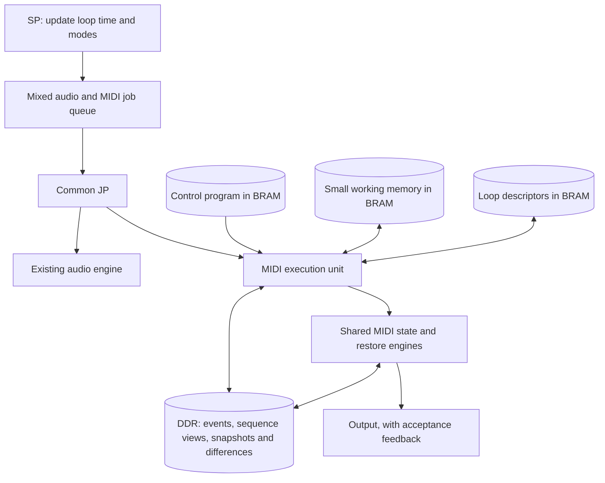
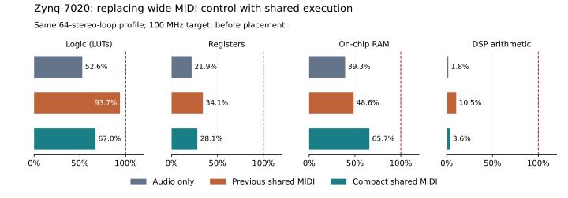

# MIDI RTL redesign: resource use and remaining limits

The main problem was the way storage bookkeeping became hardware. The previous
implementation gave many temporary values their own wide registers, connected
them through large selectors, and built several address calculators. It also
reset enough of those registers independently to make FPGA placement difficult.
The shared state processor (SP) and job processor (JP) arrangement was not the
cause. The [resource audit](measurements/midi-shared-jobs-7020/resource-audit/findings.txt)
records the attribution and the unsuccessful smaller fixes.

This redesign keeps the SP, mixed audio/MIDI job queue and common JP. Inside the
JP's MIDI service, storage bookkeeping runs as a small read-only program using
one arithmetic unit and working memory in BRAM. Large content and instrument
state remain in DDR. The Rust FPGA reference is unchanged and remains the
behavioral oracle.

## The hardware change

The execution unit does the arithmetic and branching for individual MIDI jobs.
It cannot choose loop modes or replace SP's scheduling. The same JP still consumes
audio and MIDI jobs from the same queue.

Several common operations have short hardware paths: copying or clearing DDR
words, initializing snapshots, committing changed descriptor fields, finding the
next playback event and completing idle bookkeeping. These paths avoid spending
many instructions on a simple repeated operation. General control uses three
clocks per instruction; multiplication and division take additional clocks.

A loop descriptor is a small record holding its identity, playback position,
references to recorded content and status. Only one descriptor is staged at a
time. A 32-bit map records which fields have
changed; committing writes those fields to the primary BRAM table. This replaces
the old full-width temporary descriptor and its selectors. A small header keeps
identity/status checks inexpensive. The instruction ROM is explicitly banked to
make Vivado 2021.1 use BRAM reliably. An instruction register separates ROM lookup
from execution, and a request register separates MIDI address generation from
AXI bounds checks.

The MIDI state interpreter, incremental difference tracker and ordered restore
engines stay dedicated, shared hardware. Event ordering, pedal handling, ownership,
output acceptance, partial cleanup and recovery keep their previous behavior.
There is no MIDI DDR cache.

## Resource and timing results

Compare the same stage, **after logic optimization and before placement**. The
previous shared-MIDI implementation failed placement, so comparing its estimate
with the new routed resource count would mix stages.

| Implementation | Target | Logic: LUTs | Registers | BRAM blocks¹ | DSP units |
|---|---:|---:|---:|---:|---:|
| Audio only | 100/150 MHz | 27,993 | 23,253 | 55 | 4 |
| Previous shared MIDI | 100 MHz | 49,841 | 36,303 | 68 | 23 |
| Compact shared MIDI | 100 MHz | **35,660** | **29,879** | **92** | **8** |
| Previous shared MIDI | 150 MHz | 49,832 | 36,304 | 68 | 23 |
| Compact shared MIDI | 150 MHz | **35,666** | **29,879** | **92** | **8** |

¹ 36-Kbit equivalents; the device has 140. It has 53,200 LUTs and 220 DSP units.
LUTs provide general-purpose logic, BRAM provides on-chip memory, and DSP units
provide built-in arithmetic.

At 100 MHz, total logic falls **28.5%**. The added logic above the audio-only
baseline falls from **21,848 to 7,667 LUTs: 64.9% less**. The combined MIDI
bookkeeping/storage controller falls from **17,941 to 3,498 LUTs: 80.5% less**.
The shared state engines use 2,800 LUTs and the MIDI DDR adapter 383 LUTs; their
cost is now visible beside the much smaller controller. Hierarchical attribution
can move slightly with synthesis optimizations; the whole-image numbers are the
direct comparison.

The extra 24 BRAM equivalents are 18.5 for the banked instruction ROM, four for
the mirrored working memory and 1.5 for the packed loop headers. The existing
descriptor/head tables remain three BRAM equivalents. A separate ten-BRAM
increase above audio-only belongs to the shared compiled program/queue sizing;
that part is unchanged by this redesign.

Both new builds place and route, with no routing errors. The previous shared
builds both failed placement. The completed implementation uses 35,408 LUTs at
100 MHz and 36,128 at 150 MHz; both retain 92 BRAM equivalents and eight DSPs.

| Target | Whole-image setup margin | Whole-image hold margin | Worst margin involving MIDI² |
|---|---:|---:|---:|
| 100 MHz | **−5.138 ns** | +0.045 ns | **−2.727 ns** |
| 150 MHz | **−7.773 ns** | +0.005 ns | **−5.618 ns** |

² Includes the MIDI executor, its DDR adapter, and paths crossing their boundaries.
The separate domain reports include BRAM and DSP cells as well as registers.

**Neither target meets setup timing.** A negative setup margin means that a
signal path takes longer than the clock permits. Audio-only already missed
setup by 4.578 ns at 100 MHz and 7.770 ns at 150 MHz. The new 100 MHz whole-image
worst path is in audio configuration/statistics, from the valid-view bitmap to
the configuration result. MIDI has its own remaining violations, notably state
comparison feeding DDR-request register control and common-JP command admission
feeding the local loop-header read. At 150 MHz, MIDI's worst path runs from
working RAM through 64-bit arithmetic back into working RAM. These are real
remaining timing targets; successful routing is not clock closure.

At the common pre-placement stage, the worst MIDI margin improves from −5.558 to
−1.999 ns at 100 MHz, and from −8.865 to −5.332 ns at 150 MHz. The new registered
instruction avoids the previous intermediate design's long ROM-to-working-memory
path. Routing changes placement and wire delays, so these estimates and routed
results are reported separately.

Physical packing is still tight: **12,799/13,300 slices (96.2%)** at 100 MHz and
**12,828 (96.5%)** at 150 MHz. A slice groups logic cells and registers; shared
control wiring restricts how tightly they can be packed. Audio-only already used
11,165/11,130 slices. The redesign makes this image fit, but it does not provide
large integration headroom. At 100 MHz, distinct register control combinations
fall from the old placement failure's 2,600 to 1,830 after implementation.

The comparison uses the same **64 loops, two audio channels plus one MIDI channel
per loop, 48 kHz, approximately 30 seconds of storage, 32-frame audio chunks and
32-frame processing quanta**. MIDI has one input, eight destinations, 2,432 event
blocks of 256 events, 8,192 events per sequence, 256 views and 384 snapshots. The
connected pipeline uses two 64-bit AXI3 ports. Its recorded storage profile needs
about 724.5 MiB including audio metadata, so the embedding needs at least 1 GiB
of DDR.

The original area profile admits 256 incoming events per quantum. Its 384 snapshot
slots do not cover the maximum history/capture reservation implied by that
admission limit. This was retained for an unchanged before/after area comparison;
it is not a validated worst-case deployment preset. A practical preset can lower
input admission or increase the snapshot pool. The cycle measurements below use
16 admitted events per quantum, for which this pool covers that reservation.

These are public-Docker-sourced **Vivado 2021.1** builds for **xc7z020clg484-1**,
using the same registered measurement boundary, default implementation flow,
two tool threads and 0.2 ns clock uncertainty. PS7 and the DDR controller are
outside the measured fabric. Source commits, hashes, exact parameters, raw reports
and reproduction steps are in the [measurement evidence](measurements/midi-compact-7020/README.md).

## Work per quantum

One active MIDI loop among 64 bindings, with one CC message in each recording
window:

| Work in the quantum | Clocks | At 100 MHz, if that clock were met |
|---|---:|---:|
| All 64 bindings stopped | 12,529 | 125.3 µs |
| Start one recording | 31,927 | 319.3 µs |
| Record one CC change | 33,393–36,867 | 333.9–368.7 µs |
| Start playback | 34,680 | 346.8 µs |
| Playback window, one emitted CC change | 21,785–29,158 | 217.9–291.6 µs |

The heavier measurement starts all 64 recordings together and supplies 16 CC
changes per recording window. Starting those recordings takes 5,163,835 clocks;
the two recording windows take 1,073,623 and 1,207,737 clocks. Playback windows
take 463,671 and 456,695 clocks, each emitting 64 packets. The fixtures bind one
MIDI channel per loop across four destinations; the input messages use channel 1,
so only four loops contain those CC messages. This is not a measurement of 64
independent dense streams. The [JSON results](measurements/midi-compact-7020/validation/cycles-64.json)
and [single-active-loop results](measurements/midi-compact-7020/validation/cycles-1.json)
retain the exact setup and output counts.

The cycle example compares every emitted packet with Rust and introduces delayed
memory acknowledgements and backpressure. It measures MIDI service jobs, excluding
SP/JP dispatch, audio and board DDR timing. A 32-frame quantum at 48 kHz lasts
666.7 microseconds. The simultaneous-start/burst case exceeds that budget; it is
a stress measurement, not a promise that all those operations fit one quantum.
Initialization and dense DDR state work remain throughput concerns.

## Validation and assessment

All **18 MIDI RTL tests** pass against the Rust oracle, including the compiled
mixed SP/JP job trace and audio samples, 128 loop bindings/eight destinations,
history grabs, content transfers during playback, capacity handling, incremental
state differences, pedal restoration, output refusal, recovery and AXI32/64
faults. The **131 Rust reference/compiler tests** and **10 retained RTL tests**
also pass. Generator drift checks, Verilator lint, formatting, test-attribute
policy and the warning-denying example build pass. Local logs are retained in
[validation](measurements/midi-compact-7020/validation). CI and automated review
feedback were not consulted.

I consider this a reasonable MIDI resource architecture to continue with:
scalable content stays in DDR, small control storage uses BRAM, and arithmetic is
shared where separate copies had little value. The significant cost is extra instruction ROM
and more clocks for control work. A small, restricted compiler also becomes part
of the maintenance burden. Its parser version is pinned; generated RTL is checked
in; specialized lowerings have source fingerprints that require review when the
algorithm changes. Ordinary builds do not need that compiler.

The [implementation guide](midi-compact-execution.md) describes the memory layout,
instruction timing, native operations and regeneration. Further work should be
driven by clock-path and per-job measurements, especially DDR state operations
and snapshot preparation. This result does not establish a board-level real-time
capacity or repair unrelated audio timing paths.
