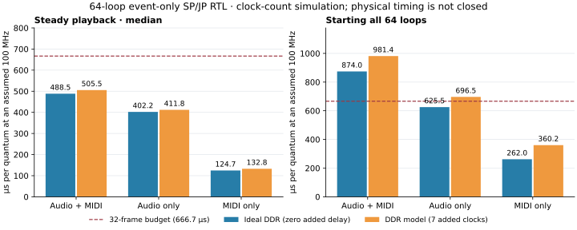

# 64-loop playback with the MIDI data-job RTL

All three workloads fit the nominal **666.7 µs** quantum budget during steady
playback. Starting all 64 loops together can exceed it. These are simulated
clock counts converted to microseconds at an **assumed 100 MHz**.

| Workload | Memory | Steady median, µs | Steady range, µs | All-64 startup, µs |
| --- | --- | ---: | ---: | ---: |
| Stereo + MIDI | Ideal | **488.49** | 488.49–491.20 | 874.05 |
| Stereo + MIDI | 7-clock DDR model | **505.50** | 505.50–510.24 | 981.36 |
| Audio only | Ideal | **402.20** | 402.20–402.20 | 625.50 |
| Audio only | 7-clock DDR model | **411.84** | 411.84–411.84 | 696.51 |
| MIDI only | Ideal | **124.72** | 124.72–127.43 | 261.96 |
| MIDI only | 7-clock DDR model | **132.84** | 132.84–137.58 | 360.24 |



Adding MIDI to the audio session costs **86.29 µs with ideal memory** and
**93.66 µs with delayed memory** in steady playback. This is the measured
additional cost in the mixed program; the two standalone times should not simply
be added, because they share SP/JP work and memory prefetch opportunities.

The previous state-free MIDI service took 3,407.24/3,522.81 µs for the mixed case
and 3,063.99/3,170.67 µs for MIDI only (ideal/delayed). The new steady medians are
therefore about **7× faster with audio and 24× faster for MIDI only** on this
same sparse playback workload. Previous timing samples and their original hashes
are retained in the evidence directory.

**Startup remains a separate limit.** Starting all 64 stereo-plus-MIDI loops
together exceeds one quantum in both memory models. Audio-only startup also
slightly exceeds it with delayed memory. MIDI-only startup fits both. None of
these numbers closes the existing physical clock-timing failures; they show the
work fits the nominal cycle budget in ordinary steady playback.


## What was measured

All 64 loops play together. The audio cases contain a distinct, nonzero stereo
recording in every loop, mixed to stereo output. The MIDI cases contain 30 seconds
of controller changes per loop: 3,000 messages at 100 messages/second. Their timing
is staggered so a quantum normally emits four or five recorded messages across
eight destinations. The mixed case performs both kinds of work through the same
SP, queue, and JP.

The session uses 48 kHz, 32-frame quanta, and 32-frame audio chunks. One quantum
represents **666.7 µs of musical time**. All three scenarios use the same connected
`midi_audio_pipeline_axi` hardware configuration, including audio caches and both
64-bit AXI adapters. Audio-only has no MIDI data jobs. MIDI-only has no audio
ports, recordings, or routes and performs no audio DDR transfers; the compiler's
one scratch-silence initialization job remains. The MIDI wrapper's admission and
end-of-quantum work remain in the timer.

The timer starts at run acceptance and ends when the complete pipeline signals
completion. It includes SP, queued work, JP, storage transactions, MIDI input
validation, and end-of-quantum MIDI maintenance. Full content preparation, program
loading, output readback, and correctness checks occur outside that interval.
These are RTL execution times calculated from clocks, not the wall time needed
to run the simulator or Rust CPU callback measurements.

Each case starts from a fresh simulation. Its first quantum measures all 64 loops
starting together with cold playback readers and audio caches. Sixteen warmup
quanta follow, then sixteen steady quanta. The steady interval covers both the
four-message and five-message cases. It does not measure recording, MIDI event-block
crossings, wrapping, history grabs, or concurrent control transfers.
This staggered pattern puts at most one due message on an output per quantum, so
its merge jobs mostly reuse empty lists. It does not benchmark dense merges.

## What “ideal” and “DDR model” mean

The memory settings match the earlier benchmarks:

- **Ideal:** zero added native-memory service delay. AXI requests, responses,
  adapter sequencing, and data beats still take clocks.
- **DDR model:** seven added clocks of service per native 16-byte request. There
  are no additional random bus stalls; output accepts messages immediately.

Audio and MIDI use independent modeled memory ports. This gives a controlled
comparison with the previous measurements. It does not simulate a real board's
DDR-controller arbitration between the ports, row scheduling, refresh, or measured
physical memory latency. “DDR model” therefore means the existing delayed model,
not a board-level DDR performance guarantee.

Times assume **100 MHz: 100 clocks = 1 µs**. The unchanged RTL still misses physical
clock timing in the [Vivado build](midi-data-jobs.md). A simulated quantum fitting
666.7 µs at that assumed rate does not establish that the FPGA can currently run
the design at 100 MHz.

## Correctness and reproducibility

Every quantum checks every emitted SP job, every MIDI message, every stereo
sample, the global frame, and all 64 loops' playback positions and lengths against
the Rust reference. Independent message/sample formulas also check the reference.
Loop clocks advance in hardware; the host does not overwrite positions between
quanta. MIDI-only verifies zero audio-memory traffic. The recorded MIDI messages
are the only MIDI output; there is no instrument-state tracking or restoration.

During initial loading, RTL allocates MIDI views and blocks. The host fills their
event payloads and counts outside the timed interval, then makes the store reload
its working descriptor. Public event reads check the first, middle, and last
records of each take before publication. This follows the earlier benchmark's
host-assisted loading approach. No event data is injected during measured playback.

The benchmark exposed and fixed a compiler validation bug: MIDI port and buffer
IDs were being checked against audio resource counts. The two spaces are now
independent, as their runtime storage already was. Prepared MIDI limits continue
to be checked during execution. A new regression covers MIDI-only programs with
zero audio ports/buffers and MIDI resources beyond the audio counts; invalid audio
ports remain rejected. All 104 selected reference/compiler/RTL-package tests pass.
No functional HDL changed for this benchmark work.

The host benchmark driver was built in both debug and optimized modes to shorten
the large initial load. A complete repeated MIDI run produces identical result
JSON in both modes, including every quantum's clocks and memory-traffic counts.
Host optimization changes simulator wall time, not the reported execution time.

Raw measurements, source hashes, tool version, aggregation, and plotting scripts
are in [the evidence directory](measurements/midi-data-jobs-64/README.md). Reproduce
one case with:

```sh
cargo run --locked --release -p rt_fpga_testbench --features sim --example midi_data_quantum_64 -- \
  --scenario mixed --ddr-delay 7 --output /tmp/mixed-7.json
```

Use `--scenario audio` or `--scenario midi` for the other cases, and
`--ddr-delay 0` for ideal memory. Default capacity/content is 64 loops × 30 seconds.
`--loops`, `--frames`, and `--quanta` allow smaller checks. The measurements here
use the full defaults, not those smaller runs. CI results and review feedback were
not consulted.
