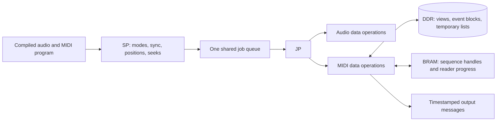
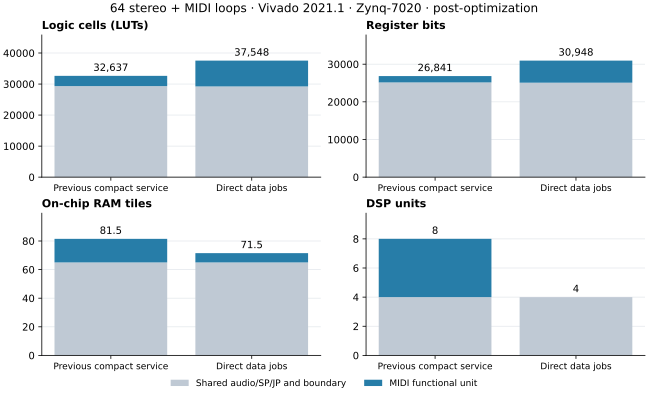

# MIDI through the shared state and job processors

The new RTL implements the event-only Rust FPGA reference. Loop decisions belong
to the existing state processor (SP); event reads, writes, merges, and output
belong to the existing job processor (JP). There is no MIDI program interpreter
or separate MIDI scheduler, and no instrument-state tracking or restoration.

The functional tests pass. This is an architectural and functional replacement,
not an area reduction: it uses more logic than the previous compact MIDI service,
although it uses less on-chip RAM and fewer DSP units. Physical results and their
limits are recorded below.



## What it does

- Record, finish a take, play it repeatedly, stop, and seek through SP's normal
  loop transitions. Finishing a recording precedes playback reads in the same
  quantum, even if playback appears first in the compiled data program.
- Route input and playback to multiple ports; filter playback MIDI channels;
  merge streams in timestamp order, with deterministic ordering for ties.
- Read and append across event-block boundaries. A 256-event block is a storage
  unit, **not a message limit per quantum**. Jobs continue until their work is
  finished or a configured memory capacity is exhausted.
- Share completed content through views and ranges. Exports remain valid across
  retakes; replacing or duplicating a sequence shares blocks. Reclamation releases
  a bounded number of blocks after each successful quantum.
- Carry complete short MIDI messages, including controller/pedal messages and
  supported system messages, through ready/valid output and 32/64-bit AXI memory.
  Refused output and memory/storage errors are explicit failures.

Stopping does not send note-offs or controller corrections. Instrument state,
history grab, overdub editing, SysEx, and MIDI byte-stream decoding are outside the
new Rust and RTL scope. The application's host MIDI endpoint is not connected to
this interface yet.

## How the work is divided

SP owns musical time and decides whether a loop should play or record. It emits
specific jobs: fetch input, create an empty list, read a view interval, begin/
append/finish a recording, merge two lists, and output a list. MIDI jobs use the
same queue and JP dispatch as audio jobs. JP does not rediscover loop modes or
calculate playback windows from a second copy of loop state.

JP's MIDI functional unit has a direct controller and a content-store controller,
like audio's data and storage units. These controllers sequence memory transfers;
they do not execute another program. The old MIDI instruction compiler, ROM, and
interpreter have been removed.

A playback cursor retains its next event. If that event lies beyond this quantum,
the read returns an empty list without accessing MIDI DDR. When playback advances,
the cursor reads forward; SP explicitly requests repositioning at starts, wraps,
and seeks. Seeking away from zero uses binary search. This keeps ordinary work
related to the messages being processed, while retaining a small cost per job.

Stored events use 16-byte records in blocks filled by event count. A view selects
an interval across those blocks. DDR also holds view descriptions, block tables,
reference counts, retirement records, and temporary event lists. Only small
sequence, list-description, and cursor tables live in BRAM. There is no general
MIDI DDR cache or speculative block prefetch; audio retains its existing caches.

Temporary lists share one DDR scratch arena. An empty merge can reuse the other
list. Merging two nonempty lists writes a sorted result to a new region. Appending
a list loads/saves the recording's view description once for the whole batch and
extends the take's duration even during silence. Finite storage remains a limit;
exhaustion is reported rather than silently truncating a successful take.

## Functional validation

**139 selected tests pass:** 103 reference/compiler/RTL-package tests, 15 MIDI RTL
tests, and 21 affected shared audio/SP/JP/target testbench tests. The connected
tests compare emitted MIDI, loop results, audio, and every SP job against Rust.

Coverage includes 3,000 messages in one quantum across twelve blocks, a
1,200-message merge, quantum sizes 1/16/32/64/128, partial blocks, channel masks,
short system messages, seeks, silent playback with zero MIDI DDR traffic, retained
ranges, retakes, capacity exhaustion, publication fences, and output refusal.
The full connected audio/MIDI pipeline passes with both delayed 32-bit MIDI AXI
and ideal-memory 64-bit MIDI AXI; isolated AXI tests also inject stalls and memory
faults. Invalid input is rejected before SP advances. A waiting UI command cannot
deadlock quantum completion.

An audio regression initially ran out of workspace storage during Verilator
compilation; after removing disposable compiler caches, its rerun passed. Format,
warning-denying builds, generated-source checks, test attributes, and testbench
coverage policy pass. Full workspace, browser, and device suites were not run;
the selected native suites cover the changed execution path. CI results and review
feedback were not consulted. The old session/state-aware MIDI fixtures were
replaced with tests for the new scope; they are not counted as passing.

## FPGA measurements

The comparison uses Vivado 2021.1, `xc7z020clg484-1`, 100 and 150 MHz constraints,
and 0.2 ns clock uncertainty. Both versions use the connected audio/MIDI pipeline,
registered test boundaries, and the same audio capacities: 64 stereo loops,
48 kHz, about 30 seconds per channel, audio chunks of 32 frames and quanta of 32
frames. The MIDI configuration has 64 sequence slots/cursors, 256 temporary-list
descriptions, 256-event blocks, 8,192 events per view, and 131,072 shared scratch
records. The block pool holds 622,592 event records.

This is a fabric-only build with two AXI memory ports. PS7, the physical DDR
controller, and contention between those ports are outside it. Audio's sample
pool alone reserves 737.7 MB; the MIDI arena reserves 12.1 MB. The full profile
therefore needs more DDR than a board with 512 MiB provides, irrespective of
whether its FPGA logic fits.

The baseline is the earlier state-free compact service at `9c75aa49`. Its saved
RTL source hashes all match the pre-port revision, `3c0d4f11`; this
reuses the actual pre-port synthesis evidence. The new RTL is `0bc04a54`.
Audio/SP capacities are identical. MIDI capacity changes are explicit: the old
256-entry input buffer is replaced by the shared DDR list arena and cursor tables.
The old service's broader history/group workflow is not part of this new scope.

Both versions were compared **after logic optimization**, before placement. This
keeps the resource comparison at the same stage:

| Target | Previous LUTs | New LUTs | Previous registers | New registers | Previous RAM tiles | New RAM tiles | Previous/new DSPs |
| --- | ---: | ---: | ---: | ---: | ---: | ---: | ---: |
| 100 MHz | 32,637 | 37,548 | 26,841 | 30,948 | 81.5 | 71.5 | 8 / 4 |
| 150 MHz | 32,642 | 37,553 | 26,841 | 30,948 | 81.5 | 71.5 | 8 / 4 |

At 100 MHz, that is **15.0% more LUTs, 15.3% more registers, 10 fewer RAM tiles,
and four fewer DSP units**. The new design uses 70.6% of the chip's LUTs and 51.1%
of its RAM tiles at this stage. A tile is 36 Kib of dedicated FPGA memory.



The MIDI functional unit itself grows from 3,309 to **8,319 LUTs**, and from 1,686
to **5,867 registers**. Its RAM falls from 16.5 to **6.5 tiles**, and its four DSPs
are removed. Within the new MIDI unit, event/list handling uses 3,991 LUTs and the
block/view store uses 4,328. The MIDI AXI adapter is outside these unit counts.

The earlier interpreter reused an arithmetic datapath and stored its instructions
and working values in RAM. Removing it saves that RAM and multiplication hardware,
but direct controllers expose more address calculations, comparisons, and working
registers to synthesis. The new DDR list/merge path also replaces the old capped
input arrangement. The result is a clearer responsibility split and uncapped
per-quantum event work, but **the measurements do not show a silicon-area gain**.

The pre-placement whole-design timing estimate is identical before and after:
−5.320 ns at 100 MHz and −8.653 ns at 150 MHz. These worst paths are in unchanged
audio metadata logic. MIDI's own estimate worsens: −0.244 to −2.566 ns at 100 MHz,
and −3.577 to −5.899 ns at 150 MHz. Thus the unchanged whole-design estimate does
not mean the new MIDI unit has no timing cost.

Both new builds completed routing, with no routing errors. **Neither meets its
requested clock rate.** The final reports show:

| Target | Whole-design setup slack | From MIDI registers | To MIDI registers | Worst hold slack |
| --- | ---: | ---: | ---: | ---: |
| 100 MHz | −5.273 ns | −2.533 ns | −3.211 ns | +0.005 ns |
| 150 MHz | −8.206 ns | −6.098 ns | −6.098 ns | +0.006 ns |

After routing, the full design uses 37,323 LUTs and 31,118 registers at 100 MHz;
38,050 LUTs and 31,126 registers at 150 MHz. Both retain 71.5 RAM tiles and four
DSPs. The DRC reports contain warnings, with no errors; they include the omitted
PS7, unused test-boundary outputs, and audio DSP pipeline suggestions.

Negative setup slack means a signal takes longer than the allowed clock interval
to reach its destination. The separate “from/to MIDI” reports include paths
crossing its boundary. At 100 MHz, the worst incoming path distributes reset from
the test boundary; the worst path starting inside MIDI calculates a DDR address
from a view's event offset. At 150 MHz, MIDI's worst path also calculates a storage
address. The whole-design worst paths remain audio metadata counters, taking
roughly 15 ns.

Before deployment at 100/150 MHz, these calculations need shorter clock stages,
and reset distribution needs attention. This can be done inside the data/storage
controllers; the evidence does not call for another programmable MIDI processor.
There are no saved baseline routed results: that earlier routing campaign was
stopped. Consequently the routed table is a result for the new design, not a
claimed before/after routed comparison.

These builds measure fabric resources and clock paths. They do **not** measure
64-loop quantum execution time or establish the 32-frame processing deadline.
Likewise, completing the 3,000-message functional test is not a deadline claim.

## Evidence and reproduction

[Selected raw reports, configuration, and hashes](measurements/midi-data-jobs/README.md)
identify the public `siliconbootcamp/xilinx-vivado:stable` image by digest. The
unmodified Vivado 2021.1 files were extracted from that image, mounted read-only,
and run in Docker with its dependency filesystem. The runtime adds an account;
it does not patch vendor Tcl or apply later tool overlays.

Vivado could not create some temporary/checkpoint directories on the bound
workspace. The build runner now uses a container-local working directory and
copies results out. The 100 MHz implementation resumed from its completed
synthesis checkpoint after an optional checkpoint-save error; it did not replace
the RTL or relax timing constraints. Checkpoint saves are optional in the reusable
runner (`MIDI_SAVE_CHECKPOINTS=1` enables them).

To prepare another build from a committed revision:

```sh
cargo run --locked -p rt_fpga_testbench --features sim --example midi_profile_64 > /tmp/midi-profile.json
python3 fpga/synthesis/midi_shared_jobs.py --revision HEAD --mhz 100 \
  --profile /tmp/midi-profile.json --output /tmp/midi-build-100
bash fpga/synthesis/run_midi_container.sh /tmp/midi-build-100 /path/to/tools runtime-image
```

`/path/to/tools` must contain `Xilinx/Vivado/2021.1`; `runtime-image` must contain
its Linux dependencies. Repeat with `--mhz 150` in a fresh directory. The harness
records source/configuration hashes and reports after optimization, placement,
and routing. See the [RTL overview](../../fpga/midi/README.md) and
[wire protocol](../../fpga/midi/PROTOCOL.md) for integration details.
