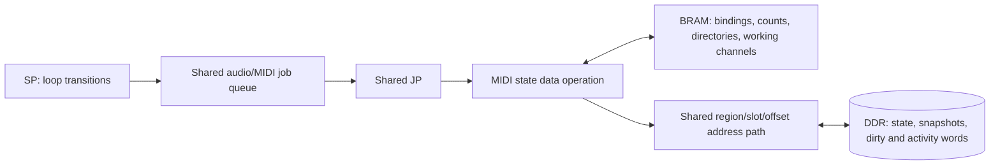

# MIDI expression hardware and execution measurements

The state implementation was revised to use the FPGA's memories and shared data
paths more deliberately. Musical behaviour, DDR formats, configured capacities,
and the SP/shared-JP division remain the same. The Rust implementation remains
the behavioural reference; these hardware changes do not restructure its hot path.

## What changed

- One address path serves all state and tracker DDR requests. Operations supply a
  region, slot and field rather than each building a wide address calculation.
- Connection metadata uses one synchronous BRAM table. The active loop's binding
  is retained in registers; watcher and owner lookups share its read port.
- Dirty counts and owner-activity counts also answer empty checks, replacing large
  duplicate register banks and their selection/update logic.
- Iterator widths follow configured capacities. View and owner generations retain
  their full width. Bulk state, snapshots, dirty words and activity words stay DDR.

The smaller design adds two address-setup cycles per DDR word and short BRAM
lookup phases. Connection-directory setup now waits for each RAM read before
updating its entry. This fixed stale membership in unrelated output/channels.
A separate correction clears the channel-rebuild flag before each restore, so a
previous pedal repair cannot make a later controller-only repair restart notes.

## Area and physical timing

The full profile is 64 stereo-plus-MIDI loops, 48 kHz, 30 seconds of storage,
32-frame chunks and quanta, eight MIDI destinations and 256 MIDI views. The
compiled program contains 835 instructions and permits 1,155 jobs per quantum.
The public-image Vivado 2021.1 build targets `xc7z020clg484-1`, with 0.2 ns clock
uncertainty and the same registered public boundaries as the event-only baseline.

The isolated unit experiments keep all command and result paths live. They are
useful for attributing the saving, while the connected builds are the full-session
result. The diagnostic compact-unit run predates only the directory wait fix;
its exact source hash is archived rather than represented as the final revision.

| Isolated state unit, post-opt | LUTs | Registers | BRAM tiles |
| --- | ---: | ---: | ---: |
| BRAM-refined baseline (`d2817bef`) | 8,272 | 2,774 | 3.5 |
| Shared address path | 6,808 | 2,762 | 3.5 |
| Compact metadata and counts | 4,194 | 1,854 | 6 |

The final diagnostic row saves 49.3% of LUTs against the matched baseline. Its
routed unit uses 4,040 LUTs and 1,308 slices, with setup slack +0.175 ns and hold
slack +0.009 ns at 100 MHz. This isolated result does not establish full-session
clock closure. The remaining post-opt unit LUTs are 3,930 logic and 264 small
policy-table memory LUTs. Dedicated BRAM is a deliberate trade for fewer LUTs.

| Connected 100 MHz profile | Post-opt LUTs | Post-opt registers | BRAM tiles | Placement |
| --- | ---: | ---: | ---: | --- |
| Event-only baseline | 37,548 | 30,948 | 71.5 | Routed |
| Initial musical state | 47,534 | 33,915 | 73 | Failed |
| Optimized musical state | 42,706 | 33,346 | 77.5 | Routed |

| Routed profile | LUTs | Registers | Slices / 13,300 | BRAM tiles |
| --- | ---: | ---: | ---: | ---: |
| 100 MHz, Event-only | 37,323 | 31,118 | 12,943 | 71.5 |
| 100 MHz, Optimized state | 41,980 | 33,441 | 13,205 | 77.5 |
| 150 MHz, Event-only | 38,050 | 31,126 | 12,900 | 71.5 |
| 150 MHz, Optimized state | 42,281 | 33,480 | 13,294 | 77.5 |

| Routed profile | Whole setup slack ns | Hold slack ns | Worst MIDI setup slack ns |
| --- | ---: | ---: | ---: |
| 100 MHz, Event-only | -5.273 | +0.005 | -3.211 |
| 100 MHz, Optimized state | -5.429 | +0.008 | -2.469 |
| 150 MHz, Event-only | -8.206 | +0.006 | -6.098 |
| 150 MHz, Optimized state | -8.562 | +0.005 | -6.771 |

Both optimized builds place and route; the original state-enabled build did not
place. Negative setup slack means a path takes longer than the requested clock
allows. **Neither full build meets 100 or 150 MHz**, as was already true of the
event-only baseline. Hold checks pass. The worst full-design path still runs from
`audio/core/media/valid_views` into `cfg_globals_data`. The worst MIDI paths
calculate event-storage addresses in `midi/content`.

At 150 MHz, post-opt usage is 42,721 LUTs and 33,346 registers; the state unit is
4,449 LUTs. RAM/DSP usage is unchanged from the 100 MHz optimized build. Physical
packing is especially tight at 150 MHz: 99.95% of slices in this registered-boundary
experiment. The resource improvement removes the placement failure; it does not
establish a deployable clock target or comfortable full-design growth margin.

A slice groups LUTs and registers with shared control signals. Registers with
incompatible controls can leave LUT capacity unused inside an occupied slice.
The event-only baseline already occupies about 97% of slices, so the full design
remains tightly packed even after the logic reduction. It has limited growth room.

The connected 100 MHz post-opt result is 42,706 LUTs, 33,346 registers,
77.5 BRAM tiles and four DSPs. Its state unit is 4,447 LUTs versus the original
9,113: a 51.2% reduction. The MIDI block as a whole falls from 18,428 to 13,568
LUTs. The whole design saves 4,828 LUTs (10.2%) and 569 registers, trading 4.5
additional BRAM tiles for that logic reduction. Relative to the event-only
37,548-LUT baseline, adding musical state now costs 5,158 LUTs instead of 9,986.

## Callback execution

All RTL values below convert cycle counts at nominal 100 MHz. The ideal model
adds zero service delay but retains AXI handshakes. The delayed model adds seven
clocks per 16-byte native request. Audio and MIDI use independent ports; board DDR
arbitration, refresh and row effects are outside these models. Preparation and
readback are outside the timer; a complete SP/JP quantum is inside it.

All numbers are microseconds; steady entries are medians of 16 quanta after
16 warmup quanta.

| Workload / tracking | Ideal steady | Delayed steady | Ideal cold start | Delayed cold start |
| --- | ---: | ---: | ---: | ---: |
| Audio only (no MIDI) | 402.20 | 411.84 | 625.50 | 696.51 |
| Audio + MIDI, state off | 488.53 | 505.54 | 874.10 | 981.41 |
| Audio + MIDI, state on | 523.05 | 541.46 | 926.76 | 1103.56 |
| MIDI only, state off | 124.76 | 132.88 | 262.01 | 360.29 |
| MIDI only, state on | 159.28 | 168.80 | 313.71 | 414.09 |

The maximum observed state-enabled mixed steady quantum is 547.53 µs in the
seven-clock model. The steady workload stays below the nominal 666.7 µs budget.
Cold mixed starts exceed it with or without state, so these results do not imply
a deadline guarantee for every transition. The state-disabled controls are the
retained pre-optimization runs of the unchanged bypass path. This table measures
one connected hardware configuration, with tracking enabled or unbound at runtime.

Against the first state implementation, the optimized design adds less than
3 µs to each steady median in this CC workload while substantially reducing LUTs.

Starting playback, restoring many notes, and interpreting a long seek prefix can
cost much more than steady playback. The sparse CC workload alone cannot show
restoration cost, so the additional musical fixture exercises held notes,
sustain/sostenuto, pressure, non-default CC values, retrigger, stop, seek and wrap.
Every accepted quantum is checked against Rust, including corrective messages.

| Musical transition (MIDI-only session) | Ideal µs | Delayed µs |
| --- | ---: | ---: |
| playback start | 429.42 | 588.04 |
| retrigger | 171.50 | 188.09 |
| stop cleanup | 178.09 | 199.02 |
| warm play | 264.62 | 325.94 |
| seek prefix | 2311.57 | 3653.40 |
| wrap after seek | 167.92 | 182.06 |
| stop after wrap | 178.09 | 199.02 |
| quiet after stop | 159.16 | 168.68 |

The nonzero seek scans its recorded prefix and misses the quantum budget in both
models. It remains best effort. Stop rows include ownership cleanup; after stop,
live input observation/routing still runs. These are measured fixture cases,
not worst-case limits for arbitrary simultaneous 64-loop note/pedal repairs.

The indexed-directory check covers 1, 8, 64 and 128 relevant trackers. An unrelated
channel always takes 17 clocks with ideal word service, or 31 with delayed service,
independent of that tracker count, with only two current-state DDR accesses. A
clean one-destination restore takes 14 clocks and no DDR traffic. At 128 relevant
trackers a changed CC takes 3,345 / 6,943 clocks and its one-message restoration
4,048 / 8,570 clocks (ideal/delayed). The correction also updates all affected
trackers; that work is included. This is a word-interface component experiment,
not an additional whole-session result.

The earlier Rust CPU samples are retained because its callback implementation is
unchanged by this hardware work. On the Xeon Platinum 8573C cloud host, the state-
enabled reference medians were 53.8 µs mixed and 8.1 µs MIDI-only; p99 was 157.1 /
80.1 µs. CPU tails and differences between separately run samples are noisy.

## Validation and reproduction

- Reference/compiler all-feature suites: 112 passing tests.
- RTL state suite: five passing tests, including mixed audio/MIDI capture,
  playback/repeat, seek/range, retained exports, replacement, stop and retake;
  quantum sizes 1/16/32/64/128; stalled 32/64-bit AXI; failures and owner generations.
- New fixtures cover relocated arenas, 1/1/1 and 3/3/5 table capacities, the last
  loop/output/view slots, multiple shared destinations, and controller-only repair
  after a note/pedal repair.
- Warning-denying Rust builds, formatting, generated files, test-attribute policy,
  and local FPGA testbench coverage checks pass. No CI or GitHub review processing
  forms part of these results.

Raw reports, per-quantum samples, source hashes and reproduction details are in
[the measurement directory](measurements/midi-expression-state/README.md).
The supported musical approximations and state ownership are documented in
[the state contract](midi-expression-state.md). This remains a limited musical
expression implementation, with one logical voice per channel/key and coupled
pedals on shared channels.
