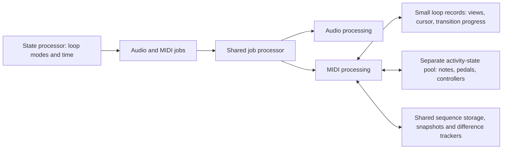
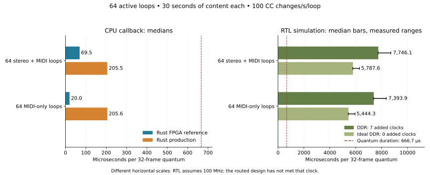

# Rust MIDI storage alignment and 64-loop benchmarks

The Rust FPGA reference now keeps each loop's large MIDI activity state (notes,
pedals and controllers) separate from its small playback/control record. Starting
playback initializes only the
MIDI channels that loop owns, plus the shared reset flag. Finishing cleanup no
longer clears a state that will be replaced before reuse. Cleanup can still pause
when output is full and resume correctly in a later quantum.

This follows the useful separation in the RTL without turning Rust into a
hardware instruction interpreter. Rust keeps ordinary functions, prepared heap
storage and fast bulk copies. There is still one persistent activity state per
loop; moving it into a pool does not remove that memory requirement. The state
processor, shared audio/MIDI job queue, job processor and frontend interface are
unchanged. No RTL source changed for this work.

The 64-loop CPU medians are **20 µs for MIDI only and 69.5 µs for stereo plus
MIDI** in the FPGA reference, versus about **206 µs** in production. Full RTL
output matches Rust, but its execution times substantially exceed the 666.7 µs
quantum budget.

## The workload

All **64 loops play simultaneously**. Each has 30 seconds of distinct MIDI
content: 3,000 mod-wheel controller changes, at 100 changes per second. Events
are staggered so each 32-frame quantum emits four or five recorded messages.
Eight destinations each carry eight loops on separate MIDI channels, avoiding
conflicting ownership. The audio case adds distinct, nonzero stereo recordings
to every loop, mixed to a stereo output. Both cases use 48 kHz and 32-frame
quanta; the reference and RTL use 32-frame audio chunks.

This is playback of prepared content. Recording, history grabs, duplication,
loop wraparound and concurrent UI transfers have functional coverage elsewhere;
their performance is not measured here. A quantum represents **666.7 µs** of
musical time.

## CPU callback results

All times are **microseconds per callback**, pooled across the three batches.
The median is the middle sample; 99% of samples are at or below the p99 value.

| Workload | Backend | Median | p99 | Mean | Maximum observed |
|---|---|---:|---:|---:|---:|
| Stereo + MIDI | Rust FPGA reference | **69.5** | 179.9 | 77.3 | 5,347.7 |
| Stereo + MIDI | Rust production | **205.5** | 650.5 | 237.7 | 58,336.0 |
| MIDI only | Rust FPGA reference | **20.0** | 55.2 | 21.9 | 3,131.6 |
| MIDI only | Rust production | **205.6** | 3,065.7 | 290.4 | 23,176.4 |

These are release builds on a cloud Intel Xeon Platinum 8573C, pinned to one
virtual CPU. Each cell summarizes 27,000 callbacks: three consecutive batches of
9,000 after 150 warmup callbacks. Their combined playback covers 18 seconds of
the loaded 30-second recordings. Preparation, output checking and control-endpoint
polling are outside the timer. Every timed callback's MIDI output and every
mixed-audio sample are checked after timing. Both implementations also pass a
heap-allocation guard during playback.

The FPGA number measures its prepared Rust state/job/storage pipeline with a
small host adapter. Production measures the actual `Render` callback through
`OfflineHost`, including its normal routing and callback bookkeeping. Production
uses its default 800-frame telemetry interval; endpoint polling is outside the
timer. Production has eight strips containing eight loops each; the compiled FPGA graph uses
direct loop routes. This compares the same audible/event workload through the
two available processing paths, with different surrounding application work.

Production's content API currently requires an audio backing for a loop even in
the MIDI-only case. Those backing recordings are silent and prepared outside the
timer. That scenario has no audio ports or routes, and the benchmark verifies
**zero audio sample reads and writes** in every checked callback.

Cloud scheduling causes long outliers, retained in the raw samples. Treat these
as descriptive measurements, not latency guarantees. The comparison does not
establish how much improvement came from this particular Rust change; there is
no before/after CPU baseline here.

## Full RTL quantum results at an assumed 100 MHz

| Workload | DDR added wait | Steady clocks: median | Steady µs: median | Steady µs: range | Startup µs |
|---|---:|---:|---:|---:|---:|
| Stereo + MIDI | 7 clocks | 774,605 | **7,746.05** | 7,738.25–8,708.00 | 18,902.77 |
| Stereo + MIDI | 0 clocks | 578,759 | **5,787.59** | 5,779.79–6,287.82 | 13,670.88 |
| MIDI only | 7 clocks | 739,391 | **7,393.91** | 7,386.11–8,355.86 | 18,257.94 |
| MIDI only | 0 clocks | 544,434 | **5,444.34** | 5,436.54–5,944.57 | 13,118.33 |

Ideal DDR lowers the steady median by **25.3% with audio and MIDI** and **26.4%
with MIDI only**. Even then, the engine takes roughly eight to nine quantum
durations to process one quantum. Removing DDR's added waiting time alone does
not reach real-time operation.

The timer covers **run acceptance through completion** in
`midi_audio_pipeline_axi`: compiled state processor, common job processor, mixed
queue, audio caches and both AXI memory adapters. All 64 loop states advance in
hardware; the host does not inject their positions between quanta. Every output
message and mixed-audio sample matches the updated Rust reference.

The model has two independent 64-bit external-memory ports, each with its own
simulated memory. The baseline gives each 16-byte native memory request a fixed
seven-clock waiting time. The **ideal-DDR repeat sets that added delay to zero
on both ports**. The AXI bus still needs clocks to send requests and data in both
cases. CPU timings use host RAM and have no simulated DDR delay setting.
There are no random bus stalls, outputs accept every message immediately, and
the two ports do not compete for a shared DDR controller.

Both sessions contain their full 30-second payloads. Setup loads audio samples
directly into simulated DDR, configures audio metadata, and uses hardware MIDI
allocation while filling event blocks and ready default-state comparison maps
outside the timer. Public MIDI export checks confirm selected loaded records.
This avoids counting content import as playback. Starting states are ordinary
default instrument states; this does not measure restoring a densely changed
instrument state.

The RTL records startup, then 16 steady quanta after 16 additional warmups. The
event pattern repeats every 15 quanta; this window also includes the first audio
storage-block boundary, at quantum 32 (1,024 frames). That is a short window near
the start of playback, 22 ms including warmup. It does not exercise a full recording's playback
or rare later storage boundaries.

**100 MHz is a conversion assumption:** `microseconds = clocks / 100`. The
last reported routed image missed its 100 MHz setup target by 5.138 ns
([Vivado report](midi-compact-vivado-7020.md)). These are simulated execution
times at that assumed clock, not demonstrated board performance.

## Startup and interpretation

Starting all loops is measured separately, once per case:

| CPU workload | Rust FPGA reference | Rust production |
|---|---:|---:|
| Stereo + MIDI | 356.3 µs | 437.8 µs |
| MIDI only | 126.4 µs | 811.9 µs |

Production emits **4,101 MIDI packets** in this first playback callback: 4,096
initial-state messages and five recorded events. The FPGA reference emits only
the five recorded events. That startup behavior differs; steady playback output
matches. All sinks accept immediately, so these times exclude physical MIDI
transmission. Single startup samples are particularly sensitive to cloud noise.

The Rust reference remains a viable fast software implementation: its median
callback is about three times shorter in the mixed case and ten times shorter
in the MIDI-only case, subject to the different callback boundaries above.
The RTL's correctness and reduced resource use do **not** establish sufficient
throughput. Even MIDI-only steady playback takes more than eleven quantum
durations with the seven-clock DDR model at an assumed 100 MHz. This 64-stream
workload needs further RTL optimization before it can run in real time.

One visible scaling cost is finding the difference trackers to update. For each
changed state value, the RTL walks the starting-state/output directory in DDR,
reading whole 12-word active entries before filtering out other outputs. Sixty-four
independent starting snapshots across eight outputs already imply 512 entries.
It compares only the changed state value, but locating all affected trackers is
still expensive. These access patterns are a concrete optimization target.
They do not require making Rust
execute the RTL controller's instruction sequence.

The follow-up [execution-time breakdown](midi-runtime-breakdown.md) adds measured
counters. It attributes about 58% of an ideal-DDR quantum to per-loop servicing
and 32% to finding difference trackers, and explains the repeated reads behind
those costs.

## Validation and reproduction

All **133 Rust reference/compiler tests** and **18 MIDI RTL tests** pass. The
32/64-bit MIDI AXI test was rerun after extending the testbench memory driver to
support a second named AXI port; the retained audio AXI endpoint test also passes.
The new Rust regression tests cover channel ownership changes on a reused loop,
partial cleanup with limited output space, the shared reset flag and reduced
initialization copying. Formatting, test-attribute policy and warning-denying
builds pass.

The 64-loop benchmark output checks pass with both DDR timing models. Both
ideal-DDR runs complete normally, checking startup and all 32 subsequent quanta.

The [measurement directory](measurements/midi-callback-64/README.md) contains raw
CPU samples, RTL clock counts, local validation logs, source hashes, host/tool
details and reproduction commands. CI results and review feedback were not used.
Testing was scoped to the affected reference/compiler, MIDI RTL and AXI paths;
the full application/browser/device suites were not rerun.
