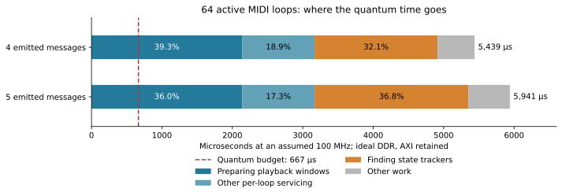

# Where the RTL MIDI time goes

Most of the time goes into repeated loop bookkeeping and finding state trackers.
It is concentrated in the **job processor's MIDI service**, whose small execution
controller runs many instructions around each storage operation.

The counters cover the same 64 playing loops, each containing 30 seconds of
100 controller changes per second, with 32-frame quanta at 48 kHz. This breakdown
uses **ideal DDR: zero added memory delay**, retaining AXI bus transactions. It
profiles ordinary steady playback, including one four-message and one five-message
quantum. All 20 execution counts, including startup and warmup, match the earlier
uninstrumented run exactly, and every emitted message matches Rust.

## The main costs

A representative four-message quantum takes **543,914 clocks: 5,439.14 µs at an
assumed 100 MHz**. Its time divides into these non-overlapping groups:

| Work | Time | Share |
|---|---:|---:|
| Prepare the 64 loops' playback windows and next events | 2,139 µs | 39.3% |
| Other per-loop servicing: cleanup checks, ownership and position updates | 1,028 µs | 18.9% |
| Find the state-difference trackers affected by emitted messages | 1,747 µs | 32.1% |
| Everything else | 525 µs | 9.6% |

The five-message quantum takes 5,941 µs. Its loop-servicing cost is nearly
unchanged; the directory walk grows to 2,184 µs. The quantum's musical duration
is only 666.7 µs. Both playback preparation and tracker lookup individually exceed
that budget, so fixing either one alone cannot meet it.

## 1. Repeatedly reading an event that is not due yet

Every quantum, the playback-read job reloads a sequence's **16-word descriptor**,
looks up its event block, and reads the next **four-word event**. If that event
falls outside the current quantum, it discards the lookahead. The next quantum
performs the same work again. The per-quantum head table is cleared at the start.

At 100 messages per second, events in each loop are 15 quanta apart. The engine
therefore repeatedly fetches information it has already seen. In the measured
four-message quantum it reads 68 event records: one for each of 64 loops, then
another after each of the four emitted messages.

The large cost is the surrounding controller work as well as the reads. Viewed
by execution mechanism, **56.3% of all clocks are controller instructions and
scratch-memory operations**. A normal controller instruction uses three clocks
for fetching, reading operands and execution. Generic descriptor-loading,
validation, address calculation and dispatch routines expand into many such
instructions. Loading the descriptor's fields is still a word-by-word routine.
The opcode-dispatch region alone accounts for about 8% of this quantum.

The playback-read job takes roughly **3,340 clocks per loop**, even with ideal
DDR. The entire quantum budget divided among 64 loops is only 1,042 clocks per
loop, including all other work.

## 2. Scanning the tracker directory for every changed value

A tracker records which values in a loop's starting state differ from an output's
current state. Playback uses it to avoid unnecessary state-setting messages.
Emitted messages change the output state, so the affected trackers must be updated.

The session has **65 starting-state snapshots**: the 64 loop snapshots plus the
engine's default snapshot. Across eight outputs, that makes **520 directory
entries**. Each controller change walks all 520 entries, reading all twelve
32-bit words of each active entry before filtering by output.

Only 65 entries belong to the output being updated. Nevertheless, each message
causes **6,240 directory word reads**. Four messages cause **24,960 reads**, about
90% of all MIDI memory transactions in that quantum. Just walking this directory
takes **437 µs per controller change**, even with zero added DDR waiting.

The directory contains bookkeeping such as addresses, generation numbers and
progress. Several addresses follow directly from the snapshot slot and output
number. Reading this information through thousands of separate word transactions
costs clocks in the adapter, bus and state machine even when memory responds
immediately.

The directory transactions occupy about 499 µs on AXI in the four-message case;
the full walk takes 1,747 µs. The remaining time is request/response sequencing in
the adapter and state machine. This is why making DDR ideal still leaves a large
cost for thousands of individual word requests.

## What is comparatively small

The actual changed-value comparisons take **74 µs, or 1.4%** of the four-message
quantum. Applying the messages to output/activity state takes about 4 µs.
There is no full-state restoration in these steady playback windows.

The 64-way next-event selection costs **10 µs, or 0.2%**. This is a linear scan
over small on-chip head records; the expensive scan described above reads DDR.
Multiplication and division together take 144 µs, or 2.6%. Time outside the active
MIDI service, including SP/JP handoffs and admission, is 171 µs, or 3.1%.
These are separate views of the same clocks, not additional rows to add to the
main table.

## Changes I would prioritize

1. **Keep the next event until it is consumed.** A small per-loop bookmark with
   its timestamp and message can avoid repeated descriptor/block/event reads.
   Refresh it on consumption or content/position changes. This is bounded
   playback working state, small enough for BRAM.
2. **Visit only trackers for the affected output.** The directory already has a
   fixed snapshot/output layout. Stepping through the relevant output's entries
   avoids the other seven outputs without changing incremental tracking semantics.
   Compact generation/readiness metadata can also be considered for BRAM.
3. **Give unchanged playing loops short execution paths.** Use the existing bulk
   read mechanism for descriptor transfers, and avoid long generic control
   routines for common cleanup checks, ownership and position updates.

The SP/JP organization can stay. The current implementation optimized the MIDI
controller's resource use without sufficiently shortening these frequent paths.
The measurements point to concrete access-pattern and execution improvements;
they do not yet establish that any particular combination will meet the deadline.

The [raw counters and reproduction instructions](measurements/midi-runtime-breakdown/README.md)
include per-job time, controller phases, program-counter counts and memory traffic.
Observation-only probes and testbench counters were added; functional RTL and the
Rust oracle were unchanged. The warning-denying build, formatting, two-loop counter
check, full-session output checks and original clock-count comparison pass.
CI and review feedback were not consulted.
