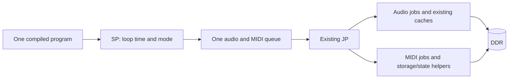
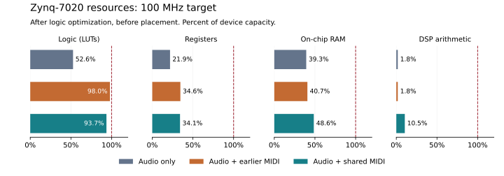

# Shared MIDI execution on the Zynq-7020

The Rust reference and RTL now execute MIDI through the same compiled state and
job processors as audio. Functional comparisons pass. **Both combined builds
still fail placement, at 100 and 150 MHz; neither has routed MIDI timing.**
The redesign reduces logic use, but does not make the full MIDI feature set cheap.

## Shared execution

Previously, a separate MIDI controller decided what every loop should do each
quantum. Now the compiled program and state processor (SP) make those decisions once.
The existing job processor (JP) executes distinct operations: record, observe input,
clean up old notes/pedals, claim output channels, restore/play, submit output and
maintain storage. Its MIDI helpers manage storage and accepted-message progress;
they do not advance a second musical clock.

The full managed behavior remains: recording and silent duration, play/repeat,
stop cleanup, incremental state restoration, output ownership/refusal/recovery,
history grabs and staged import/export/duplicate/replace/clear. Only accepted
messages advance playback/state. Grouped content changes hold the next quantum
until matching SP metadata is published. Rust uses normal functions and loops over finite prepared storage; RTL chooses
its own memory access, arithmetic and event-merging implementation.
Application MIDI transport and board integration remain outside this work.

## Area and fit

These are **optimized, pre-placement** results at the same stage. LUTs implement
logic; registers hold bits; BRAM is on-chip memory; DSPs perform arithmetic.
The device has 53,200 LUTs, 106,400 registers, 140 BRAM blocks and 220 DSPs.

| Target | Design | LUTs | Registers | BRAM¹ | DSPs |
| --- | --- | ---: | ---: | ---: | ---: |
| 100 MHz | Fresh audio only | 27,993 | 23,253 | 55 | 4 |
| 100 MHz | Earlier audio + MIDI | 52,121 | 36,768 | 57 | 4 |
| 100 MHz | Shared audio + MIDI | 49,841 | 36,303 | 68 | 23 |
| 150 MHz | Fresh audio only | 27,993 | 23,253 | 55 | 4 |
| 150 MHz | Earlier audio + MIDI | 52,318 | 36,768 | 57 | 4 |
| 150 MHz | Shared audio + MIDI | 49,832 | 36,304 | 68 | 23 |

¹ 36-kibit equivalents; two half-sized blocks count as one.

At 100 MHz, the whole design saves **2,280 LUTs (4.4%)** versus the earlier
implementation. MIDI services plus their DDR adapter use **20,836 LUTs**, versus
24,053 before. The shared audio/SP/JP portion grows by 798 LUTs; the remaining
small difference is connected-top and measurement-boundary logic. The generated
boundary itself uses 96 LUTs and 6,731 registers, versus 100/6,606 previously.

The extra memory is deliberate. The actual 64-loop compiled program needs
**1,030 instructions and 1,158 worst-case jobs**, exceeding the old 1,024-entry
memories. Both now have 2,048 entries. That and the shared-processor configuration
add a net ten BRAM blocks to audio. MIDI uses three: two for its small context
table, one for event-selection working data. Full events, snapshots of starting state, mutable
instrument state and comparison maps stay in DDR, without a MIDI cache.
Nineteen added DSPs implement bounded address arithmetic that previously used
more general logic.

The MIDI job service still contains about **11,775 LUTs** of coordination/working
logic, with 6,166 for content storage and 2,621 for musical-state services.
Sharing SP/JP removes duplicate scheduling; it does not remove the machinery for
history, transfers, ownership, DDR reads/writes and output acceptance. Further
area work must address those implementations, rather than assuming the execution
architecture alone will solve packing.

## Timing and physical fit

Physical placement still fails. Logic and registers must pack into compatible
groups called *slices*; spare registers cannot necessarily share a slice with
logic using different enable/reset conditions. The placement diagnostics show:

| Target | Unplaced work needs | Slices remaining | Register control groups |
| --- | ---: | ---: | ---: |
| 100 MHz | 9,668 slices | 7,815 | 2,600 |
| 150 MHz | 9,752 slices | 7,815 | 2,580 |

The older builds had 3,364/3,370 control groups. This is an improvement, but the
rebuild still does not fit this device. Sharing SP/JP removes duplicated loop
scheduling; it does not remove the substantial DDR/storage/state-service logic.

| Target | Design | Result | Setup slack | Hold slack |
| --- | --- | --- | ---: | ---: |
| 100 MHz | Audio only | Routed | −4.578 ns | +0.046 ns |
| 100 MHz | Earlier audio + MIDI | Placement failed | — | — |
| 100 MHz | Shared audio + MIDI | Placement failed | — | — |
| 150 MHz | Audio only | Routed | −7.770 ns | +0.042 ns |
| 150 MHz | Earlier audio + MIDI | Placement failed | — | — |
| 150 MHz | Shared audio + MIDI | Placement failed | — | — |

A negative setup slack means a path is slower than the requested clock allows.
Audio has zero routing errors and hold violations at both clocks, with 18 DRC
warnings (DSP pipelining, unused diagnostics and omitted PS7), no DRC errors or
critical warnings. Routed audio uses 27,625/28,289 LUTs and 11,165/11,130 slices.
[The extracted data](measurements/midi-shared-jobs-7020/summary.json) also records
routed registers, total negative slack, failing endpoints and control groups.

Before placement, the shared design estimates setup slack of **−5.558 ns at
100 MHz / −8.865 ns at 150 MHz**. The worst path goes from MIDI state-field
selection through address construction and the DDR range check. These are
**unplaced estimates**, not achievable clock speeds. Registering that address/
validation boundary is a remaining timing target. Audio has its own long status
counting and directory-size calculations, already present before this redesign.
Both fresh audio-only runs reproduce the earlier routed status-counting
critical path. No routed result establishes the clock-speed impact of adding
MIDI. Address timing and physical packing remain follow-up work;
the functional rebuild is not a timing-qualified 7020 deployment.

The targeted improvements in this rebuild include validated narrow address
operands/offsets, dense controller labels, a small event-head RAM, and a separate
256-entry audio prefetch-hint queue so MIDI jobs do not inflate it. Musical time
and arena bases remain 64-bit. During development, activity setup was limited to
owned MIDI channels; the delayed-memory two-loop example fell from roughly 103,000 to
16,000 cycles at first playback, and 166,000 to 20,000 at repeat. This is a small
functional workload measurement, not a 64-loop deadline qualification.

## Workload and evidence

All fresh builds use public Docker-sourced **Vivado 2021.1**, Zynq
`xc7z020clg484-1`, 0.2 ns clock uncertainty and comparable out-of-context
implementation settings. The old study remains unchanged. The fresh audio-only
source set genuinely excludes MIDI. The new measurement is a connected pipeline;
the earlier combined study measured separate audio/MIDI components without this
compiled coordination. The resource comparison includes that additional work.

The shared profile retains **64 loops with stereo audio plus one MIDI binding**,
48 kHz, approximately 30 seconds/channel, 32-frame chunks/quanta, 64-bit AXI,
one MIDI input and eight destinations. The baseline keeps identical audio sizing.
Audio plus MIDI payload/metadata reserves
about **724.5 MiB**, requiring at least **1 GiB DDR** before caller/OS headroom is
considered. MIDI reserves 18.655 MiB, 64 contexts, and 8,192 events per sequence;
a 3,000-event recording fits comfortably, subject to the finite shared pools.

The final Rust reference/compiler run passes **131 tests**; all **18 MIDI RTL
tests** and **nine retained audio/compiler/loading/target tests** pass. They check
compiled jobs, exact samples/messages/state, all quantum sizes, partial output,
publication, faults, AXI32/64 and retained service scenarios. Broader local native
startup/launcher failures are documented separately, including the untouched
baseline reproduction. CI/review feedback was not consulted.

The tests and synthesis capacity profile do not prove the complete session can
finish each 667-µs quantum under a real DDR controller and MIDI-output pressure.
PS7, DDR arbitration, board I/O and a new application control transport remain
embedding work. See the [architecture](midi-shared-jobs.md),
[validation](midi-shared-jobs-validation.md), and
[raw reports, configuration, source hashes and reproduction steps](measurements/midi-shared-jobs-7020/README.md).

## Follow-up resource investigation

The [netlist audit and isolated experiments](measurements/midi-shared-jobs-7020/resource-audit/findings.txt)
trace most extra logic to the controller and storage-management implementation.
The main service has 6,803 working flip-flops, including 1,792 in its context/history
staging arrays. All 19 added DSPs calculate addresses. Padding DDR strides removes
18 DSPs, but changes total LUTs from 49,841 to 49,894, so it does not solve the
logic shortage. Preventing reset replication reduces detailed control sets from
2,602 to 675, yet improves the failed-placement slice shortfall by only 24.
The earlier control-group explanation was incomplete: reducing those groups alone
does not rescue the design. The working datapath, value selection and repeated
memory-access machinery need a more compact hardware implementation.
