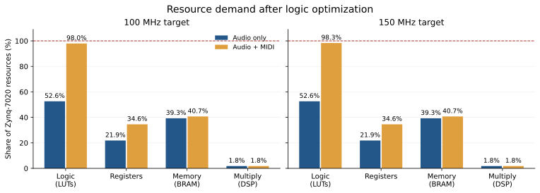
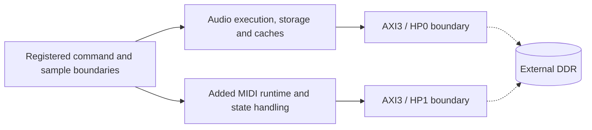

# MIDI RTL on the Zynq-7020

Fresh **Vivado 2021.1** builds show a clear capacity problem: adding the current MIDI implementation raises logic use from about **53% to 98%**, and **the combined design fails placement at both 100 and 150 MHz**. MIDI adds only **two BRAM blocks**. Its storage fits comfortably on chip where intended; its control logic needs substantial optimization.

Audio alone routes successfully at both frequencies, but misses setup timing at both. These results do not qualify either configuration for deployment at the requested clocks.

## Resource cost

All builds are sized for **64 stereo loops plus MIDI**, approximately **30 seconds per audio channel at 48 kHz**, **32-frame audio chunks**, and a **32-frame quantum**. Before MIDI was added, the hardware build contains the audio components; the MIDI Rust reference consumes no FPGA resources.

The table compares the same stage—**after logic optimization, before placement**—because the combined designs cannot complete placement. LUTs are small logic building blocks; registers hold individual bits; BRAM is on-chip memory; DSP blocks provide dedicated arithmetic.

| Target | Components | LUTs | Registers | BRAM blocks¹ | DSP blocks |
| --- | --- | ---: | ---: | ---: | ---: |
| 100 MHz | Audio | 27,993 | 23,253 | 55 | 4 |
| 100 MHz | Audio + MIDI | 52,121 | 36,768 | 57 | 4 |
| 150 MHz | Audio | 27,993 | 23,253 | 55 | 4 |
| 150 MHz | Audio + MIDI | 52,318 | 36,768 | 57 | 4 |
| Device capacity | | 53,200 | 106,400 | 140 | 220 |

¹ 36-kibit equivalents; two half-sized blocks count as one.

At 100 MHz, adding MIDI costs **24,128 LUTs, 13,515 registers and two BRAM blocks** in this measurement. That is **86% more logic**, compared with about **4% more BRAM**. Vivado maps MIDI arithmetic into general logic here; all four DSP blocks belong to audio.

Being just below the nominal LUT limit does not guarantee that a design fits. Logic and registers must also fit together into physical groups called *slices*. Registers with different enable/reset conditions cannot always share those groups. Placement changes how logic is packed and can duplicate parts of it, increasing the required count. Vivado reports:

| Target | LUTs required during placement | Available LUTs | Placement diagnostic |
| --- | ---: | ---: | --- |
| 100 MHz | 54,303 | 53,200 | Unplaced instances need 9,540 slices; 6,930 remain available |
| 150 MHz | 55,080 | 53,200 | Unplaced instances need 9,608 slices; 6,930 remain available |

The failed builds have 3,364 / 3,370 distinct register control groups. Reducing raw LUT count alone may not resolve this packing problem.

## Clock timing

“Setup slack” is the spare time on the slowest path between registers. Zero or positive passes; negative means that path exceeds the allowed time. The clock periods are 10 ns and 6.667 ns. Hold timing checks that new data does not arrive too early; both audio builds pass it.

| Target | Components | Result | Setup slack | Hold slack |
| --- | --- | --- | ---: | ---: |
| 100 MHz | Audio | Fully routed | −4.578 ns | +0.046 ns |
| 100 MHz | Audio + MIDI | Placement failed | — | — |
| 150 MHz | Audio | Fully routed | −7.770 ns | +0.042 ns |
| 150 MHz | Audio + MIDI | Placement failed | — | — |

Both audio builds have **zero routing errors and zero hold violations**. Their routed LUT counts are 27,625 and 28,289 after physical optimization. Their DRC reports contain zero errors/critical warnings and 18 warnings about DSP pipelining, unused diagnostic capture outputs, and the omitted PS7 block.

The audio builds' slowest routed path counts occupied audio views for status reporting. The portable implementation of that count is part of the compatibility adjustment described below. Audio's directory-size calculation also produces a long path: this storage capacity requires a five-level directory, whose page requirements are calculated through several additions in one cycle.

MIDI also needs timing work. A separate examination of its **unplaced** logic finds a long path from selecting a state field through constructing and checking its DDR address: estimated slack **−5.247 ns at 100 MHz / −8.580 ns at 150 MHz**. Those estimates identify an optimization target; they are **not routed timing results**. The failed combined builds provide no reliable measurement of the final clock-speed impact of adding MIDI.

## Where MIDI spends its logic

The MIDI core itself, excluding measurement registers, uses **24,053 LUTs, 12,065 registers and two BRAM blocks** in the 100 MHz optimized build.

| MIDI work | Approximate LUTs | Share |
| --- | ---: | ---: |
| Coordinate loops, history, transfers and working data | 14,733 | 61% |
| Manage event blocks, views, snapshots and cleanup | 5,959 | 25% |
| Interpret messages, restore state and track differences | 2,881 | 12% |
| Memory interface and remaining logic | 480 | 2% |

This points first to the controller and storage-management implementation. Sharing arithmetic between operations, using smaller internal indices/offsets where capacity permits, and reducing the number of independently enabled register groups should improve area. Splitting long address and bookkeeping calculations into shorter registered steps should improve timing. Large musical timestamps can remain 64-bit.

The measurements support keeping the DDR storage model. They also show that the current RTL implementation needs further work before this full configuration is practical on a 7020. They do not show that the refined musical-state handling is the main area cost.

## Storage and measurement scope

Audio uses four-byte samples. Allocation rounding gives 30.016 seconds per channel: **703.5 MiB** for 128 mono channels. Audio metadata adds **2.373 MiB**. The selected MIDI pools reserve **18.655 MiB**, with 64 bindings and up to 8,192 messages per sequence. Its private loop descriptors occupy **8 KiB of primary BRAM**; events, full states and scalable tracking tables live in DDR.

Together this is approximately **724.5 MiB**, before OS/application memory. A **512 MiB ZedBoard cannot hold the requested session**. A board with at least **1 GiB DDR** is needed for this storage profile.

These builds reserve enough storage and working memory for the 64-loop configuration. They include the existing audio execution/storage/caches and the full new cache-less MIDI runtime. Each has a 64-bit AXI3 memory interface, suitable for separate Zynq HP ports into shared DDR. Generated input registers and output capture registers retain the public interfaces during measurement. PS7, codec, application frontend and the future SP/MIDI coordinator are outside the build.

The measurement wrapper accounts for **100 LUTs and 6,606 registers** in the combined optimized builds. It affects physical packing; a real frontend will pack differently. The two cores alone still consume approximately **98% of the LUTs**, leaving little margin before adding that frontend. The placement failures apply to the measurement wiring used here; they do not rule out a different fit with a different frontend.

Quantum throughput was not measured. At 48 kHz, 32 frames allow about **667 microseconds**: 66,667 cycles at 100 MHz or 100,000 at 150 MHz. Closing clock timing would still need to be followed by execution measurements with realistic DDR service and output backpressure.

## Reproduction and baseline qualification

Tool: **Vivado 2021.1, SW build 3247384**, from the pinned public `siliconbootcamp/xilinx-vivado` Docker image. The original compiler payload and matching base OS/dependencies were extracted from verified image layers; later tool-file overrides were excluded. The vendor files were mounted read-only in Docker. [Tool provenance](measurements/midi-vivado-7020/tool-provenance.json) records the image/layer hashes and runtime details.

All four runs target **`xc7z020clg484-1`**, use 0.2 ns clock uncertainty, the same out-of-context clock-source assignment, two Vivado threads, default placement/routing and post-placement physical optimization. Each starts from RTL with no reused checkpoint.

Before source: **`147c2457`**. After source: **`f24cc89b`**, with compatibility edits committed at **`9ea68d2a`**. Vivado 2021.1 rejects the original dynamic `$countones` in audio and four MIDI state constants declared after their first use. Both builds use the same equivalent balanced audio bit-count tree; the MIDI constants move before their first use. Every measured audio source is byte-identical before/after, and every measured after source matches `9ea68d2a`.

The comparison therefore includes those compiler compatibility changes in both versions. The baseline timing figures depend on that portable view-count implementation, which appears on its worst routed path. They do not describe an untouched build of `147c2457`.

The [complete configuration and commands](measurements/midi-vivado-7020/README.md), [machine-readable results](measurements/midi-vivado-7020/results.json), source hashes, constraints, console logs and detailed reports are retained with the study. The existing audio statistics/reuse checks and MIDI record/restore/repeat/stop/history-grab comparison pass after the compatibility edits. No Rust source changed; no CI or review feedback was used.

PR: [#1020](https://github.com/SanderVocke/shoopdaloop/pull/1020).
