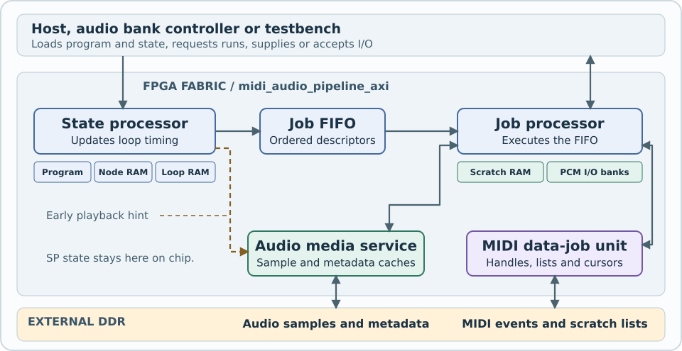
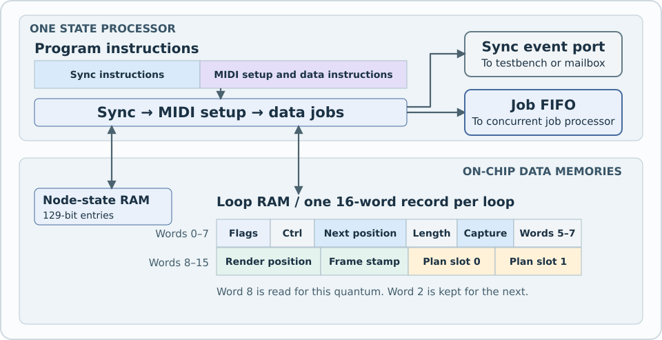
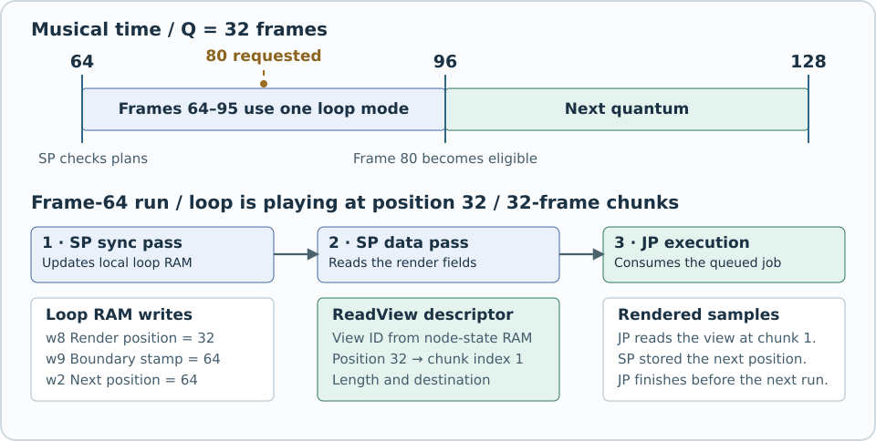
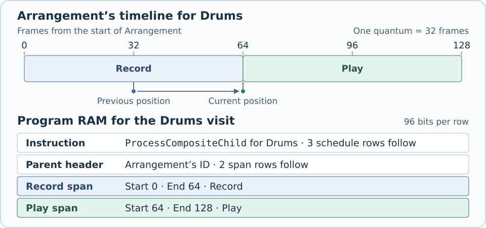
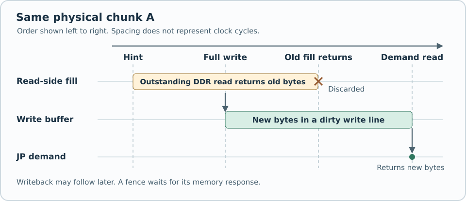
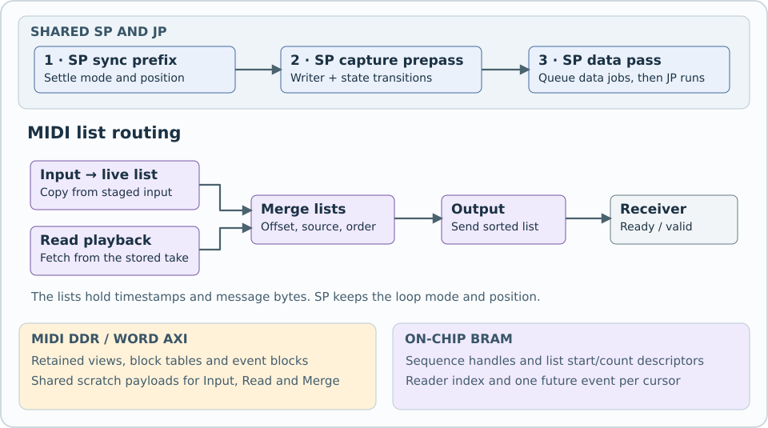
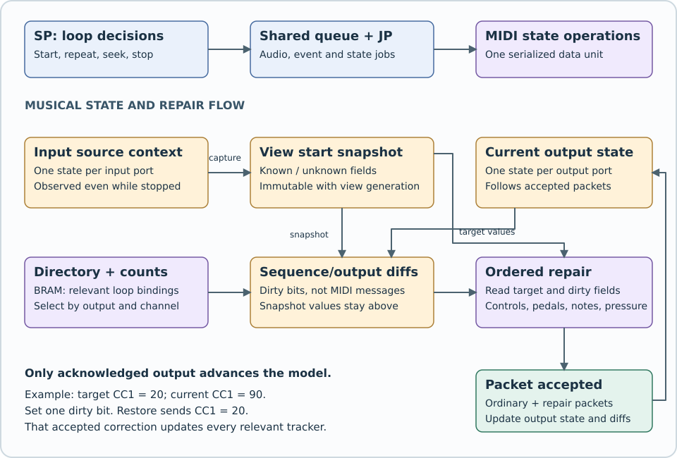
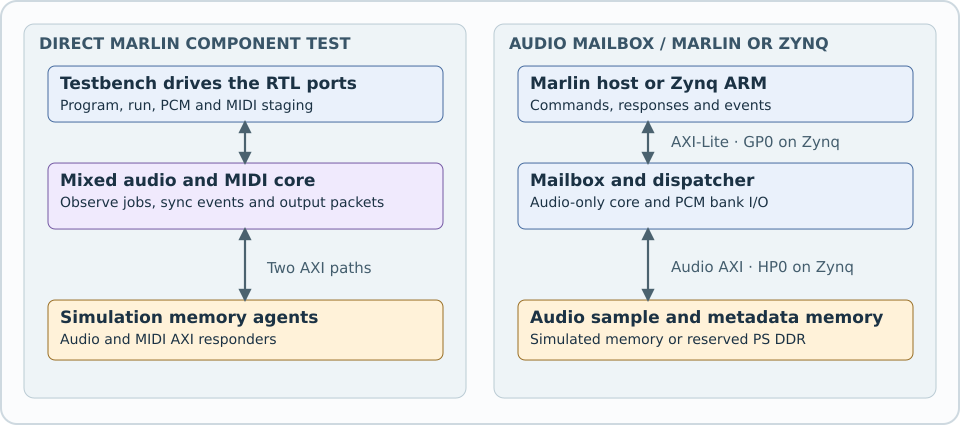

# System architecture

This reference describes the shared audio/event pipeline at
`feat/backend-replacement` revision `cc410f27`, the optional MIDI expression-state
implementation at `462ce74e`, and the bounded composite audio extension described
in the state processor chapter. Historical source links pin the relevant
revision. For each processing quantum, the **state processor (SP)**
determines which loops are playing or recording and where they are in their
content. It writes an ordered list of jobs for the **job processor (JP)**,
which processes samples and packets using the on-chip audio buffers and
media services. The host, device controller, or testbench supplies input,
configuration, and the signal to start each quantum.



## Where to read the RTL

A **top-level module** is the outermost SystemVerilog module selected for a
simulation or synthesis build. The smaller modules inside it can also be
simulated on their own. Start with the build that has the interfaces you want
to follow.

- **Audio and MIDI together.** Start at `midi_audio_pipeline_axi`. Inside
  it, `media_audio_pipeline_axi` contains the audio media store and
  `audio_pipeline`, which in turn contains the SP and JP. The MIDI data-job unit attaches to JP's MIDI job port. It moves
  events between staged input, DDR lists, stored views and output ports.
- **Marlin or ARM using the audio mailbox.** Start at `host_pipeline_axi`.
  It adds an AXI-Lite mailbox and command dispatcher around an audio-only
  configuration of `media_audio_pipeline_axi`.
- **The loop algorithm itself.** Start at `state_processor` and then
  `sp_engine`. This module can run in isolation using on-chip RAM and
  testbench-supplied configuration.

## One processing quantum

1. The host, audio bank controller, or testbench supplies input and requests
   processing for the next quantum. In the mixed core, the wrapper validates
   the staged MIDI batch before starting SP.
2. SP updates loop state at the quantum boundary. It queues MIDI writer
   transitions before the regular work pass, then writes the data jobs
   into an on-chip FIFO. When SP queues an audio playback job, wires named
   `read_intent_valid` and `read_intent_data` also expose a one-clock copy
   of that descriptor. The audio store can use this hint to start fetching
   samples before JP reaches the job.
3. After SP finishes, JP reads and executes the jobs in FIFO order. A job
   such as Gain reads samples from an on-chip scratch buffer written by an
   earlier job, then writes its result for a subsequent job such as Output.
   Audio media jobs and MIDI jobs can also wait for memory or I/O.
4. The mixed wrapper runs bounded MIDI retirement after a successful JP pass.
   Pipeline completion reports whether the quantum succeeded. The output bank
   can then be handed back to the audio device using its own interface. Audio
   writes can still be sitting in the FPGA's caches. A separate media
   **fence** waits for the memory interface to acknowledge
   those writes before it reports success.

| Unit | Meaning |
| --- | --- |
| Frame | One sample time. A stereo frame contains two channel samples. Musical positions and MIDI offsets use frames. |
| Quantum (Q) | Frames processed by one run. Managed sync supports 1, 16, 32, 64 and 128, subject to the instantiated limits. |
| Audio chunk | Fixed power-of-two count of 32-bit mono samples. The run quantum must be an integer number of chunks. |
| Audio allocation block | Contiguous group of physical chunks with one ownership count. Default geometry uses 32 chunks per block. |
| MIDI event block | Fixed capacity measured in events. Event timestamps and view duration remain measured in frames. |

Sources. [Architecture index](https://github.com/SanderVocke/shoopdaloop/blob/cc410f27/FPGA_ARCHITECTURE.md) · [Mixed top](https://github.com/SanderVocke/shoopdaloop/blob/462ce74e/fpga/midi/rtl/midi_audio_pipeline_axi.sv) · [Pipeline controller](https://github.com/SanderVocke/shoopdaloop/blob/cc410f27/fpga/job_processor/rtl/audio_pipeline.sv)

# State processor

The program has a sync prefix and a work section. The prefix visits each loop
once, using `ProcessLoop` for an ordinary visit and `ProcessCompositeChild`
for a loop driven by a composite. After the prefix, a capture prepass
scans the work section for MIDI Capture and State instructions and queues
writer transitions and optional state restore/cleanup jobs. SP then walks the
work section again to build the audio and MIDI data jobs. All three scans use the same `sp_engine` hardware, including
its instruction controller, working registers and 65-bit adder.



## What lives on the FPGA

The program, node-state and loop RAMs in Figure 2 are **all on-chip
synchronous memories**. The job FIFO also uses on-chip RAM and a registered
head. These RTL arrays can infer FPGA block RAM (BRAM). The synthesis result
depends on the target and memory geometry. Consult the post-synthesis
utilization for the target profile to see the BRAM mapping.

| Storage | What it holds |
| --- | --- |
| Program RAM | 96-bit instructions and composite schedule rows. Live loading can provide a second program region. |
| Node-state RAM | 129-bit entries for values such as view IDs, enables and gain ramps. |
| Loop RAM | Sixteen 64-bit words per loop. They hold loop identity, mode, positions, capture length, revisions and two plan slots. |
| Job FIFO | 256-bit job descriptors for the current run. |
| Engine registers | Working operands while the engine processes one instruction or loop. The sync event shares a descriptor register with job emission. |

SP has **no DDR master or DDR-backed state RAM**. A view ID stored in SP
identifies audio content. The audio store, reached through JP, uses that ID
to find sample and metadata pages in DDR. A MIDI sequence ID selects
a view handle in the data-job unit. SP supplies the playback interval,
recording position and writer transitions. The data-job unit keeps the
view handles and event cursors and accesses its own DDR arena. In a
standalone fixture without a sync prefix, the work pass can read explicit
loop records supplied by the testbench on the `loop_read_*` ports.

## When a loop can change mode

**The sync pass makes loop decisions once per quantum, at its starting
frame.** A quantum contains one or more whole audio chunks. A chunk is a
storage and transfer size. Even if the quantum contains several chunks, SP
does one sync pass for the entire quantum.

Each loop has two slots for commands that can stop, play, record or seek.
For an **absolute-frame plan**, SP tests whether the requested frame is at or
before the current boundary. If frame 80 is already in a slot when a Q=32
run starts at frame 64, it is still pending at 64 and becomes eligible at 96.
The renderer processes the entire interval from 64 through 95 under one
settled loop mode. For a **source-pulse plan**, a pulse from the configured
sync source can make the plan eligible at the current boundary, after any
requested pulse skips and once the effective frame is due. A pulse is a
logical notification such as a loop restart or wrap. The compiler orders
source loops before dependent loops so the latter can see the source's pulse
from the same boundary. Each loop can deliver at most one pulse per quantum.
The newer eligible plan takes precedence where plans compete.

MIDI packets can carry sample offsets within the quantum. Those offsets tell
the receiver when to play an event. SP loop decisions still occur at the
boundaries.



## Composite audio loops

A composite loop keeps a playhead and tells other loops when to act. Suppose
the composite **Arrangement** controls an ordinary audio loop called **Drums**.
Arrangement is the parent and Drums is its child. Drums holds the recorded
audio. A child can also be a composite with children of its own.

A **span** says what one child should do over one stretch of the parent's
timeline. It lists a start frame, an end frame and an action. Frame numbers
are measured from the start of the parent's pass. In the example below,
Arrangement runs for one pass. The Record span starts at frame 0 and ends
at frame 64, so Drums records frames 0–63. At frame 64, the Play span begins
and Drums plays the new take during frames 64–127. The two spans make up the
schedule for Drums.



### How the schedule is stored

A **schedule row** is one 96-bit word in the same on-chip program RAM that
holds the SP instructions. The compiler puts the rows for Drums immediately
after the `ProcessCompositeChild` instruction that visits Drums. The
instruction says three rows follow. The first is a **parent header** that
identifies Arrangement and says it has two spans for Drums. The next two
rows each hold one span's start frame, end frame and action. If several
parents schedule the same child, each parent has its own header followed by
its spans. Appendix A gives the exact bit layout.

For example, if one parent schedules a single Play span for each of 64 child
loops, each child needs one header row and one span row. That is 128 schedule
rows in addition to the instructions that visit the loops. These rows share
the existing program RAM budget in each program region.

### How the state processor picks an action

With a quantum of 32 frames, here's what happens when Arrangement reaches
frame 64.

1. **Update the parent first.** The compiler orders parents and sync sources
   ahead of the loops that depend on them. Arrangement's loop record now
   shows that its playhead was at frame 32 in the previous quantum and is at
   frame 64 in this one.
2. **Find both positions in the schedule.** When SP reaches the instruction
   for Drums, it uses the header to find Arrangement's loop record. It reads
   the span rows in start-frame order. A row matches if the position is at
   or after its start and before its end. Frame 32 matches Record. Frame 64
   matches Play.
3. **Apply the change.** SP switches Drums from Record to Play so the usual
   audio playback jobs can use the completed take. SP then skips the schedule
   rows to continue with the next instruction. At the following quantum,
   both positions match Play, so Drums keeps playing.

A parent that leaves a span and enters a gap asks the child to stop. A seek
can apply the action at the new position even if the playhead stays inside
the same span. For Play, SP uses the distance from the start of the span to
position the child.

Drums still emits sync pulses when it starts or wraps. Other loops can use
those pulses even while Arrangement controls Drums. Drums can also have its
own sync source. A command scheduled directly on Drums
for a particular frame can take precedence when it comes due. If several
parents request a change at the same boundary, SP takes the first in the
compiled order. One-pass (explicit) programs come before repeating (regular)
programs. Loop IDs break ties.

SP uses the audio store's capacity report to decide whether a scheduled
recording can start. See the admission rule under
[Views, allocation and reclamation](#views-allocation-and-reclamation).

### Supported behaviour

- **Playback.** Regular programs repeat and can be empty. Explicit programs
  stop after one pass. Nested playback and seek run at quantum boundaries.
- **Actions.** Regular spans play children. Explicit spans can Play, Stop or
  Record. Record targets ordinary Direct audio loops with separate writable
  media views. Authored MIDI, Replace and dry/wet modes are outside this
  composite profile.
- **Timing.** Each composite unit is a whole number of quanta. The unit and
  the full pass each fit in a 32-bit frame count. A loop can sync to itself.
  Parent and sync links between different loops must be free of cycles.
- **Capacity.** A child can have several parents, with several spans from
  each. Every header and span uses a row of program RAM. The total must fit
  alongside the program instructions in the same region.
- **Host controls.** The prepared Rust and Marlin hosts accept composite graph
  images, Play and Seek by iteration, and start and stop commands. A mode change
  can wait for a sync pulse. Immediate and delayed changes share the two plan
  slots in the loop record. Repeat sync can be changed while a program is
  running.
- **Application edits.** After the initial layout is installed, the application
  can create a composite, convert an empty stopped loop, edit its plan, and
  clear or remove a composite. For a single composite with no parent, the
  host can stop it as part of the clear or removal. The old schedule runs
  for that quantum so its children stop and any take it started can finish.
  The host compiles each proposed plan
  into the unused program region. It reports the new version once the region
  has taken over and the state snapshot shows that version. If a primitive
  begins recording before conversion takes over, the handoff refuses the
  conversion and the primitive keeps its take.
- **Editing during playback.** The prepared hosts can apply compatible
  future changes, such as adding another child later in the current pass.
  A parent can keep playing while an edit changes a later part of a nested
  composite, including which child composite plays there. For this early
  handoff, the edited composite keeps its timing and sync source, and the
  first change is beyond the current and next iteration. An edit to a single
  nested composite can also wait until the child stops, either by finishing
  its own run or when its parent releases it. Unchanged parents keep playing
  and use the new plan the next time they start the child.
  A repeating child can also pick up a compatible edit at its own restart
  while its parents keep playing. An ancestor command that could change the
  child's entry point makes the edit wait for a safe boundary.
  A compatible one-pass child can take up an edit as it finishes. A parent
  that starts it again at that same boundary starts the replacement plan.
  An independent repeating composite can pick up an edit at its next restart,
  including changes to the length of an iteration or the whole pass. Both plans
  use the same sync source. At an uninterrupted restart, SP compares what was
  playing with what should play next. Continuing children keep their place.
  The edit can drop a child from the schedule while leaving the loop and its
  audio in the session. A child still playing at the end of the old pass needs
  one extra program row so SP can stop it. When that child is a composite,
  its schedule also releases its own children. A direct play command for
  the removed branch can keep it running at the switch. If the row cannot fit,
  waiting for a sync clock can give the old schedule time to release its children. The
  clock can be a primitive, a composite, or a chain of loops that sync to
  one another. The chain keeps the same links and schedules during the edit,
  and its loops run free of composite parent actions. A primitive can pass
  along a source pulse. A composite clock supplies its own repeat pulse.
  A clock command that could act at the boundary makes the edit wait.
  A timing change needs one free loop record while the new program is staged.
  For a one-pass composite that keeps its sync source, an edit can take effect
  as the old run ends. When both plans end with the same child modes, the
  switch needs no extra rows. If the old ending only plays children, the same
  additional rows can release children that the new plan drops.
  An independent one-pass edit also keeps pending transport commands when it
  preserves the iteration and pass lengths. Other one-pass edits can take
  effect one quantum after the old run stops.
  Playback controls still run while an edit waits. If a scheduled stop is
  pending, it takes effect first and the edit can apply once the loop stops.
  Cancelling an edit that still waits leaves the active version in place. If
  the edit reaches the handoff first, the application reports the version that
  took over.

## How the render state reaches JP

SP owns loop timing. During `ProcessLoop`, it loads one loop into working
registers, applies eligible plans, resolves wraps and pulses, and performs
these writes to the **same loop record**:

1. **Save the value this quantum should use.** Write the current render
   position to word 8 and stamp the current boundary in word 9.
   Set the begin-capture flag in word 0 if the loop is recording and its
   capture length is still zero.
2. **Save the values the next quantum will start with.** For playback, advance
   position by Q and write it to word 2. For recording, grow the capture length
   in word 4 by Q. Word 3 is the content length used for playback. It can be
   shared by both passes because the advancement step leaves it intact.
3. **Read the saved render values to build jobs.** After the sync pass, the
   work instructions read the mode, begin-capture flag, render position and
   content length from the record and check its boundary stamp. SP then
   writes the required operands into the job FIFO. For example, ReadView
   carries a view ID, chunk position and length. First capture can emit
   BeginCapture ahead of Capture.

On the first Q=32 recording run, word 4 is already 32 when the work pass
reads the loop. The begin-capture flag still describes this run as the first,
so SP can queue BeginCapture followed by Capture.

JP finds everything it needs about the loop in the FIFO descriptor. It
processes samples or packets and updates the relevant media storage. SP
already wrote the next loop position or capture length during the sync
pass. JP completion lets the pipeline start another quantum using those
values. A failure can leave the earlier SP writes in place.

## Where sync events go

`sync_event_valid/ready/data` is a hardware output carrying 256-bit records
for loop transitions, wraps, pulses and plan results. The record includes a
loop slot, a boundary frame and a type-specific payload. The frame describes
the musical boundary. Transferring the record can take additional FPGA
clocks. This output lets a testbench or host observe the loop decisions. JP gets its work separately
through the job FIFO, and dependent loops get their pulse from loop RAM.

A Marlin test can accept the stream directly. The audio host wrapper routes
it into the mailbox's event queue for the Marlin host owner or Zynq ARM to
read. A wrapper with `EXPORT_SYNC_EVENTS=0` accepts events internally without
waiting for an external sink. When exported, SP holds the current event and
waits if `sync_event_ready` is low. The host mailbox instead accepts the
stream during a live session and flags a fault if its event queue overflows.

## Work pass and admission

A packed instruction has an 8-bit opcode, five 16-bit operands and eight
reserved bits. A job descriptor carries an 8-bit opcode, two 16-bit ID fields,
24 reserved bits and three 64-bit payload words. The work pass resolves
state addresses into the job operands that JP consumes.
A gain instruction emits an immutable ramp snapshot and advances the
persistent counter once per quantum. Audio playback jobs encode position and
length in chunks. MIDI jobs address ports, sequences, cursor slots and
event lists. Read also carries the loop identity to validate cursor reuse.
The capture prepass uses the writer-open flag in loop RAM. Jobs stay in
the FIFO until SP finishes.

The compiler supplies the **maximum number of job descriptors one run can
enqueue** as `run_job_budget` or, with live loading, in the switch descriptor.
The budget is measured in FIFO entries. For example, a budget of 20 needs
room for 20 descriptors even if a particular loop mode produces only 12.
A single instruction can emit more than one job. For example, a MIDI retake
can emit FinishCapture, BeginCapture and Append. Since JP starts only after SP finishes, the FIFO must
hold the whole list at once. The bound says nothing about execution time
or how many clock cycles those jobs take.

`run_valid && run_ready` starts admission checks for geometry, instruction
and state counts, an empty FIFO and enough FIFO slots for the budget. SP
reports a queue-full error when it cannot fit the declared budget.
A fault can leave earlier state writes and a partial queue. A caller using
the standalone core can inspect and drain that queue. The combined controller skips the normal JP pass on
SP failure. Reset invalidates execution and FIFO state while retaining RAM
payloads. Reload required records before resuming managed execution.

| Port family | Use |
| --- | --- |
| `cfg_*` | Read/write program or persistent state, with `cfg_loop` selecting loop RAM. Observe the response beat. Live loading permits writes to the inactive instruction region under its dedicated rules. |
| `run_*`, `done`, `error_code`, `instruction_pc` | Admit a run and identify success or the failing instruction. |
| `job_*`, `queued_jobs` | Drain the FIFO after the run. SP holds the descriptor stable under backpressure. |
| `read_intent_*` | Advisory pulse on playback enqueue, with no ready input. |
| `sync_event_*` | Ready/valid events, held until accepted. |

Sources. [SP RTL](https://github.com/SanderVocke/shoopdaloop/blob/cc410f27/fpga/state_processor/rtl/state_processor.sv) · [Executor](https://github.com/SanderVocke/shoopdaloop/blob/462ce74e/fpga/state_processor/rtl/sp_engine.sv) · [Loop RAM layout](https://github.com/SanderVocke/shoopdaloop/blob/462ce74e/fpga/state_processor/rtl/sp_loop_defs.svh) · [Instruction and port specification](https://github.com/SanderVocke/shoopdaloop/blob/cc410f27/fpga/state_processor/README.md)

# Job processor

`audio_pipeline` runs SP first, then JP. Each JP job finishes before JP
accepts the next one. The compiler uses numbered **scratch buffers**, which
are regions of on-chip sample RAM. For example, Input writes buffer 0, Gain
reads buffer 0 and writes buffer 1, then Output reads buffer 1. The dependency
is a concrete RAM read of the samples written by the earlier job. JP checks
per-buffer readiness bits that it clears at the start of each run.

**`MAX_FRAMES` defaults to 32** in `job_processor` and the main
pipeline wrappers. It limits the runtime quantum and sets the reserved size
of each scratch buffer, in samples. The address is
`buffer_id * MAX_FRAMES + frame_in_quantum`. With the default stride,
buffer 1 starts at word 32 even during a 16-frame run. A 64-frame run needs a
build with `MAX_FRAMES` at least 64. Chunk size is configured separately.


| Job family | Activity | Duration depends on |
| --- | --- | --- |
| Input, Silence, Constant, Output | Copy or produce quantum data and accumulate output | Quantum frames and RAM/I/O scheduling |
| Gain, Arithmetic, Mix, Smoothing | Read scratch, apply signed fixed-point math, write results | Operand reads, pipeline fill and ramp initialization |
| ReadView, BeginCapture, Capture | Resolve playback or recording view, exchange sample words, wait for store completion | Cache and metadata residency, memory service and stream readiness |
| MIDI | Submit a data-job descriptor on `midi_job_*` and wait for the result | List length, DDR responses and downstream output acceptance |

Audio words are signed Q8.24. Mix saturates the sum. Gain multiplies, truncates
toward zero, then saturates. An active ramp uses a shared divider up front and
incremental quotient/remainder stepping across samples. Restart smoothing
retains per-history state across runs. Unstalled gain emits one result per
clock after pipeline fill. Mix reads two operands on one scratch read port and
can produce one result every two clocks. Those rates describe the inner sample
loops.

For playback or capture, JP translates chunk-based job operands to frame-based
store arguments. The store then resolves authoritative view metadata. JP's
late look-ahead of a following playback job can also supply an advisory hint.
`monitor_valid/ready/data` shows the SP FIFO head and its consumption, so a
trace can distinguish a stalled head from an accepted descriptor. `state_done`
ends SP execution. `jobs_done` ends JP execution. Check the pipeline
`error_code` together with `error_stage` on completion and examine the
`midi_error_code` for the cause of a MIDI failure. A failed MIDI job ends
the JP pass with `INVALID_JOB` and invalidates the quantum.

Sources. [JP RTL](https://github.com/SanderVocke/shoopdaloop/blob/462ce74e/fpga/job_processor/rtl/job_processor.sv) · [Audio job arithmetic and interfaces](https://github.com/SanderVocke/shoopdaloop/blob/cc410f27/fpga/job_processor/README.md)

# Audio media and caches

The media command layer accepts logical frame ranges within views. Metadata
maps a view's block ordinal to a physical allocation block. The low bits of
the position within that block select a chunk and then a sample. The sample
cache operates on physical chunk tags. At 32 frames/chunk and 32
chunks/block, a chunk is 128 bytes and a mono block is 4 KiB. For an aligned
view, block ID 7 and chunk index 3 within that block select physical chunk
`7 * 32 + 3 = 227`, starting `227 * 128 = 29,056` bytes into the sample arena.


## Views, allocation and reclamation

On-chip view descriptors and roots identify dense radix-16 trees in DDR.
Leaves contain allocation-block IDs. The root state also caches a leaf
translation per view. Reference counts belong to physical blocks. A grabbed
range retains the blocks it intersects, including partial boundary blocks.
A writer can append beyond the published prefix. Clearing or replacing a
view can detach its old tree into the retirement FIFO and publish the new
view without walking the old recording.

The bounded collector walks detached trees from the tail. The final reference
to a block triggers grouped chunk-cache retirement. This drains matching dirty
writes and in-flight traffic, cancels speculative work, and invalidates
matching entries before the block ID is published on the free stack. Pending
retirements therefore consume capacity. The view pool, block pool, table page
pool and retirement queue each have independent capacity limits.

For authored composite recording, the media wrapper reports credits based on
available sample blocks, table pages and retired-root slots. SP samples these
credits at run admission and compares them with the compiled count of audio
writer lanes. The count covers all compiled capture lanes when the image can
perform authored Record, even if only some write in the current quantum. A
refused start keeps the old take. If capacity runs out during an admitted take,
the accepted prefix closes and remains playable. Rust preflights the selected
writes, so RTL can decline a take earlier near capacity.

## Sample-cache operations

The sample cache has separate read and write RAM pools with associative tags,
round-robin victim selection and free-line preference. Defaults are four lines
in each pool. A line contains one fixed-size physical chunk. Directory state
tracks valid, loaded/dirty and transfer ownership. Read lines stay pinned until
the last sample is accepted.

| Operation | What the cache does |
| --- | --- |
| Read hit | Streams the resident chunk or forwards from the authoritative write line, including dirty data. |
| Read miss | Reserves a line, issues a demand fill, and streams after successful acknowledgement. |
| Full-chunk write miss | Installs the new data directly in a write line. |
| Partial write miss | Fills the previous chunk first, then overlays changed words. |
| Writeback | Drains dirty lines after a quiet interval of `CHUNK_FRAMES+8` clocks or sooner under pressure, fence or retirement. |
| Prefetch | Uses spare transfer capacity. Drops or invalidates superseded speculative data on conflicting writes and retirement. |

The audio pipeline can buffer a copy of SP's `read_intent_*` descriptor as
an early playback hint. JP can offer a second hint by looking ahead at a
queued playback job. The hint resolver looks up the view mapping and can
ask the sample cache to fetch the physical chunk. The hint only changes
when fetching can start. JP still executes the original playback job. Foreground work takes priority over new speculative
metadata lookups. A queued hint can be cancelled. An already accepted memory
fill can drain, with its superseded result discarded. The actual playback job
always re-resolves the view at execution time.



Consider a FIFO sequence of read, capture and read. The first read can use a
prefetch. Capture may change the logical mapping or replace the bytes of an
existing chunk. The second read resolves the mapping anew and can forward
updated dirty data immediately. DDR writeback can follow later.

## Metadata cache and DDR layout

Metadata has separate fully associative writeback caches for table/directory
pages, block reference counts and the reusable-ID stack. A line is 16 words
(64 bytes). The defaults of 8, 4 and 2 lines total 896 bytes of metadata cache
payload. A playback hit can require only the table path. Ownership updates
can touch all three caches. Lines persist across normal quanta. On a miss, a
dirty round-robin victim is written back before the new line fills. A word
write updates the resident line and marks it dirty. Allocating a fresh table
page can install a zeroed line directly, with no read of its old bytes.

Let `A = round_up(SLOTS * CHUNK_FRAMES, 16)` and
`S = round_up(SLOTS / BLOCK_CHUNKS, 16)`. These are counts of 32-bit words,
and `SLOTS` counts physical chunks.

| Region | Word offset | Length (words) |
| --- | ---: | ---: |
| Audio samples | 0 | `A` |
| Block reference counts | `A` | `S` |
| Reusable block stack | `A + S` | `S` |
| Radix pages | `A + 2*S` | `16 * TABLE_PAGES` |
| Retired roots | `A + 2*S + 16*TABLE_PAGES` | `16 * RETIRED_TABLES` |

`shared_axi` gives the sample and metadata DMA clients one physical master.
It alternates competing clients at completed burst boundaries and holds
ownership through RLAST or B. There is one outstanding AXI transaction.
INCR bursts have up to 16 beats and stop at physical 4 KiB boundaries. A
32-sample chunk takes one full 64-bit burst or two full 32-bit bursts when
aligned and contained in a page. Device and controller backpressure affect
latency, so the burst bounds alone give no quantum deadline.

A fence is a command to the audio media store. It tells the sample cache
and the three metadata caches to write back dirty lines and waits for the
AXI write responses. For example, a Capture job can finish while its samples
still reside in a write buffer. A later JP read can use those samples
immediately from the buffer. If a host or simulator needs a coherent image
from the backing memory, it issues a fence and waits for success first.
That success means the AXI endpoint acknowledged the writes. The DDR timing
model tracks physical completion separately. A failed fill or writeback
latches a memory fault. Reset loses cache and allocator state while
external bytes can remain. Coordinate endpoint reset with the response source
and reload a coherent image. A failed transfer may already have changed some
physical bytes.

Sources. [Allocation blocks](https://github.com/SanderVocke/shoopdaloop/blob/cc410f27/fpga/media_store/BLOCK_ALLOCATION.md) · [Metadata layout](https://github.com/SanderVocke/shoopdaloop/blob/cc410f27/fpga/media_store/DDR_METADATA.md) · [Sample cache RTL](https://github.com/SanderVocke/shoopdaloop/blob/cc410f27/fpga/chunk_memory/rtl/chunk_memory.sv) · [Prefetch coherence](https://github.com/SanderVocke/shoopdaloop/blob/cc410f27/FPGA_CHUNK_PREFETCH.md) · [AXI endpoint](https://github.com/SanderVocke/shoopdaloop/blob/cc410f27/fpga/axi_memory/README.md)

# MIDI execution and storage

MIDI uses the same SP, job FIFO and JP as audio. SP chooses when a loop
records, plays, wraps, stops or seeks. JP dispatches MIDI jobs to
`midi_data_jobs`, a directly sequenced functional unit with a content-store
controller. MIDI data jobs read and write lists of complete timestamped
messages. In default raw event mode, Stop changes the loop mode and can finalize
a take, with no automatic Note Off, pedal release or controller correction.
The optional expression-state extension adds snapshots and explicit JP repair
jobs, as described in the next chapter. Stored event bytes keep their normal
playback meaning in either mode.



## Order of work within a quantum

1. **Validate input.** The mixed wrapper latches the input address and
   record count, then checks the entire batch before starting SP. Each
   16-byte staging record has four u32 words: input port, offset within
   the quantum, packed message, and ignored padding. The array is
   16-byte aligned after the declared MIDI arena, inside the AXI window.
   Sort the array by offset, keep offsets below Q, and preserve it until
   completion.
2. **Settle loop timing and queue writer transitions.** SP runs its sync
   prefix. It then scans the work program for MIDI Capture and State instructions
   and queues FinishCapture or BeginCapture as needed. With prepared state
   bindings, the prepass also visits MIDI State instructions and queues Restore
   or Cleanup ahead of the ordinary data jobs. The writer-open
   bit in SP loop RAM records the intended writer lifecycle. This pass
   completes before any regular data job is queued.
3. **Queue and execute the data jobs.** SP walks the regular work pass in
   program order. JP then dispatches each queued descriptor and waits for
   its result. On playback, SP supplies the loop-relative starting
   position, Q, a channel mask and a restart flag. The MIDI unit resolves
   the sequence's view and moves the messages in that interval. It gets
   no loop mode input.
4. **Run bounded retirement.** After a successful JP pass, the mixed
   wrapper waits for MIDI retirement before asserting `done`. The
   default retirement budget is 64 steps per quantum.

| JP job | Reads | Updates or produces |
| --- | --- | --- |
| MIDI Input | Staged batch and selected input port | One scratch list with that port's messages |
| MIDI Empty | Destination list ID | A zero-length list |
| MIDI Read | Sequence handle, cursor and stored view | A scratch list for the interval, plus the updated cursor |
| MIDI BeginCapture | Sequence slot and any old view | A new writer view and its sequence handle |
| MIDI Append | Source scratch list and recording interval | Timestamped records and the writer's new duration |
| MIDI FinishCapture | Open writer and its accumulated duration | A completed view that a later Read can use |
| MIDI Merge | Two ready scratch lists | One sorted list, or an alias of the nonempty input |
| MIDI Output | One ready scratch list | Packet handshakes for the selected output port; optional accepted-output tracking |
| MIDI Restore / Cleanup | Prepared binding, current output state, snapshot/differences or owned activity | Ordered correction packets and updated tracking state; requires the state extension |

## Variable event counts and the job budget

An audio quantum fixes a sample count. A MIDI quantum fixes a time
window. It can carry zero messages or many messages at the same offset.
The input count is supplied with the run as a 32-bit record count. The
RTL checks input shape and memory access. The size of a storage block
places no per-quantum event limit on the run.

The compiler reserves one job for each MIDI Input, Playback, Merge, or
Output instruction, and up to three for each MIDI Capture instruction.
Three slots cover a retake that finishes an old writer, begins a new
one and appends a list. Reserve one additional job per MIDI State instruction
for its possible Restore or Cleanup. This sizing depends on the graph. A burst makes
the jobs run longer without adding FIFO descriptors. The RTL component
tests record and play 3,000 messages at one sample offset and separately
merge 1,200 messages. At the default block geometry, 3,000 stored events
take twelve blocks. Deadline measurements use their stated graph, memory
delay and event distribution.

| Capacity | Mixed-top default | What uses it |
| --- | ---: | --- |
| Sequence slots and reader cursors | 128 each | Sequence-to-view handles and independent playback progress |
| List descriptors | 256 | Start/count pairs in BRAM |
| Scratch records | 131,072 | Shared DDR space for Input and Read lists and intermediate Merge results |
| Events per view | 8,192 | Lifetime capacity of an individual take or imported view |
| Event blocks | 4,864 × 256 records | Stored takes and shared views, 19 MiB of event payload |
| Views and retirement entries | 512 and 256 | Shared ranges, retained exports and pending releases |

## What stays in BRAM and DDR

A **sequence** is a stable on-chip index holding a 64-bit view handle.
The view descriptor in DDR gives its event count, duration, time origin,
first-event offset and block-ID table. Every stored event is 16 bytes:
a 64-bit timestamp, a 32-bit insertion order and a packed message.
Blocks fill by event count. Batch Append advances time even for a list
of length zero and allocates blocks as messages arrive. Completed views
and range views can share blocks. A retained export keeps an old take's
blocks alive across a retake.

A **scratch list** is an on-chip start/count pair pointing to a contiguous
run of records in the shared DDR scratch arena. Each 16-byte record holds
quantum offset, source ID, insertion order and packed message, all u32.
The arena's allocation cursor resets for each prepared quantum. Merging
two nonempty lists copies their events to a new list in offset, source
and insertion order. Equal-time messages and duplicates remain distinct.
An empty merge can reuse the other list's start/count pair. Account for
intermediate lists when sizing scratch memory.

A **reader cursor** lives on chip and retains the active view and owner
identity, next event index and one fetched future event. Starting,
wrapping or seeking can reset this cursor. A nonzero restart position
uses binary search, followed by ordinary forward reads. If the next
event is already held and falls beyond the current interval, Read
returns an empty list without fetching from DDR. The store also keeps
the current view descriptor and block lookup in working registers.
MIDI uses acknowledged 32-bit word accesses through its own AXI adapter.
The separate audio path keeps its sample and metadata caches.

## Output and fault handling

The MIDI unit holds destination, offset, length and packet bytes stable
until `midi_packet_valid && midi_packet_ready`. A high
`midi_packet_refused` on that transfer faults JP. Previously accepted
packets remain delivered. Raw mode has no instrument-state traffic. With the
state extension, accepted packets also update output state and comparisons;
restoration packets use the same acceptance rules.

Malformed staged input reports an error before SP advances and can be
corrected and retried. A memory fault during validation, a failed job,
or a retirement failure latches a fault in the connected pipeline.
The caller must discard the failed quantum's audio buffers. The wrapper
holds off future runs until reset. Storage exhaustion can leave an
incomplete recording prefix, and an incomplete view cannot be published
as a successful take. Use `midi_error_code` for the MIDI cause alongside
the shared `error_code` and `error_stage`.

## Content publication and live loading

Between quanta, the MIDI control port can import, export, release,
create a range, replace, duplicate or clear a sequence. Successful
replace, duplicate or clear raises `midi_publication_valid` and fences
run admission. The caller must have identified the matching stopped
SP loop and completed any writer. It updates the loop's mode, position,
length, revisions and plans as required, then asserts
`midi_publication_commit`. The command response can then complete.
A compatible live-loading switch preserves the sequence and cursor
IDs it carries forward. The loading caller is responsible for preserving
an open writer's binding across the handoff.

Sources. [MIDI protocol](https://github.com/SanderVocke/shoopdaloop/blob/462ce74e/fpga/midi/PROTOCOL.md) · [Mixed wrapper](https://github.com/SanderVocke/shoopdaloop/blob/462ce74e/fpga/midi/rtl/midi_audio_pipeline.sv) · [Data-job RTL](https://github.com/SanderVocke/shoopdaloop/blob/462ce74e/fpga/midi/rtl/midi_data_jobs.sv) · [Event-only baseline validation](https://github.com/SanderVocke/shoopdaloop/blob/cc410f27/docs/fpga/midi-data-jobs.md)

# MIDI expression state and restoration

A MIDI recording contains messages, such as “press C” or “move the modulation
wheel to 20”. An instrument also remembers earlier messages. A note can already
be held when recording starts, or playback can leave a pedal down at the end of
a loop. **Expression state** models that remembered musical condition. It is
separate from SP's loop state, which says whether a loop is playing and where it
is in its recording.

The optional state extension restores selected musical expression. Enable
`MIDI_STATE_SUPPORTED=1` on the mixed top (`STATE_SUPPORTED` on the data-job
unit). Raw event mode remains the default. The loader prepares state bindings
and a fresh arena for this image. After Format, control command 31 returns
`0x45580100` for the state-capable ABI, or Unsupported for a raw-only image.
Do not reuse a formatted arena between the two layouts. Hardware support alone
does not choose a recording source or output scope: the prepared bindings and
compiled MIDI State instructions supply those choices.



## Who owns each kind of state

| Owner | Stored information | Lifetime and purpose |
| --- | --- | --- |
| Input port | The last observed musical state of that source | MIDI Input jobs observe each source once per quantum, including while loops are stopped. This supplies the next recording's starting condition. |
| Content view | An immutable starting-state snapshot, with known/unknown fields | Captured before that take's first quantum of input is applied. It remains attached to the view generation, including an empty take. Retained exports keep the old snapshot across retakes. |
| Output port | The modeled current state of the accepted output stream | Shared by everything routed to that output. It advances after ordinary and corrective packets are accepted. It is independent of the input state. |
| Sequence/output pair | Difference bits relative to that sequence's current view snapshot | One bit per field, plus summaries and counts. These are neither per-event-block state nor stored lists of correction messages. |
| Sequence/output pair | Note and hold-pedal ownership for cleanup | Records playback activity actually emitted by this owner, including repairs. It has a different purpose from the difference bits. |
| Active seek job | One temporary target state and comparison workspace | Builds the musical condition at a nonzero position without changing the immutable starting snapshot. The shared JP serializes this work. |

A binding identifies the loop slot and generation, sequence, direct input,
output-port mask and MIDI-channel mask. The compiler puts MIDI State
instructions after all Capture instructions. The loader installs matching
bindings with command 21 before rendering. SP uses loop RAM to decide when to
queue Restore or Cleanup; `midi_expression_state` performs the data work under
the same JP used for audio. It adds no separate instruction processor or MIDI
scheduler. The State instruction does not rebuild the routing directory every
quantum.

## How differences stay up to date

For example, a view's snapshot says modulation wheel = 20, but another source
sends value 90 to its output. After that packet is accepted:

1. Update that output's current wheel value to 90.
2. Use the output/channel directory to find only the relevant bound sequences.
3. Compare this changed field with each sequence's known snapshot value. Set
   its difference bit when they disagree, and clear it when they agree.
4. Update the small count and nonempty-word summaries for those maps.

A later value of 40 leaves the same bit set; it does not accumulate correction
packets. A return to 20 clears the bit immediately. On restore, a dirty wheel
field can generate one CC message with value 20. Matching fields emit nothing.
That correction also updates the current output and every relevant comparison,
so it can clear or create differences for other loops sharing the channel.

Ordinary changes inspect the changed fields and relevant trackers, rather than
comparing every loop's entire state. A pedal edge or reset can affect a channel's
128 keys, so those messages require more work. A clean restore checks on-chip
counts and performs no state DDR transfers.

**Unknown is different from zero.** Only observed or explicitly seeded target
values are restored. A previously unseen control is not assumed to have a reset
value. A known target silence with unknown current note state can require a
conservative Note Off. The engine has no instrument readback: output acceptance
means the downstream interface accepted a packet, not that the synthesizer
confirmed its sound. Traffic sent around the engine is outside this model.

## Recording, playback and content changes

| Operation | State behaviour |
| --- | --- |
| Begin recording | Copy the bound input context before processing that quantum's input events, then seal the snapshot. An event at offset zero belongs to the recording, not to its earlier starting state. |
| First play or restart | SP queues Restore before the regular event jobs. Repair the known target differences, then play the recorded events. Corrections use quantum offset zero. |
| Repeat/wrap | Restore the starting state again before the new interval's ordinary events. A matching starting note can continue without an artificial off/on. |
| Explicit retrigger | Restart the reader and restore differences. Matching starting notes are not forcibly reattacked; a replayed recorded Note On still acts normally. |
| Nonzero seek | Start with the view snapshot and apply stored events strictly before the requested position to a temporary target. Restore that target before reading the new interval. Events exactly at the position remain ordinary playback events. Persistent difference maps continue to describe the view start. |
| Stop, enter recording, or leave active playback | Queue Cleanup once for the previous playback owner. Release its owned hold pedals and send Note Off for its still-active owned notes. Other controller values remain at their last output values. |
| Duplicate or retained export | Share or retain the content view and its snapshot. A second sequence has its own output comparisons and cleanup activity. |
| Create range | Derive a new starting snapshot by applying the source prefix before the range's start. The rebased event content can still share storage blocks. |
| Replace, clear, or retake | Update the sequence's snapshot association and refresh comparisons. A retained old view keeps its snapshot. Follow the stopped-loop publication handshake in the MIDI storage chapter. |

A note that already matched the starting snapshot and merely continued is not
newly claimed for stop cleanup. For example, stopping a loop need not release a
player's unchanged live note just because that note was present at loop start.
A stop with no owned notes or hold pedals needs no cleanup packets.

Direct-input recording uses its explicitly bound source context. The engine does
not infer the complete musical state of an arbitrary merged routing graph.
For imported or merged-source content, provide a meaningful initial seed or
accept unknown fields. Raw event recording/playback still works for unknown
state. Snapshot seeding is allowed only on an empty, unsealed writer before its
first recorded event; a captured snapshot is already sealed even for an empty
take. Completed snapshots are immutable.

## Musical behaviour supported

Each output has 16 MIDI channels, with one logical voice per channel/key and
128 keys per channel. The model remembers a sounding note's Note On velocity,
whether the key is down, whether sustain or sostenuto holds it, and known
per-note pressure.

| Message or condition | Tracking and restoration behaviour |
| --- | --- |
| Note On / Note Off | Note On velocity zero is Note Off. A new Note On replaces that key's logical voice and initializes modeled per-note pressure to zero. Release velocity is not retained; generated Note Off uses velocity zero. Overlapping same-key Note Ons are not a counted stack of voices. |
| Sustain, CC64 | Values 64–127 mean down; 0–63 mean up. Releasing a key under sustain can leave it sounding. Raising the pedal removes that hold. |
| Sostenuto, CC66 | An up-to-down edge captures the keys currently down. Notes played later are not captured by that edge. Repeated down values do not capture additional keys. Raising the pedal removes the capture hold. |
| Soft pedal, CC67 | Restore its known value as a sound control. It does not create note-holding membership in the model. |
| Pitch bend | Restore the known 14-bit value per channel. |
| Channel pressure | Restore the known 7-bit channel value. A pressure-only difference does not restart notes. |
| Polyphonic pressure | Track pressure for an active logical voice and restore its known 7-bit value after note reconstruction. A pressure-only difference does not restart notes. |
| Other selected controls | Restore known 7-bit absolute values under the output's controller policy. |

The default restored controllers are:

| CC | Meaning | CC | Meaning |
| ---: | --- | ---: | --- |
| 1 | Modulation wheel | 11 | Expression |
| 2 | Breath | 64 | Sustain |
| 4 | Foot controller | 66 | Sostenuto |
| 67 | Soft pedal | 74 | Brightness / sound control |

Policy command 23 can select additional ordinary absolute CCs from **1–5,
7–31, 64–68, 70–95 and 102–119**, for example volume CC7 or pan CC10. Sustain
and sostenuto remain managed even if their policy bits are omitted. Notes,
pitch and pressure remain managed within the binding's channel scope. Ordinary
CC values can be observed even when not selected for restoration; policy changes
refresh the comparisons between quanta.

Bank/program selection, RPN/NRPN and data-entry transactions, tuning, device
configuration, SysEx and paired high-resolution controller restoration are outside
this contract. A selected high-resolution controller's coarse CC is treated as
an independent 7-bit value; its fine CC is not paired with it. Supported packet
bytes are still recorded and replayed even when their meaning is not restored.
SysEx and byte-stream running status remain outside the packet interface itself.
Instrument configuration is assumed stable while restoring musical expression.

## Observed panic and reset messages

These messages affect the model when observed on an input or accepted on an
output. Routine restoration and cleanup use specific note/pedal repairs rather
than generating a channel-wide panic command.

| Received message | Model effect |
| --- | --- |
| CC120, All Sound Off | Mark all voices on that channel silent; preserve controller values. |
| CC123, All Notes Off | Release known keys under the existing pedals. Pedal-held voices can continue. CC124–127 are modeled with the same release effect; omni/mono/poly configuration is not restored. |
| CC121, Reset All Controllers | Release pedal-only holds and retain keys still down. Set pitch to 8192, channel/per-note pressure to zero, CC1 and CC64–67 to zero, and CC11 to 127. Preserve CC7, CC10 and CC91–95; other ordinary controller values become unknown. |
| `0xff`, System Reset | Silence all modeled voices on all 16 channels. Establish the same pitch/pressure and CC1/64–67/11 defaults; other ordinary controller values become unknown. This is a musical-state approximation, not a device configuration reset model. |

Other accepted system packets, including MIDI Clock, Start, Continue and Stop,
remain event data. MIDI Stop `0xfc` does not apply an SP Stop plan.

## How repair packets are ordered

A controller-only repair sends differing managed controls. A simple note repair
can use targeted Note Off/On. If pedal capture or holding relationships need
reconstruction, the unit conservatively rebuilds the affected channel:

1. Release current sustain/sostenuto and turn off the relevant sounding notes.
2. Restore sound controls, pitch, channel pressure and sustain, deferring
   sostenuto until its capture set is ready.
3. Start the notes that must belong to the sostenuto capture set, then restore
   sostenuto so that those keys are captured.
4. Start the remaining notes. Send Note Off for target notes whose keys should
   be up but whose sound should remain held by a pedal.
5. Restore known per-note pressure.

Unknown target fields retain modeled current values during reconstruction.
This procedure can reattack otherwise matching notes on that channel. It aims
for reasonable musical expression, not envelope/oscillator preservation or a
provably shortest packet sequence. The straightforward controller-only case
still avoids a full-state dump.

## Work, memory and integration limits

Bulk input/output state, per-view snapshots, difference words and ownership words
live in DDR. Small binding tables, output/channel directories, counts, view masks
and two working channel images use on-chip memory. All state requests reuse one
region/slot/offset address path and one acknowledged word-memory interface.
RTL serializes those accesses; Rust keeps ordinary prepared indexed arrays.
Appendix E gives the exact RTL layout and control encoding.

The directory skips unrelated outputs/channels; it does not make fan-out free.
A changed field can require updating every relevant loop's comparison. Pedal
edges and channel reconstruction can inspect 128 keys. Nonzero seeks interpret
the event prefix, and range creation derives its starting state similarly.
These are finite, best-effort operations, with no additional 256-message limit
per quantum. A long seek or cold start can exceed the processing deadline.

Packets keep the ordinary ready/valid and refusal rules. Accepting a correction
updates the modeled output, comparisons and ownership before work continues.
Earlier accepted packets are not rolled back after a later refusal. A DDR fault
can interrupt tracking itself: the connected engine then requires reset and
fresh preparation, not continued use of half-updated comparisons.

Shared channels represent one physical musical state. Loops cannot have
independent pedals or independent same-key voices there, and one loop's cleanup
can affect another source using those notes/pedals. Use separate output/channel
assignments where independent articulation is required. Existing bindings must
remain identical across live program switches; changing them requires stopped
execution and fresh preparation. The mixed core's low-level state controls are
not an application MIDI frontend or an ARM mailbox extension.

Sources. [State data unit](https://github.com/SanderVocke/shoopdaloop/blob/462ce74e/fpga/midi/rtl/midi_expression_state.sv) · [Shared-JP integration](https://github.com/SanderVocke/shoopdaloop/blob/462ce74e/fpga/midi/rtl/midi_data_jobs.sv) · [Rust musical rules](https://github.com/SanderVocke/shoopdaloop/blob/462ce74e/src/rust/rt_fpga_reference/src/midi/performance.rs) · [State ownership and tracking](https://github.com/SanderVocke/shoopdaloop/blob/462ce74e/src/rust/rt_fpga_reference/src/midi/expression.rs) · [Contract and hardware measurements](https://github.com/SanderVocke/shoopdaloop/blob/0a94aa7a/docs/fpga/midi-expression-hardware.md)

# Marlin and ARM interfaces

Marlin can exercise the component ports directly or run host software through
the AXI-Lite mailbox. The Zynq audio integration uses the mailbox register
contract. The mixed core independently exposes MIDI packet, command,
publication and memory ports. Connecting them to application device routing,
ARM configuration, and SoC DDR arbitration is a separate integration step.



## Marlin component and mailbox tests

The Rust/Marlin testbench drives the synthesized-design interfaces in
simulation. It can load packed program/state entries, initiate runs, monitor
job acceptance and events, and exchange media and MIDI traffic. The functional
AXI responder exercises RTL and real backing bytes in simulation. Use the
DRAMsim3 agent to explore memory timing, and the fixed-delay or fault-injection
modes to exercise stalls and error paths. Rust provides expected logical
results independently of the FPGA cache timing.

The `shoop_rt_host_marlin` owner and mailbox tests exercise the software
side through MMIO and the actual mailbox RTL. They cover a different boundary
from direct mixed-core tests. The mailbox drives the audio-only specialization
of `media_audio_pipeline_axi`.

## Zynq ARM audio bridge

The Z-turn block design routes the PS GP0 host aperture to AXI-Lite and the
fabric's 64-bit sample/metadata AXI master to PS HP0. GP0 carries commands and
results. HP0 carries audio storage traffic to the reserved DDR aperture.
`host_mailbox` holds request, response and event transport.
`host_dispatch` drives configuration, switch, snapshot and audio control.
The compiled-audio bring-up can use a deterministic source or the external
I²S adapter, based on the build profile.

| Mailbox concern | Version 8 register anchors |
| --- | --- |
| Discover the image | `ID` 0x000, `VERSION` 0x004, `STATUS` 0x008, `EPOCH` 0x00c, geometry at 0x010–0x03c |
| Submit command | `REQUEST_EPOCH` 0x040, `REQUEST_OP` 0x044, payload from 0x048, `REQUEST_PUSH` 0x078 |
| Consume response | `RESPONSE_TAG` 0x080, `RESPONSE_CODE` 0x084, payload from 0x088, `RESPONSE_POP` 0x0b8 |
| Consume events | `EVENT_COUNT` 0x0c0, tag/data from 0x0c4, `EVENT_POP` 0x0f8, revision at 0x0fc/0x100 |
| Observe service | Completed quanta 0x104, peak quantum cycles 0x108, audio xruns 0x10c, abort 0x110 |

The register schema defines payload widths, operations and result codes.
The owner checks the epoch and capabilities, stages a request when room is
available, then reads and pops the result. Program upload, request/response
polling and the device's audio cadence have separate roles.

## Live program handoff

The allocator preserves addresses for continuing instances and initializes
new slots before activation. The loader writes the inactive instruction
region. A revision-qualified switch selects it at a quantum boundary.
The pipeline waits for old job and hint queues and the media handoff fence
before returning completion and ownership. SP state remains live across that
switch. The returned first frame identifies the new program's boundary.
The host must wait for completion before reclaiming the previous region or
the retired state bindings.

For a composite edit, the prepared host stages a versioned schedule in the
inactive region and checks the affected loops before selecting it. Supported
boundaries include a switch with the affected loops stopped, a compatible
restart of an independent repeating parent, and a future-only edit that leaves
the next unit intact. A single compatible switch request can wait while the old
program runs to a repeat boundary or finishes its one-pass schedule.
For an uninterrupted repeat, the loader can put each child's old ending mode
in the new parent header. A dropped child that was still playing gets a header
with no spans. SP uses the old mode for the wrap at the switch, then reads the
new spans for subsequent passes. A following switch waits for that quantum to run.
Continuing child media remains attached to its existing views through the
handoff.

## Audio device clock boundary

The board audio path uses two banks between the sample clock and core clock.
The I²S adapter serializes codec traffic at the device side. The core is
paced by bank handoff and uses external sample I/O on JP. The bank controller
coordinates ownership across the clock domains. Completion releases output
for the device, while watchdog and xrun accounting indicate missed service.
For the provisional Z-turn I²S2 profile, the supplied external 12.288 MHz
reference drives 48 kHz stereo I²S. The current graph consumes the left
input and duplicates mono output to both DAC channels.

Sources. [Marlin runner](https://github.com/SanderVocke/shoopdaloop/blob/cc410f27/src/rust/rt_fpga_testbench/README.md) · [Mailbox schema](https://github.com/SanderVocke/shoopdaloop/blob/cc410f27/fpga/host_bridge/registers.json) · [Z-turn bridge](https://github.com/SanderVocke/shoopdaloop/blob/cc410f27/fpga/host_bridge/README.md) · [Live loading](https://github.com/SanderVocke/shoopdaloop/blob/cc410f27/LOADING_DESIGN.md) · [Audio bank RTL](https://github.com/SanderVocke/shoopdaloop/blob/cc410f27/fpga/audio_io/rtl/audio_io.sv)

# Verification guide

The most direct way to follow a quantum is to capture run acceptance,
`instruction_pc` and sync events, job acceptance, and pipeline completion
on the same clock axis. For a slow audio job, add the view translation,
sample cache tag and relevant DMA handshakes. For a slow MIDI job, add the
input validation and retirement phases, the list start/count pairs, job
completion, packet acceptance and the word-memory response.
For an issue at the ARM boundary, record the mailbox epoch, active
revision, event count and the audio bank release.

| Question | Starting point |
| --- | --- |
| Did loop mode and render position settle as expected? | Marlin `sync` test and SP sync-event stream |
| Did the compiled sequence drive the intended jobs and produce the right samples? | `state`, `audio`, `pipeline`, and mixed `midi` tests |
| Did a composite seek, shared child, authored take or schedule switch settle correctly? | `graph_compiler` in `rt_fpga_testbench` and `shoop_rt_host_marlin`, and `transition_traces` in `rt_fpga_reference` |
| Did the second read observe intervening writes? | `chunk`, `metadata`, `ownership` and `deferred` tests |
| Did ownership survive a switch at the intended frame? | `loading` and `shoop_rt_host_marlin` mailbox tests |
| Did snapshots and musical repairs agree, including held pedals and shared outputs? | `midi_expression` RTL suite and Rust `midi_expression` tests |
| Did a memory or output stall cause a problem? | `axi` and `midi` tests with delayed responses and refusal cases |
| Is the implementation fast enough for the target profile? | Routed timing report, cycle counts per tested quantum, then measured device deadlines |

Run individual suites from the repository root.

```sh
cargo test --locked -p rt_fpga_testbench --features sim --test sync
cargo test --locked -p rt_fpga_testbench --features sim --test graph_compiler
cargo test --locked -p shoop_rt_host_marlin --features sim --test graph_compiler
cargo test --locked -p rt_fpga_testbench --features sim --test midi -- --test-threads=2
cargo test --locked -p rt_fpga_testbench --features sim --test midi_expression
cargo test --locked -p rt_fpga_reference --test midi_expression
cargo test --locked -p rt_fpga_rtl --test midi_target
cargo test --locked -p shoop_rt_host_marlin --features sim --test mailbox_endpoint
```

Functional simulation establishes behavior for the tested cases. Static
timing reports establish clock timing for a routed profile. End-to-end
deadlines also depend on the job and event distribution, memory delays,
backpressure and device cadence. At 48 kHz, Q=32 offers about 667 µs between
audio quanta. Compare the available time to the full service interval,
including bank handoff, under the intended workload.

State-specific fixtures compare compiled SP/JP jobs, accepted corrective packets,
snapshots and difference maps against Rust. They include all supported quanta,
32/64-bit AXI stalls, a refused correction, generation validation, and retained
content across replacement. See the [state measurement report](https://github.com/SanderVocke/shoopdaloop/blob/0a94aa7a/docs/fpga/midi-expression-hardware.md)
for nominal cycle times, deadline misses and routed 100/150 MHz results.

Sources. [Testbench and reproduction commands](https://github.com/SanderVocke/shoopdaloop/blob/cc410f27/src/rust/rt_fpga_testbench/README.md) · [Event-only MIDI RTL validation and measurements](https://github.com/SanderVocke/shoopdaloop/blob/cc410f27/docs/fpga/midi-data-jobs.md) · [Event-only 64-loop quantum measurements](https://github.com/SanderVocke/shoopdaloop/blob/cc410f27/docs/fpga/midi-data-jobs-benchmarks.md)
