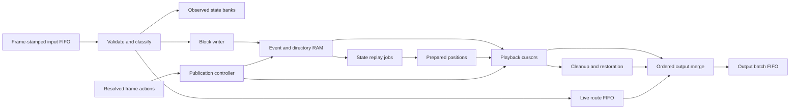

# A MIDI runtime for Rust and RTL

Status: Rust implementation accepted; P11 complete within the basic-MIDI scope.

Written 2026-11-13 against `feat/backend-replacement` at `bfe73c9a`.
The design was written against the revision above; section 18 records its Rust
implementation. This document supersedes the broad MIDI-history proposal in the
[P11 investigation](../investigations/p11-midi-state.md). The
[acceptance evidence](evidence/midi-rtl-runtime.md) records the verified
implementation, platform CI, intentional exclusions and hardware limits.

## 1. Objective and decisions

Build a small MIDI execution kernel whose Rust implementation is a practical
reference for a later register-transfer-level (RTL) implementation. Both use the
same fixed-width records, memory tables, queues, state machines, operation order
and resource limits. Hardware should replace those mechanisms directly rather
than reverse-engineer behavior from a different software algorithm.

The design chooses:

1. A four-byte message payload, matching master's storage cap.
2. Rejection of SysEx. Parameter commands are rejected by default; an optional
   live-only policy forwards them without recording or tracking their effects.
3. One authoritative engine frame counter and externally resolved loop actions.
4. Ordered event blocks, addressed through a fixed-depth directory.
5. Immutable published versions, private edits and explicit publication fences.
6. A sequential state interpreter, cached entry states and advancing writer state.
   Arbitrary-position state is prepared by bounded replay of a pinned version.
7. Fixed pools, explicit admission, bounded cleanup and reserved output recovery.

The baseline deliberately does not contain a general persistent semantic search
tree, variable-length packet allocator, runtime tree balancing, or absolute state
checkpoints after every block. Replacing an early event invalidates later absolute
checkpoints; avoiding that dependency is an important design decision.

This trades some preparation throughput and memory bandwidth for simple, explicit
execution. It does not assume that scanning a large recording can fit inside an
audio callback. Section 9 defines where replay occurs and how it is bounded.

## 2. Behavioral contract and scope

The kernel handles MIDI capture, retained input history, Grab, primitive recording
and Replace, version selection, playback, cleanup/restoration and event reads.
It integrates with the existing loop planner, mixed audio/MIDI commit authority,
service operations and file codecs. It does not add another musical clock.

The intended state semantics are the replacement's supported basic-MIDI semantics,
including pedal latches and loaded versus pending program banks. They are not an
instruction to reproduce master's simpler state tracker or its output messages.

Behavioral equality between Rust and RTL means equality of:

- accepted/rejected normalized input records and commands;
- output message bytes, frame timestamps and ordering;
- published event content, initial state, duration, cuts and revision changes;
- command outcomes and the frames at which they take effect;
- capacity refusals, incomplete captures and recovery sequences.

It does not require identical internal addresses or elapsed host CPU time.
Preparation is driven by declared work grants, so equality can include readiness
under an identical grant schedule. Matching audio waveforms, effects and device
driver timing is outside this MIDI-kernel specification.

Stored MIDI originals retain their bytes and equal-frame order. Initial state is
a canonical supported-state image, not an archive of the packets that produced
it. Synthesizer voices, envelope position, arbitrary device settings, SysEx state
and RPN/NRPN parameter values are outside the contract.

This proposal retains explicit preparation/publication, but changes the state
lookup strategy. Compatibility includes preparation latency and admission behavior;
it cannot be judged only by comparing successful playback. Section 16 identifies
the migration gates.

## 3. Message policy

### 3.1 Accepted classes

The baseline accepts complete MIDI 1.0 channel messages, statuses `80` through
`EF`, subject to their exact standard lengths and seven-bit data bytes. Note-on
with velocity zero remains byte-for-byte unchanged in storage and acts as note-off
in the state interpreter. System Reset (`FF`) is also supported.

Other system-common/realtime statuses are outside the baseline and return
`UnsupportedMessage`. Supporting MIDI Clock or transport forwarding later is a
separate advertised policy, not an implicit consequence of the four-byte cap.

The cap is a storage limit, not permission for arbitrary four-byte combinations.
Supported channel messages occupy two or three bytes. The parser rejects running
status fragments, concatenated messages, malformed data and extra trailing bytes.
Host stream receivers expand running status before this boundary.

### 3.2 SysEx

Reject messages beginning with `F0` and standalone `F7`, even if they fit in four
bytes. Refuse a message longer than four bytes before copying its payload. Never
truncate a long message into an apparently valid short one.

A raw UART receiver may discard an unsupported SysEx stream until its terminating
`F7` using a fixed parser state and bounded byte service. It must not allocate an
assembler for that stream. Its treatment of interleaved realtime bytes belongs to
the explicit host policy; it must not turn SysEx payload bytes into channel events.

### 3.3 Parameter commands

Treat the following CC numbers as one excluded family:

| CC | Meaning |
| --- | --- |
| 6, 38 | Data Entry MSB/LSB |
| 96, 97 | Data Increment/Decrement |
| 98, 99 | NRPN selection |
| 100, 101 | RPN selection |

`ParameterPolicy::Reject` is the default. Reject all members, including selectors;
do not interpret a Data Entry command as an ordinary remembered controller.
Bank Select CC0/32, ordinary controls and program changes remain supported.

An advertised `ParameterPolicy::LiveOnly` is optional. Under it:

- preserve accepted parameter packets and their ordering in the live route;
- exclude them from recording, history, Grab, state interpretation and restoration;
- count them against live input/output queue and work limits;
- report their exclusion as policy filtering, not incomplete capture;
- do not retain a parameter-history warning or synthesize selector/Data Entry
  packets during restoration.

The opt-in makes no promise about restoring externally changed parameter values.
For example, a live parameter command can change pitch-bend range while the kernel
still tracks only the wheel position. The routing policy is persisted separately
from media and changes with the route generation. A host without LiveOnly support
refuses that policy rather than silently substituting another one.

File import/load is different from live routing: a document containing excluded
messages refuses as a whole before activation. The narrowly defined legacy
canonical-prefix migration in section 14 is the only normalization exception.
Do not silently strip arbitrary saved data because the live policy would have
filtered it. A future explicit conversion tool could offer general filtering,
but is not part of this design.

## 4. Timing, ordering and the integration boundary

### 4.1 One clock

`Frame` is an unsigned 64-bit engine sample-frame coordinate. The enclosing runtime
advances it. The MIDI kernel receives frame-stamped work; no module advances a
private wall clock. Checked exhaustion faults explicitly instead of wrapping.

Media positions, cursors and directory indices are coordinates derived from that
clock and published content; they are not independent clocks. Input normalization
from native timestamps or UART arrival belongs to the host adapter.

Keep the configured engine quantum Q and the existing distinction between
Q-aligned loop actions/periods and frame-precise stored MIDI events. RTL may operate
one clock cycle or event at a time internally, but must reproduce the same logical
frame boundaries. Hardware is not permission to silently change the timing model.

### 4.2 Resolved actions

The loop resolver owns competing Play/Stop/Record/Replace/Seek requests, sync and
composite behavior. It produces at most one resolved action per loop at each
settlement boundary. The MIDI kernel validates and executes that action; it does
not invent another command-precedence policy.

The shared Rust/RTL interface includes the resolved action, logical frame,
operation sequence, expected loop/content/timing/route generations and any prepared
position token. Duplicate or contradictory resolved actions are `InvalidPlan`.
The existing resolver's same-frame arbitration must be captured in executable
test vectors before integration. Moving the resolver itself into RTL is a
separate translation of that same state machine, not a second scheduler.

### 4.3 Boundary order

At logical boundary F:

1. Finish publication of the preceding complete interval, ending at F.
2. Apply due route/control fences and the resolver's resolved actions.
3. Expose the settled content/state cut strictly before original events at F.
4. For each affected playback stream, perform cleanup, restoration, then originals
   at F, in that order. Subsequent originals retain their timestamps and order.
5. Capture accepted input in `[F, F+Q)` into private storage. Initial recording
   state excludes original input packets at F; those packets belong to the take.
6. Publish the next common completed cut only after all required members succeed.

Step 1 is the preceding tick's completion; it must not be executed twice by a
software callback adapter. A zero-length callback advances nothing. Stopping at
F excludes input at F from the old take. Starting at F includes it in the new one.

Within a source, preserve `(frame, equal_frame_order)`. Across inputs, normalize
ties using a prepared port rank and per-port sequence. Across playback/live
streams, merge by `(frame, prepared_stream_rank, stream_phase, ordinal)`; phases
are cleanup, restoration and original/live traffic. Stream ranks are explicit in
the prepared routing plan and independent of pointer values, allocation history
or hash-table iteration. There is no implied all-loops-cleanup barrier: phase
ordering is within each ranked stream. Port recovery supersedes ordinary output.

Ingress is a sealed, bounded contribution with an explicit end watermark for
each source/tick. The kernel never waits for a producer while advancing required
work. Per-port input FIFOs retain packet boundaries; a bounded head merge produces
the normalized order, without an unbounded sort. A late packet cannot be assigned
to a frame already processed: return `LateInput` and apply the source-loss policy,
rather than silently moving it to a later frame. Host buffering/lead determines
whether a contribution can arrive before its declared boundary.

## 5. Kernel structure and RTL correspondence



| Rust module | RTL equivalent |
| --- | --- |
| Message validator and policy classifier | Fixed combinational decode plus a small input FSM |
| Observed state interpreter | Addressed state RAM and bounded update sequencer |
| Event/block store | Record RAM, descriptor RAM, free-ID FIFOs and directory walker |
| Private writer | Bounded read/filter/merge/write FSM |
| Replay preparer | Sequential reader, state interpreter and job table |
| Version/publication controller | Descriptor banks, generation checks and an active-version register |
| Playback reader | Directory/event cursor and timestamp comparator |
| Restoration emitter | Fixed table traversal sequencer |
| Output merge/recovery | Bounded head comparison and separate recovery lane |
| Retirement engine | Explicit work FIFO and bounded release FSM |

Every engine operates through explicit requests and responses. The Rust reference
can execute multiple microsteps per call, but uses the same state transitions and
work grants. A memory read is not an arbitrary recursive helper that RTL must
somehow reproduce. RAM port counts, arbitration, backpressure and completion are
part of the implementation profile.

Replay preparation, allocation, version management and retirement are part of this
mapping, not unspecified work delegated to a future host CPU. They may execute on
a CPU in an initial deployment, but their finite controllers and RAM interfaces
remain specified for a standalone RTL kernel. File codecs and the enclosing loop
resolver remain outside this MIDI kernel's boundary.

## 6. Fixed records and prepared memory

### 6.1 Event record

Use a 128-bit canonical record. A slightly larger regular record is preferred to
packing CPU-specific fields or overloading an unused payload byte.

| Byte offset | Width | Field |
| --- | --- | --- |
| 0 | 64 bits | Frame in the owning media coordinate space |
| 8 | 32 bits | Message bytes, maximum four; unused bytes zero |
| 12 | 8 bits | Actual message length |
| 13 | 8 bits | Reserved, zero |
| 14 | 16 bits | Equal-frame order within that stream |

Specify byte encoding explicitly as little endian. Rust struct layout is not a
wire or RAM ABI. Four payload bytes do not include the timestamp or length field.
The profile bounds per-frame event count below order-field exhaustion. Overflow
refuses the whole contribution; order numbers never wrap or alias.

Input history uses engine-frame coordinates. Imported media can start at zero.
A view supplies an origin and extent, allowing Grab to share records while
rebasing the logical view. No timestamp rewrite of the whole history is required.

### 6.2 Blocks, tiles and directory

- An event page holds P fixed records and a bounded header. P is fixed by profile.
- A time tile covers T raw frames, with T a multiple of Q and at least Q.
- A tile descriptor contains its full tile coordinate, event count, page count
  and an array of at most C page IDs. Its records are sorted and packed.
- A directory maps a tile coordinate to a tile descriptor. Use a fixed radix of
  16 and a profile-fixed depth L: a page table, not a balanced search tree.
- Directory page entries contain numeric child IDs. There are no rotations,
  dynamically chosen tree depths, variable-length bodies or payload chains.

A lookup performs at most L directory reads plus a tile/page access. A sequential
cursor caches those positions. Empty tiles contain no event pages. The directory
uses the low profile-defined tile bits; a full coordinate tag detects stale slot
reuse. A single view must fit the configured directory span, including unaligned
edge tiles. Admission checks that its first and last visible tiles cannot collide.

P, C, T and L are capacity parameters, not musical policies. Imports and live
writers validate tile density as well as total event count. A profile must cover
its advertised per-tick density across tile boundaries; using smaller tiles is
not permission to silently reduce supported desktop density.

### 6.3 Pools and identities

Prepare finite arrays for event pages, tile descriptors, directory pages, versions,
state banks, readers, writers, jobs, output batches and retirement work. Allocate
from explicit free-ID FIFOs. Internal owned references use indices; externally
held tokens include slot and generation. Generations and reference counts use
checked fixed widths, with exhaustion distinct from temporary capacity refusal.

The baseline Rust kernel performs no heap allocation, deallocation, locking,
unbounded sorting or implicit reference-count destruction during rendering.
Leaving a scope does not recursively free a published version.

## 7. Published versions and private edits

A version descriptor identifies a directory root, media coordinate origin/extent,
canonical initial-state bank, revision and complete-cut metadata. Window/timing
information is version-fenced and remains distinct from the raw event extent.

Published descriptors and their reachable storage are immutable. Playback,
duplication, Grab and export retain versions explicitly. Retaining an existing
version does not copy its records. A writer has a private candidate root.

When an edit touches a tile, copy the bounded directory path and tile descriptor
as needed, then stream that tile into new pages. The merge removes old records
in the half-open replaced range and inserts the accepted replacement records.
Unchanged records preserve bytes/order. Empty positive replacement erases events.
No cleanup or restoration packets are inserted into stored media.

The simple baseline rebuilds touched tiles rather than optimizing partial-page
sharing within a tile. Work is bounded by the maximum tile density, not the
duration of the recording. Unchanged tiles remain shared. A wrapping interval is
split into ordered nonwrapping intervals; raw offsets can add edge tiles, so
admission counts every touched tile rather than assuming one tile per tick.

Publishing changes an active descriptor reference at a defined frame. In mixed
audio/MIDI use, the existing commit authority installs the complete pair after
both media have passed preflight. No consumer can observe new MIDI with old audio
as a supposedly common completed capture. Packet writes and state-bank updates
remain private until this point.

Copies/exports keep their original descriptor even if the source is replaced,
cleared or removed. A failed private edit leaves the preceding complete version
available. This does not introduce rollback for service operations whose existing
contract has already committed another mutation, such as cross-kind clear/copy.

### 7.1 Writer and transaction lifecycle

The writer lifecycle is `Free -> Prepared -> Armed -> Active -> Frozen`, followed
by explicit release/retirement. Prepared means that resources and initial entry
state are ready; it does not mean that future live input already exists. Armed
binds a reserved activation frame. Cancellation before activation retires private
owners without replacing current content. Active capture ends only at a complete
committed interval or a reported incomplete boundary.

Each write interval has its own transaction:

| Phase | Rule |
| --- | --- |
| Reserve | Reserve peak page/table/state/output/result/retirement ownership before promising the interval |
| Stage | Build private event pages, directory changes and matching frontier/state banks |
| Validate | Check expected versions, timing/route generations, complete input and all paired members |
| Commit | Install the prepared descriptor set and common cut through one publication authority |
| Settle | Deliver the pre-reserved terminal result and enqueue old ownership for bounded retirement |

Commit has no remaining fallible allocation or unreserved result delivery. An RTL
implementation may write descriptor RAM over several cycles, but readers switch
only after the final commit-valid/epoch change. Until then all readers use the old
set. The Rust implementation uses the equivalent explicit publication point.

Command admission and terminal completion are distinct. Cancellation cannot undo
a committed interval, and an uncertain external outcome is reconciled using its
operation identity rather than resubmitting the mutation. Storage publication is
not an atomic transaction with sound already delivered to a physical device;
capture failure does not roll back unrelated playback or observed input.

## 8. Canonical basic-MIDI state

Use fixed tables with explicit known/unknown representation:

| State | Representation and meaning |
| --- | --- |
| Notes | Per channel/key: sounding velocity, physically held flag, sostenuto latch and poly pressure |
| Controls | Per channel/CC: latest known value; excluded parameter CCs are always absent |
| Program | Known/unknown program plus the bank observed when that program was selected |
| Pending bank | Current CC0/32, which may differ from the program's loaded bank |
| Pitch bend | Full 14-bit value and the declared baseline |
| Pressure | Known/unknown channel pressure and per-key pressure, including known zero |
| Modes and resets | Latest applicable omni and mono/poly mode; reset markers and their defined effects |

A straightforward state RAM encoding uses four bytes per key, one byte per CC
with 128 meaning unknown, a 16-byte channel header, and a 16-byte global header.
That is `16 * (128*4 + 128 + 16) + 16 = 10,512` bytes per bank. The header encoding
must reserve an explicit pitch-known flag for fault handling. This is a proposed
canonical layout, not a measurement of today's Rust type. State-pool capacity
counts every observed, initial, writer, reader and preparation bank.

One sequential interpreter is authoritative for recording, replay preparation,
input-history advancement and playback state. It implements:

- note-on/off, including zero-velocity note-on semantics and latest velocity for
  repeated note-on of one key;
- sustain, Hold2 and the actual subset latched by a sostenuto rising edge;
- ordinary controls, bank/program relationships, bend and pressure;
- All Notes Off, All Sound Off, Reset All Controllers and System Reset, with the
  replacement's documented reset-retention and mode-exclusion rules.

Repeated note-ons are not a per-voice synthesizer model. Unknown controls are not
invented. Normal initial state has inactive notes, neutral bend and released
holds; other unknown fields stay unknown. A known reset establishes only its
specified baseline. System Reset is device-global; the kernel does not promise
isolation between unrelated streams routed to the same device.

State operations that touch many keys/controllers are explicit bounded substeps
over the fixed tables, or equivalent fixed-width mask operations. Neither Rust
nor RTL hides an uncharged 128-key scan inside an allegedly one-cycle CC update.
The largest update cost participates in work admission.

## 9. Bounded state lookup without suffix checkpoints

### 9.1 Entry caches

A playable version carries a prepared state/cursor for its configured playback
entry. This includes the raw window and preplay entry when applicable. Ordinary
start and wrap use that cache. A timing/window change requires a new prepared
entry bound to the new timing generation before activation.

### 9.2 Arbitrary-position preparation

`PreparePosition(version, target)` pins an immutable version, initializes a working
state bank from its initial state, and sequentially applies visible records
strictly before the target. It returns a state bank and cursor whose next original
is at or after the target. It never consumes originals at the target frame.

Replay is deliberately linear in the visible prefix. It is bounded by advertised
`N_max` events and `D_max` directory/tile visits, plus fixed state initialization
and per-message update bounds. The job reports Building, Ready or Failed and
advances only through explicit work grants. Empty time is skipped by directory
traversal; it is not replayed frame by frame.

The design does not call this constant-time seeking. The benefit is simple
hardware and no suffix-checkpoint repair; the cost is bounded preparation latency
and memory bandwidth. A long recording can take more grants to prepare than a
short one. This is visible before mutation admission.

A seek/select may execute at frame F only with a matching ready token. The token
binds version, target, window/timing and routing generations. Acceptance reserves
execution and output resources for F. Stale content or an unready token refuses;
an accepted frame is never silently moved later. A profile may offer an immediate
path only if it reserves the entire worst-case preparation before that deadline.
An adapter can expose asynchronous preparation, but cannot report an acknowledged
immediate seek as applied while still preparing it.

### 9.3 Continuous writer frontier

Continuous Record/Replace does not run a prefix replay on every tick:

1. Before activation, prepare state at the writer's first raw position.
2. Retain that state as the writer frontier: state of the candidate's prefix
   strictly before the next contiguous write position.
3. Erase the next replaced interval, append its new originals, and apply only
   those new originals to the frontier. Removed originals do not affect it.
4. Publish the complete new version and its corresponding frontier together.
5. On a normal cyclic return to the entry, use the prepared entry state. Refresh
   raw-zero initial state from pre-input observed state when the recording
   contract requires it, then apply originals at zero exactly once.

The invariant is checked against a linear interpretation of the published
version. Raw coordinates, logical wrap and input-clock position remain separate;
a nonzero raw start does not accidentally refresh raw-zero state. Growing writers
continue their frontier instead of wrapping. Stop/freeze and return to playback
at that frontier need no suffix rebuild or whole-history copy.

Noncontiguous edits, a changed window, or selection at another raw position need
a separately prepared position. A concurrent reader at another position must
have its own valid state/cursor or reserve preparation for the new version before
switching. It may continue reading its old immutable version meanwhile. The
implementation must not silently reuse a frontier belonging to another position.

This deliberately limits the fast path to sequential writers. It is the reason
that eliminating the prior semantic index need not make continuous Replace
rebuild the unchanged suffix. A compatibility test must exercise each actual
Record/Replace/monitoring transition; an unsupported transition is a migration
blocker, not permission to delay a required completed cut.

## 10. Recording, rolling history and Grab

The observed state interpreter sees every accepted managed input packet once,
before storage admission. Policy-excluded live-only packets never enter it.
Storage pressure does not roll the observed bank back.

An active capture reserves its writer, private workspace, initial-state bank,
required publication slots and future tick credits before activation. Each tick
stages a complete bounded contribution. The common coordinator commits all
required audio/MIDI members at the end boundary or preserves the prior complete
cut. A take cannot contain a successful interval after an unreported missing one.

History retains complete time tiles and explicit boundary views. Eviction
advances its canonical initial state by applying the discarded originals before
dropping their visibility. That work and any partial-edge tile copy have separate
reserved bounds. Long input gaps start a new history segment rather than forcing
an unbounded eviction pass during a required tick. Existing retained views keep
their old records/state while retirement proceeds.

Grab pins the requested completed window, prepares its strict-before-start state,
and publishes a rebased view with that state. A clipped view never exposes hidden
records when later extended or edited; reads and writes enforce its visibility
bounds even if an edge tile physically contains additional records. A boundary at
F excludes F from initial state and includes originals at F in the grabbed content.

Storage exhaustion freezes a truthful incomplete prefix, reports its frame and
reason, and follows the existing planner's stop/monitoring outcome. It does not
silently drop events and keep calling the take complete. Resuming capture after a
gap requires a new segment and valid observed state.

Transport loss is stronger than storage refusal: the interpreter may never have
seen the missing message. Mark affected source state/coverage invalid and require
the host's explicit reset/rebind baseline before claiming complete state again.
Recovery note-offs alone do not prove that a lost controller value was restored.

## 11. Playback and restoration

A playback reader owns a version, directory/event cursor and intended output
state. Sequential playback reads records in order and updates that state. A
prepared version switch either supplies an exact matching continuation cursor or
causes an explicit discontinuity; cursor equality is not inferred from addresses.

At a discontinuity, emit:

1. Cleanup of the old projected held/sounding notes and active hold pedals.
2. A recorded System Reset marker where required, then channel reset markers.
3. The bank used to load the program, the program, and later pending bank values.
4. Known ordinary controls and current supported channel modes, then bend and
   channel pressure. Never synthesize excluded parameter CCs.
5. Sustain/Hold2 and the note/sostenuto sequence needed to reproduce the latched
   subset. Release physically released pedal-held keys after retriggering them.
6. Known per-key pressure and the original destination-frame packets.

Use stable channel, controller and key traversal order. Retain the existing
tested cleanup/program/pedal behavior except for the explicitly excluded parameter
emissions. Sounding notes are retriggered; synth envelopes are not resumed.

Traversal and emitted-event maxima are finite functions of 16 channels and 128
keys/controllers, not a configurable truncation quota. Keep conservative existing
cleanup/restoration bounds until tighter bounds are independently proven. Reserve
capacity for complete cleanup, restoration, ordinary playback, live routes and
recovery across every simultaneous stream and actual host egress.

The intended state is not an acknowledgement from an external synthesizer.
Device failures and shared-channel/key interference remain explicit integration
limits; they are not solved by the fixed-record representation.

## 12. Admission, work budgets and memory service

### 12.1 Profile

An advertised profile specifies at least:

| Bound | Purpose |
| --- | --- |
| Q, sample rate, loop/source/port counts | Engine timing and concurrency |
| P, T, C, L and maximum visible tile span | Block shape and bounded directory depth |
| N_max and per-tick/per-frame event limits | Replay, density, staging and order width |
| Page/tile/directory/version/state pool sizes | All retained and private ownership |
| Active writer/read/job limits | Concurrent work and preparation slots |
| Directory reads, record visits, state operations and copies per grant | Explicit engine work accounting |
| Required write/publication/eviction service and retirement service | Sustained operation, separately from optional jobs |
| Output events/bytes/batches and reserved recovery capacity | Complete logical output and backpressure |
| RAM word width, ports, latency and arbitration | RTL implementation of each abstract step |

The profile distinguishes event-memory capacity from state-lookup throughput.
A recording fitting RAM does not imply that arbitrary seeks can execute without
preparation. Likewise, preparing an arbitrarily large future action queue does
not create enough output or memory service to execute it.

### 12.2 Required versus preparatory work

Required playback, accepted capture, commit and reserved cleanup/recovery have
protected service. Imports, replay preparation and read-only transfers receive
separate grants. Background work cannot spend an active writer's credits.

Work is charged in fixed primitives: directory/page reads and writes, event
visits, state-RAM operations, queue transfers and ownership decrements. Large
message effects, page copies and state-bank copies decompose into those steps.
The scheduler is deterministic, with fixed priority for required lanes and
round-robin progression among eligible preparation jobs. New required obligations
cannot steal service already promised to an accepted action.

For a tick, conservative bounds include:

```text
write_work <= touched_tiles *
              (bounded_directory_copy + old_tile_visit + new_tile_write)
              + input_state_work + frontier_state_work

position_prepare_work <= bounded_directory_walk
                         + N_max * max_event_apply_work
                         + state_bank_initialization

output_work <= complete_cleanup + complete_restore
               + admitted_originals + live_forwarding + recovery_allowance
```

All terms are evaluated against the profile, active writers/readers and pinned
versions. A deployment must prove sufficient memory arbitration and service for
its admitted required workload. Q=1 or a large loop count can demand a different
profile; this document does not certify any clock rate or FPGA resource budget.

Rust must run the same finite step engines, not substitute an unlimited desktop
scan for an unfinished job. Optional job progress follows explicit grants rather
than incidental wall-clock speed or OS thread scheduling.

### 12.3 Sustained memory ownership

Admission counts old exports, candidate roots, touched directory paths, rebuilt
tiles, state banks, reserved output and retirement debt simultaneously. Expected
future reclamation is not free capacity. Reserve peak edit workspace before
publishing promises, including the worst edge/wrap tile count.

Ending a writer releases its future-write reservation only after outstanding
work settles; retained completed versions remain charged. A finite pool cannot
promise unlimited new recordings while a reader pins every old version. Refusal
in that situation is part of the advertised contract.

## 13. Failures, retirement and recovery

| Condition | Required behavior |
| --- | --- |
| Unsupported/malformed packet | Reject whole packet with class/reason; never truncate or reinterpret it |
| File contains excluded packets | Refuse the candidate before activation; preserve existing content |
| Preparation lacks capacity | Return Capacity/Building as appropriate; keep mutation unaccepted |
| Ready token has stale identity | Refuse Stale; do not retarget or replay automatically |
| Live storage cannot commit the complete tick | Preserve the preceding common cut; report incomplete capture/history |
| Output cannot retain a promised complete batch | Fault the affected port and enter reserved recovery; no partial restoration success |
| Input transport loses events | Invalidate affected source coverage/state; report loss and recovery boundary |
| Generation/frame/reference arithmetic exhausts | Explicit Exhausted; never wrap into another live owner |

Dropping a retained version enqueues bounded release work. The retirement FSM
decrements references and visits directory children/page lists through explicit
cursors. It does not recursively release an entire recording in one step.
Preallocated retirement slots cover the maximum owned objects; queue saturation
cannot force a heap free or block required rendering. Retirement receives a
required maintenance allowance even when optional transfer work is disabled.

Output reserves whole logical batches before publication, with a separate
recovery lane. The recovery sequence is CC120 then CC123 for each channel 0–15.
A full downstream sink leaves the recovery head pending; only acceptance advances
it. Never restart the sequence or skip a refused packet. Ordinary traffic on the
affected port is fenced until recovery completes; engine time and unrelated
ports/audio can continue under the enclosing runtime's fault policy.

Logical engine output timestamps and physical UART serialization are different
boundaries. Rust/RTL equality compares the same logical batches and supplied
downstream acceptance trace. A host must also state its wire-bandwidth, late-send
and queue-overflow behavior. Putting many same-frame events in a FIFO cannot make
a serial cable transmit them simultaneously or hide an egress drop.

## 14. External interfaces and file compatibility

The core exposes typed operations for policy/profile setup, version retain/release,
input tick staging, writer preparation, position preparation, resolved actions,
publication, event reads and status. A prepared action carries expected identities
and sufficient ready/output ownership; paths and codecs never enter it.

Native typed commands and encoded carriers must describe the same operations.
An RTL register/FIFO interface carries their fixed-width equivalents, with
request/result sequences and generation fences. Existing app-level operations can
remain asynchronous while the adapter stages these lower-level jobs.

Read/export uses an event cursor or bounded event batches. Existing variable-length
file and transport encodings can be generated at an adapter boundary from fixed
records; they need not dictate internal RAM layout. If the existing byte-offset
bulk API is retained, the adapter prepares a charged offset index or sequential
streaming view. It must not rescan the whole recording for every requested chunk.

Persist canonical initial state with an explicit state-format version. Supported
old initial-message vectors can be interpreted in order into that state. Preserve
known/unknown values, bank/program relationships and pedal latches. If a new state
encoding cannot be expressed by the existing file schema, version the schema;
do not depend on a particular Rust struct layout or silently discard fields.

Legacy canonical-state prefixes may contain protective selector-null CC98–101
packets even when no parameter value was used. A versioned migration may normalize
those prefix-only encoder artifacts if every selector component is 127 and there
are no Data Entry or relative parameter commands. Report this normalization in
conversion metadata. This exception never filters timeline messages, accepts
non-null parameter selection, or reconstructs parameter values. Tests must cover
old basic-MIDI files containing Reset All Controllers, which can produce this
scaffolding in the old canonical encoder.

Exact files preserve supported timeline packets, frames, stable order and supported
canonical state. SMF conversion separately reports timing, prefix-state and packet
representation loss. Unsupported old SysEx/parameter-bearing documents refuse
before mutation rather than being advertised as compatible basic-MIDI content.

## 15. Rust implementation discipline and verification

Use fixed-width integer fields, indexed memory arrays and enums with documented
encodings. Use explicit FSM state records and iterative directory walkers of
maximum depth L. Keep data path, memory service, resource arbitration and semantic
state interpretation separately testable. Generic helpers must not hide dynamic
allocation, recursion, unbounded iteration or destructor-driven reclamation.

The same memory-service model can initially use arrays in Rust, then model RAM
latency/backpressure before RTL exists. Its grants, handshakes and module state
are observable for differential testing. A faster implementation is permitted
only if its externally visible readiness and admitted work obey the same profile.

An independent simple oracle interprets accepted event lists sequentially and
copies complete versions freely. It specifies results without reproducing the
block store, directory or frontier algorithm.

Required tests include:

- policy classification, including short SysEx, every parameter CC, strict message
  lengths, LiveOnly exclusion and whole-document refusal;
- all boundary ties: initial state excludes F, originals at F occur once, Stop
  versus input, wrap, preplay, revision switch and simultaneous ranked streams;
- ordinary CC, bank/program/pending-bank, pitch, pressure, repeated notes,
  sustain/sostenuto/Hold2, modes and resets against independent state machines;
- old/edited/Grab/duplicated versions held simultaneously through clear, slot
  reuse, cancellation, directory wrap, clipping and complete retirement;
- dense early-tile Replace followed by a long unchanged suffix, repeated cyclic
  Replace, recording continuation, empty erasure and every mode-exit cut;
- frontier-versus-linear-state equality at every completed writer boundary;
- preparation at the maximum supported prefix and sparse directory extent, with
  exactly bounded grants, stale ready tokens and output reservations;
- simultaneous writers, retained exports and imports under pool/retirement
  pressure, including paired audio/MIDI publication failure;
- full/refusing output and recovery sinks; no hidden event drop, retry duplication,
  partial-restore success, allocator activity or arithmetic wrap;
- native typed/encoded and actual AudioWorklet application flows, offered firmware
  profiles, public files and accepted-operation recovery.

For RTL, replay identical normalized inputs, resolved actions, grants and memory/
output handshakes against both implementations. Compare complete output and
publication traces, including unsuccessful outcomes. Add assertions for immutable
published RAM, reference conservation, no access after generation reuse, monotonically
advancing cuts and recovery precedence. Logical parity and timing closure are
separate acceptance gates.

## 16. Integration and feasibility gates

This is a proposed replacement of MIDI storage/state access, not a rewrite of the
service, loop resolver, UI or whole audio engine.

| Component | Expected responsibility |
| --- | --- |
| `rt_runtime` | Fixed records, directory/block/state pools, writers/frontiers, replay jobs, readers, retirement and work accounting |
| `shoop_loops` | Ready-position integration, entry caches, basic-state restoration, source/window mapping and complete-cut coordination |
| `shoop_rt_engine` | Profile preparation, resource/output admission and common publication authority |
| Protocol/backend adapters | Versioned job/token transfer, bounded event/byte conversion, consistent validation and preparation outcomes |
| Host adapters | Four-byte policy, ordered ingress/egress, transport-loss reporting and actual output capacity |
| Session/codecs/client | Canonical state migration, unsupported-content refusal, file loss reporting and useful pending/error states |

Before enabling the new store:

1. Freeze the supported message/state/timing contract and the shared trace format.
2. Prototype the fixed-record store and sequential writer frontier against the
   independent oracle, including nonzero raw windows and monitored transitions.
3. Measure the existing supported desktop event density, long recordings,
   simultaneous writers and retained-export workloads against proposed memory
   profiles. Do not silently lower existing desktop density to make the design fit.
4. Prove that every required live transition has prepared state without a suffix
   rebuild or delayed completed cut. Any transition requiring an additional cache
   or reserved job must be accounted for explicitly before activation.
5. Validate preparation latency/capacity changes through public operation semantics,
   then typed/encoded/native/browser integration and file compatibility.
6. Produce an RTL-style cycle/memory model using concrete port counts and grants.
   Check resource estimates, service bounds and the Rust/RTL trace oracle before
   claiming that the architecture meets a particular FPGA clock/sample-rate target.

The principal feasibility risks are touched-tile bandwidth, state-bank memory,
arbitrary-seek preparation latency and peak retained ownership. They are explicit
costs of this design, not reasons to hide scans, silently skip MIDI, or defer an
already accepted musical action. If the measured profile cannot preserve required
behavior, revise the representation or provide an explicitly approved capacity
contract before adoption.

## 17. Relation to the existing implementations

Master provides the useful model of short inline messages and simple sequential
state interpretation. It also has off-thread snapshot publication; immutable
exports are not a new capability exclusive to the replacement.

The replacement provides the useful model of one timing authority, explicit
prepared ownership, immutable cuts, paired publication, finite admission and
failure recovery. Its prior continuous semantic index solved a real problem:
early edits invalidate later absolute checkpoints. See
[the existing writer-index rationale](midi-writer-index.md) and
[the shared-history contract](../../src/rust/shoop_loops/docs/shared-history.md).

This design replaces that index with fixed-depth block addressing, sequential
writer frontiers and explicitly prepared arbitrary-position replay. It does not
claim the same random-seek throughput. That tradeoff is intentional: the software
and future RTL should perform the same finite, understandable work, with their
limits and readiness visible at the command boundary.

## 18. Rust implementation

The production engine uses this store through `resource::indexed_midi`. The
historical API name remains for callers; the packet slab and persistent semantic
state tree have been removed. File upload/read staging retains its existing byte
encoding and read offsets. These are adapter formats, not the editable runtime's
representation. The older standalone shared-MIDI utility API remains covered by
tests; the application's live sources and continuous writers select the new store.

### 18.1 Data path and ownership

`shoop_midi_protocol` is the common allocation-free classifier used by runtime,
application and processor protocols and browser MIDI. Production selects the
reject-parameter policy. The optional LiveOnly classifier has no advertised host
setting. It cannot construct a managed event or mutate supported state.

An event has the section 4 sixteen-byte encoding: little-endian frame, four inline
payload bytes, length, zero flags and a sixteen-bit equal-frame ordinal. Each page
contains 32 records. The directory is radix sixteen with sixteen levels over a
64-bit tile coordinate. Production tiles span two quanta. A quantum edit touches
at most two tiles; the per-tile record allowance includes shifted raw windows and
the permitted density across intersecting raw buckets. Reads use fixed-depth
directory traversal and binary search inside the bounded sorted tile.

`BlockLimits` declares independent event credits, record pages, directories,
version leases, media/state-cache banks and borrowed import-base slots. Physical
page counts and logical event credits are separate. Desktop sizing retains the
previous event limits and reserves one page per credit to cover sparse layouts;
dense pages use fewer physical pages. This is intentionally conservative and can
cost more memory than packed packet storage. `capacity()` and prepared/allocated
byte accounting include all pools, including edit scratch and state banks.

Published roots are immutable. Clipping makes a read-only view; normalization
prunes complete directory branches and copies at most two boundary tiles before
extension. Retained exports keep their old roots. Retirement drains by explicit
grants; logical credits are not reused ahead of physical reclamation. Scope and
generation fences reject stale job/version handles. Resource or density refusal
leaves the previously published media intact.

### 18.2 State and preparation

The basic-state interpreter has 4,225 addressable cells. `BasicUpdate` advances
large reset/pedal/mode changes one cell per step. State copy and projection also
have stepped forms. Native `MidiState` is a typed in-memory bank, not the proposed
10,512-byte wire/RAM layout in section 8. No native struct is persisted or sent as
a raw hardware record. Files retain canonical initial-message vectors; the
versioned prefix decoder defines their supported semantics independently of Rust
layout. A future RTL bank encoding must preserve these cells and known flags.

`PositionJobs` pins an immutable root and executes Copy → Read → Apply → Ready.
Target-frame originals remain unread. Each media cache has a cold preparation
bank, a separately warmed playback bank and two prepared entry banks. Warming a
reader cannot change an in-progress cold job. Entry reuse checks identity and the
unchanged prefix. Read-only `midi_seek` never starts replay: a cold query returns
Busy until explicitly prepared.

The same prepared pool holds each media owner's initial and frontier banks.
Media, writer and Grab descriptors carry bank indices and small metadata; moving
ownership does not copy a full state bank through nested calls. Rust still uses
bounded temporary state values at interpreter/snapshot boundaries. The firmware
budgets 512 KiB per control/render task inside its existing RTOS heap; native
callback and small-stack startup acceptance verify those paths separately.

Background Grab jobs share finite grants with private edits. They pin the exact
requested source cut and prepare both start and end states before publication;
later history eviction does not change their result. Immediate input transactions
obtain a checked complete replay grant before entering the resolver. Discontinuous
playback positions and window/preplay entries are prepared during preflight,
before mutation. The conservative full grant is
`(4,225 + 1) * event_count + 4,225 + 2` interpreter steps. Sparse time is skipped.
This bounds work but is linear in prefix events; it is not a fixed-duration seek
or a hardware deadline guarantee. Embedded profiles must budget this path or use
asynchronous preparation before accepting a musical deadline.

Writers keep separate current and pending roots/state banks. An interval declares
all spans, including a wrap, and publishes only after every span completes.
Contiguous ticks advance the frontier using new input, without rebuilding suffix
state. A failed interval freezes the writer at its last complete cut. Private
patch jobs use prepared scratch, skip empty directory regions, support cancellation
and publish a finished candidate atomically. The loop planner remains the sole
frame/action authority and coordinates paired audio/MIDI cuts.

### 18.3 Boundaries and failures

All buffers and host bridges enforce the same complete-message policy. MIDI loss
is distinct from a rejected unsupported message: losing accepted managed input
invalidates the source baseline. Histories and captures keep their last complete
cut and refuse further stateful continuation until a fresh host baseline. Other
audio keeps running. Cleanup is announced once rather than becoming newly
recorded input on every lost tick.

Native egress sizes its queue from the complete prepared output batch plus the
reserved reset. A batch that cannot fit is refused as a whole. An interrupted
producer is fenced by an epoch. Recovery retries the same reset head until the
device accepts it, discards stale ordinary traffic and only then resumes. The
direct JACK writer and the worklet use equivalent persistent recovery cursors.
The firmware USB adapter preflights its fixed transport queue, observes input
recovery epochs and establishes a new baseline only on device-generation change.
Frontend Web MIDI also retries device-send failures rather than consuming the
failed reset head. Shutdown confirmation requires the host's actual completion.
JACK repeats the shutdown reset in a silent callback after cleanup and retries
shutdown xruns before waiting for completed graph cycles. Global xruns during
ordinary playback do not suppress each following MIDI batch. Native Lua device
control ports use the same short-message classifier as browser controls; their
larger script-command envelope does not advertise longer device messages.

The worklet MIDI lane has a separate zero-length transport-loss descriptor; it is
never a zero-length MIDI event. JavaScript ingress retains at most twice the
configured lane byte capacity and 64 queued chunks. Overflow clears the
interrupted stream and explicitly fences all affected input baselines. Output
lane sizing includes complete prepared batches; explicitly smaller profiles use
the reserved recovery state across quanta.

Legacy prefix version 0 may normalize only CC98–101 with value 127. Meaningful
selectors, Data Entry, relative parameter operations and unsupported timeline
messages refuse the complete document, even if followed by a reset. Successful
normalization reports version 0 → 1 and the removed artifact count through native
and browser codec workers to the completed import result. New prefixes use the
strict basic policy. Exact supported timeline bytes/order and canonical state
remain preserved. SMF's separate representation-loss report remains applicable.

### 18.4 Verification and RTL handoff

The executable reference consists of the fixed record encoder, block-store
operations, `BasicUpdate`, `PositionJobs`, `WriterSet` and acknowledged reset
cursor. Test inputs can drive identical normalized records, interval declarations,
grants and output acknowledgements through these modules. Compare event bytes and
ordering, published roots' visible contents, initial/frontier state, complete cuts,
readiness, refusals and recovery heads; allocator addresses are not trace fields.
Counters expose directory/record reads and writes, state cells, copies and
retirement. Checked counters report saturation instead of wrapping.

Independent packet-list/state oracles cover the store, writers and application
flows. Tests retain old versions, replace early tiles with a long suffix, cross
raw-window/wrap boundaries, pin Grab across eviction, force capacity refusal and
output backpressure, and guard callback allocation/destruction. Existing native
typed/socket/shared-memory and actual AudioWorklet acceptance cover integration.
The final evidence record identifies the tested revision and commands.

No synthesizable RTL, concrete RAM-port arbiter or FPGA timing target is delivered
by this Rust change. Section 16's cycle/port feasibility gate applies before such
a target is claimed. The logical work counters must be expanded into RAM requests
with explicit latency and backpressure for that gate; an interpreter grant is not
assumed to equal one clock cycle.
