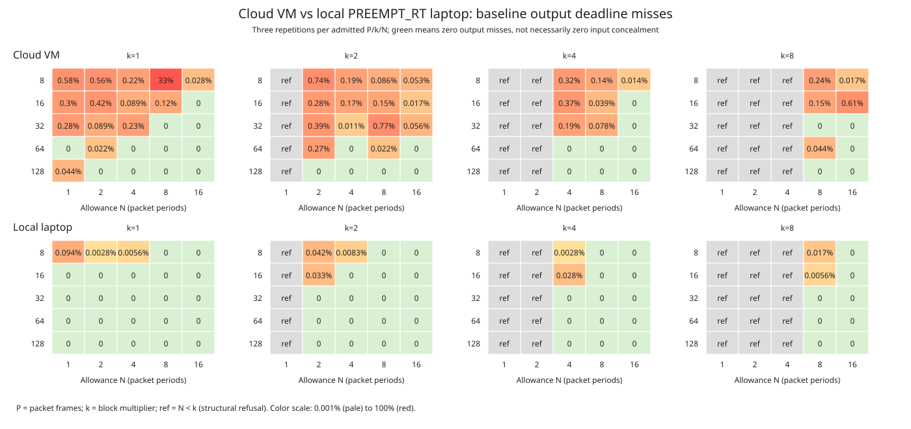

# Remote DSP: local PREEMPT_RT laptop versus cloud VM

## Summary

The experiments were reproduced on **2026-11-03**, using the checked-out
`feat/network-dsp-host` revision `ec4b52ec2de23b60714eadb8ebf1be69834dd3e0`.
The sequential measurement campaign ran from **12:19:53 to 13:28:07 UTC**.
The [original sweep](localhost-results.md), [cloud scheduling report](tuning-results.md)
and their evidence have been preserved unchanged.

**This laptop performed substantially better, but ordinary scheduling still did
not provide uniformly uninterrupted audio.** The newly available **FIFO and
round-robin priority-1 conditions had zero output misses, input concealments,
source skips or retirements in all 64 runs**, including all sixteen 60-second
runs. These are promising finite observations, not a hard real-time guarantee.

Across the complete local campaign:

- **547 records: 516 measured runs and 31 expected configuration refusals.**
- **12,715,748 measured packet slots.**
- **366,303,744 independently verified received audio samples, zero mismatches
  and zero unverified samples.** Verification includes diagnostically late audio;
  it does not imply that every presentation slot received usable audio in time.
- **317 late responses, 5,536 missing responses, 264 concealed input packets,
  and one retired stream.** Missing responses all belong to one short
  ordinary-priority pinned/spinning run; its failure is retained below.
- All case/coverage, packet-count, sample-count, histogram, quantile-bin,
  concealment-mask, affinity and scheduling audits passed. Report regeneration
  preserved each archive's decompressed payload byte for byte.

See the [complete comparison tables](local-evidence/comparison-tables.md),
[machine-readable audit](local-evidence/audit.json), and per-campaign evidence
linked below. Results from different configurations must not be compared only
through aggregate totals.

## Host and build differences

| Property | Original cloud environment | This system |
| --- | --- | --- |
| CPU reported | AMD EPYC 7763 | AMD Ryzen AI 7 350 with Radeon 860M |
| CPU access | Five allowed virtual CPUs; four-CPU cgroup quota | 16 allowed logical CPUs, eight physical cores, SMT |
| Memory | 16 GiB cgroup limit | About 61 GiB host RAM; no memory limit exposed in this session's cgroup view |
| Kernel | Linux 6.18.57 | NixOS Linux 7.0.3, reporting `SMP PREEMPT_RT` |
| Affinity for pinned conditions | Requester CPU 1, server CPU 2 | Requester CPU 2, server CPU 4 |
| Pinned CPU topology | Separate reported cores | Separate physical cores, both reporting 5090.91 MHz maximum; SMT siblings 10 and 12 not reserved |
| Power policy | Not recorded | AC connected; `performance` governor and platform profile; active AMD P-state |
| Rust | 1.99.1 | 1.97.1 from repository Nix flake |
| Python / glibc | 3.12.14 / 2.41 | 3.14.7 / 2.42 |
| Build | Release, `RUSTFLAGS=-D warnings` | Release, empty `RUSTFLAGS`, no Carla feature for timing experiments |
| FIFO / RR priority 1 | Permission denied | Permitted and verified |
| Niceness −10 | Permission denied; actual nice remained 0 | Still denied; actual nice remained 0 |

This is a **cross-environment reproduction**, not an experiment isolating the
causal effect of PREEMPT_RT, CPU architecture, virtualization, or compiler version.
The laptop remained a shared system, without CPU isolation, exclusive SMT-core
reservation, NIC tuning, or system-wide changes. No builds or test campaigns were
launched concurrently with measurements. Background host activity was not removed.

The local binary SHA-256 is
`d799a5b273203068f06b5eb6f9c9fd340d3e7fc9a2dd2e8779b893e4b659a186`.
The DSP-host source has no changes relative to the frozen cloud tuning revision
`e21ca5ee`; the original sweep predates the polling/service-gap instrumentation.
No Rust source was changed for this reproduction. Pre-existing `.pi` worktree
changes and the added experiment scripts are recorded in the manifests; the
measurement executable was built from the checked-out Rust source.

Full inventory, CPU topology, limits, power settings, script identities and
commands are in [campaign.json](local-evidence/campaign.json) and the individual
manifests. The session's read-only cgroup view did not expose `cpu.max` or
`memory.max`; this is not proof that all ancestor limits were absent. Recorded
`cpu.stat` deltas showed zero quota-throttled periods and include unrelated host
tasks. They do not establish absence of all scheduling interference.

## What was reproduced and added

All timings use separate native requester and server processes, localhost UDP
audio and authenticated TCP control, delay-copy DSP, 48 kHz, stereo unless noted,
1500-byte MTU, and 64-packet reorder allowance. The input-gap timeout is 200 us
except for the explicitly named 1000 us condition. Negotiated socket send/receive
buffers were 2,097,152 bytes on both processes.

| Campaign | Local coverage | Records |
| --- | --- | ---: |
| Full sweep | All 100 `P/k/N` combinations; three repetitions of the 70 admitted combinations; all 40 non-aligned delays; both 16-channel MTU boundaries; six locally selected 60-second boundary runs | 288 |
| Tuning | Eight configurations × nine conditions × three short repetitions, then eight fresh baseline/selected-alternative pairs for 60 seconds | 232 |
| Matched tuning additions | Complete ordinary-pinned/FIFO/RR 60-second triplets and the original cloud-selected alternatives, reusing identical already-measured conditions instead of counting them twice | 26 |
| Matched sweep addition | The original cloud's `P=8,k=1,N=16` 60-second condition; the other five original follow-ups already existed locally | 1 |

Short baseline/tuning runs retain 0.5 s warm-up and 2 s nominal measurement.
Long runs retain 0.5 s warm-up and 60 s nominal measurement. Durations round up to
whole DSP batches. Delay and MTU cases retain the original shorter durations.
Seeded randomized ordering and the original selection rules are unchanged.
The two new screening conditions use yielding and pinned CPUs, with FIFO or RR
priority 1. Negative-niceness timing conditions were not silently substituted.

Because local short-run selection differed from the cloud selection, the extra
runs deliberately hold the **cloud configurations and conditions fixed** for
comparison. Likewise, FIFO/RR received complete long-run coverage whether or not
the exploratory selector chose them. Reuse references distinguish shared results
from newly measured runs.

## Scheduling, concealment and calculated audio latency

### FIFO and round-robin

These are Linux thread-scheduling policies, not packet-ordering policies.
**FIFO (`SCHED_FIFO`)** lets a runnable real-time thread continue until it blocks,
explicitly yields, or a higher-priority thread preempts it, subject to kernel RT
bandwidth limits. It does not enforce a normal time slice between equal-priority
threads. **Round-robin (`SCHED_RR`)** adds a time slice so equally prioritized,
runnable real-time threads take turns. That CPU-sharing quantum is not an audio
buffer or extra audio latency. Both policies allow higher-priority work to preempt.

The tested priority 1 is the lowest Linux real-time priority, but it takes
precedence over ordinary `SCHED_OTHER` threads. Both conditions use cooperative
yielding in idle polling. They aim to reduce scheduling delays, not make the DSP
algorithm itself faster, and neither policy guarantees deadlines on its own.

### What is a concealed input packet?

An expected input packet was unavailable when the server's bounded input-gap wait
expired. Instead of stalling or shifting the audio timeline, the server fills that
packet's `P` frames with zeros across all channels, issues MIDI reset events to
avoid stuck notes, and processes the block. A subsequently arriving packet cannot
replace the already-processed input. Here concealment means zero substitution,
not reconstruction of the missing sound or a promise that the defect is inaudible.

This does not necessarily mean a packet was physically lost on the network:
requester dispatch, receiver scheduling, or draining the socket too late can also
leave input unavailable to the DSP at the decision point. A result based on
substituted input can still be returned **before its output deadline**. Thus
`0 / 73` in the tables means zero output deadline misses but 73 zero-substituted
input packets, not uninterrupted correct audio. At `P=16`, that represents
`73*16/48000 = 24.333 ms` of input audio across the minute, possibly split across
many separate gaps. It does not necessarily mean 73 distinct audible dropouts.

### Latency calculation

The **allowance** in the original tables starts only after a whole packet is
available. It is not the complete modeled source-to-output audio latency.
For sample-paced playback starting at each packet's scheduled consumption time:

```text
packetization time       = P / fs
allowance after readiness = N*P / fs
algorithmic sample delay = A / fs
modeled audio latency    = ((N+1)*P + A) / fs
```

All fixed-comparison rows below use `fs=48000 Hz` and `A=0`. For example,
`P=16,k=4,N=4` has 0.333 ms packetization plus 1.333 ms allowance, giving
**1.667 ms modeled digital audio latency**. Its 1 ms aggregation wait
`(k-1)*P/fs` must fit **inside** that 1.333 ms allowance; do not add it again.
Network transit, DSP work and scheduling must also fit the remaining allowance.
An early reply waits for its presentation slot, so measured turnaround is not
added on top of this fixed latency. A missed deadline causes fallback rather than
an increase in the configured latency.

This is a calculated digital presentation target, not measured analogue
input-to-output latency. The experiment opens no audio device. ADC/DAC latency,
audio-driver/callback buffers, extra endpoint buffers and any unmodeled plugin
delay would need to be included in an actual deployed system.

## Output deadlines: matched ordinary-scheduling baselines

These are the fresh **yielding, unpinned 60-second baselines** from the tuning
campaign on each host. Output misses count late plus missing measured slots.
Input concealment is separate and covers the whole stream, including warm-up.

| P / k / N | Allowance (ms) | Audio latency (ms) | Cloud output misses | Local output misses | Cloud → local input concealments |
| --- | ---: | ---: | ---: | ---: | ---: |
| 8 / 1 / 4 | 0.667 | 0.833 | 1,190 | 147 | 0 → 0 |
| 8 / 1 / 8 | 1.333 | 1.500 | 887 | 0 | 0 → 0 |
| 8 / 1 / 16 | 2.667 | 2.833 | 527 | 0 | 0 → 0 |
| 16 / 4 / 4 | 1.333 | 1.667 | 369 | 3 | 138 → 1 |
| 16 / 4 / 8 | 2.667 | 3.000 | 102 | 0 | 227 → 0 |
| 16 / 4 / 16 | 5.333 | 5.667 | 10 | 0 | 174 → 0 |
| 128 / 8 / 8 | 21.333 | 24.000 | 1 | 0 | 3 → 0 |
| 128 / 8 / 16 | 42.667 | 45.333 | 13 | 0 | 14 → 1 |

The allowance is `N*P/fs` after packet readiness. Aggregation consumes
`(k-1)*P/fs` within that allowance: 1 ms for the `P=16,k=4` cases and 18.667 ms
for `P=128,k=8`. It is not additional latency beyond the audio-latency column.
The 0.667 ms local baseline still missed 147 of 360,000 slots, about 2.45 per
second. Thus the large improvement is not equivalent to a reliable low-latency
ordinary-priority configuration.

For the eight **cloud-selected alternatives held fixed on the laptop**, seven
local long runs were fully healthy. The exception was `P=16,k=4,N=4,spin-pinned`,
with five late outputs and 28 concealed inputs, versus 612 output misses and 232
concealments in the cloud. The complete baseline/alternative table is in
[comparison-tables.md](local-evidence/comparison-tables.md#original-tuning-same-60-second-conditions-on-both-hosts).

The local selector's own 16 long runs had **12 fully healthy runs**, compared with
zero in the original cloud campaign. Different selected conditions make this an
exploratory result; the held-fixed comparisons above are the stronger comparison.

## Newly permitted FIFO and round-robin experiments

The following triplets hold polling, CPU assignment, input-gap policy and
configuration fixed. Only the scheduling policy changes. FIFO/RR use priority 1;
ordinary scheduling uses `SCHED_OTHER`, nice 0. Whole-process affinity puts the
server's control thread and DSP worker on the same CPU, just as in the original
runner; this is not worker-only isolation.

**Each entry is output misses / input packets concealed**, not two measures of
the same packet loss. Concealed-input counts cover warm-up plus measurement;
all 115 concealments in these ordinary-pinned runs occurred during measurement.

| P / k / N | Allowance (ms) | Audio latency (ms) | Ordinary pinned | FIFO pinned | RR pinned |
| --- | ---: | ---: | ---: | ---: | ---: |
| 8 / 1 / 4 | 0.667 | 0.833 | 0 / 0 | 0 / 0 | 0 / 0 |
| 8 / 1 / 8 | 1.333 | 1.500 | 0 / 0 | 0 / 0 | 0 / 0 |
| 8 / 1 / 16 | 2.667 | 2.833 | 0 / 0 | 0 / 0 | 0 / 0 |
| 16 / 4 / 4 | 1.333 | 1.667 | 13 / 38 | 0 / 0 | 0 / 0 |
| 16 / 4 / 8 | 2.667 | 3.000 | 0 / 73 | 0 / 0 | 0 / 0 |
| 16 / 4 / 16 | 5.333 | 5.667 | 0 / 0 | 0 / 0 | 0 / 0 |
| 128 / 8 / 8 | 21.333 | 24.000 | 0 / 0 | 0 / 0 | 0 / 0 |
| 128 / 8 / 16 | 42.667 | 45.333 | 0 / 4 | 0 / 0 | 0 / 0 |

Both priority conditions also passed all 24 short screening runs apiece. Together
these **64 real-time runs covered 3,663,040 measured slots and 101,386,240 verified
received samples**, with no delivery, reference-check, source-skip or retirement
failures. Live per-thread observations confirm requester, control-thread and
worker policy/priority, niceness and affinity; these are preserved under
[matched-tuning/scheduling/](local-evidence/matched-tuning/scheduling/).

Across the 64 real-time runs, the maximum recorded requester service-loop gap was
232.8 us and the maximum worker gap was 121.0 us. No 1 ms service gap was recorded.
These counters include the program's work and OS delays, including warm-up and
capture, and are **not direct scheduler-latency or worst-case bounds**.

The matched ordinary-pinned runs show why counting output deadlines alone is
insufficient: `P=16,k=4,N=8` returned every output on time but concealed 73 input
packets. In this finite experiment FIFO/RR avoided that problem. One long run per
policy/configuration does not establish a universal FIFO-versus-RR ranking, or
prove that ordinary pinning always fails and real-time scheduling always succeeds.

The global RT bandwidth settings were left at 950,000 us runtime per 1,000,000 us
period. No scheduling, CPU-isolation, power, IRQ or kernel limits were changed.
The session allows priority changes through `RLIMIT_RTPRIO=99`, despite an empty
capability set and `NoNewPrivs=1`; successful priority probes and live observations
establish which settings actually took effect.

### Still blocked

The niceness −10 probe returned exit status 0 but printed `Permission denied`;
querying the child showed **nice 0**, so no negative-niceness timing run is claimed.
`RLIMIT_NICE=0`, read-only system mounts, an empty capability bounding set, and
`NoNewPrivs=1` also prevent this session from using `sudo` for system-wide tuning.
Completing the negative-niceness condition requires an appropriately authorized
session outside those restrictions. No privilege restrictions were bypassed.

## Sweep boundaries and turnaround



Each cell below is **cloud → local lowest tested N (audio latency in ms)** for
which **all three** baseline repetitions were fully healthy: no output misses,
concealed input, source errors, retirement, reference failures or unverified
samples. An em dash means none of the tested allowances qualified. This is a
short-run empirical boundary, not a safe deployment threshold.

| P | k=1 | k=2 | k=4 | k=8 |
| --- | --- | --- | --- | --- |
| 8 | — → 8 (1.500) | — → — | — → 16 (2.833) | — → — |
| 16 | 16 (5.667) → 1 (0.667) | — → 16 (5.667) | — → 16 (5.667) | — → — |
| 32 | 8 (6.000) → 1 (1.333) | — → 2 (2.000) | — → 8 (6.000) | — → 8 (6.000) |
| 64 | 1 (2.667) → 1 (2.667) | — → 4 (6.667) | — → 8 (12.000) | — → 8 (12.000) |
| 128 | 2 (8.000) → 1 (5.333) | — → 2 (8.000) | — → 8 (24.000) | — → 8 (24.000) |

The six original cloud follow-up configurations were all reproduced, independent
of the local boundary selection:

| P / k / N | Audio latency (ms) | Cloud → local output miss fraction | Cloud → local input concealments | Cloud → local batch p99 (us) |
| --- | ---: | ---: | ---: | ---: |
| 8 / 1 / 8 | 1.500 | 95.10194% → 0% | 52 → 0 | 62.9 → 4.0 |
| 8 / 1 / 16 | 2.833 | 0.07778% → 0.00056% | 0 → 0 | 55.1 → 3.6 |
| 16 / 4 / 8 | 3.000 | 0.17000% → 0% | 278 → 0 | 74.0 → 9.0 |
| 16 / 4 / 16 | 5.667 | 0.01889% → 0% | 268 → 5 | 73.2 → 10.4 |
| 128 / 8 / 8 | 24.000 | 0.02222% → 0% | 17 → 0 | 114.4 → 23.7 |
| 128 / 8 / 16 | 45.333 | 0% → 0% | 24 → 0 | 148.4 → 29.0 |

The cloud's first row retired with `Future`; most of its misses therefore were
absent output after retirement, not simply high turnaround. The local row did not
retire. The local `8/1/16` run had two late replies, despite the adjacent `8/1/8`
run having none. The sweep's `16/4/16` run concealed five inputs, whereas its fresh
tuning baseline concealed none. These non-monotonic observations are retained
rather than averaged away or presented as a deterministic buffer threshold.

Batch turnaround starts at actual submission of the final input in a complete,
unconcealed batch; it excludes the earlier aggregation interval. RTT, sender
lateness, DSP processing duration, exact quantiles, histogram counts and maxima
remain in the archived JSON. Missing responses remain in the miss denominator,
and late diagnostic responses do not repair expired presentation slots. Client
and server timestamps are never subtracted from each other.

All 40 non-aligned algorithm-delay cases preserved exact sample placement.
For `P=128,k=8,N=64,A=1027`, algorithm delay is 21.396 ms, but local batch
turnaround averaged 16.5 us with a 28.8 us p99 over 24 complete measured batches.
The `A=1` companion averaged 18.0 us with a 31.9 us p99. Calculated audio
latency including packetization, allowance and algorithmic delay is 194.729 ms
for `A=1027`, versus 173.354 ms for `A=1`. This again separates sample history
from wall-clock server holding time. The 16-channel `P=16` case
was admitted and verified; `P=32` was explicitly refused at the 1500-byte MTU.

## CPU cost and the retained failure

Both yielding and spinning still actively poll. Average short-run pair CPU cost
was about **1.96–2.01 cores**, depending on condition, versus **1.99–2.07 cores**
in the cloud. FIFO/RR each averaged 1.987 cores in screening; their long runs
averaged 1.991 cores together, compared with 1.985 for ordinary-pinned long runs.
There is no substantial CPU saving. These costs cover both processes, startup,
warm-up, capture and reporting, not just the delay-copy algorithm. A hardware
requester would remove the software requester's CPU cost from the computer.

The failure in `screen-p8-k1-n4-spin-pinned-r0` is important counter-evidence:

- 58 late and 5,536 missing measured outputs; `Future` retirement.
- 252 send errors/overdue-source skips, with a maximum sender backlog of 317
  packet periods.
- A 52.9 ms maximum requester service gap and a 0.880 ms worker service gap.
- Zero mismatches among received samples and no input concealment before
  retirement. The other two repetitions of this condition had no output misses.

All missing outputs and all source skips in the local campaign belong to this
one run. The counters identify a severe requester interruption but do not prove
its OS-level cause. Pinning and spinning did not eliminate this tail event, even
on a PREEMPT_RT host. It was not discarded or rerun to replace its result.

## Reproduction, evidence and validation

The added driver runs the original tools sequentially, then fills missing matched
conditions. It refuses to resume with changed executable or campaign-script hashes.
Use a fresh output directory for a different binary, runner or CPU assignment:

```sh
nix develop --command cargo build --release -p shoop_dsp_host --no-default-features
nix develop --command python3 scripts/reproduce_remote_dsp_local.py \
  --client-cpu 2 --server-cpu 4 --output artifacts/remote-dsp-local
nix develop --command python3 scripts/compare_remote_dsp.py \
  --results artifacts/remote-dsp-local --output docs/remote-dsp/local-evidence
```

The last command audits and regenerates reports/tables/the SVG from raw per-case
files without rerunning measurements. The published compressed archives contain
the same case records. Individual process logs and generated credentials remain
only in the ignored `artifacts/remote-dsp-local/` directory; **credentials are not
included in published evidence**.

- [Campaign inventory](local-evidence/campaign.json), [completion/binary identity](local-evidence/all-finished.json), and [audit](local-evidence/audit.json).
- Sweep: [manifest](local-evidence/sweep/manifest.json), [summary CSV](local-evidence/sweep/summary.csv), [complete results](local-evidence/sweep/results.jsonl.gz), [generated report](local-evidence/sweep/report.md).
- Tuning: [manifest](local-evidence/tuning/manifest.json), [selection](local-evidence/tuning/selection.json), [summary CSV](local-evidence/tuning/summary.csv), [complete results](local-evidence/tuning/results.jsonl.gz), [generated report](local-evidence/tuning/report.md).
- Matched additions: [tuning manifest](local-evidence/matched-tuning/manifest.json), [tuning results](local-evidence/matched-tuning/results.jsonl.gz), [tuning reuse references](local-evidence/matched-tuning/reused.json), [sweep results](local-evidence/matched-sweep/results.jsonl.gz), [sweep reuse references](local-evidence/matched-sweep-reused.json).
- [Complete like-for-like comparison tables](local-evidence/comparison-tables.md).

Before measurement, the targeted DSP/protocol/socket/process suite passed **19
tests**, followed by ordinary, spin, FIFO and RR process-pair smoke checks.
After all timing experiments finished, the complete Python script suite passed
**154 tests**, including eleven new evidence-auditor and latency-calculation regression checks. A cached
extension-phase resume and repeat publication preserved the recorded completion
identity and archive payloads. Required real-Carla network gain/save/restore
validation also passed alongside the other DSP-host process tests (**four tests,
no optional-runtime skip**). Carla was not loaded during the timing campaign;
arbitrary plugin performance is still outside these results.

**Practical conclusion:** permitted low-priority FIFO/RR plus separate-core
pinning is a substantially stronger candidate on this machine than the cloud
measurements suggested, including the tested 0.667 ms allowance with `P=8,k=1` (0.833 ms modeled
digital audio latency).
Ordinary pinning alone remains inconsistent, especially for input-gap concealment.
Longer repeated/stressed runs, a hardware-paced requester, physical LAN/NIC
measurements, worker-only affinity, and representative plugin workloads remain
necessary before claiming reliable deployed audio or a minimum safe allowance.
