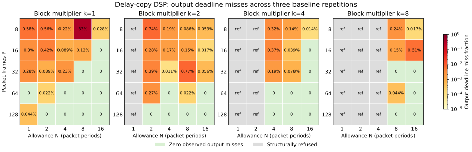

# Localhost network DSP results

The planned campaign completed **288 records: 257 measured runs and 31 explicit
refusals**. The independent sample checker verified **71,534,176 received samples
with zero mismatches and zero unverified samples**. Every recorded timing
histogram and packet-outcome count passed the consistency audit.

The experiment used the delay-copy processor in separate release-build client and
server processes on one Linux host. The source was commit
`46b9fd8d5a593cd915dc310cf37f974da9b931c7`. The host reported an AMD EPYC 7763,
a four-CPU cgroup quota and 16 GiB memory limit. Processes used ordinary scheduling
with no affinity, real-time priority, or kernel/NIC tuning. Builds and tests were
stopped during measurement. This is a software-loopback baseline; physical LAN,
FPGA execution and plugin performance remain separate experiments.

## Coverage and evidence

- All 100 baseline combinations: `P=8,16,32,64,128`, `k=1,2,4,8`,
  `N=1,2,4,8,16`, at 48 kHz stereo and `A=0`.
- The 70 admitted combinations ran three times with 0.5 s warm-up and 2 s measured
  source time. The 30 combinations with `N<k` were explicitly refused.
- Every `P/k` pair also ran with `A=1` and `A=C+3`, `N=64` (40 runs).
- 16-channel `P=16` passed, and `P=32` was refused at a 1500-byte IP MTU.
- Six 60-second follow-ups tested observed baseline boundaries.
- Reorder capacity was 64 packets and the input gap allowance was 200 microseconds
  throughout. These remain configurable independently of the output allowance.

The frozen source and binary identity, commands, build/environment details and
actual socket-buffer sizes are in [manifest.json](evidence/manifest.json) and the
per-run archive. [summary.csv](evidence/summary.csv) supports comparisons;
[results.jsonl.gz](evidence/results.jsonl.gz) preserves all run reports, source
scheduling counters, input concealment masks, fault reasons, exact observed
percentiles, histogram counts and sample counts. [audit.json](evidence/audit.json)
records the validation totals and decompressed-data hash. Generated credentials
are excluded from these artifacts.

## Baseline deadline behavior



The figure combines all three baseline repetitions. Green cells have zero
observed output deadline misses; input concealment and source skips are reported
separately in the archive. The following stricter table requires every repetition
to have zero output misses, zero input concealment/source skips, verified samples
and an unretired stream. Values are packet periods; an em dash means no tested
allowance met all conditions.

| P | k=1 | k=2 | k=4 | k=8 |
| --- | --- | --- | --- | --- |
| 8 | — | — | — | — |
| 16 | 16 | — | — | — |
| 32 | 8 | — | — | — |
| 64 | 1 | — | — | — |
| 128 | 2 | — | — | — |

One `P=8,k=1,N=8` baseline repetition retired with `Future` before its measured
window; this accounts for the prominent aggregate miss fraction in that cell.
Independent repetitions retain their actual outcomes and host scheduling variation.

These finite runs establish observable operating points for this host. They do
not bound scheduler tails or establish a minimum safe allowance for arbitrary
plugins and networks.

## Longer runs

Every follow-up ran for 60 measured seconds after 0.5 s warm-up. Output miss
fractions and late/missing counts cover measured slots. Input concealment counts
cover the complete stream, including warm-up. Batch p99 uses complete,
unconcealed batches and starts at actual submission of the final input packet.

| P | k | N | Output miss fraction | Late | Missing | Input packets concealed | Retirement fault | Batch p99 (us) |
| --- | --- | --- | --- | --- | --- | --- | --- | --- |
| 8 | 1 | 8 | 95.10194% | 165 | 342,202 | 52 | Future | 62.9 |
| 8 | 1 | 16 | 0.07778% | 280 | 0 | 0 | none | 55.1 |
| 16 | 4 | 8 | 0.17000% | 306 | 0 | 278 | none | 74.0 |
| 16 | 4 | 16 | 0.01889% | 34 | 0 | 268 | none | 73.2 |
| 128 | 8 | 8 | 0.02222% | 5 | 0 | 17 | none | 114.4 |
| 128 | 8 | 16 | 0.00000% | 0 | 0 | 24 | none | 148.4 |

The `P=8,k=1,N=8` run reached a sender backlog of 87 packet periods and recorded
22 send errors or overdue-source skips. It exceeded the bounded receive window and retired with
`Future`; retirement accounts for most of its 342,202 missing packets. Its
received audio still passed the reference check. The adjacent `N=16` run stayed
active and recorded 280 late replies among 360,000 measured slots.

The aggregated runs also demonstrate the separate input-gap policy. For example,
`P=128,k=8,N=16` had no output deadline misses, while 24 input packets were
replaced under the 200-microsecond gap policy. Increasing `N` provides more time
for output completion; it does not automatically increase that input reorder
wait. With a software requester, sender scheduling variation can cause input
concealment as well as output misses. Both must be considered when choosing a
configuration. A deterministic FPGA sender will require its own measurements.

## Algorithm delay and turnaround

All non-aligned delay cases preserved exact sample placement. As one example,
`P=128,k=8,N=64,A=1027` has 21.396 ms of algorithm sample delay; its observed batch
turnaround averaged 56.2 microseconds, with a 93.4-microsecond p99 across
24 complete measured batches. The companion
`A=1` run averaged 45.9 microseconds, with a 124.3-microsecond p99. Algorithm delay
is implemented as sample history; the server returns each completed block
immediately and preserves the source frame tag.

Packet RTT includes aggregation for early packets in a `C=kP` batch. The batch
metric removes that accumulation by starting after final-input submission. DSP
processing durations use only the server clock. Source lateness is measured
against nominal readiness, and never extends the consumption deadline. A 50 ms
capture grace records diagnostic late replies; replies absent at that cutoff are
counted as missing. Percentiles describe received results, and missing results
remain in the miss-fraction denominator. No clock synchronization is assumed.

## Reproduction

Use the repository's selected build environment:

```sh
cargo build --release -p shoop_dsp_host --no-default-features
python3 scripts/sweep_remote_dsp.py --profile all --output work/remote-dsp-sweep
python3 scripts/sweep_remote_dsp.py --report-only --output work/remote-dsp-sweep
python3 scripts/plot_remote_dsp.py --results work/remote-dsp-sweep/results.jsonl.gz --output work/deadline-misses.svg
```

Report regeneration reproduced the decompressed per-run data byte for byte.
Plotting additionally requires Matplotlib. `--profile smoke` runs the short
correctness-focused CI subset without wall-time percentile thresholds.

The required Carla validation is separate from this placeholder campaign:
real internal stereo gain processing at gain 0.5 and state restoration passed
through separate process pairs. The complete native suite passed 2,531 tests
with four skips; the clean-worktree DSP/protocol/native-Carla/process checks passed
31 tests. Bare-metal portable-core builds, the WebAssembly application check,
formatting, warning-denying builds and repository policy checks passed. The pinned
Carla runtime was built headlessly; GUI ownership/lifecycle tests were exercised,
and an actual GUI window was not part of this campaign.
