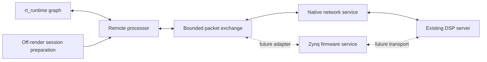

# Remote DSP node in an rt_runtime graph

Status: Planned; implementation has not started.

Planning branch: `feat/rt-runtime-remote-dsp`, created from
`feat/network-dsp-host` at `ec4b52ec2de23b60714eadb8ebf1be69834dd3e0`.
The existing host/protocol is delivered in
[PR #915](https://github.com/SanderVocke/shoopdaloop/pull/915).

## Goal and scope

Provide a reusable `rt_runtime::Processor` for remote audio/MIDI processing and
a native graph-to-server demo. The node must also be usable by the parallel
Zynq SoC integration without requiring Linux, an OS networking stack, threads,
or an OS clock in the runtime. Delay-copy is the correctness reference; the same
graph path must work with the existing native Carla server.

This milestone includes the portable exchange contract, prepared node, native
client/worker adapter, lifecycle/fault behavior, deterministic graph tests and
real UDP demonstration. Native networking is one platform implementation.

Deferred: Zynq Ethernet/DMA drivers and board execution; Shoop strip/session
inserts, persistence and UI; automatic graph latency compensation; automatic
plugin latency discovery; physical-LAN performance guarantees. Integration does
not depend on finding a glitch-free setting in the shared cloud environment.

## Repository findings

- `rt_runtime/src/processor.rs` provides prepared processors and absolute source
  frames. Rendering forbids allocation/deallocation, locking, waiting and I/O;
  processing ranges can be smaller than a host callback.
- `rt_runtime` already uses `no_std` plus `alloc` and bounded `rtrb` ownership
  transports. A platform-independent exchange can follow those ownership rules.
- `shoop_remote_dsp` supplies portable configuration, wire encoding, source-order
  adaptation and return slots. Its current requester deadline API uses elapsed
  nanoseconds; graph integration needs a separate frame-domain policy.
- `shoop_dsp_host` currently keeps authenticated control and the software source
  client in executable-private modules. Extract the reusable session/network
  operations, retaining benchmark generation and wall-clock pacing in the CLI.
- `shoop_rt_engine` uses its own closed `EngineNode` composition. Adding a generic
  runtime processor does not automatically create a Shoop strip/session insert.
- `Processor` has no latency-reporting method, and the current application rejects
  non-default track compensation. Report latency through integration metadata;
  do not claim that existing graphs automatically align parallel paths.

## Immutable acceptance criteria

1. The node implements the runtime processor interface and runs in a real
   `GraphRuntime` graph. Its portable dependency tree has no `std`, socket/thread
   APIs, Linux facilities, native Carla or legacy engine dependency. It builds
   for both `armv7a-none-eabi` and `aarch64-unknown-none`.
2. The node depends on a documented, bounded, nonblocking packet-exchange
   interface. A deterministic implementation and a native queue/worker
   implementation satisfy the same contract. A firmware adapter can implement
   it without adopting the native client library or its scheduling model.
3. Configuration, authentication and session preparation occur outside rendering.
   A portable prepared-session descriptor supplies the stream identity, source
   origin, shape and latency contract. The node owns no TCP connection, secret
   file, socket address, wall-clock reader, thread or network-driver operation.
4. For admitted configurations, source samples retain their identity across
   arbitrary valid runtime ranges, packet size `P`, and DSP block size `kP`.
   Transport latency `L` is fixed and explicit in graph frames. Delay-copy of
   known delay `A` produces exactly `output[n] = input[n-L-A]`, initially zero.
   The admission rule accounts for maximum callback size and actual publication
   cadence; insufficient lead is refused.
5. Rendering has preallocated storage and bounded work, including faults and
   queue exhaustion. It never waits for a reply or performs network/control I/O.
   Each output packet is committed once to processed audio or defined fallback;
   a late result cannot change already committed samples or shift the timeline.
6. MIDI offsets survive graph/packet boundaries. Limits on ports, event counts
   and message bytes are explicit. Loss, overflow and unsupported messages have
   bounded recovery; messages are never silently truncated.
7. Disconnect, stale/duplicate/reordered traffic, lost packets, worker stalls,
   stream retirement, node removal and fresh-session restart have defined,
   tested behavior. Runtime graph epochs and network stream epochs are distinct.
   State preparation, stop/join and final storage reclamation stay off-render.
8. A native demo runs `graph input -> remote node -> graph output` through real
   UDP with delay-copy and optional Carla. Required real-Carla validation checks
   known gain audio. Tests require actual processed output, so an implementation
   returning only fallback cannot pass. Correctness and timing misses are
   reported separately; successful CI is not a real-time performance guarantee.

## Design rules

### Separate the portable node from platform services

- Keep reusable packet exchange/session data in the portable remote-DSP layer.
  Put the runtime adapter in a small `shoop_remote_dsp_node` crate. Extract native
  control/networking into a separate `shoop_remote_dsp_client` library used by
  both the existing CLI and the demo. Preserve server/protocol independence from
  `rt_runtime`; the native client must not force runtime code into the server.
- The exchange interface transfers prepared buffers or bounded packet contents;
  it does not conceal socket calls inside a `try_send` method. Calls made by the
  processor must be memory-only and bounded. Native SPSC queues are one backend,
  not a requirement imposed on future firmware.
- A Zynq service may run in firmware's surrounding service loop, another
  execution context, or a hardware-backed adapter. DMA submission, interrupts,
  cache maintenance and buffer coherency belong to that platform adapter.
  Do not assume coherent DMA/shared memory or require 64-bit atomics on Cortex-A32.
- `no_std` does not forbid existing off-render `alloc` preparation. Explicitly
  document storage ownership/capacities, and keep final buffer destruction out of
  the render path, including queue-full and node-retirement paths.
- Session negotiation is a separate platform concern. The initial native
  bootstrap uses the existing authenticated TCP protocol. Firmware may provide
  an already negotiated descriptor; that does not make native TCP code portable.
  A platform session owner must retain the live control connection for the
  stream's lifetime; handing over a descriptor does not replace that ownership.
  Preserve the server's authenticated peer-IP/UDP-port/epoch binding. A separate
  controller with a different IP cannot proxy negotiation without an explicit,
  separately designed protocol extension.

### Use the graph clock for the graph contract

- The runtime frame cursor controls input identity and output consumption.
  Platform services can use their own monotonic timer outside rendering; neither
  `Instant` nor a Linux clock belongs in the node.
- Before implementation, specify the exact mapping from source packet readiness
  to output frame, how `P`, `k`, `N` and maximum callback size determine admissible
  `L`, and when an output packet becomes irrevocable. Include callback-boundary
  early consumption and delayed input publication in the calculation. Do not
  reuse nanosecond benchmark deadlines by pretending graph frames are wall time.
- Retain the current benchmark deadline API and evidence. Share packet/epoch/
  duplicate/bounds validation with frame-based returns rather than fork it.
- Assemble partial input packets and retain partial output packets across runtime
  calls. Snapshot/drain only bounded ready work; continuous producer traffic may
  not make a render call run indefinitely. Missing output initially means silence
  plus MIDI recovery, without adaptive latency or an implicit dry bypass.
- Expose fixed transport latency separately from processor latency. Preserve
  unknown Carla latency as unknown. Use `L+A` for the delay-copy oracle; parallel
  path compensation remains outside this milestone.
- An unrelated graph activation must not reset a surviving stream. A source
  discontinuity or session replacement requires an explicit fresh incarnation.
  Prepare and activate that replacement outside rendering; no render-side reconnect.

## Implementation stages

### 0. Establish the integration branch and contract

- [x] Inspect processor, graph, protocol, requester and lifecycle boundaries;
      confirm node/demo scope and the Zynq portability constraint with the user.
- [x] Create `feat/rt-runtime-remote-dsp` from the delivered host revision.
- [ ] Specify the exchange, prepared-session descriptor, latency/admission formula,
      per-call work limits and failure table. Resolve these before node code.
- [ ] Commit the contracts with examples covering callbacks larger than
      packets and ranges splitting a packet. Keep PR #915 and its evidence intact.

### 1. Extract reusable native session operations

Depends on Stage 0 contracts; can precede the native worker implementation.

- [ ] Extract authenticated negotiation, datagram operations and control lifecycle
      into the native client library. Keep CLI sample generation, synthetic clock,
      capture arrays and experiment/reporting policy in the CLI.
- [ ] Define the portable descriptor/exchange without native handles or implicit
      background threads. Keep the wire protocol compatible and Carla optional.
- [ ] Verify existing delay-copy/Carla process and state workflows, authentication
      refusals, dependency isolation and existing CLI behavior after extraction.

### 2. Implement the portable node and deterministic graph tests

Depends on Stage 0; uses the extracted descriptor from Stage 1.

- [ ] Implement prepared packet accumulation, bounded submission, frame-based
      return buffering and exactly-once consumption behind the exchange interface.
- [ ] Implement runtime processor ports and generic planner/operation compatibility
      without changing the runtime's graph executor or adding network APIs to it.
- [ ] Implement MIDI rebasing/limits/recovery and bounded diagnostic snapshots.
      Refuse incompatible shapes, insufficient latency, overflowing source ranges
      and unsupported session configurations during preparation.
- [ ] Test an actual graph using a deterministic exchange: multiple channels,
      impulses and non-aligned delay `A`; callback sizes below/equal/above `P`;
      irregular ranges splitting packets; source origins and sequence boundaries.
- [ ] Inject reorder, duplication, loss, late returns, full queues, unavailable
      service and stale epochs. Test packet commitment across partial output,
      graph activation without reset, explicit replacement and retirement.
- [ ] Guard successful and failing render paths against heap activity. Verify
      bounded draining under a continuously producing peer and ownership return
      under exhaustion; check appropriate concurrent-queue invariants.
- [ ] Build portable libraries for Cortex-A32, Cortex-A64 and the retained
      Cortex-M target. Inspect features/dependencies for native leakage.

### 3. Implement the native adapter and graph-to-server demo

Depends on Stages 1–2. No Linux policy is added to the portable interface.

- [ ] Implement the native ownership queues/pools and an explicit service worker
      owning UDP/control operations. Prepare/activate only a ready session; bound
      shutdown and reclaim resources after graph retirement on the control side.
- [ ] Drain queued input in bounded batches and distinguish local queue drops,
      invalid/stale traffic, late output, remote input concealment and retirement.
      Preserve fixed latency under stalls; do not add automatic reconnect in render.
- [ ] Provide a runnable graph demo with configurable graph callback size,
      `P/k/N`, fixed transport latency, delay-copy and Carla state selection.
      Native pacing, affinity and scheduling choices belong to this host adapter.
- [ ] Verify real UDP delay-copy samples against `L+A`; verify a real pinned-Carla
      gain/state workflow through the same node. Require processed output and
      distinguish wire/control success from audio-deadline success.
- [ ] For deterministic integration tests, coordinate/pump network work between
      graph calls outside render. Keep that simulated-time correctness mode
      separate from a paced demonstration; waiting there is not latency evidence.
- [ ] Exercise server stop/restart, worker stall, preparation failure, removal and
      reactivation with a fresh session. Check that unrelated graph nodes continue
      processing when remote output falls back.

### 4. End-to-end validation and delivery

Depends on Stages 1–3; finishes this milestone without adding strip/session UI.

- [ ] Document native build/run commands, latency accounting, capacities/fallback,
      the portable platform-adapter contract and a Zynq integration sketch.
      Clearly label actual native execution versus unimplemented board drivers.
- [ ] Reproduce graph delay-copy and required real-Carla workflows from a clean
      checkout. Preserve both previous measurement campaigns; store any new demo
      evidence separately and avoid fragile CI timing-percentile thresholds.
- [ ] Run formatting, Rust test policy, warning-denying workspace build, focused
      graph/protocol/client regressions, complete native suite, tracing inventory,
      Cortex-A/M builds and affected WebAssembly checks using repository guidance.
- [ ] Add a correctness-focused graph/UDP CI subset on supported native platforms
      and bare-metal compilation of the node. Keep real-Carla validation mandatory
      in its prepared Linux environment; missing-runtime skips cannot satisfy it.
- [ ] Push the branch and create a separate PR. While PR #915 is open, stack it
      on `feat/network-dsp-host`; after that dependency merges, retarget to
      `feat/backend-replacement` and verify the integrated base.
- [ ] Monitor CI to green, inspecting logs before targeted corrections. Check
      automated review and address justified feedback until its checks pass and
      participating reviewers approve. Record evidence and final status here.

## Execution contract

- Keep the plan updated as work progresses and check off completed items.
- Commit each completed stage or meaningful milestone.
- Implementation steps may be revised when new evidence warrants it.
- Design rules may be revised for a documented, well-supported reason.
- Goals and acceptance criteria must not be changed without explicit user approval.
