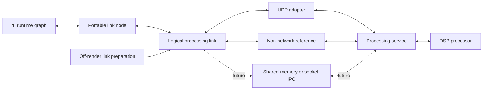

# Transport-independent DSP link node in an rt_runtime graph

Status: In progress. The portable contract is recorded in [link-contract.md](link-contract.md).

Planning branch: `feat/rt-runtime-remote-dsp`, created from
`feat/network-dsp-host` at `ec4b52ec2de23b60714eadb8ebf1be69834dd3e0`.
The existing host/protocol is delivered in
[PR #915](https://github.com/SanderVocke/shoopdaloop/pull/915).

## Goal and scope

Provide a reusable `rt_runtime::Processor` for asynchronous audio/MIDI processing
over a processing link. The shared stack must accommodate remote networking,
same-machine socket bridges and out-of-process IPC. The node must also be usable
by the parallel Zynq SoC integration without Linux, an OS network stack, threads
or an OS clock. Delay-copy is the reference; DSP algorithms remain behind the
existing processor abstraction, including native Carla.

This milestone implements the portable link contract, prepared node, reusable
processing service, a non-network reference binding, a native UDP binding and
the graph-to-server demo. Production shared-memory/socket IPC adapters are
follow-ups; the reference binding must exercise the common stack without a UDP
codec, MTU or network-specific configuration. This extends the design for reuse
without adding a complete IPC implementation to the agreed first milestone.

Deferred: Zynq Ethernet/DMA drivers and board execution; Shoop strip/session
inserts, persistence and UI; automatic graph latency compensation; automatic
plugin latency discovery; physical-LAN performance guarantees. Integration does
not depend on finding a glitch-free setting in the shared cloud environment.

## Repository findings

- `rt_runtime/src/processor.rs` provides prepared processors and absolute source
  frames. Rendering forbids allocation/deallocation, locking, waiting and I/O;
  processing ranges can be smaller than a host callback.
- `rt_runtime` already uses `no_std` plus `alloc` and bounded `rtrb` ownership
  transports. A platform-independent exchange can follow those ownership rules.
- `shoop_remote_dsp` supplies portable configuration, wire encoding, source-order
  adaptation and return slots. Its current requester deadline API uses elapsed
  nanoseconds; graph integration needs a separate frame-domain policy.
- `shoop_dsp_host` currently keeps authenticated control and the software source
  client in executable-private modules. Extract the reusable session/network
  operations, retaining benchmark generation and wall-clock pacing in the CLI.
- `shoop_plugin_protocol` and the retained Carla shared-memory bridge provide
  useful generation/ownership examples, but are native, Carla-oriented and include
  blocking waits. Existing shared-memory record carriers also have different
  payload/throughput contracts. Evaluate reusable mechanisms; do not make these
  existing protocols the portable DSP-link contract.
- `shoop_rt_engine` uses its own closed `EngineNode` composition. Adding a generic
  runtime processor does not automatically create a Shoop strip/session insert.
- `Processor` has no latency-reporting method, and the current application rejects
  non-default track compensation. Report latency through integration metadata;
  do not claim that existing graphs automatically align parallel paths.

## Immutable acceptance criteria

1. The node implements the runtime processor interface and runs in a real
   `GraphRuntime` graph. Its portable dependency tree has no `std`, socket/thread
   APIs, Linux facilities, native Carla or legacy engine dependency. It builds
   for both `armv7a-none-eabi` and `aarch64-unknown-none`.
2. The node uses a documented, bounded, nonblocking processing-link interface
   exchanging logical audio/MIDI blocks and ownership, not UDP packets. The same
   node and processing service run through a non-network reference binding and
   a native UDP binding. A firmware or IPC adapter need not adopt the native
   network client, its scheduling model or its wire format.
3. Configuration, authorization and session preparation occur outside rendering.
   A portable prepared-link descriptor supplies the incarnation, source origin,
   audio/MIDI shape, handoff limits and latency contract. Native handles and
   network-specific settings belong to adapter configuration. The node owns no
   TCP connection, process handle, secret file, address, clock or driver operation.
4. For admitted configurations, source samples retain their identity across
   arbitrary valid runtime ranges, logical handoff quantum `Q`, and DSP block
   size `B`. The UDP binding separately maps `P/k/N` to this contract; its
   `B=kP` restriction is not imposed on every link. Link latency `L` is fixed
   and explicit in graph frames. Delay-copy of
   known delay `A` produces exactly `output[n] = input[n-L-A]`, initially zero.
   The admission rule accounts for maximum callback size and actual publication
   cadence; insufficient lead is refused.
5. Rendering has preallocated storage and bounded work, including faults and
   queue exhaustion. It never waits for a reply or performs network/control I/O.
   Each output range is committed once to processed audio or defined fallback;
   a late result cannot change already committed samples or shift the timeline.
6. MIDI offsets survive graph/block boundaries. Limits on ports, event counts
   and message bytes are explicit. Loss, overflow and unsupported messages have
   bounded recovery; messages are never silently truncated.
7. Disconnect, stale results, full buffers, helper/worker stalls, retirement,
   node removal and fresh-session restart have defined, tested behavior.
   UDP additionally covers duplicate/reordered/lost packets. Runtime graph epochs
   and processing-link incarnations are distinct.
   State preparation, service shutdown and final storage reclamation stay off-render.
8. A native demo runs `graph input -> remote node -> graph output` through real
   UDP with delay-copy and optional Carla. Required real-Carla validation checks
   known gain audio. Tests require actual processed output, so an implementation
   returning only fallback cannot pass. Correctness and timing misses are
   reported separately; successful CI is not a real-time performance guarantee.
9. The non-network binding exercises block shapes independently of UDP packet
   and MTU settings. Shared processing code performs no mandatory serialization,
   network jitter buffering, TCP negotiation or process launch. Buffer ownership
   permits a future mapped-memory adapter without exposing Rust pointers across
   processes or requiring the render thread to wait for a helper.

## Design rules

### Separate logical processing from its carrier

- Introduce a small `no_std` plus `alloc` DSP-link core for logical block/session
  contracts, buffer ownership and reusable processing-service adaptation. It
  depends on the DSP abstraction, not the network protocol or graph runtime.
  Proposed names are `shoop_dsp_link` and `shoop_dsp_link_node` for the runtime
  adapter; native ownership/setup belongs in a separate native adapter library.
  These are dependency boundaries, not a requirement for a crate per carrier.
- Keep `shoop_remote_dsp` as the UDP protocol/adapter layer. Its wire headers,
  MTU, packet sequence/reorder window, gap timer and `P/k/N` configuration must
  not become mandatory fields or behavior of the generic node/link. Extract
  common block assembly/execution where useful, preserving the UDP wire contract.
- The shared service adapts logical input blocks to the prepared DSP block size,
  processes them in source order and returns identified results. Both carriers
  can use this service and the same delay-copy/Carla DSP interface; adding IPC
  should not require another processor wrapper or graph-node implementation.
- Logical blocks identify a link incarnation, source-frame range, audio/MIDI
  contents and result quality. A prepared contract sets bounded handoff quantum
  `Q`, DSP size `B`, capacities and latency. Their relationship is admitted by
  each binding; UDP may choose `Q=P`, while IPC may hand off whole DSP blocks.
  Do not impose UDP's packet multiplier on the common service.
- The render endpoint transfers prepared buffer ownership or bounded logical
  block contents. Its calls must be memory-only and bounded; a `try_submit`
  method may not hide socket I/O. Native SPSC queues are one implementation.
  A reliable socket still needs framing, buffering and overload policy outside
  rendering; reliability does not make synchronous render-side waiting acceptable.
- Allow buffer leases/pool slots without promising zero-copy in every backend.
  Cross-process descriptors use validated layouts, offsets/IDs and generations,
  never Rust `Vec`/`Box`/trait-object pointers. Mapping, wakeups, publication,
  recycling and peer-death reclamation belong to the adapter. A future direct
  shared-memory render endpoint needs a demonstrated bounded, nonblocking contract.
- A Zynq service may run in firmware's surrounding service loop, another
  execution context, or a hardware-backed adapter. DMA submission, interrupts,
  cache maintenance and buffer coherency belong to that platform adapter.
  Do not assume coherent DMA/shared memory or require 64-bit atomics on Cortex-A32.
- `no_std` does not forbid existing off-render `alloc` preparation. Explicitly
  document storage ownership/capacities, and keep final buffer destruction out of
  the render path, including queue-full and node-retirement paths.
- Setup/lifetime management is separate from the real-time data path. A platform
  owner can connect remotely, launch a helper, open a mapping or attach firmware
  services. Generic configure/start/quiesce/state/stop semantics must not require
  TCP or a subprocess. The owner retains resources until render-side retirement;
  process death and disconnection publish bounded link-unavailable state.
  Data and control carriers can differ, such as shared-memory audio with socket
  control/liveness; neither carrier choice dictates the other.
- The initial UDP bootstrap retains its existing authenticated TCP session,
  peer-IP/UDP-port/epoch binding and live-control ownership. These are UDP-backend
  requirements, not universal link rules. A controller with another IP needs an
  explicitly designed protocol extension; an IPC adapter uses its own access and
  liveness mechanisms. Native client extraction must not force TCP into firmware.

### Use the graph clock for the graph contract

- The runtime frame cursor controls input identity and output consumption.
  Platform services can use their own monotonic timer outside rendering; neither
  `Instant` nor a Linux clock belongs in the node.
- Before implementation, specify the mapping from logical input availability
  to output frames, how `Q`, `B`, maximum callback size and the binding's lead
  budget determine admissible `L`, and when output becomes irrevocable. For UDP,
  derive that budget from `P/k/N`. Include callback-boundary
  early consumption and delayed input publication in the calculation. Do not
  reuse nanosecond benchmark deadlines by pretending graph frames are wall time.
- Retain the current benchmark deadline API and evidence. Reuse source-range,
  incarnation and bounds validation in the common layer; keep network packet
  validation/reordering in its adapter. Jitter/loss handling is not imposed on IPC.
- Assemble partial logical input blocks and retain partial output blocks across runtime
  calls. Snapshot/drain only bounded ready work; continuous producer traffic may
  not make a render call run indefinitely. Missing output initially means silence
  plus MIDI recovery, without adaptive latency or an implicit dry bypass.
- Expose fixed link latency separately from processor latency. Preserve
  unknown Carla latency as unknown. Use `L+A` for the delay-copy oracle; parallel
  path compensation remains outside this milestone.
- An unrelated graph activation must not reset a surviving stream. A source
  discontinuity or link replacement requires an explicit fresh incarnation.
  Prepare and activate that replacement outside rendering; no render-side reconnect.

## Implementation stages

### 0. Establish the integration branch and contract

- [x] Inspect processor, graph, protocol, requester and lifecycle boundaries;
      confirm node/demo scope and the Zynq portability constraint with the user.
- [x] Create `feat/rt-runtime-remote-dsp` from the delivered host revision.
- [x] Refine the design for network, local socket and shared-memory processing;
      keep the first production binding/demo on UDP with a non-network reference.
- [x] Specify the logical link, descriptor, buffer ownership, latency/admission formula,
      per-call work limits and failure table. Resolve these before node code.
- [x] Commit the contracts with examples covering callbacks larger than
      handoff blocks and ranges splitting a block. Keep PR #915 and evidence intact.

### 1. Establish reusable link/service and native operations

Depends on Stage 0 contracts; can precede the native worker implementation.

- [x] Extract authenticated negotiation, datagram operations and control lifecycle
      into the native client library. Keep CLI sample generation, synthetic clock,
      capture arrays and experiment/reporting policy in the CLI.
- [x] Define the portable logical-block descriptor/link without network headers,
      native handles or implicit threads. Extract reusable DSP block adaptation
      and service execution; let UDP translate between wire packets and this core.
      Keep the wire protocol compatible and Carla optional.
- [x] Implement a non-network in-memory reference binding using the common
      service. Exercise a separately configured `Q/B` shape without importing
      the UDP crate, configuring an MTU or requiring TCP/process supervision.
- [x] Verify existing delay-copy/Carla process and state workflows, authentication
      refusals, dependency isolation and existing CLI behavior after extraction.

### 2. Implement the portable node and deterministic graph tests

Depends on Stage 0; uses the extracted descriptor from Stage 1.

- [x] Implement prepared logical-block accumulation, bounded submission,
      frame-based returns and exactly-once consumption behind the link interface.
- [x] Implement runtime processor ports and generic planner/operation compatibility
      without changing the runtime's graph executor or adding network APIs to it.
- [x] Implement MIDI rebasing/limits/recovery and bounded diagnostic snapshots.
      Refuse incompatible shapes, insufficient latency, overflowing source ranges
      and unsupported session configurations during preparation.
- [x] Test an actual graph using a deterministic exchange: multiple channels,
      impulses and non-aligned delay `A`; callback sizes below/equal/above `Q`;
      irregular ranges splitting blocks; source origins and incarnation boundaries.
- [x] Inject late/stale/out-of-order logical results, full queues and service stalls;
      include transport-specific reorder/duplication/loss in UDP adapter tests.
      Test output commitment across partial blocks,
      graph activation without reset, explicit replacement and retirement.
- [x] Guard successful and failing render paths against heap activity. Verify
      bounded draining under a continuously producing peer and ownership return
      under exhaustion; check appropriate concurrent-queue invariants.
- [x] Build portable libraries for Cortex-A32, Cortex-A64 and the retained
      Cortex-M target. Inspect features/dependencies for native leakage.

### 3. Implement the native UDP binding and graph-to-server demo

Depends on Stages 1–2. No Linux policy is added to the portable interface.

- [x] Implement the native ownership queues/pools and an explicit service worker
      owning UDP/control operations behind the common link. Prepare only a ready session; bound
      shutdown and reclaim resources after graph retirement on the control side.
- [x] Drain queued input in bounded batches and distinguish local queue drops,
      invalid/stale traffic, late output, remote input concealment and retirement.
      Preserve fixed latency under stalls; do not add automatic reconnect in render.
- [x] Provide a runnable graph demo with configurable graph callback size,
      `P/k/N`, fixed transport latency, delay-copy and Carla state selection.
      Native pacing, affinity and scheduling choices belong to this host adapter.
- [x] Verify real UDP delay-copy samples against `L+A`; verify a real pinned-Carla
      gain/state workflow through the same node. Require processed output and
      distinguish wire/control success from audio-deadline success.
- [x] Run the same graph correctness scenarios through the non-network reference
      and UDP bindings. Verify the node and shared service do not branch on UDP,
      TCP, process IDs or shared-memory mapping details.
- [x] For deterministic integration tests, coordinate/pump network work between
      graph calls outside render. Keep that simulated-time correctness mode
      separate from a paced demonstration; waiting there is not latency evidence.
- [x] Exercise server stop/restart, worker stall, preparation failure, removal and
      reactivation with a fresh session. Check that unrelated graph nodes continue
      processing when remote output falls back.

### 4. End-to-end validation and delivery

Depends on Stages 1–3; finishes this milestone without adding strip/session UI.

- [x] Document native build/run commands, latency accounting, capacities/fallback,
      and the portable link/service contracts. Include adapter sketches for Zynq,
      shared-memory IPC and local socket bridging, identifying actual code versus
      future adapters. Do not describe the reference binding as production IPC.
- [x] Reproduce graph delay-copy and required real-Carla workflows from a clean
      checkout. Preserve both previous measurement campaigns; store any new demo
      evidence separately and avoid fragile CI timing-percentile thresholds.
- [x] Run formatting, Rust test policy, warning-denying workspace build, focused
      graph/protocol/client regressions, complete native suite, tracing inventory,
      Cortex-A/M builds and affected WebAssembly checks using repository guidance.
- [x] Add a correctness-focused graph/UDP CI subset on supported native platforms
      plus the non-network core tests and bare-metal node compilation. Keep real-Carla validation mandatory
      in its prepared Linux environment; missing-runtime skips cannot satisfy it.
- [x] Push the branch and create a separate PR. While PR #915 is open, stack it
      on `feat/network-dsp-host`; after that dependency merges, retarget to
      `feat/backend-replacement` and verify the integrated base.
- [ ] Monitor CI to green, inspecting logs before targeted corrections. Check
      automated review and address justified feedback until its checks pass and
      participating reviewers approve. Record evidence and final status here.

## Execution contract

- Keep the plan updated as work progresses and check off completed items.
- Commit each completed stage or meaningful milestone.
- Implementation steps may be revised when new evidence warrants it.
- Design rules may be revised for a documented, well-supported reason.
- Goals and acceptance criteria must not be changed without explicit user approval.

## Execution evidence

- Stage 0 contract: `link-contract.md` defines the conservative frame bound,
  lease ownership and fault table before implementation.
- Added portable DSP-link/service and runtime-node crates, and a separate native
  session/UDP adapter library. The original requester uses extracted session
  operations; the UDP server and non-network service share prepared DSP execution.
- Nine focused tests passed, including Q=3/B=5 audio and MIDI, exact L+A graph
  output across variable callbacks, bounded credit exhaustion and irrevocable
  fallback across a partial output block. Render/service heap guards passed.
- Two additional recovery regressions failed before correction and passed after:
  preserving transport context across an initial gap, and propagating MIDI reset
  even when a DSP filters MIDI output.
- Complete required-Carla native suite: **2564 passed, four skipped**. Formatting,
  test attributes, warning-denying workspace build and closed tracing inventory
  (378 modules) passed. Portable link/node builds passed on Cortex-A32, Cortex-A64,
  Cortex-M and WebAssembly at that milestone.

- The graph demo now runs a non-network reference or real UDP through the same
  node. Focused validation passed all 20 core/node/demo tests, including real
  Carla gain/state restoration and a two-second native no-progress watchdog.
- Added graph activation/retirement/replacement, impulses, oversized SysEx with
  budgeted host recovery, an unrelated dry path during service failure, and a
  continuously-ready peer that cannot extend the render drain budget.
- A repeated-reply watchdog regression failed before correction: duplicate data
  kept a stalled link alive. Only advancing source results now renew progress.
- The six-case native demo script passed with configured Carla, including a
  software-paced UDP example. Carla's smoothing fixture uses an explicitly
  reported warm-up; delay-copy remains bit-exact.

- Final local gates: **2575 native tests passed, four skipped**, with required
  Carla. All 20 focused core/node/demo tests passed in release too. Warning-denying
  workspace build, formatting, test policy, closed tracing (379 modules), 143
  Python repository tests, all four portable targets and affected app/worklet
  WebAssembly checks passed. The node's normal dependency tree contains only
  rt_runtime, the portable link/DSP crates and no-default-feature rtrb.
- CI now includes the link/node in Cortex-A/M builds and the native graph/UDP
  correctness subset. Coverage requires the real Carla graph workflow; the 80%
  patch floor is unchanged. Workflow filters include the stacked PR target.
- Clean detached checkout `13ff3c0d` reproduced all six cases with 55,002 verified
  samples, zero mismatches/unverified samples, and 96 paced fallback samples.
  [Results and reproduction](integration-results.md) link the audited JSON records;
  original benchmark campaigns remain unchanged. Delivery is in
  [PR #922](https://github.com/SanderVocke/shoopdaloop/pull/922), stacked on #915.
- CodeQL review prompted explicit allocation bounds and a heap-guarded rejection
  regression. The UDP correctness test's zero-fallback timing assertion failed
  under local and CI contention; it now permits counted misses while retaining
  positive processed output and complete sample checks. The non-network reference
  still requires zero fallback. After these corrections, **2576 native tests passed,
  four skipped**, all **23 focused DSP/link/node/demo release tests** passed,
  and warning-denying workspace/portable builds, formatting and test policy passed.
  Updated remote checks and automated-review resolution remain pending.
