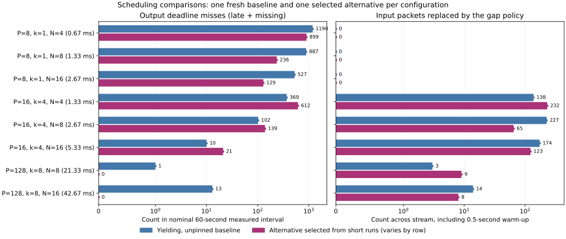

# Scheduling and polling results

The additional controls produced **useful but inconsistent improvements**. For
8-frame packets, selected alternatives reduced late outputs by about 73–76% at
1.33–2.67 ms allowances. They still missed deadlines several times per second.
For aggregated processing, some alternatives improved input concealment while
worsening output misses. **No 60-second run was fully healthy:** every run had
output misses, concealed input, or both. These settings have not demonstrated
reliable low-latency audio on this shared host.

This report supplements the [original experiment](localhost-results.md). Its
measurements and report are preserved unchanged. The follow-up recorded **184
runs, 4,495,600 measured packet slots and 124,441,600 verified received samples**,
with zero incorrect or unverified samples. There were 6,813 late packets, zero
responses missing at the diagnostic cutoff and zero retired streams. These totals
combine different workloads; use the fixed-configuration comparisons below to
judge performance.

## Controlled comparisons

The campaign used the same delay-copy algorithm with `A=0`, 48 kHz stereo,
1500-byte MTU and 64-packet reorder allowance. It varied:

| Condition | Requester polling | Server polling | Process affinity | Input gap |
| --- | --- | --- | --- | --- |
| `yield-free` | yield | yield | inherited | 200 us |
| `yield-pinned` | yield | yield | separate CPUs | 200 us |
| `spin-free` | spin | spin | inherited | 200 us |
| `spin-pinned` | spin | spin | separate CPUs | 200 us |
| `client-spin-pinned` | spin | yield | separate CPUs | 200 us |
| `server-spin-pinned` | yield | spin | separate CPUs | 200 us |
| `spin-pinned-gap1000` | spin | spin | separate CPUs | 1000 us |

Eight configurations covered `P=8,k=1,N=4/8/16`, `P=16,k=4,N=4/8/16` and
`P=128,k=8,N=8/16`. Each condition/configuration ran three times with 0.5 s
warm-up and 2 s nominal measurement, in seeded randomized order: 168 short runs.
For each configuration the runner selected an alternative using retirement count,
then output misses plus input concealments/source errors, then CPU cost. This
selection was exploratory; a small CPU-cost tie-break is not evidence of a timing
advantage. It then randomized one fresh baseline and one selected alternative
for 60 nominal measured seconds each: 16 longer runs. Durations round up to whole
DSP batches. Every outcome is retained.

The source and executable were frozen from
[`e21ca5ee`](https://github.com/SanderVocke/shoopdaloop/tree/e21ca5ee566f97724dbd11af79504e5a4ae45c80).
The executable SHA-256 is
`36d952b0f15d49368913ab7b12cdf693e25bd1978bb3146432312ffdae6a4b89`.
The fresh baselines use the same instrumented executable as their alternatives;
it adds bounded service-gap counters to the original implementation. No builds
or test campaigns ran during measurement.

## Longer-run outcomes



Counts below compare the fresh yielding/unpinned baseline with the selected
alternative. Output misses cover measured slots. Input concealments cover the
whole stream, including warm-up; they are not missing output packets.
The allowance is `N*P/fs` after packet readiness. Aggregation separately consumes
`(k-1)*P/fs`: 1 ms for the 16-frame/k=4 rows and 18.67 ms for the 128-frame/k=8 rows.

| P / k / N | Allowance (ms) | Alternative | Output misses: baseline → alternative | Input concealments: baseline → alternative |
| --- | --- | --- | --- | --- |
| 8 / 1 / 4 | 0.67 | spin-free | 1,190 → 899 | 0 → 0 |
| 8 / 1 / 8 | 1.33 | server-spin-pinned | 887 → 236 | 0 → 0 |
| 8 / 1 / 16 | 2.67 | yield-pinned | 527 → 129 | 0 → 0 |
| 16 / 4 / 4 | 1.33 | spin-pinned | 369 → 612 | 138 → 232 |
| 16 / 4 / 8 | 2.67 | spin-pinned-gap1000 | 102 → 139 | 227 → 65 |
| 16 / 4 / 16 | 5.33 | spin-pinned-gap1000 | 10 → 21 | 174 → 123 |
| 128 / 8 / 8 | 21.33 | client-spin-pinned | 1 → 0 | 3 → 9 |
| 128 / 8 / 16 | 42.67 | spin-pinned | 13 → 0 | 14 → 8 |

The 8-frame/1.33 ms comparison improved by 73.4%, and the 2.67 ms comparison by
75.5%. Even the latter alternative missed 129 of 360,000 slots, approximately
2.15 times per second. At the tight aggregated setting, spinning/pinning worsened
both output misses and input concealment. A longer input-gap allowance reduced
concealment in the selected 16-frame cases, but did not reduce their output misses.
Waiting for input spends the same finite deadline budget.

The two large-buffer alternatives had no output misses, but still processed
concealed input: all nine and eight concealed packets, respectively, occurred
during measurement rather than warm-up. Zero output misses therefore did not
mean uninterrupted correct input delivery. No source skips, missing responses or retirement occurred in the
longer runs. The original campaign's overload retirements remain valid evidence;
their absence here does not establish that overload recovery changed or was fixed.

One long run per condition and shared-host variation limit causal conclusions.
The alternative for each row can change multiple factors; the short-run matrix
provides the separate polling/pinning comparisons. This is not a universal ranking
or proof of a minimum safe allowance.

## CPU cost and priority limits

This was the same managed Linux host, reporting AMD EPYC 7763 CPUs, five allowed
virtual CPUs (`0–4`), a four-CPU cgroup quota per 100 ms and 16 GiB memory limit.
Pinned requester processes used CPU 1 and server processes CPU 2; actual masks
were checked. Whole-process pinning also places the server's control/UI thread on
the same CPU as its processing worker. It does not reserve a CPU or isolate it
from the OS or hypervisor.

Average child-process CPU cost over the 24 short runs in each condition was:

| Condition | Pair CPU cores | User CPU cores | System CPU cores |
| --- | --- | --- | --- |
| yield-free | 2.070 | 0.944 | 1.126 |
| yield-pinned | 1.994 | 0.899 | 1.094 |
| spin-free | 2.070 | 1.402 | 0.668 |
| spin-pinned | 1.994 | 1.299 | 0.694 |
| client-spin-pinned | 1.993 | 1.145 | 0.849 |
| server-spin-pinned | 1.993 | 1.063 | 0.931 |
| spin-pinned-gap1000 | 1.993 | 1.312 | 0.681 |

CPU time covers the complete pair lifetime, including startup, warm-up, capture
and reporting, rather than DSP alone. Both yielding and spinning actively poll;
the yielding implementation already consumes approximately two cores. Spinning
shifts work from kernel calls to user space and does not deliver a large CPU
saving. The deployed FPGA arrangement would remove the software requester's CPU
cost from the laptop; this table measures both localhost processes together.

The runner attempted `SCHED_FIFO` priority 1, `SCHED_RR` priority 1 and niceness
−10. FIFO/RR were denied with `Operation not permitted`. The `nice` command
returned success despite reporting permission denial; querying the child confirmed
its actual niceness remained 0. Consequently **no elevated-priority timing
condition was measured**. All measured runs used `SCHED_OTHER`, niceness 0.
The manifest retains the commands, errors and actual results. A later runner
refinement uses cooperative yielding for permitted priority conditions so FIFO
peers can hand control back; that path was unavailable here and is unmeasured.

## What the diagnostics establish

No cgroup quota-throttled period was recorded during any run. Nevertheless, the
longer runs observed service-loop gaps as large as 62.8 ms in the requester and
24.9 ms in the server. These counters include program work and scheduling delays,
and include warm-up/capture; they are not direct scheduler-latency measurements.
No quota throttling does not rule out OS or hypervisor preemption.

The saved source-lateness histograms also provide a conservative lower bound on
inputs submitted after their own output deadline. Sum bins whose lower edge is
at least `ceil(N*packet_ns/1000)` microseconds. In the 5.33 ms
`spin-pinned-gap1000` run, at least 16 of 21 output misses already had such late
input submission. Faster server processing could not have met those deadlines.
This bound understates source-induced misses for aggregated blocks, whose earliest
output has less remaining budget when the final input becomes ready. Other misses
cannot be assigned solely to the server: requester receive scheduling is also
part of the observed completion time.

A deterministic FPGA requester would remove the software source-dispatch problem.
It would still encounter the computer's receive/processing/send scheduling. This
campaign gives no physical-LAN, FPGA or arbitrary-plugin timing guarantee.

The next useful investigations are a dedicated physical host with permitted
real-time scheduling; worker affinity separate from control/UI activity; reduced
control polling wakeups; and draining queued input before expiring a gap after
preemption. The latter is a code-review hypothesis about the current receive-one,
then-expire loop, not a measured fix. Hardware-paced source/LAN measurements remain
necessary. Affinity and spinning alone have not solved continuity here.

## Evidence and reproduction

[manifest.json](tuning-evidence/manifest.json) records source/binary/runner hashes,
commands, affinity, CPU limits and priority probes.
[selection.json](tuning-evidence/selection.json) records the screening rule and
selected alternatives. [summary.csv](tuning-evidence/summary.csv) and
[results.jsonl.gz](tuning-evidence/results.jsonl.gz) retain every case, exact counts,
timing histograms, service-gap counters, resource measurements and timestamps.
[audit.json](tuning-evidence/audit.json) records the consistency checks and
decompressed archive hash. Report regeneration reproduced that hash exactly.
Generated credentials and raw process logs are excluded from the published files.

Use the frozen revision in a separate checkout for the recorded source, or the
current branch for the latest runner. Choose two distinct allowed CPUs:

```sh
cargo build --release -p shoop_dsp_host --no-default-features
python3 scripts/tune_remote_dsp.py --client-cpu 1 --server-cpu 2 \
  --profile all --output work/remote-dsp-tuning
python3 scripts/tune_remote_dsp.py --report-only --output work/remote-dsp-tuning
python3 scripts/plot_remote_dsp_tuning.py \
  --results work/remote-dsp-tuning/results.jsonl.gz --output work/matched-followups.svg
```

The plot helper was added with this report. Matplotlib is optional and required
only for plotting. `--report-only` uses the raw output directory's individual case
JSON files; the committed compressed archive contains the same case records.
Run the experiment with builds/tests stopped. CPU pinning is Linux-specific in
this runner; priority conditions are added only when the requested setting is
verified. Conditions and results can differ on a machine that permits priority
changes. Timing misses remain measured outcomes rather than correctness-test
failures or hidden refusals.
