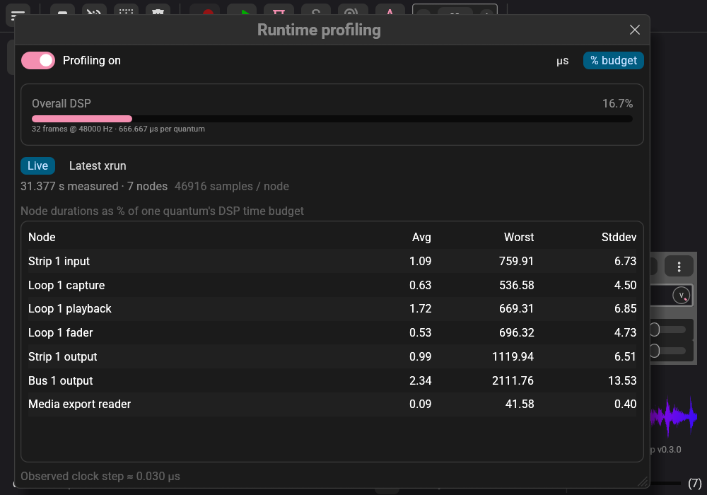
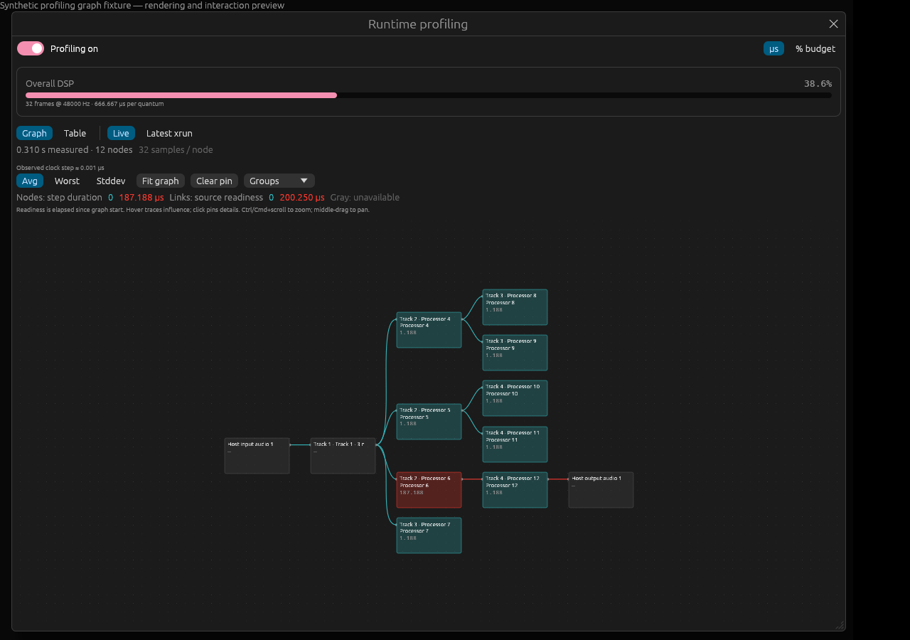
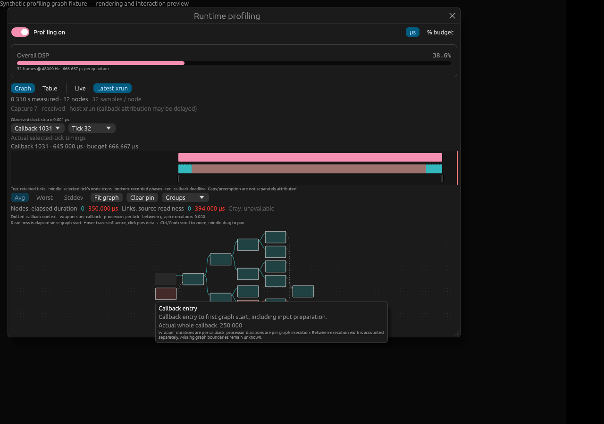

# Runtime profiling

Hover over or click the backend status LED at the bottom of the application and
choose **Profiling…**, below **Host Manager…**. The dedicated window has an
immediate on/off switch and an overall DSP load bar showing the same reading as
the bottom status bar. Profiling defaults to off. A switch sends its runtime
request immediately and saves the preference in the background; no Save action
or audio restart is needed. The window reports the engine's acknowledgement. Profiling is independent
of developer tracing. There are no recording levels or xrun arming controls.

The screenshot uses the native dummy driver in a debug build; its live readings
illustrate the interface. [Microsecond presentation](runtime_profiling/window-us.png).
Release performance measurements are linked below.

The window offers **Graph** and **Table** tabs with shared controls. The table
contains **Node / Avg / Worst / Stddev** in graph execution order.
Choose **µs** or **% budget**. Percentages use one fixed quantum's time budget:
`100 × duration_ns / (quantum_frames × 1e9 / sample_rate)`. They represent a share
of the available quantum period, rather than a share of the currently consumed
DSP time. For example, at 48 kHz with Q=32, a 10 µs step uses 1.50% of the
666.667 µs budget. Formatting changes preserve the measured data. Names identify prepared strip, loop and bus slots and their
roles, so tracks with identical display names remain distinguishable. A node
handling both audio and MIDI has one combined row.

Each sample measures one complete fixed-tick node step: local input preparation,
incoming routes, MIDI handling, processing, output recovery and executor
bookkeeping. Avg is the arithmetic mean, Worst is the maximum, and Stddev is the
population standard deviation. An unfinished step contributes no duration; its
row shows an em dash until a complete sample exists. Elapsed time includes OS
preemption and profiling work. It does not measure exclusive CPU time or the
latency until sound reaches the device.

Live statistics accumulate from enable or the latest reset, over accepted complete
records, through the displayed interval boundary. Every application graph build
resets tracking, including an identical rebuild or a build that fails. Activation,
engine replacement and re-enable also reset. Queued records and retained captures
from older generations are discarded; node IDs are never reconciled across
layouts. Disabling retains the final report until a reset or disconnection.

While enabled, callback budget overruns and host xrun notifications automatically
freeze recent raw history plus following work. **Latest xrun** shows statistics for
that actual interval using the same table. History is finite: the view reports its
actual bounds and incomplete/lost data. Host notifications may arrive late and do
not identify the exact offending node. Captures already leased to a collector are
protected; additional incidents that cannot be retained are counted. A large
callback or small quantum can exhaust post-trigger space, ending the capture
early and marking it incomplete. Changing the graph invalidates the capture.

## Graph and xrun analysis

The graph shows the active executable audio/MIDI plan, including host endpoints.
It is read-only: inspection cannot change routing or processor state. Use **Fit
graph**, middle-drag to pan, and Ctrl/Cmd+scroll to zoom. The **Groups** menu
collapses track, loop and bus members into summary nodes while retaining their
external connections. Measurements updating do not re-run layout or move nodes
unless the expensive-processor filter changes which processors are visible.

Enable **Expensive processors only** to show the top five individual processors
and their immediate input/output neighbors; adjust **Top** from 1 to 20. Ranking
uses the selected Avg/Worst/Stddev processor metric for live or capture-interval
statistics, and actual elapsed step durations for a selected captured tick. It
waits for all retained node timing pages before ranking a selected tick, and
excludes unavailable and zero-valued measurements. Equal values use processor
slot order. **Ranked processors** lists the values in descending order; click an
entry to pin its details. Ranked graph nodes show their rank; other visible
processors provide connection context. Filtering precedes group collapse, so a
summary contains only retained members. Callback entry/exit, between-execution
statistics and the capture timeline remain available. Turning the filter off
restores the complete graph.

This filter locates large elapsed spans, not a critical dependency path or proof
of xrun causality. Independent branches still consume the callback budget, and
elapsed durations include OS preemption. Per-node Worst values may come from
different ticks; Stddev ranks variability rather than average cost. Use an actual
captured tick and its callback timeline to investigate a particular interval.

Hover a processor to see its complete-step Avg/Worst/population Stddev and sample
count; click to pin details. Hover also highlights upstream dependencies and
downstream affected outputs. This is structural influence, not proof that a
processor caused an xrun. Collapsed groups retain member details and have no
invented aggregate duration.

Links show **source output readiness**: elapsed time from graph execution start to
the source processor's output-ready boundary in each tick. All outgoing links
from one processor share its readiness. This includes independent work that the
sequential executor actually ran earlier. A 20 µs source followed by unrelated
80 µs work and a 10 µs dependent has 110 µs readiness at the dependent, although
the two connected processors contain 30 µs of work. Readiness statistics are
computed per tick and then aggregated; summing node worst values or standard
deviations would be incorrect. There is no path cost mode.

Processor names include the current UI track label and, for loop processors, the
loop label (`Drums / Verse · Loop 3 playback`). The processor role and prepared
slot remain visible to distinguish duplicate names. Group menus and collapsed
nodes use these same names. Renaming a track or loop updates the graph and table
without resetting measurements or layout. Prepared slot generations prevent old
records from acquiring a reused slot's new name. Names are resolved through structured
backend identities, not inferred from the numeric slot or display text; unresolved
or mismatched topology retains the generic processor label.

Zoom in to read inline node labels; very small overview nodes retain their colors
and full hover details.

Processor node colors represent step duration; link colors represent readiness. Their
separate numeric legends use the selected Avg/Worst/Stddev metric and µs or
percentage of the original quantum period. Gray means unavailable. A bundled
link uses the maximum displayed source metric for its color; its tooltip lists
its actual member statistics. Host input links use a labeled zero graph-start
baseline. Links to host outputs still show source readiness, not completed output
routing or device playback latency; host-to-host bypass timing is unavailable.

Callback entry and exit remain neutral gray and do not contribute to the processor
color scale. Their percentages use the full callback buffer's time allowance,
while processor percentages use one quantum. Entry, exit and between-execution
percentages are normalized against each callback's original budget before computing
Avg/Worst/Stddev, including when callback sizes vary. A missing callback budget
leaves percentages unavailable; microsecond durations remain available. These
budget-relative statistics are carried by application protocol version 30.

**Latest xrun** initially shows statistics over the actual retained capture
interval. The callback selector switches to a recorded callback; the tick selector
chooses one of its retained ticks. The graph then displays **actual** values for
that tick, and interval statistic selectors are disabled. Return to **Capture
interval** for Avg/Worst/Stddev. Maxima in an interval graph need not come from the
same tick. A callback with no retained tick has unavailable node and link timings.

The timeline shows retained ticks, the selected tick's node spans and recorded
phase boundaries. Its red line uses the complete callback's original budget;
engine parts and ticks do not receive fictitious independent device deadlines.
If a parent callback was not retained, its deadline is unavailable. Host xrun
notifications can be delayed; the capture does not automatically identify an
exact offending callback or processor. Gaps remain unmeasured, and elapsed time
cannot distinguish preemption from work. Receiving, truncation, loss and clock
resolution remain visible. Old detail responses are ignored after changing the
selection, capture, graph generation or connection.

The native preview below uses prescribed synthetic timestamps. It shows callback
entry statistics, a processing hotspot, dotted context dependencies and selected
callback timing with the original deadline; it is not a recorded production incident.

The graph supports at most 4,096 processors and 16,384 executable connections;
larger plans report visualization capacity unavailable while audio and table
profiling continue. Capture selection indexes at most 8,192 retained traces and
reports truncation. Selected node details arrive in pages of at most 256 steps
and 64 phase boundaries, without putting the complete raw capture in every app
snapshot. Graph/selection state is local to the window and is not saved in sessions.

### Callback wrapper nodes

The graph includes **Callback entry** and **Callback exit** virtual nodes. Dotted
connections link them to graph roots and sinks; these are callback context,
not audio/MIDI connections or extra measured readiness links. Entry measures
callback entry to the first graph start. Exit measures the last processor's
completion to callback exit, including final output routing. Their Avg, Worst
and population Stddev use complete callbacks; ordinary processor statistics
use individual graph executions. Work between graph executions is shown
separately above the graph, so multiple ticks cannot inflate entry/exit costs.
Selected-callback entry/exit values cover the whole callback even when a middle
tick is selected. Percentages retain the displayed quantum-budget denominator;
the timeline uses the selected callback's original deadline budget.

The callback hooks cover native host preparation/render/output work and the
worklet's input preparation through output copying/MIDI publication. They do not
measure device/OS scheduling outside those hooks, or every instruction before
entry and after exit. Partial engine callback records are labeled partial and
receive no independent driver deadline. Missing/unfinished graph records leave
wrapper attribution unknown. A callback without graph execution retains its
measured total, but has no artificial entry/exit split. An unavailable elapsed
clock leaves measurements unavailable, including these virtual nodes.

## Clocks and browser support

Native hosts supply nanoseconds from a primed `Instant` epoch. A browser worklet
imports `shoop_profiling.now`, using its realm's `performance.now()` when present.
The observed positive clock step is shown; zero means resolution is unknown.
Complete native/worklet driver callbacks supply the deadline budget; split engine
parts are never treated as independent device deadlines. Offline hosts without
outer callback timing use their complete engine callback budget.
Clock origins differ by host instance and cannot be compared across connections.
Logical sample frames identify audio intervals, not elapsed execution time. Raw
host records preserve both engine stream frames and the external AudioContext
callback frame, which can start at a different origin.

Chrome for Testing 147.0.7727.117 exposes no `performance` object in its
AudioWorkletGlobalScope. On that browser the setting is acknowledged as requested,
but timing is explicitly unavailable and rendering continues. `Date.now()` and
logical audio time are not substituted for a monotonic execution clock. The raw
worklet contract independently exercises the production clock import, toggle,
timestamps and automatic captures with an injected monotonic clock. Browser
support needs a host-provided monotonic clock in that realm; it cannot be inferred
from `performance.now()` working in the main window.

## Runtime and transport bounds

Targets without 64-bit atomics report timing unavailable; the core still builds
for bare-metal targets and never substitutes locks for those atomics. This is a
hardware capability check, with no profiling Cargo feature or build option.

The portable recorder is `no_std`, uses no unsafe code and allocates its owners
before rendering. Off checks cached enable/reset state and performs no profiling
clock reads, sample writes or rolling history maintenance. Toggle/reset boundaries
can finish or invalidate a pending capture once. On reads one timestamp at each
node completion plus explicit callback, tick and phase boundaries. Storage copies,
publication and capture ownership swaps are bounded and never wait for a reader.

For a prepared pool of N nodes, each trace reserves `2*N + 24` 16-byte samples,
bounded by 65,536. Two circular banks reserve approximately 2 MiB each including
trace overhead (2–4,096 traces per bank), plus 64–1,024 independent live stream pages selected from an 8 MiB byte budget,
a callback trace and a spare page. `storage_bytes` reports prepared sample-array
bytes; it excludes owner/header/channel metadata. `high_water` is the maximum ready live-stream queue occupancy. Capacity exhaustion drops live batches with a
counter and does not borrow command, recovery or media capacity. Reserved history
remains independent of a stalled collector. Unsupported pool sizes report timing
unavailable rather than failing audio preparation.

The endpoint forwards at most 128 chunks per poll, with at most 24 samples per
chunk and independent profiling admission. Reliable messages have priority;
bulk, metering and profiling rotate fairly. Engine protocol version 24, application
protocol version 32, and SDM2 shared-memory descriptors reject incompatible peers.
The browser MessagePort additionally allows at most 256 unconsumed profiling
records. The main thread returns credits after decoding consumption, coalesced
into one asynchronous flush. Status, names, topology and timestamp chunks share that
profiling-only window. When it fills, existing bounded queues absorb the backlog
and live recording eventually reports drops; reliable controls still progress.
The application backend collects and computes Welford statistics outside rendering;
live reports refresh at most five times per second. The worklet endpoint performs
bounded forwarding on the audio thread, including the existing record encoding
and JavaScript MessagePort work. These whole-host costs are distinct from the
allocation-free render kernel.

Raw `Packet` records retain generation, capture/sequence/callback IDs, tick and
callback frames, graph epoch, nanosecond boundaries, completion/fault flags and
trigger causes. Node keys are dense prepared slots; high bits distinguish phase
and layout markers. `Collector::raw_capture()` exposes only the latest current
capture. No timings are stored in session files. Graph and selected-callback timeline UI use the current generation only; export
formats are outside this feature.

## Reproducing validation

Release timing data, raw callback measurements, clock and UI costs, methodology
and measurement recipes are in the [benchmark guide](runtime_profiling/README.md).

The native production benchmark is
`cargo run --release -p shoop_rt_engine --example profiling_benchmark -- <strips> <quantum> <callbacks> <off|on|stalled> <steady|midi|recording|edits|partitions>`.
It times the whole offline callback with an independent clock, and control/draining
separately. Each strip has stereo routes, MIDI and a loop; the midpoint injects a
host xrun. The stalled mode withholds collection. It prints raw callback durations,
period budgets, misses, wire bytes, accepted samples, storage and loss counters.
Compare against the same harness on the recorded pre-feature commit; removing
profiling setup/collection from that harness does not change the workload.

Focused tests prescribe clock values independently and verify statistics,
completion boundaries, all five quanta, arbitrary host partitions, audio/MIDI,
faults, no-heap execution, saturation, capture leases, toggles and generation
invalidation. The packaged socket/shared-memory probe exercises application
projection and UI loss while recording. The browser core workflow checks requested
state, available/unavailable acknowledgement, graph resets and toggles through the
same application intents as the UI. The worklet artifact contract checks the raw
ABI and JavaScript processor together.

## Host reports and extension points

The profiling window has **Audio** and **Host** panels. Audio retains its graph,
statistics and xrun inspection controls. Host shows the advertised FreeRTOS task
report, with an independent collection switch, acknowledged sampling interval,
report age and delivery/assembly loss counters. A host without this producer shows
it as unavailable; unknown schemas are identified without disconnecting the app.

The FreeRTOS producer starts disabled and samples at 1 Hz when requested. It
reports task name/identity, state, current/base priority, cumulative runtime and
historical minimum unused stack bytes. CPU percentages use deltas between complete
samples, include idle tasks and follow scheduler accounting rather than exclusive
CPU or separate ISR time. First samples, re-enable boundaries, failed/incomplete
samples and counter resets have unavailable CPU percentages. Disabling retains
the last sample; detach removes collection demand and a new attachment starts
with fresh client state. Graph rebuilds do not reset host measurements.

Collection uses a fixed 32-task buffer in the control task. Kernel snapshots and
stack watermark scanning suspend scheduling; each report includes collection time.
That time is elapsed host time and may include preemption after scheduling resumes.
Runtime accounting uses a 64-bit Cortex-A9 timer counter. It has a context-switch
cost even when report collection is disabled. Bounded create/delete hooks assign
boot-scoped 64-bit task tokens without recording a scheduler trace; reused TCB
addresses do not reuse a token. Identity/table exhaustion yields incomplete data.
QEMU measurements establish software behavior, not physical board deadlines.

Both the engine and application protocols use `profiling_protocol` envelopes.
`rt_profiling::wire` owns raw audio payloads; the backend still computes audio
statistics and the service resolves application names. Derived audio views and
host task reports use a diagnostic channel separate from session snapshots and
session revisions. Collection, stream forwarding and UI rendering retain their
separate costs. Reliable controls/heartbeats take priority; snapshot/media and
profiling delivery have bounded fair service and independent profiling admission.

The [stream contract](profiling/protocol.md) specifies versions, limits, identity,
fragmentation, loss and subscriptions. To add a report, allocate a stable type ID
and namespaced name, implement its bounded schema/codec and producer, and register
it with `Service::register_profiling_provider`. Add the typed decoder and UI in the
application client. Neither carrier implementations nor outer protocol variants
need another report-specific case. Reports are not persisted in session files.
