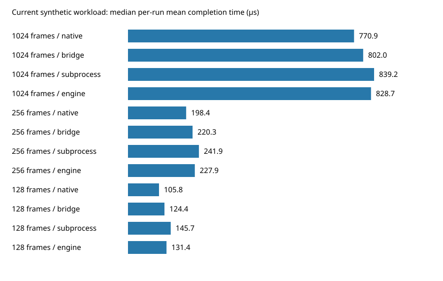

# Carla processing performance investigation

The large steady-state Voyage Voyage processing slowdown reported in [#880](https://github.com/SanderVocke/shoopdaloop/issues/880) was **not reproduced** in these headless Linux VM experiments. This does not establish equivalence on the reporter's laptop or preset. The experiments found a concrete floating-point policy change, a smaller increase in caller CPU cost at the native-hosting boundary, and sensitivity to scheduling and VST3 implementation selection. No production processing behavior has been changed.

## Hypothesis dispositions

| Hypothesis | Disposition | Evidence and limits |
|---|---|---|
| Packaged Carla build targets alone slow DSP | Unsupported by this controlled comparison | Matched-dependency `plugin` and `plugin frontend` recipes produced byte-identical native/LV2 libraries. Timing flags between identical binaries cannot establish a generated-code difference. Unknown distribution/CI dependency differences remain untested. |
| A Carla version change explains the report | Unsupported in the previous-stable proxy comparison; actual installation inconclusive | Fixed-host Voyage comparisons of 2.5.9/2.5.10 show no material slowdown with FP state held constant. Release dates do not identify the reporter’s installed package. |
| LV2 → native greatly increases Carla computation | Unsupported for validated workloads | Synthetic ABI LV2/native CPU ratio at 1024 frames: 0.982 [0.930, 1.013]. Adjacent-switch confirmation finds caller CPU overhead without a confirmed inner-Carla increase. Historical small-buffer failures prevent blanket claims. |
| Rust replacement changed numerical execution | Supported in measured headless contexts | Old processing has FTZ/DAZ enabled, Rust paths have it disabled. An old zita library initializer and same-binary numerical controls demonstrate a mechanism. Physical audio callback threads remain unmeasured. |
| Bridge/scheduling affects completion | Supported as a mechanism | Controlled contention increases completion tails without comparable mean inner CPU increases. That alone does not explain a higher embedded Carla meter. |
| Carla build features matter independently of targets | Supported for compatibility/implementation | Minimal native VST3 processing crashes Voyage; fuller JUCE processing works. A same-full-binary implementation selector reproduces the crash. Crashes provide no timing comparison. |
| Large reported Voyage regression is confirmed | Inconclusive / not reproduced | Matched-cadence measurements show no large slowdown; unknown preset, old Carla, GUI and physical scheduling remain limitations. |

Intervals below are bootstrap 95% intervals over independent run-level ratios, not individual blocks. These are observational uncertainty estimates, not equivalence bounds.

## Carla's meter and host independence

Carla 2.5.10's embedded engine measures processing wall time and computes `100 × elapsed / (configured_buffer_size / sample_rate)`. The host supplies size and rate through callbacks. Carla knows the nominal period, without knowing how much time the rest of ShoopDaLoop consumed.

The display is a decaying peak: a larger sample replaces it (capped at 100%); otherwise it multiplies the previous reading by approximately `1 - period_seconds` per callback. It is neither mean plugin CPU utilization nor remaining host budget. See [the tested source](https://github.com/falkTX/Carla/blob/v2.5.10/source/backend/engine/CarlaEngineInternal.cpp#L715). Carla's JACK engine instead uses `jack_cpu_load`, with different scope.

Higher embedded DSP readings can originate outside plugin arithmetic: preemption/blocking *inside the timed call* increases wall time. Host floating-point state, plugin state, implementation, period and cadence also matter. Waiting strictly outside that interval cannot directly increase its instantaneous reading, but may affect scheduling/cache state when the call runs.

The audit finds 359,811 of 359,820 meter transitions compatible with peak/decay behavior and integer-microsecond clock quantization, using outer-call time as a bound. Nine remain unexplained by this simple audit. No conclusion depends on perfect display reconstruction.

## Numerical state: a concrete historical difference

Actual processing-thread MXCSR captures show FTZ/DAZ mask `0x8040` in the as-shipped 0.2.0 dummy backend, and `0x0000` in all twelve Rust contexts (pre-switch/post-switch/current × native/bridge/subprocess/engine), before and after processing.

Fresh-process `dlopen` probes localize a cause: old `libzita-resampler.so` changes MXCSR from `0x1f80` to `0x9fc0`; loading the old backend does the same through its dependencies. Minimal/full Carla native libraries leave it unchanged. The old zita disassembly contains a `set_fast_math` initializer that reads MXCSR, ORs `0x8040`, and writes it back (retained in `zita-fp-initializer.txt`). This changes the **loading thread**, with POSIX threads subsequently created by that thread inheriting a copy; it is not process-wide and does not update already-running threads. It does not establish the state of a physical JACK callback thread.

Same Carla/plugin binaries, fresh instances per policy, ten alternating pairs of 2,000 measured blocks:

| Workload | CPU FTZ/DAZ off | CPU on | Off/on paired ratio [95% CI] |
|---|---:|---:|---:|
| Deliberate subnormal-heavy LADSPA, 128 frames | 2262.6 µs | 44.5 µs | 50.904 [49.791, 51.845] |
| Voyage, 200 priming blocks then silent tail, 1024 frames | 1256.4 µs | 1169.0 µs | 1.070 [1.014, 1.131] |

The extreme synthetic test proves sensitivity, not the user's cause. Actual Voyage shows a modest contribution with factory defaults and 8/10 agreeing pairs. Its ~87 µs mean difference is ~0.4 percentage points of a 1024/48 kHz period; it does not explain a large spike by itself.

### Recommended floating-point policy

**FTZ/DAZ live in the calling thread’s MXCSR register, not in a process-global variable.** The operating system saves/restores this CPU state during thread switches. FTZ flushes subnormal results to zero; DAZ treats subnormal input operands as zero. [Intel documents their SSE/AVX scope](https://www.intel.com/content/www/us/en/docs/dpcpp-cpp-compiler/developer-guide-reference/2025-0/set-the-ftz-and-daz-flags.html). [POSIX thread creation inherits a copy of the creator’s floating-point environment](https://www.man7.org/linux/man-pages/man3/pthread_create.3p.html); changing the parent later does not update existing workers. Other thread APIs should not be assumed to have the same inheritance behavior.

For ShoopDaLoop, use an explicit scoped policy around each actual audio processing entry: the driver callback/engine DSP block, the in-process Carla worker’s DSP block, and the subprocess Carla worker’s DSP block. Setting only the UI/main thread or the thread that enqueues work is insufficient. On an exclusively owned persistent worker, initialization at worker entry is also possible, but applying a small scope per processing block establishes the policy again if other code changed it. Restore the caller’s previous state when returning to a host-owned callback thread. Plugin-owned helper threads require their own policy; the host cannot assume a scope on its caller controls an existing third-party pool.

On the tested x86/SSE platform the operation is `saved = _mm_getcsr(); _mm_setcsr(saved | 0x8040);` around DSP, followed by `_mm_setcsr(saved)` at scope exit, preferably through an RAII guard. Preserve unrelated rounding/exception-control bits rather than assigning a fixed complete register value such as `0x9fc0`. Confirm actual processing-thread bits and output in tests. Use a separate architecture-aware implementation on ARM; MXCSR masks do not apply there.

This is an intentional numerical policy for audio, changing gradual underflow behavior. It is preferable to relying on a dependency initializer or enabling broad compiler `fast-math` optimizations merely to get denormal suppression. No production policy is implemented by this investigation. The measured Voyage contribution is modest; this recommendation is not a claim that it fixes the entire reported regression.

## Historical Voyage, matched cadence

Voyage Voyage 1.0.2 Linux VST3 runs with the fuller Carla/JUCE build, factory defaults and identical seeded binary input. The old dummy driver internally rounds cadence using integer division to ~21.739 ms at 1024/48 kHz. Supplemental Rust controls match this cadence and use 200 paced warm-up blocks. The nominal audio budget remains 21.333 ms.

| Path | Median per-run mean inner CPU | Candidate / 0.2.0 ratio [95% CI] | Eligible pairs |
|---|---:|---:|---:|
| 0.2.0 LV2 baseline | 1345.0 µs | — | — |
| Pre-switch Rust LV2 host | 1253.4 µs | 0.909 [0.730, 1.061] | 10 |
| Current direct native | 1283.2 µs | 0.895 [0.728, 1.044] | 10 |
| Current subprocess | 1355.1 µs | 1.062 [0.981, 1.167] | 9 |

One current subprocess run contains a miss, remains in the raw data and is excluded from CPU attribution. Medians use successful invocations; ratios use eligible pairs. Historical phases were collected separately, so aligning repetition numbers does not eliminate phase/environment confounding. The uncertainty does not rule out smaller increases.

The first optional matrix compared continuous new hosts with the paced old backend. Those comparisons remain explicitly labeled `cadence differs` in generated tables and are exploratory, not evidence newer hosts are faster.

## Adjacent switch and bridge overhead

The native-switch commits `9b169b5` and `0cec63c` are adjacent. A separate ten-pair subprocess synthetic 1024-frame confirmation finds:

| Metric, post / pre | Ratio [95% CI] | Predeclared screen |
|---|---:|---|
| Caller thread CPU | 1.124 [1.089, 1.160] | increase |
| Inner Carla CPU | 1.019 [0.999, 1.042] | no increase established |
| p99 completion wall time | 1.073 [0.893, 1.267] | no increase established |

This localizes caller CPU overhead to the adjacent switch without establishing increased DSP computation or latency. There are no intermediate commits to bisect. Caller timing includes transport/waiting; its precise code-level cause remains unresolved. No speculative fix was made.

Current synthetic 1024-frame medians of per-run means:

| Path | Completion wall | Inner Carla CPU |
|---|---:|---:|
| Direct native | 771 µs | 770 µs |
| In-process bridge | 802 µs | 770 µs |
| Subprocess | 839 µs | 786 µs |
| Headless engine | 829 µs | 766 µs |

Pinned-CPU contention increases p99 completion by 1.93× [1.80, 2.05] for bridge, 1.61× [1.53, 1.70] for subprocess, and 2.12× [1.94, 2.40] for engine. Mean inner CPU does not increase similarly; inner wall tails do not consistently increase across these paths. The native tail estimate is noisy and fails directional agreement. These are software scheduling observations, not hardware xruns. Request-to-inner-start includes copies/dispatch and only bounds worker wake-up delay from above.

## Added previous-stable Carla comparison

ShoopDaLoop 0.2.0 was [published on 9 November 2025](https://github.com/SanderVocke/shoopdaloop/releases/tag/v0.2.0). [Carla 2.5.10 was released on 31 July 2025](https://github.com/falkTX/Carla/releases/tag/v2.5.10), and [Homebrew’s contemporaneous formula](https://github.com/Homebrew/homebrew-core/blob/5fbbc037e215a838737db86eec39fcd27d7ba684/Formula/c/carla.rb) already selected it. Release dates therefore do not establish that an older Carla was commonly installed. [Carla 2.5.9](https://github.com/falkTX/Carla/releases/tag/v2.5.9), released 22 September 2024, is used as the preceding-stable/older-installation sensitivity proxy. Installation prevalence and the actual reporter version remain unknown. The original numerical report describes an i7 Linux laptop, separately from the Catalina compatibility discussion.

The official website advertises macOS 10.12+ support. An audit of the actual universal DMGs shows a limitation that the advertised minimum misses: 2.5.9 includes OpenSSL/liblzma dependencies requiring macOS 12, and 2.5.10 includes dependencies requiring macOS 13. The main executables and Carla libraries themselves target 10.12. Thus neither unmodified complete DMG establishes actual Catalina compatibility. [Per-file audit/checksums](macos-upstream-audit.json) and [selection evidence](versions-selection.json) preserve these findings. ShoopDaLoop’s Catalina recipe replaces the incompatible dependencies.

The added fixed-host experiment uses the same compiler/full SDK/release plugin recipe, same Voyage 1.0.2 VST3 and factory state/input, 48 kHz/1024 frames, native/LV2 hosts, and separate explicit FTZ/DAZ off/on strata. Each of eight cells has ten alternating-order repetitions of 200 warm-up + 2,000 measured continuous blocks. All **80 invocations and 160,000 measured blocks pass** output, frame/rate and before/after FP-mask checks. FP register operations are outside the measured interval. This tests Linux source-version effects, not the differing prebuilt macOS packages or physical Catalina audio.

| Interface | FTZ/DAZ | 2.5.10 / 2.5.9 processing-thread CPU ratio [95% CI] |
|---|---|---:|
| Native | off | 1.022 [0.952, 1.099] |
| Native | on | 1.013 [0.932, 1.115] |
| LV2 | off | 0.986 [0.960, 1.014] |
| LV2 | on | 0.966 [0.931, 0.997] |

No comparison meets the predeclared ~5.12% CPU or 20% wall-latency screen. The small LV2 decrease with suppression on has an interval excluding 1 but falls below the material-effect threshold. Native uncertainty still permits a smaller slowdown. No large version-driven increase is reproduced. The DSP-meter implementation source file is byte-identical between these revisions. [Full comparison tables](VERSIONS.md), paired ratios and per-run data are retained; this adds a version axis without pretending to recover the reporter’s former runtime.

## Build features and actual VST3 processing

The controlled minimal builds disable JUCE/DGL/X11, retaining liblo/PyQt tools for LV2 rack registration. Voyage loads but segfaults processing through Carla's native VST3 path. A captured stack ends in `juce::ClientRemappedBuffer<float>` inside the plugin. The fuller build enables JUCE VST3 and processes successfully.

The same full library (`483ab83c…`) succeeds by default and crashes with signal 11 when `CARLA_DO_NOT_USE_JUCE_FOR_VST3=1`. This demonstrates implementation selection as the compatibility difference, without identifying which component owns the bug. Full-reference/full-packaged optional aliases are identical copied/incremental artifacts, serving as A/A controls rather than independent compiler comparisons. Minimal core target recipes were built independently.

## Protocol, provenance and explicit failures

- Current baseline: `580f6191c9b2d00c6ad43fcbf30445e590235a49`; pre/post: `9b169b5ec4f3a9ea86b4e0bdffbbd71882be4069` / `0cec63cc03ce0e3d3046e8f06f8de1b3104675be`; v0.2.0: `d08aafcb049f6c7a848c97a18b5c3a1456046696`, using its authentic public Linux backend. Minimal adapters live in isolated pinned checkouts. Old packaging/compiler remains a confound.
- Carla 2.5.10 archive SHA256: `ae2835b12081f7271a6b0b25d34b87d36b022c40370028ca4a10f90fcedfa661`. Minimal native: `83ef3d1502ab87f16d45012142520593e3e5b4c95419cf50519c2ae289f2437c`; LV2: `406e19ff8c85d433ab2b82cbaaf9e6c5c5d83828f1648a29d444a1c2000a2a8c`.
- Voyage archive SHA256: `97a2ac1e6ba991bfd5f897e368b05a113c598214bd21b5ae0e6197ff4dd92673`; plugin: `6f95c452b38ca9a926b26259751b3fe77b4e7d1fced4a4882820be0ad4527c36`; seeded two-channel input: `8eac35e676e81b1d19933f802f957ab6e2468ecb521c6567940b328f62a72c60`.
- Xeon Platinum 8573C VM, five visible CPUs/four-CPU cgroup quota, normal scheduling. Rust 1.99.1/local GCC and dependency versions/checksums in manifests. Timing/builds ran serially. Physical host occupancy/frequency were not controlled. Per-run affinity and cgroup throttling counters are retained.
- Core protocol: 48 kHz, 1024/256/128 frames, ten alternating-order repetitions of 2,000 continuous blocks and 200 warm-up blocks. Paced diagnostics and Voyage use 200 measured blocks per repetition, with weaker tail resolution. Old dummy processing always paces, even cases initially named `continuous`.
- Validation checks exact empty/gain/synthetic output, actual call/frame/period counts and transport counters. Voyage checks loaded state, finite bounded non-silent output and input transformation; output is not bit-exact across hosts. Repeated input alone cannot detect stale blocks, making call matching/miss counters essential.
- CPU clocks cover the measured owning thread, without summing plugin-owned helper threads. The single-threaded synthetic fixture supports attribution; Voyage CPU is not a total-process CPU measurement.
- CPU screen: ≥8 eligible pairs, 95% interval excluding 1, effect above both 5% and three times A/A median absolute ratio deviation, and ≥80% directional agreement. Observed A/A deviation ~1.71%, threshold ~5.12%. Tail screen requires 20%. Multiple comparisons have no multiplicity correction; isolated flags require confirmation. CPU attribution excludes runs with invalid output/misses/incomplete inner matching. Latency summaries retain fallback effects.
- Instrumentation materially affects empty racks (2.09× caller CPU at 1024 frames). Loaded fixture overhead is not established: 0.990 [0.972, 1.005]. Empty-rack nanosecond differences are not estimates of plugin regression. Low-instrumentation controls are retained.

Final evidence: **2,253 records: 2,205 successful invocations, 48 failed invocations**. Failures comprise 46 historical small-buffer subprocess warm-up/transport failures and two historical Voyage warm-up failures (post-switch bridge repetition 4, subprocess repetition 3). Successful invocations still contain 14,936 invalid-output blocks and 14,939 reported misses, retained in raw records and excluded from CPU attribution. Core current matrix: zero failed invocations, 358 invalid blocks/361 misses. No failed dataset cell was silently retried into a passing result. These failures limit small-buffer historical conclusions.

Old no-FX routing/output validation passes, but only aggregate backend profiling is available, without comparable per-block full-callback CPU timing. Sessions exercise active monitoring/routing with no recorded-loop workload; complex loop load remains outside the comparison. In-process headless paths keep plugin UI closed and omit normal GUI dispatch; subprocess mode includes its real UI service. GUI-induced contention is not reconstructed.

## Reproduction, validation and retained data

Follow [runner instructions](../README.md). Final preparation rebuilds/selects pinned adapters and verifies artifacts. A fresh-directory end-to-end smoke replay executes every suite and regenerates analysis: 229 records with five historical subprocess failures explicitly retained. This verifies orchestration/failure accounting, not statistical performance repeatability. The follow-up fresh replay including the version axis contains 237 records, with six historical failures retained; 48 positive version/interface/FP/workload checks and eight deliberate missing/bypass rejections pass.

Passed locally: six positive workload/interface checks; deliberate missing-plugin/bypass/missing-runtime rejection; formatting; warning-denying workspace build; tracing inventory; complete Rust suite (1,809 passed/four skipped); explicitly selected installed-Carla test (one passed). Release adapters also build with warnings denied. Production runtime source and Rust tests are unchanged.

Committed data: [per-run summaries](raw-runs.csv), [comparisons and paired ratios](comparisons.json), [generated tables](MEASUREMENTS.md), numerical/meter/implementation diagnostics, and manifests. Full per-block CSV, timing captures, commands/logs and failed cells are archived separately in the execution workspace; `raw-archive.json` records path/size/SHA256. Binaries are excluded. Frozen original core harnesses/manifest remain under `frozen-core`; optional extensions have a separate manifest. The frontend's designated output directory was not writable on this VM, so workspace output is used.

## Next steps justified by evidence

Measure MXCSR on the affected system's actual audio/plugin-worker threads and repeat the same preset with an explicit per-thread FTZ/DAZ policy as a diagnostic. Record Carla build features/VST3 implementation, fixed binary/preset, period and cadence. These test the two mechanisms demonstrated here.

For spikes, correlate inner Carla wall/CPU time with callback/worker completion and scheduling. Investigate historical small-buffer transport failures separately from DSP arithmetic; their precise cause is unresolved. Obtain the former Carla package/revision before attempting a version comparison. The VM and synthetic denormal extreme do not establish the reporter's cause.
