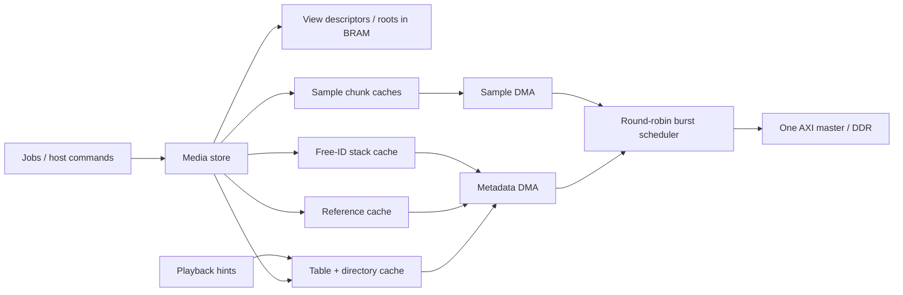

# DDR media metadata

Allocation now uses [32-chunk blocks](BLOCK_ALLOCATION.md). In the layout and
ownership descriptions below, table IDs, counts and the reusable-ID stack refer
to allocation blocks; sample addresses remain physical chunks. Replace SLOTS by
`BLOCKS=SLOTS/BLOCK_CHUNKS` for metadata-region sizes, table geometry and config
indices. The original measurements describe one-chunk allocation at `676093aa`.

The media store owns sample allocation, view chunk-ID vectors, reference counts
and deterministic LIFO reuse. Its compact view descriptors and vector roots stay
on chip. Sample payloads and the three recording-capacity-sized metadata arrays
live in DDR. Rust remains the logical oracle; it does not model hardware caches.

## Layout and capacities

Every word is 32 bits. Metadata lines/pages are 16 words (64 bytes); cache tags
use arena-relative offsets. Logical arena bases retain four-byte alignment;
the integrated physical placement requires eight-byte alignment. The DMA adds
the physical base after validating the complete request against the arena.

With `S = round_up(BLOCKS,16)` and
`A = round_up(physical SLOTS * CHUNK_FRAMES,16)`, word offsets are:

| Region | Start | Size |
| --- | ---: | ---: |
| Sample arena | 0 | A words |
| Per-allocation-block reference counts | A | S words |
| Reusable allocation-block ID stack | A + S | S words |
| Allocated table/directory pages | A + 2S | TABLE_PAGES * 16 words |
| Retired-table FIFO records | A + 2S + TABLE_PAGES * 16 | RETIRED_TABLES * 16 words |

There is no `VIEWS * SLOTS` reservation. A view's chunk IDs form a dense prefix
in a radix-16 tree. Directory words contain page IDs; leaf words contain sample
chunk IDs. Page ID zero means absent. Depth is
`max(1,ceil(clog2(BLOCKS)/4))`; indexed seeks have bounded tree depth. Each view
has an on-chip root, used count and one cached leaf translation (128 bits total),
plus valid bits. Persistent table caching is shared by foreground work and hints.

Table pages have their own allocator: high-water/free-head/free-count registers,
with a freed page linking the next free page in its first DDR word. Allocation
zeros the entire page through the coherent cache. Tail trimming unlinks empty
ancestors and recycles pages. Dense-prefix writes allow this without scanning
every directory entry. Debug writes may replace an existing ordinal or append
the next one; sparse writes are refused. Restore writes tables in ordinal order.

Sample allocation keeps its high-water mark and stack count on chip. The stack
contains sample IDs, independently of the page allocator. Reference counts are
indexed by physical sample chunk ID, rather than repeated in every view table.
A detached root retains its existing pages and block references. Queue records
store a root page at byte offset 0 and remaining entry count at offset 4; bytes
8..63 are reserved. Only on-chip FIFO indices publish records. The active block,
phase and bounded traversal context survive iteration boundaries in registers.
Completed tail entries checkpoint the root/count and recycle empty pages.
Root transfer and record publication are serialized with live descriptor updates.
There is no persistent journal or reset-time collector recovery.

Playback only needs table IDs; reference/stack traffic comes from ownership
changes. Only the last reference retires sample transfers before publishing reuse.

| Parameter | Default | Purpose |
| --- | ---: | --- |
| TABLE_LINES | 8 | Fully associative table/directory cache |
| REF_LINES | 4 | Fully associative reference-count cache |
| STACK_LINES | 2 | Persistent blocks around the free-stack top |
| TABLE_PAGES | ceil(BLOCKS/15) + 8*VIEWS + 16 | Shared live/retired DDR page-pool capacity |
| RETIRED_TABLES | 256 | Fixed-size retired-table records in DDR |

Caches use round-robin replacement and writeback. Defaults contain 896 bytes of
cache data, independent of recording duration. The 64-loop benchmark explicitly
uses 128 table lines (8 KiB), four reference lines and two stack lines. Normal
quantum boundaries neither flush nor invalidate these caches. Capacity checks
count additional radix nodes before mutating a view and refuse insufficient page
space with MemoryFull. Sample slots, issued view IDs, retired-record capacity and shared page capacity
remain separate limits. Append counts only actually reusable IDs and available
pages; pending releases cannot satisfy its capacity check. Deleted view IDs remain holes until reset.

In the historical one-chunk ownership measurement, 32 reference lines (2 KiB) retain the
strided ownership working set and reduce the simultaneous-retake cost from
738.05 to 430.68 us at an assumed 100 MHz. Four lines remain the small default;
size this cache for active recording/release traffic. Playback does not need it.
See the measurement report for both results and deadline limitations.

The 64-stereo-loop, 30-second, 48 kHz example contains 5,760,000 physical chunks
at 32 frames/chunk, or 703.125 MiB of logical samples. With 32-chunk allocation
blocks, its 128 channel recordings need 180,096 block references (including
rounded final blocks), approximately 0.687 MiB each for table words, reference
counts and reusable IDs, plus directory/page slack. The payload still exceeds
the supplied 512 MiB DDR profile. The deferred ownership stress instead uses
32 mono or 16 stereo loops, totaling 45,024 references and about 176 MiB.

## Ownership, transport and visibility

`media_metadata.sv` serializes logical operations and reference read/modify/write;
AXI atomics are unnecessary. The media bridge stalls its logical FSM until all
required metadata responses have arrived. Foreground work takes priority over
new speculative lookups. An admitted hint completes through the same owner and
cache as demand; jobs still resolve their current mapping. Trim invalidates the
affected leaf translation; explicit invalidate clears all translations.

`shared_axi.sv` connects separate sample/metadata DMA clients to one AXI master.
The core's `memory_meta_*` port mirrors the sample descriptor/stream handshake:
64-bit byte addresses, counts in 32-bit words, a word stream and a held aggregate
completion. Scalar diagnostics select `BURST_MEMORY=0` for both clients.
The scheduler alternates competing clients at completed burst boundaries. Each
burst is at most 16 beats, cannot cross 4 KiB, and retains its owner through the
last read beat or write response, including errors. There is one outstanding
AXI transaction with ID zero. A multi-burst chunk releases ownership between
bursts; neither a whole chunk nor a dependency retains the physical port.

Descriptors publish after coherent logical metadata updates, which can still
be dirty in cache. Fence drains sample writes and all three metadata caches.
It establishes backing-store acknowledgement; DRAMsim3's additional physical
drain is recorded separately. On a fill/writeback fault, sticky memory_fault
reaches the loop coordinator, which suppresses output and requires reset/reload.
Faults can leave partial physical writes; there is no rollback or crash recovery.

Reset discards cache/allocator/control state, retaining external bytes. Coordinate
it with the endpoint/slave to discard old responses. Fence before reset if data
must survive; reload a validated logical snapshot afterwards. Physical tree roots
are private implementation state and are reconstructed through logical config.

## Configuration and simulation

The existing idle-only 160-bit config port now has variable latency: hold requests
until cfg_ready and wait for cfg_response_valid. Space 2 addresses pack
`(view << SLOT_BITS) | ordinal`, where `SLOT_BITS=max(1,clog2(SLOTS))`; holes in
non-power-of-two capacities are invalid. Logical snapshot format/version is
unchanged. Space 5, address 0, write performs a fenced metadata flush/invalidate
for cold-cache diagnostics. Ordinary execution does not use it.

CLI options propagate through standalone media, audio and connected loop runners:
`--metadata-lines`, `--metadata-pages`, `--reference-lines`, `--stack-lines`,
`--retired-tables`, `--reclaim-blocks`, `--reclaim-cycles`, `--reclaim-guard`.
Backing images include the full arena; restore/snapshot go through hardware
config and actual DDR/SV bytes. Python does not allocate pages, resolve tables or
maintain a substitute metadata model.

Native direct simulation uses a single non-synthesizable SV backing array. Its
responses are functional. DRAMsim3 uses the same shared RTL AXI path with native
DDR timing and is the realistic performance mode. The retained legacy scalar
diagnostic has a separate raw-word metadata backing adapter; it checks semantics
but does not model contention on the common physical port. `--word-transfers`
keeps the shared AXI endpoint while selecting scalar DMA on both clients.

Reproduce focused cache/page/transport checks with
`python fpga/media_store/simulate_metadata.py`. The tests cover both AXI widths,
multi-burst lines, held responses, competing clients, dirty eviction, page
exhaustion/reuse, tree boundaries, reset and injected errors in all three banks.
See [the measurement report](measurements/README.md) for full-system results,
resource scaling and exact benchmark/replay commands.
