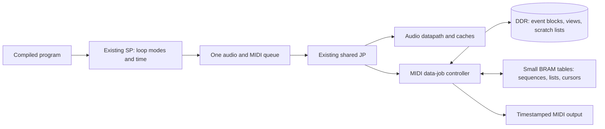

# MIDI event looping through SP and JP

The RTL implements the Rust FPGA reference: record MIDI messages,
play and repeat them, seek, route ports, merge streams, and share stored content.
Raw event mode replays messages unchanged. Optional expression support
(`MIDI_STATE_SUPPORTED=1`) adds view snapshots, output state, difference maps,
and ordered restoration through explicit shared-JP data jobs. See the
[state contract](../../docs/fpga/midi-expression-state.md).
The [expression hardware report](../../docs/fpga/midi-expression-hardware.md)
describes the serialized DDR path, BRAM metadata and measured resource tradeoffs.



## Execution

SP performs the same sync pass as audio. It emits concrete MIDI jobs: input,
empty list, read a view interval, begin/append/finish recording, sorted merge, and
output. The existing JP consumes those jobs alongside audio jobs. There is no
MIDI instruction interpreter, instruction ROM, phase program, or second scheduler.

A short SP pass queues recording transitions before the normal data pass. A take
can therefore finish before its first playback read, regardless of capture's
position in the compiled program. SP keeps the writer-open flag and supplies the
recording position, playback position, interval length, and restart request. JP
never advances a loop clock or reconstructs a loop's mode.

The MIDI functional unit is a directly sequenced controller with a separate
content-store controller. These are the implementation of data jobs, analogous to
JP's audio/media functional units. They do not execute a MIDI control program.
The former service interpreter and generated instruction ROM have been removed.

Each reader retains its view/owner identity, event index, and one future event.
Quiet playback therefore needs no MIDI DDR traffic. Starts, wraps, and seeks
explicitly reposition the reader. A seek away from zero uses binary search;
ordinary playback walks forward. The store keeps its current view descriptor and
block pointer in working registers while processing a stream.

## Storage and capacity

- Timestamped events remain 16-byte records in blocks filled by event count.
- A view selects an interval spanning any number of blocks, including partial
  first and last blocks. It rebases event timestamps by subtracting its origin.
- Completed views and range views share blocks through reference counts. Retained
  exports survive replacement and retakes.
- Sequence handles, logical list descriptors, and reader lookahead use small
  synchronous BRAM tables. View descriptors, block tables, free/reference tables,
  event payloads, retirement entries, and intermediate list payloads live in DDR.
- All lists in a quantum share one prepared scratch arena. A list is a start/count
  pair; empty merges can alias the other list. Merging two nonempty lists copies
  their messages in timestamp/source/insertion order into a new list.
- Recording appends an entire list across block boundaries, loading and saving
  its view descriptor once for the batch. It extends duration during silence too.
- Cleanup releases at most 64 blocks/view retirements after a successful quantum.

There is **no 256-message limit per quantum**, event-iterator quota, or fixed array
of messages per loop. Jobs finish their required work, crossing blocks as needed.
A 256-record block is only a storage choice. A test records and plays 3,000 messages
per quantum; a separate test merges 1,200 messages. Neither is a deadline claim.

Physical memory remains finite. Sequence slots, cursors, buffers, blocks, views,
per-view event capacity, scratch records, and retirement entries are configurable.
Scratch capacity includes intermediate merge results. Exhaustion returns an error;
the engine does not silently drop messages or finalize a partial recording as a
successful take. Larger scratch payloads consume DDR, rather than a full BRAM
message array per loop. Power-of-two block sizes make address arithmetic cheaper.

## Boundaries and error handling

`midi_audio_pipeline` connects SP, the mixed queue, JP, audio memory services, and
MIDI data jobs. `midi_audio_pipeline_axi` adds the MIDI word-to-AXI adapter;
`midi_data_jobs_axi` is an isolated functional-unit test boundary. Both 32-bit and
64-bit MIDI AXI are supported. Audio keeps its existing caches; MIDI has no general
DDR cache or speculative block-payload prefetch.

Input validation runs before SP starts. Bad input timestamps/order can be
corrected and retried without advancing musical time. Valid input has no message
count cutoff. Quantum work takes priority over a waiting control command; an
already admitted control command completes atomically before another quantum.
Formatting and bulk preparation belong outside active rendering.

Output uses ready/valid backpressure and holds packet fields stable while stalled.
A refused packet faults the shared JP, as do job/storage failures. Already accepted
packets cannot be undone. Memory errors invalidate the MIDI image. The connected
pipeline latches execution faults and stops admitting quanta until reset; a failed
quantum's audio buffers must be discarded by its caller. No cleanup/recovery MIDI
packets are generated.

Control operations expose view creation/import, export/read/release, ranges,
replacement, duplication, clearing, and maintenance. Publication waits for the
caller to update the matching stopped SP loop and acknowledge the fence. The
caller must preserve open-writer bindings across program switches, as required
by the Rust reference's image-switch guard. Sequence/cursor resource IDs remain
stable across compatible switches. Live reference and RTL state are independent;
the Rust implementation is the behavioral oracle, not part of RTL execution.

The application's host endpoint is not wired for this MIDI interface yet. History
grab, overdub editing, full instrument configuration, SysEx, and byte-stream
running-status decoding are outside this implementation, just as in the current
Rust reference. Ports accept complete one-to-three-byte messages, including all
channel controllers and supported short system messages.

See [the protocol](PROTOCOL.md) for memory layout, instructions, and handshakes.
Older MIDI measurement documents describe earlier implementations and are not
performance results for this one.
The [current implementation report](../../docs/fpga/midi-data-jobs.md) includes
the Rust comparisons and Vivado 2021.1 utilization/timing at 100 and 150 MHz.
The [64-loop playback measurements](../../docs/fpga/midi-data-jobs-benchmarks.md)
compare audio plus MIDI, audio only, and MIDI only with ideal and delayed DDR.

## Generation and verification

```sh
python3 fpga/midi/generate_control.py --check
python3 fpga/midi/generate_pipeline.py --check
cargo test --locked -p rt_fpga_testbench --features sim --test midi -- --test-threads=2
cargo test --locked -p rt_fpga_rtl --test midi_target
```

The content-store generator copies the directly sequenced store from its source;
the pipeline generator connects existing core ports. Neither compiles a program
into hardware microcode.

Tests compare Rust and RTL events and, for connected programs, every emitted job.
They cover mixed audio/MIDI, supported quantum sizes, partial blocks, dense input,
channel masks, short system messages, seeks, silent intervals, retained ranges,
duplication/retakes, publication, capacity failures, refusal, and AXI stalls/faults.
The old phase/session-based testbench and benchmarks have been replaced; their
sources and numbers remain available in Git history.
