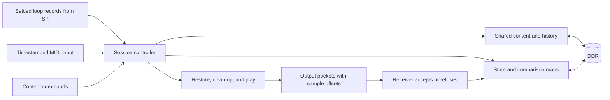

# Cache-less MIDI RTL

This is the hardware counterpart of managed MIDI in the Rust FPGA reference. It
records and plays timestamped packets, shares recorded content between loops,
grabs recent input history, and restores state at the start of playback. The
same scenarios run against Rust and RTL in the testbench.

Large data structures live in DDR. The fixed per-loop descriptors live in primary
BRAM: at most 16 KiB for 128 loops. Small command registers and temporary working
values also stay on chip. There is no cache or fixed memory-latency assumption.



The core uses timing supplied by SP. It does not schedule loop transitions or
run another musical clock. Application graph/control endpoint enablement, board
wiring and device drivers remain outside this component, as they do for reference
MIDI. An embedding supplies settled SP records and applies successful content
publications to SP before its next quantum. Publications stop/reset the affected
loops. Existing application compilation still refuses MIDI.

## Content and history

Events occupy fixed blocks, filled by event count. Silence needs only a duration.
One view describes a sequence's range, time origin, duration and immutable starting
state. Views share blocks; duplication copies no event payloads. An export retains
its view, so a later retake cannot change exported content.

Each input has a history writer and rolling checkpoints. A checkpoint follows
every 32 ordinary messages and every operation that can change many notes, such
as releasing a pedal. A range start shares an exact checkpoint or copies one state
and replays at most 31 ordinary messages. Starting state includes earlier messages
and excludes messages at the start frame itself.

Comparisons are prepared with checkpoints. A new checkpoint or range copies its
base's comparison maps and updates only changed cells. Recording starts use this
same history service. They do not run a fresh full-state comparison per loop.

Clear/replacement releases ownership, then bounded maintenance releases blocks
and descriptors. A block is reusable after its final owner is gone. Generations
reject stale handles within an image; a new prepared image invalidates old handles.

Defaults support 128 bindings, 4,864 blocks of 256 events, 512 views, 768 snapshots
and 256 retirement records. Each sequence admits 8,192 events; history has two
extra blocks of headroom. Events occupy 16 bytes. The event arena is 19 MiB:
128 independent 3,000-event recordings use 1,536 blocks (6 MiB with padding);
128 maximum-size recordings use 4,096 blocks (16 MiB). History and retained
versions share the remaining finite capacity.

## State and output

Inputs own their observed state. Outputs own the state of messages their receiver
actually accepted. A playing loop separately owns its cursor, pinned content and
note/pedal activity. Starting snapshots belong to content/history, not outputs.

A comparison bitmap belongs to a snapshot/destination pair. Accepted output
changes update affected cells in prepared comparisons. Unknown target controls
are ignored; returning a value to its target clears its difference bit. Maps use
weak references: generation and reference checks prevent a bitmap referring to a
reused snapshot slot, without keeping otherwise unused snapshots alive.

Restoration skips matching values. It handles loaded versus pending bank
selectors, pressure, pitch and the relationship between notes and pedals. With
pedals up, differing notes can change individually; more complicated pedal changes
rebuild the affected channel's relationship. Temporary state consists of scalar
values and nine bitmap words for one MIDI channel. Note/controller cells are read
directly from DDR.

All old-loop cleanup precedes new restoration. Established owners take priority
over newly starting loops. Independent playing loops cannot own the same MIDI
channel at one destination. A binding selects channels without renumbering them;
System Reset playback requires all sixteen channels.

Progress follows output acceptance. Playback/restoration refusal starts
coordinated destination recovery and suppresses overdue packets until a later
loop beginning. Recovery sends All Sound Off and All Notes Off per channel and
retains its position through refusal. Stop cleanup can resume over several calls.
A DDR fault invalidates the image; explicit recovery can still silence outputs
without DDR access. Processing then needs a newly prepared image.

The managed subset matches Rust: MIDI 1.0 channel packets and System Reset,
including sustain, sostenuto, Hold 2, pressure, pitch, banks/programs and channel
modes. Parameter-editing CCs 6, 38 and 96–101, SysEx and other system messages are
unsupported. Seek, overdub, automatic input monitoring, arbitrary channel remapping
and same-key voice merging remain outside the subset.

## Composition and controls

| Component | Responsibility |
| --- | --- |
| `midi_store` | Event blocks, views, snapshots, references and retirement. |
| `midi_state` | Apply one packet to DDR state; report changed cells. |
| `midi_difference` | Initialize/update comparison cells. |
| `midi_transition` | Propose ordered restoration/cleanup packets. |
| `midi_state_service` | Acceptance, output/activity updates and live comparisons. |
| `midi_runtime` | History, loop execution, transfers and atomic publication. |

`midi_runtime` combines these on an acknowledged 32-bit word-memory interface.
`midi_runtime_axi` adds the existing `word_axi` endpoint for AXI32 or AXI64.
`memory_arena_bytes` includes caller staging space as well as required
`arena_bytes`; they have different purposes. The core reserves an address window
for its private BRAM descriptors; that window has no DDR-backed copy.

Transfers share grants replenished per quantum: 64 events, 256 comparison cells,
64 metadata operations and 128 published bindings. Import preparation is resumable.
Imports preserve capacity promised to admitted recording/history writers. Private
capture/history writers reject import edits. Groups validate targets and reserve
new ownership before changing bindings. Publication conservatively reserves two
retirement entries per target and can return `Busy` until maintenance makes room.

See the [protocol](PROTOCOL.md) for commands, ownership and memory formats.

## Verification

Use the repository build environment and Verilator 5.032:

```sh
cargo test --locked -p rt_fpga_reference --all-features -p rt_fpga_compiler
cargo test --locked -p rt_fpga_testbench --features sim --test midi -- --test-threads=1
```

Comparisons check packets, offsets, content, starting state and accepted output
state under delayed memory and output pressure. Cases cover all quantum sizes,
31-message replay/checkpoint edges, 128 loops/eight outputs, transfers during
playback, resource exhaustion, retirement, refusal recovery and AXI32/64 faults.
There is no wall-clock performance gate. Simulation/synthesis establish
functionality and synthesizability; routed-board deadlines require later work.

The [Vivado 2021.1 study](../../docs/fpga/midi-vivado-7020.md) compares the audio
components before and after adding MIDI, sized for 64 stereo loops with MIDI,
30-second audio storage, and 32-frame chunks/quanta on a Zynq-7020. It reports
resource use and clock timing separately from quantum execution deadlines.
