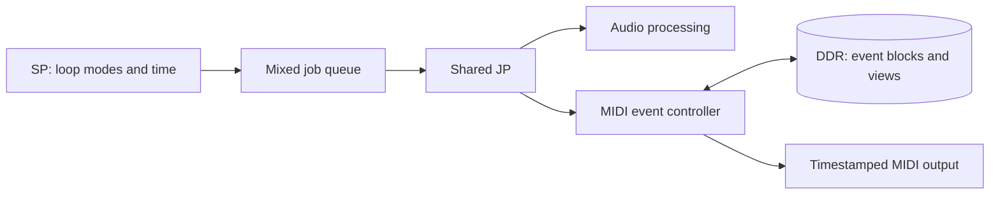

# Event-only MIDI through the shared SP and JP

The RTL deliberately omits MIDI instrument state. It stores and plays timestamped
messages without interpreting their effect on notes, controllers or pedals.
The Rust FPGA reference retains its complete state tracking and restoration.

`midi_audio_pipeline_axi` contains the existing compiled state processor (SP),
one mixed audio/MIDI queue and the common job processor (JP). SP still controls
loop modes and musical time. The removed state is the instrument state, not SP's
loop scheduling.



The event controller retains recording, ordered playback, channel filtering,
rolling input history, shared range views, imports, exports, duplication, atomic
group publication and bounded storage retirement. Events remain 16-byte records
in blocks filled by event count; one sequence view can span several shared blocks.
Loop descriptors and playback heads use BRAM; bulk storage remains in DDR without
a MIDI cache.

There are no input/output/activity states, starting snapshots, checkpoint states,
difference bitmaps, comparison directory, channel ownership arbitration, state
queries, restoration, note/pedal cleanup or recovery-message generation. Stop,
repeat and replacement release playback references but emit no extra MIDI.
Overlapping channel bindings can both play. Output backpressure is honored;
refusal blocks the affected loop until retrigger. DDR faults invalidate the image.

The compiled program still submits the same job kinds as Rust. State-only claim
jobs return without doing ownership work; the former cleanup job only releases
playback references and supplies the next playback window. This preserves the
shared SP/JP arrangement and keeps the performance experiment focused on removing
instrument state rather than changing the compiler or audio implementation.

The existing short-message validation remains: MIDI 1.0 channel packets and
System Reset, excluding parameter-editing CCs 6, 38 and 96–101. Arbitrary SysEx,
seek and overdub remain outside this component.

See [protocol](PROTOCOL.md) for the event-only interface, and the
[measurement report](../../docs/fpga/midi-stateless-rtl.md) for results and scope.
Earlier state-capable RTL remains available in Git history and in its historical
measurement reports.

## Generation and verification

Generation uses Python with `program/requirements.txt`; ordinary builds use the
checked-in generated RTL. The restricted control compiler produces the shared
execution unit's ROM. `midi_store` is generated from the same content-control
source used by that compiler.

```sh
python3 generate_control.py --check
python3 generate_pipeline.py --check
cargo test --locked -p rt_fpga_testbench --features sim --test midi -- --test-threads=2
```

Tests check retained event/storage behavior, lack of correction packets, refusal,
AXI32/64 faults, shared audio/MIDI job traces and several quantum sizes. The full
Rust reference's state tests remain in its own unchanged suite.
