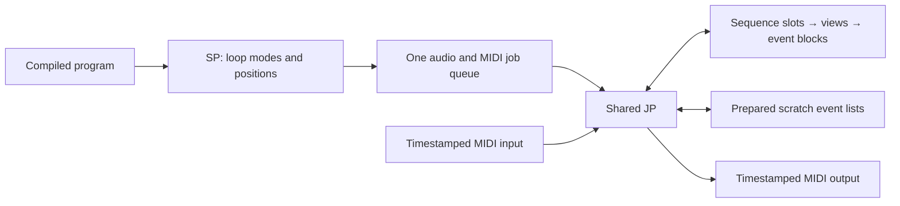

# MIDI data jobs in the Rust FPGA reference

This implementation records and replays timestamped MIDI messages. Loop timing is
controlled by the existing state processor (SP); the existing job processor (JP)
executes both audio jobs and MIDI data jobs from one queue. There is no separate
MIDI processor, MIDI program interpreter, or instrument-state service.

## Who does what?



SP applies Play, Record, Stop, seeks, and synchronization using the same loop state
as audio. The program specifies input routing, which sequence a loop reads or
writes, which buffers to merge, and which output receives a buffer. SP turns these
instructions into jobs with concrete positions and lengths. JP never decides a
loop's mode, advances its musical clock, or reconciles a second copy of that state.

SP holds one MIDI-specific flag per loop: whether a recording writer is open.
It queues begin/finish jobs only when necessary. These jobs precede the ordinary
data jobs, so a recording can become playable in the same quantum. A graph switch
may keep an open writer, but cannot remove or rebind it until recording finishes.

The jobs are ordinary variants of the common `Job` enum:

| Job | Work performed by JP |
| --- | --- |
| `MidiInput` | Copy one input port's messages for this quantum into a scratch list. |
| `MidiEmpty` | Publish an empty list for an inactive playback instruction. |
| `MidiReadView` | Read the explicit time interval supplied by SP, crossing event blocks as needed. |
| `MidiBeginCapture` | Allocate a new writer for a sequence slot. |
| `MidiAppend` | Append a scratch list at SP's supplied recording position; extend duration even during silence. |
| `MidiFinishCapture` | Make the recorded view complete and readable. |
| `MidiMerge` | Combine two sorted lists, preserving all messages. |
| `MidiOutput` | Send a list to its selected port with callback-relative timestamps. |

Data producers must precede their consumers in the program. Audio and MIDI jobs
can be interleaved. Their typed buffer IDs refer to separate prepared audio and
MIDI storage, so the same numeric buffer slot can be used for each kind of data.

## Event storage and views

The reusable block store remains. Each stored record is 16 bytes: an absolute
frame number within the recording, a same-time ordering number, and a short MIDI
message. Blocks have a configurable number of records. A block size of 256 is a
storage choice; it does **not** limit a quantum to 256 messages.

```text
sequence slot ──owns──> view
                       ├─ duration and event count
                       ├─ first-event offset and time origin
                       └─ block table ──> [events] [events] [events] ...
other view ────────────────────────────────┘         └──────┘
                                        shared event blocks
```

A view describes one continuous interval, possibly beginning or ending inside a
block. Reading it rebases timestamps by subtracting its time origin. Range views
and duplicates share immutable recorded events; they do not copy all messages.
A recording writer can continue appending beyond a captured range. Block reference
counts keep the range's existing events alive.

`MidiMemory` owns a prepared table of sequence slots. Each occupied slot owns one
view reference. Completed exports can retain a view, and ranges own references to
the blocks they use. Replacing a sequence or starting a retake releases the old
slot reference; retained exports and ranges remain valid. View handles include a
generation number, so a recycled slot cannot silently become an old handle's data.

Releasing a view queues it for retirement. After each successful quantum, the
pipeline performs at most 64 cleanup steps, each releasing a block or completing
a view retirement. This is a cleanup budget, not a message-processing budget.

## Scratch lists and playback cursors

JP uses one shared, preallocated event arena for all intermediate MIDI lists in a
quantum. A logical buffer is just a start/count pair into that arena. Merges append
a result list; when one input is empty they can alias the other list. Arena space
is reused at the next quantum. Preparation must allow for inputs, playback lists,
and materialized merge results, rather than just the final output's event count.

Each playback cursor keeps a view identity, its reader identity, the next record
index, and at most one future event. The reader identity invalidates the cache if
a program assigns the cursor to a different loop. These are data-reader details,
not a second loop state. They do not pin a view: ordered jobs and sequence ownership
keep reads valid, and a changed view handle invalidates the cursor.

On a start, wrap, or seek, SP explicitly requests repositioning. At position zero,
JP starts at the first event; elsewhere it locates the first relevant event with a
binary search. During continuous playback it walks forward. A future event stays
cached across quanta; a quiet interval therefore needs no event-store read.

Messages are ordered by timestamp, then source ID, then original insertion order.
Playback source IDs are cursor slots; live input IDs follow those slots. This
gives deterministic same-time ordering even when merge operands are reversed.
Merging already sorted lists takes work proportional to their combined length.

## Scope and limits

Supported:

- Recording, stopping, immediate record-to-play, repeating, and SP-controlled seeks.
- MIDI-only programs and programs that also record/play audio through the same JP.
- Multiple input/output ports, explicit routing, playback channel masks, and merging.
- Every channel-voice message, including parameter-selection and pedal controllers,
  treated as uninterpreted bytes; supported one-to-three-byte system messages too.
- Completed-view import, shared duplication, range views, and event-by-event export
  through the storage API. `Pipeline::replace_midi_view` publishes a completed,
  quantum-aligned view to a matching stopped loop and sequence slot.
- Multi-quantum callbacks with sample-relative input and output timestamps.

Deliberately absent: instrument-state snapshots, differences, restoration, note
ownership, automatic note-off/pedal cleanup, history capture/grab integration,
overdub editing, and the former session/group-control API. Stopping playback emits
no correction messages. SysEx and MIDI byte-stream decoding/running status are not
implemented; callers supply complete short messages with explicit status bytes.
The application's host control endpoint is not wired to this new MIDI path yet.

There is no fixed number of MIDI messages allowed per quantum and no instruction
quota for an event iterator. Read, append, merge, and output jobs finish all their
work across as many blocks as necessary. This is best effort: a sufficiently dense
quantum can miss its real-time deadline. Practical limits need later measurement.

Memory is still finite and prepared up front: sequence slots, blocks, views,
per-view event capacity, cursors, intermediate scratch events, and retirement
entries are configurable. Exhaustion returns an explicit error instead of growing
the heap, silently dropping messages, or reporting a partial take as complete.
Failures after SP has started a quantum latch the pipeline fault. Output refusal
also faults the pipeline; already accepted output cannot be rolled back. There is
no state-based recovery protocol.

## Hardware mapping

The Rust code uses normal functions, indexed arrays, and linear merge loops. It is
a software reference, rather than a cycle-by-cycle hardware simulation. A later
RTL implementation can use the same SP commands and shared JP queue while giving
each job a small data-moving controller:

- Event blocks and view block tables can live in DDR. Small sequence descriptors,
  cursor lookahead, queue entries, and list descriptors are candidates for BRAM.
- A read controller follows a block table, compares event timestamps with the
  supplied interval, and keeps the first future event. No loop-window service pass
  is needed in JP.
- An append controller advances through free event blocks. A merge controller
  compares the two next events and copies the earlier one to the result stream.
- Scratch events can use DDR with small staging buffers. They need not become a
  maximum-sized BRAM array per loop. A hardware implementation may stream results
  rather than reproduce the software arena's copies.
- Reference-count updates and deferred retirement map to serialized memory
  operations. Their traffic and temporary capacity still need hardware evaluation.

The interfaces expose positions and counts directly, and block traversal is data
dependent. There is no reason to synthesize a general MIDI instruction interpreter
or expand a quantum into a fixed maximum number of message slots. None of this
claims a proven hardware deadline. The RTL counterpart still needs workload-specific
throughput measurements as configurations change.

## Validation and migration

Run the active Rust suites and the small functional example:

```sh
RUSTFLAGS='-D warnings' cargo test --locked -p rt_fpga_reference --all-features -p rt_fpga_compiler
RUSTFLAGS='-D warnings' cargo run --locked -p rt_fpga_reference --example midi_loop
```

The example records and plays 3,000 messages in one 32-frame quantum across twelve
256-record blocks. Tests also cover mixed audio/MIDI, 1,200-message merges,
multi-quantum callbacks, quiet-event lookahead, seeks, capture transitions, program
switches, shared ranges, capacity failures, and callback heap-allocation guards.

State-based tests and benchmarks are archived under `tests/retired_midi` and
`examples/retired_midi`; Cargo does not discover them. Useful storage tests have
been adapted to the new API. The RTL counterpart now uses the same explicit data operations and is checked
against the Rust reference, including connected SP/JP traces and AXI32/64 traffic.
See the [RTL implementation and protocol](../../../../../fpga/midi/README.md).
The compiler keeps its old phase format only for historical fixtures; both current
targets reject that format. The application host control endpoint remains outside
this MIDI path.
