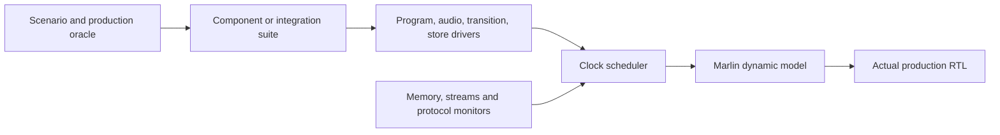

# Native FPGA testbenches

This crate owns the complete RTL regression suite in Rust/Marlin. It covers
the 75 test definitions at revision `0f9a31b1`, including their protocol,
fault, reset, ownership, arithmetic and production comparisons. The historical
mapping, definition hashes and Cargo targets are in [coverage.json](coverage.json).
`scripts/check_fpga_testbench_coverage.py` checks that every row still names a
Rust implementation and a native test target. It also checks that Python FPGA
tools contain only preparation/generation logic and native-runner aliases.

The `sim` feature is optional and native only. Ordinary workspace and Wasm builds
do not load Marlin, Verilator, or the DRAM library.

## Run

Install Rust, a C++ compiler and Verilator 5.032. The realistic memory tests also
need the existing DRAMsim3 C ABI library:

```sh
python fpga/axi_memory/build_dramsim3.py
cargo test --locked -p rt_fpga_testbench --features sim
cargo test --locked -p rt_fpga_sim --features sim -- --test-threads=1
python scripts/check_fpga_testbench_coverage.py
```

The first command downloads/builds the pinned native timing dependency. Functional
and fixed-latency CLI runs do not need that library. The complete Cargo regression
does exercise it; a missing library fails rather than skipping coverage.

For a focused run:

```sh
cargo run --locked -p rt_fpga_testbench --features sim -- state --config small
cargo run --locked -p rt_fpga_testbench --features sim -- chunk --memory-model fixed
cargo run --locked -p rt_fpga_testbench --features sim -- deferred --memory-model dramsim3
cargo run --locked -p rt_fpga_testbench --features sim -- pipeline --config small --waves
cargo run --locked -p rt_fpga_testbench --features sim -- production --directed --random-cases 20
cargo run --locked -p rt_fpga_testbench --features sim -- production --case my-session.json
cargo run --locked -p rt_fpga_testbench --features sim -- continuous --p 16 --frame-cycles 1600 --stalls
cargo run --locked -p rt_fpga_testbench --features sim -- demo
cargo run --locked -p rt_fpga_testbench --features sim -- zedboard --control-tests
```

`fpga-testbench --help` lists the suites and current options. `all` runs every
suite for the selected memory backend and component presets; `cargo test` is the
complete parameter/backend matrix. Focused `deferred`, `capacity`, `reuse`, and
`statistics` suites use the deliberately constrained geometries required by
their assertions. Other geometry experiments can call the public suite functions
with a `Geometry`; these checks must keep their queue/page constraints.

The old `fpga/*/simulate*.py` names are small aliases to the same native runner.
They accept its current options, with convenience selectors such as `--pipeline`,
`--deferred`, `--demo`, and `--control`. They contain no simulation implementation.
Old runner-specific flags are not a second supported configuration interface.

## Replay and measurements

The production suite accepts JSON, arrays of scenarios, or JSONL; `--case -`
reads standard input. Expected state, completion, event, sample and logical-media
results come directly from the production Rust backend. RTL receives the compiled
initial image and common actions/inputs; expected jobs or transition states are
never injected into it.

Fixed, float and arithmetic-audit reference artifacts are retained together.
`python scripts/check_fpga_float_accuracy.py work/fpga-testbench` applies the
existing independent float error-bound calculation to them; CI checks this as
well as exact fixed/RTL equality. The numeric checker remains a CPU-only tool.

Existing pure-input generators remain useful for long sessions and scale work
(install `scripts/rt_backend_testbench/requirements.txt` when using them):

```sh
python scripts/generate_fpga_scenarios.py --long-sessions --output work/long.jsonl
cargo run --locked -p rt_fpga_testbench --features sim -- production --case work/long.jsonl
cargo run --locked -p rt_fpga_testbench --features sim -- production --config 8x8 \
  --benchmark64 --scale-workload streaming --block-chunks 32 --slots 4096 \
  --memory-model dramsim3 --output work/streaming
```

Python here constructs common inputs and prepares hardware images; it does not
drive HDL. Normal Rust tests, including prepared/demo tests, need no Python
interpreter. The production CLI's optional generated workloads use that existing
Python input generator so there is one implementation of those datasets.

`--output` contains a `run.json` with arguments, result, elapsed time, tool versions,
revision/worktree state and RTL source hashes. Production runs also save exact
actual/expected JSON and per-quantum timing. Timing includes coordinator/TP/JP
phases, job intervals, allocator/cache/transport counters, reclamation progress,
and physical DRAM bus utilization when the backend supplies it. Native DRAM
reports retain reset generations, refresh/queue/latency accounting, and finalize
statistics once. Functional SV memory reports no physical timing claims.

VCD output is opt-in. Normal runs create no waveforms; `--waves` or an explicit
trace path enables them only for a selected investigation. The small core
waveform regression explicitly opens traces to check timestamp/model lifetime.
Do not enable waveforms for routine regression or CI runs: they consume disk
space quickly. Enabled VCDs use integer-picosecond timestamps. The elaborated
adapter, Verilator logs and compiled model cache are under `work/marlin-suite`.
Each session owns its model/context/trace; DRAM reports use distinct directories,
including when Rust tests execute concurrently.

## Architecture



The layers have deliberately small responsibilities:

- `model.rs` asks Verilator to elaborate the actual ports and parameters, then
  generates a thin literal-width adapter for Marlin. It supports explicit internal
  observations, array/generate-block probes and fault injection. It does not
  reproduce RTL behavior. Model builds hold an interprocess lock through loading.
- `clock.rs` and `sim.rs` schedule clocks in integer picoseconds. Coincident edges
  change together. Each edge evaluates current inputs, drives agents, samples
  handshakes, advances clocks, evaluates RTL, then observes results. `tick`,
  `until`, and watchdog limits keep sequential transactions readable and bounded.
- `protocol.rs` checks stalled payloads, occupancy and exclusion on every edge.
  These checks continue during configuration, another driver's waits, and reset
  placement. They are not hidden inside a particular transaction's polling loop.
- `memory/` owns one shared storage implementation for functional SV, AXI fixed
  latency, AXI DRAMsim3 and the legacy scalar transport. It checks independent
  AW/W admission, byte lanes/strobes, bursts, bounds, backpressure and fault drain.
  Tests control stalls/errors through the same `Control` fields.
- `drivers/` owns transactions, stream sources, independent observations and
  ownership audits. `Pipeline` composes audio plus store; `Loops` adds transition
  control around that same composition. There is no second scheduler or AXI
  implementation for an integration bench.
- `suites/` owns stimulus, explicit expected vectors and production comparisons.
  Stable seeded stimuli and serialized directed inputs are separate from timing
  or transport helpers. `prepared.rs` shares loader-ROM construction between
  continuous audio, the prepared demo and the timing runner.

To add a bench, build a `Design`, create a `Sim`, attach the relevant drivers and
agents, then write ordinary sequential Rust assertions. A driver waits by
advancing the shared scheduler, so all clocks and agents continue running. Use
`#[shoop_test]` for the Cargo entry point and put common protocol/transport behavior
in an agent only when another bench needs it. No custom coroutine executor or
new scenario language is required.

## Architecture assessment

For this suite, the result is maintainable in Marlin: production encoders and
oracles are called directly, ownership/state/media audits are shared, and the
same agents cover isolated components and full pipelines. The three saved pilot
cases match the frozen baseline exactly for all 216 stereo frames, final
states/media and observable counters in the ordinary Rust regression.

The suite owns port discovery, clock scheduling and reusable agents. That code is
centralized and exercised by width, multi-instance, waveform, reset and protocol
regressions. This suite uses Verilator, explicit clocks and synchronous protocols;
ordinary Rust transactions plus autonomous agents fit those requirements well.
Verilator uses two-state simulation; these tests do not establish four-state/X
propagation or analog clock-domain safety.

The migration exposed a pre-existing demo reset problem. A collector can leave a
quiescent boundary while an accepted response retires; the demo must count its
reset duration only while `session_reset_ready` remains asserted. The generated
demo/controller template now does that. The memory-error bench also waits for a
fresh loaded epoch before arming the fault, so an old draining transaction cannot
consume the intended new-epoch error. Pending-response and silence assertions
remain in place, and all three memory backends pass the recovery campaign.
