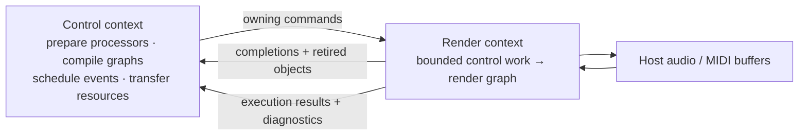

# rt_runtime

A prepared-storage audio/MIDI graph runtime for Rust hosts. Prepare storage before rendering, submit changes from a control context, and process borrowed buffers in your audio callback.



## What you get

| Capability | User-visible behavior |
|---|---|
| Typed audio/MIDI graphs | Deterministic DAG execution; audio fan-in sums without clipping |
| Live graph edits | Old graph keeps rendering during validation; legacy commits activate at callback boundaries, opt-in staged permits coordinate exact domain boundaries |
| Sample-frame scheduling | Parameter changes and MIDI injections split rendering at their target frames |
| Generic interval planning | Explicit shared decision bindings and per-consumer observations; no internal subdivision quota |
| Required resource data access | Explicit `RenderIo` read/capture capability with saturating work counters, independent of background quotas; indexed byte/event/state positioning; opt-in reserved capture groups and staged commits |
| Bounded ownership transfer | Accepted commands reserve completion space; replaced objects return for non-RT disposal |
| Revisioned resources | Fixed-page uploads, recording, immutable snapshots, and incremental reads |
| Explicit overload handling | Refusal instead of growing storage; reserved MIDI reset delivery |

**The host supplies** devices, callback/thread scheduling, processors, and any browser or wire adapter. There is no internal thread or hidden executor. The core uses `std` and `rtrb`, with no device or browser bindings in its production dependencies.

**The real-time contract is conditional:** runtime callback paths use prepared storage and finite application-dependent rendering work without heap allocation, freeing, locks, waits, or external I/O. Your processors and host callback must satisfy the same contract. This is not a hard-real-time deadline guarantee.

## Documentation

The [nineteen-chapter book](docs/README.md) is the primary guide. Its tasks use small independent public-API examples rather than a growing application.

| Task | Reading path |
|---|---|
| Process audio | [First graph](docs/part-1-process-audio/02-your-first-audio-graph.md), [processors](docs/part-1-process-audio/03-writing-processors.md), [callback adapter](docs/part-1-process-audio/04-connecting-an-audio-callback.md) |
| Control a running graph | [Owning commands](docs/part-2-control-a-running-graph/05-commands-completions-and-ownership.md), [routing](docs/part-2-control-a-running-graph/06-routing-and-live-graph-edits.md), [exact-sample changes](docs/part-2-control-a-running-graph/07-changing-parameters-at-an-exact-sample.md), [MIDI](docs/part-2-control-a-running-graph/08-processing-and-scheduling-midi.md) |
| Work with stored media | [Upload/read](docs/part-3-work-with-stored-media/09-loading-and-reading-resources.md), [record/export](docs/part-3-work-with-stored-media/10-recording-and-exporting.md), [MIDI seeking/state](docs/part-3-work-with-stored-media/11-seeking-and-reading-midi-events.md) |
| Coordinate processors and changes | [Planning](docs/part-4-coordinate-processors-and-changes/13-planning-processing-intervals.md), [typed operations](docs/part-4-coordinate-processors-and-changes/14-application-specific-operations.md), [staged graphs](docs/part-4-coordinate-processors-and-changes/15-staging-and-coordinating-graph-activation.md), [capture groups](docs/part-4-coordinate-processors-and-changes/16-recording-resources-together.md) |
| Operate the runtime | [Sizing](docs/part-5-configure-and-operate-the-runtime/17-capacity-work-budgets-and-diagnostics.md), [prepared ingress](docs/part-5-configure-and-operate-the-runtime/18-submitting-without-allocation.md), [shutdown](docs/part-5-configure-and-operate-the-runtime/19-stopping-disconnecting-and-reclaiming-ownership.md) |

The [reference](docs/reference/README.md) consolidates configuration/errors, execution, media/MIDI, lower-level APIs and host boundaries. Generate API details with `cargo doc -p rt_runtime --no-deps --open`. Previous guides remain historical background under `docs-previous/`, not the primary reading path.

## Try it

From this directory, in an environment with the workspace's Rust toolchain and dependencies:

```sh
cargo run -p rt_runtime --example gain_graph
cargo run -p rt_runtime --release --example gain_graph
cargo test -p rt_runtime
```

The [gain graph example](examples/gain_graph.rs) checks output samples, exact-frame parameter changes, allocation-free render scopes, and processor removal. The [bounded runtime example](examples/bounded_runtime.rs) measures seven synthetic offline workloads with legacy quota-based capture, not required/group/loop throughput. See [capacity and measurement limits](docs/part-5-configure-and-operate-the-runtime/17-capacity-work-budgets-and-diagnostics.md) and [repository performance evidence](../../../VALIDATION.md#performance-observations).

## Current boundaries

- Generic planning supports borrowed decisions, observations and internal intervals through `GraphRuntime<P, L = NoPlanner>`. Typed operations have reliable terminal receipts and finite independent recovery. Required resource access has separate counters; legacy optional access retains shared quotas. MIDI checkpoints and coordinated capture are opt-in prepared stores. [Staged graph activation](docs/part-4-coordinate-processors-and-changes/15-staging-and-coordinating-graph-activation.md) separates Ready/retired owners and actual-boundary preflight/publication. Loop timing, roles, restoration, media/configuration and paired program/graph transactions belong to the [separate loop library](../shoop_loops/README.md) over prepared physical templates, not arbitrary new processor construction.
- Graphs are acyclic: no feedback edges or automatic delay compensation.
- Processor slots and port signatures are reserved at startup. Rewiring is live; arbitrary new slots or larger signatures are not.
- Audio processing uses planar `f32`; resource audio uses interleaved little-endian `f32`. Conversion, resampling, codecs, and playback DSP belong to the host/processors.
- MIDI is complete MIDI 1.0 packets, including bounded SysEx—not a raw byte-stream parser or MIDI 2.0 API.
- Native and Wasm hosts need their own adapters. The crate does not install an AudioWorklet or bridge separate Wasm memories.
- Packaging is still workspace-managed, including version, dependency settings, and dev-only test support. The documentation is standalone; the directory is not yet a separately buildable/published package.
