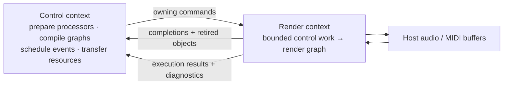

# rt_runtime

A prepared-storage audio/MIDI graph runtime for Rust hosts. Prepare storage before rendering, submit changes from a control context, and process borrowed buffers in your audio callback.



## What you get

| Capability | User-visible behavior |
|---|---|
| Typed audio/MIDI graphs | Deterministic DAG execution; audio fan-in sums without clipping |
| Live graph edits | Old graph keeps rendering during validation; complete plans activate at callback boundaries |
| Sample-frame scheduling | Parameter changes and MIDI injections split rendering at their target frames |
| Generic interval planning | Explicit shared decision bindings and per-consumer observations; no internal subdivision quota |
| Required resource data access | Explicit `RenderIo` read/capture capability with saturating work counters, independent of background quotas; indexed/group lifecycle APIs remain pending |
| Bounded ownership transfer | Accepted commands reserve completion space; replaced objects return for non-RT disposal |
| Revisioned resources | Fixed-page uploads, recording, immutable snapshots, and incremental reads |
| Explicit overload handling | Refusal instead of growing storage; reserved MIDI reset delivery |

**The host supplies** devices, callback/thread scheduling, processors, and any browser or wire adapter. There is no internal thread or hidden executor. The core uses `std` and `rtrb`, with no device or browser bindings in its production dependencies.

**The real-time contract is conditional:** runtime callback paths use prepared storage and finite application-dependent rendering work without heap allocation, freeing, locks, waits, or external I/O. Your processors and host callback must satisfy the same contract. This is not a hard-real-time deadline guarantee.

## Documentation

| Start here | Then read |
|---|---|
| [Getting started](docs/getting-started.md) — a complete gain graph | [Host integration](docs/integration.md) — callbacks, graph edits, ownership, shutdown |
| [Scheduling and MIDI](docs/scheduling-midi.md) — timing and overload recovery | [Resources](docs/resources.md) — upload, playback access, capture, export |
| [Generic planning](docs/planning.md) — prepared decisions, observations, internal intervals | [Capacity and performance](docs/performance.md) — defaults, sizing, tuning |
| Public API reference | `cargo doc -p rt_runtime --no-deps --open` |

These guides are self-contained; their links stay within this crate.

## Try it

From this directory, in an environment with the workspace's Rust toolchain and dependencies:

```sh
cargo run -p rt_runtime --example gain_graph
cargo run -p rt_runtime --release --example gain_graph
cargo test -p rt_runtime
```

The [gain graph example](examples/gain_graph.rs) checks output samples, exact-frame parameter changes, allocation-free render scopes, and processor removal. The [bounded runtime benchmark](examples/bounded_runtime.rs) measures seven offline workloads; see [performance measurement](docs/performance.md#measure-and-diagnose) for usage and limitations.

## Current boundaries

- Generic planning supports borrowed decisions, observations, and internal intervals through `GraphRuntime<P, L = NoPlanner>`. Typed planner/processor operations retain reliable terminal receipts, with independent recovery admission. Planner resource access still shares the existing I/O quotas; indexed required-render access and capture transactions remain future work.
- Graphs are acyclic: no feedback edges or automatic delay compensation.
- Processor slots and port signatures are reserved at startup. Rewiring is live; arbitrary new slots or larger signatures are not.
- Audio processing uses planar `f32`; resource audio uses interleaved little-endian `f32`. Conversion, resampling, codecs, and playback DSP belong to the host/processors.
- MIDI is complete MIDI 1.0 packets, including bounded SysEx—not a raw byte-stream parser or MIDI 2.0 API.
- Native and Wasm hosts need their own adapters. The crate does not install an AudioWorklet or bridge separate Wasm memories.
- Packaging is still workspace-managed, including version, dependency settings, and dev-only test support. The documentation is standalone; the directory is not yet a separately buildable/published package.
