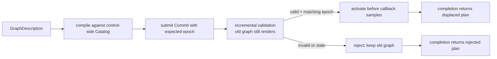

# Host integration

[Overview](../README.md) · [Getting started](getting-started.md) · [Scheduling and MIDI](scheduling-midi.md)

## Ownership and callback lifecycle

```text
PREPARE (non-RT)            RUN                         STOP (non-RT)
─────────────────          ───────────────────────     ───────────────────
validate Config            control: submit + drain     stop new submissions
prepare processors         render: process buffers    stop/join callbacks
allocate runtime/buffers   host: deliver MIDI resets   dispose returned owners
compile initial graph      repeat                     destroy endpoints
```

Keep `GraphRuntime` with one owner. The control endpoint can live on another thread; it is not a multi-producer command bus. If several UI/worker sources produce commands, serialize them on the control side rather than locking the render owner.

### One nonempty callback

```text
validate host buffers and frame
        │ invalid: bounded output clearing; no clock/control progress
        ▼
advance clock → snapshot queued work → stage commands / validate plan
        ▼
apply due events → render subranges → reclaim within remaining budget
        ▼
publish diagnostics → host drains MIDI recovery → host delivers outputs
```

| Host input | Required behavior |
|---|---|
| `AudioBlock::frame` | Use `runtime.next_frame()`; starts at `Frame(0)` and must remain contiguous |
| `frames` | Variable sizes up to `max_frames`; channel slices contain at least this many samples |
| Port arrays | Exact configured audio and MIDI input/output counts |
| Audio layout | One `f32` slice per channel; only the selected prefix is processed |
| MIDI inputs | Preallocated `MidiBuffer`s with valid offsets inside this host block and within configured count/byte limits |
| Zero frames | No-op: no shape validation, clock advance, output clearing, or command progress |

Preallocate host MIDI buffers, recovery sinks, and any conversion scratch before starting. `process` clears ordinary host outputs itself; the host manages input buffers and separate recovery sinks.

A processing error is **not a rollback**. Invalid host blocks leave the clock unchanged, but a processor error occurs after clock advance and possibly after state changes. On a propagated render error the runtime clears host audio/MIDI outputs, records `render_error`, and returns the error. Do not replay the same frame; consult `next_frame()`.

## Graph edits



- A host endpoint is an **input when used as a source**, and an **output when used as a destination**. Node endpoints have the opposite direction.
- Audio fan-in sums; there is no clipping, normalization, or extra routing block of latency. A host-to-host route is valid.
- Nodes run in deterministic dependency order. Reordering a description does not change compiler ordering. Cycles, duplicate edges/nodes, missing IDs, and incompatible ports are rejected.
- Only nodes in the active plan run. Rewiring retains processor state; excluding a node pauses its processing rather than destroying it.
- Commit, remove, and install all use `Lane::Normal`. Successful structural edits advance the epoch. Track completion epochs and maintain a matching control-side `Catalog`/signature description. Do not borrow `runtime.catalog()` concurrently with rendering.
- Use completion results, not lossy telemetry, to confirm an edit. A stale epoch requires reconsidering/recompiling the edit against current state.

Validation may occupy several callbacks and holds the current command until finished. Commands behind it wait, **including recovery commands**; recovery admission is reserved, not preemption of an already-held operation.

### Replace a processor

```text
commit plan without node → await Applied
        → Remove old NodeId → await processor in Retired::Processor
        → dispose processor / release its resource leases on control side
        → Install prepared replacement with next-generation NodeId
        → await Applied → commit plan using replacement
```

The slot must have been declared at startup. Its replacement must use the exact same audio/MIDI port counts. Increasing `max_nodes` alone does not create installable slots. Stale IDs never target the replacement.

## Commands, results, and backpressure

```text
submit ──refused──────────────► SubmitError { error, value: original command }
   │
   └─queued─► callback ──────► Completion { outcome, request, retired, epoch }
                                     │
                              try_completion()
                                     │
                              admission credit reusable
```

| Channel | How to consume it | If not drained |
|---|---|---|
| Owning completions | `Control::try_completion`; inspect then dispose/recycle off RT | Command slots stay occupied |
| Scheduled execution results | `Control::try_execution`; distinct from command completion | Scheduler slots stay occupied |
| Copy diagnostics | `Control::try_telemetry` | New telemetry may be refused; audio/terminal completions continue |

A completion returns the command in its **post-operation state** plus any retired object. For example, an applied commit has moved its candidate plan into the runtime; a rejected commit still owns its candidate. Do not drop owning results in a callback.

### Lanes and cancellation

| Normal lane | Recovery lane |
|---|---|
| Graph edits, scheduling, ordinary resource requests | `ResetMidi`, upload cancellation, snapshot release, capture stop |
| `command_slots` admission credits | One independent admission credit in `GraphRuntime` |
| FIFO within the lane | Selected before normal work when no operation is already held |

Recovery can overtake dependent normal requests. Releasing a snapshot before its queued read executes can make that read fail. There is no global FIFO across lanes.

`Ticket::cancel()` is best effort **until dequeue observes it**. It cannot undo an applied command or cancel an event already admitted to the scheduler. The terminal completion—not the ticket flag—is authoritative. Requests arriving after the callback's queue snapshot wait for a later callback.

### Allocation-free submission when needed

Ordinary `submit` allocates a cancellation flag and belongs off RT. For a bounded ingress adapter:

1. Call `prepare_submissions` before callbacks, with no outstanding requests.
2. Prepare owning payloads/buffers in advance; use `submit_prepared`.
3. Recycle returned payloads and drop finished tickets/completions off RT. Retaining them can exhaust cancellation-flag availability (`Busy`) even after command credit returns.

Submission scans at most that lane's slot count. This does not make constructing arbitrary payloads or disposing them RT-safe.

## Shutdown and disconnect

Stop submitting, then stop/join callbacks **before destroying the runtime**. Drain and dispose received completions/tickets on a non-RT context. If graceful completion is required, keep rendering nonzero blocks and draining results before stopping; there is no blocking flush method.

Disconnect does not mean immediate reclamation. Dropping control leaves render-owned and queued objects retained until non-RT teardown. Dropping the render endpoint causes future submissions to return `Disconnected` with their payload. Endpoint destruction after callbacks stop reclaims remaining queued/held owners; it does not publish terminal results for work abandoned at shutdown.

## Using the lower-level pieces

Most hosts should use `GraphRuntime`; the following are opt-in building blocks:

| API | Additional host responsibility |
|---|---|
| `transport::channel<T, R, S>` | `T` is a command, `R` an owned retirement bundle, `S: Copy` telemetry. Call `begin_cycle` once per callback, borrow via `next_operation`, then `complete`. Retain the retirement payload if completion fails; never drop it on RT. No queued closures are executed. |
| `PreparedPlan::from_descriptor` | Checks storage bounds only, **not execution safety**. Run `PlanValidator` before execution; keep plan and catalog unchanged throughout incremental validation. `GraphRuntime` does this on commit. |
| `PreparedPlan::with_capacity` | Prepare reusable plan storage off RT. Only edit exclusively owned inactive plans; bound `push_step`/`push_connection` work per ingress callback. Materialization is not validation. |
| `ResourceStore` / `Scheduler` | Respect callback-wide budgets/credits yourself. The executor normally owns this lifecycle. |
