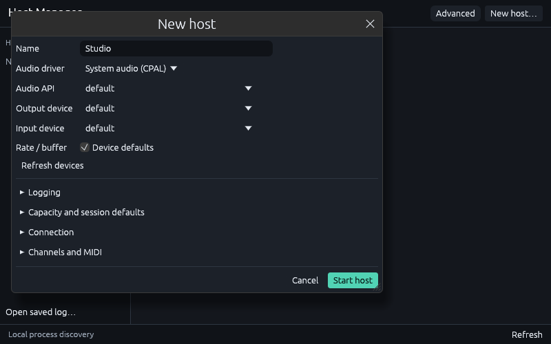
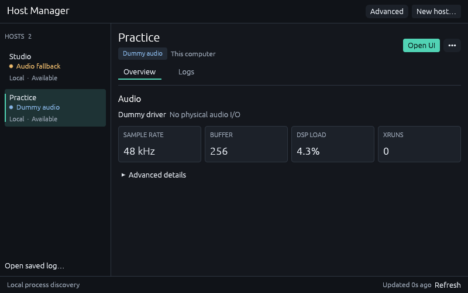
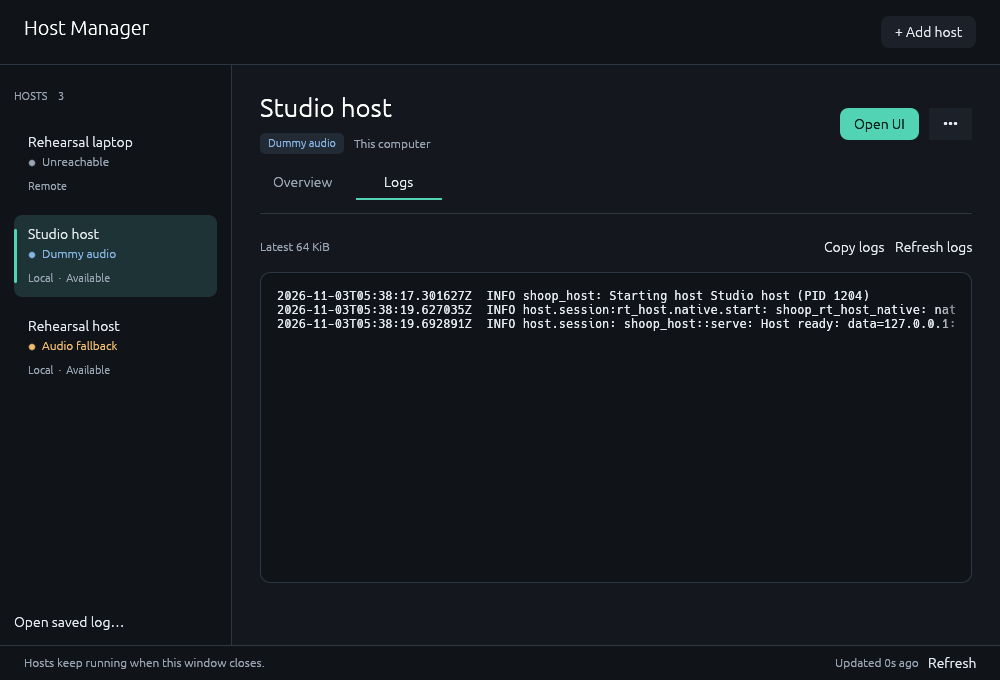
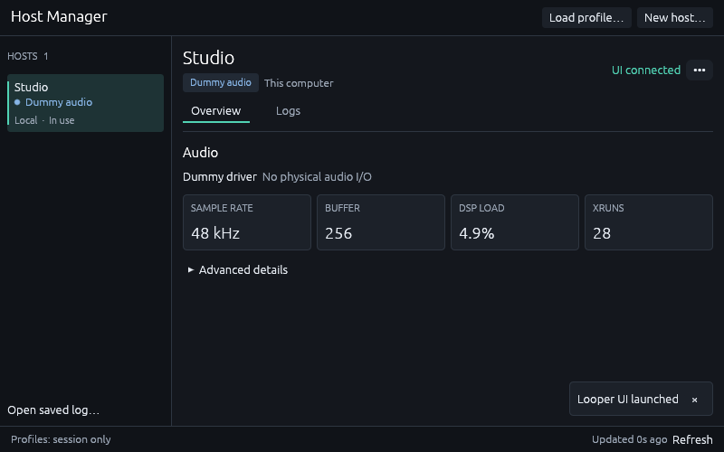
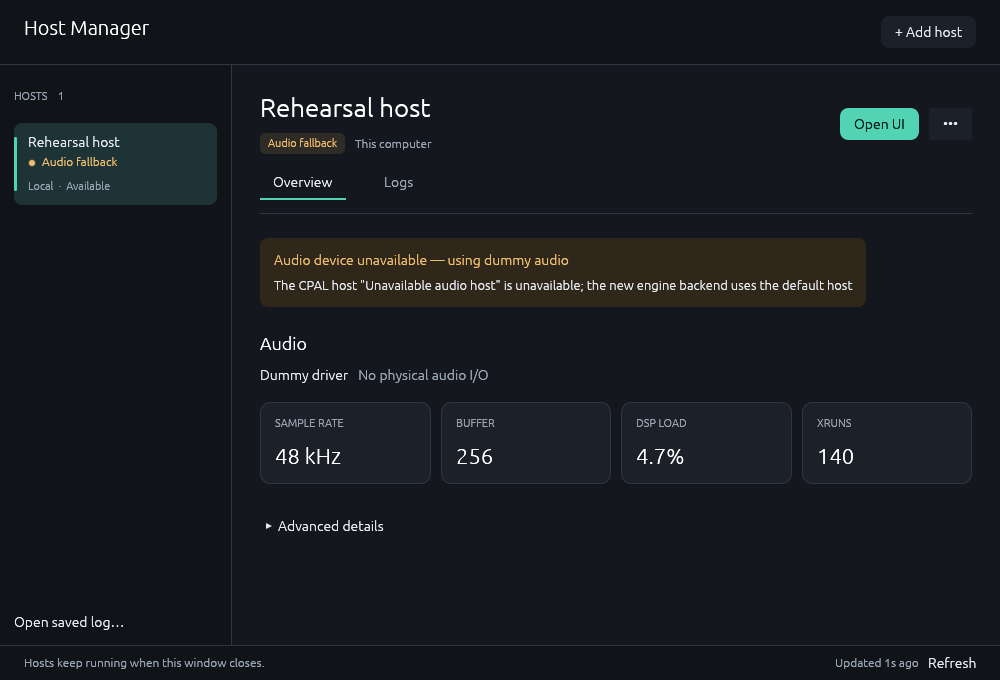
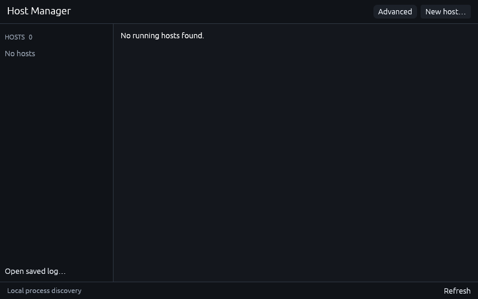
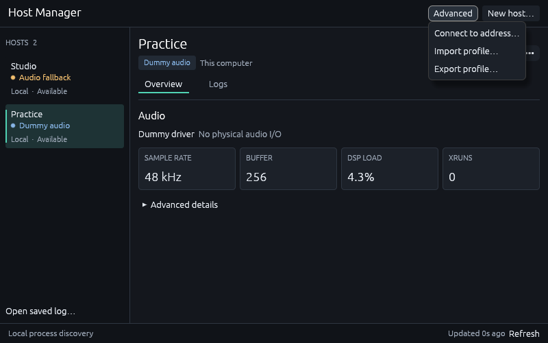
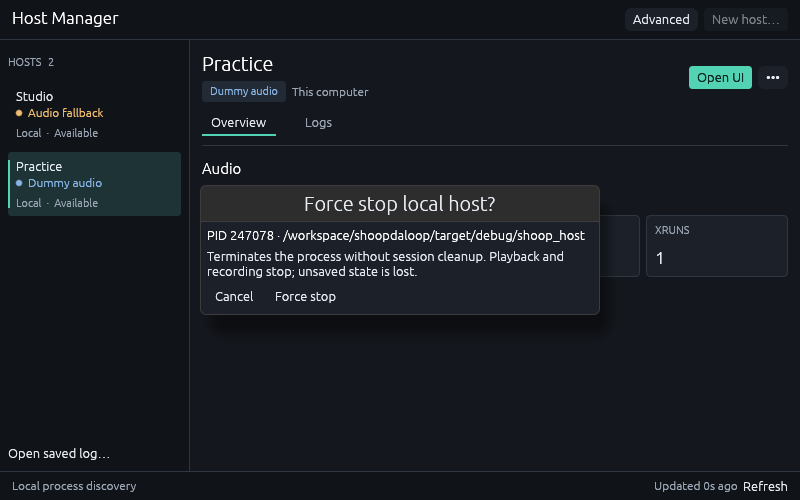

# ShoopDaLoop application

One session service owns musical state and admitted work. The UI and its local Lua
runtime use a confirmed client projection in every deployment. The RT engine is
the sole production backend. Its current core looping capability set is smaller
than the old stack's; [the feature parity ledger](../../../docs/native_session_recovery/feature-parity.md)
tracks each temporary gap, reference implementation/test and restoration criterion.
Feature editors, document/configuration fields and reference behavior are retained
for upcoming parity work. Recovery is independent of disk persistence.

For remote native UI connections, see [trusted-LAN setup and the Cortex-A adapter contract](../../../docs/trusted-lan-networking.md).

## Native roles and delivery

```sh
cargo build -p shoopdaloop -p shoop_host -p shoop_host_manager
cargo run -p shoopdaloop
# Detached host and UI siblings, with configuration exchanged over pipes.
target/debug/shoopdaloop --session-transport socket
# Shared memory permits one data attachment.
target/debug/shoopdaloop --session-transport shared_memory
# Configure and manage detached hosts from the GUI.
target/debug/shoop_host_manager
```

The default is `in_process`. **Settings → Audio → Session delivery** selects the
next launch's placement. `--engine-transport` remains a CLI alias. A detached host
survives its launcher and UI. Socket delivery supports reattachment; a shared-memory
host supports its first attachment only. Hosts do not restart automatically.

The manager discovers local `shoop_host` processes and their owned TCP listeners
through the OS. It probes only those sockets and retains OS-assigned ports. Discovery
and status queries do not take control or consume a shared-memory attachment.
There is no registry, port scan, advertisement file or remembered host list.

For CLI use, start the roles separately (the host defaults to dummy audio):

```sh
target/debug/shoop_host
# Use the management address printed by the host, or select it in Host Manager.
target/debug/shoopdaloop --ui-only --host-address 127.0.0.1:PORT
```

`shoop_host --config PATH` accepts an optional host configuration.
`--endpoint`, `--management-endpoint`, `--name` and `--log-file` remain explicit host
options. Advanced connection profiles can be exported with `--export-profile PATH`
and imported with `--host-profile PATH` (`--remote-profile` is an alias). Profiles
select endpoints, never process or session identities, and are never saved or loaded
automatically. The launcher exchanges bounded startup/readiness messages over pipes.
Manager and sibling UI launches pass the live endpoint through a bounded stdin pipe;
normal creation and attachment require no configuration or profile files.

Compatible clients connect without keys, certificates or trust records. Protocol
checks, controller generations and exclusive control still apply. A second controller
is refused while the current owner remains healthy.

Every connection obtains a fresh snapshot of the endpoint's current state. The
**Connect to endpoint** action uses the same flow after loss or host restart.
Previous pending requests are discarded and commands are not replayed. Configured
scripts remain visible but disabled; start them explicitly in Scripts. Connection
does not apply local preferences or initialize the host's session.

The Session menu's **Connected host settings…** panel queries the host's startup
settings, effective audio status and diagnostics. Local preference saves change
future local launch defaults, independently of the connected host.

For an external host, the Session menu and window/platform close offer:

- **Close UI only (keep host running)** releases control and exits this UI.
- **Close UI and host** waits for MIDI reset, render stop and cleanup.
- **Cancel** keeps the UI open.

After data loss, shutdown uses a separate management connection with
the last owner's generation. A replacement UI fences that authority. Failure is
reported with retry and UI-only options; an uncertain retry checks the same operation.
A host with no live UI owner can be closed explicitly with
`shoopdaloop --shutdown-host --host-address HOST:PORT`. This acquires a new
shutdown generation; a live owner refuses it. It also manages a shared-memory host
after its single data connection is lost, without enabling shared-memory reattachment.
The UI never uses this claim as a fallback for stale-owner shutdown.
Product shutdown does not kill a PID. In-process mode ends with its process; browser
mode ends with its page. Shared-memory mode cannot reattach after UI exit.

## Drivers, controls and files

Default native builds include CPAL+midir and native JACK audio/MIDI. The application
and Host Manager default to CPAL, or JACK in a JACK-only build; the standalone host
defaults to Dummy. Driver-free builds use Dummy. Lua controller MIDI remains client-local.
JACK connects directly to the JACK server; CPAL's JACK API is a separate CPAL selection.
Unusable device settings fall back to Dummy with a visible warning and do not
overwrite the saved preference.

**Settings → Audio** selects the application's preferred driver for its next launch.
In Host Manager, **New host → Audio driver → JACK** exposes the client name; expand
**JACK ports and connections** to configure local audio/MIDI port names and startup
source/destination pairs. The JACK server supplies sample rate and buffer size.
No profile files are required.

Both native launch executables accept the same audio overrides:

```sh
shoop_host --audio-driver jack --jack-client-name Studio
shoopdaloop --audio-driver jack --session-transport socket
shoop_host --audio-driver jack --jack-audio-inputs capture_l,capture_r \
  --jack-audio-outputs main_l,main_r --jack-midi-inputs= \
  --jack-connect 'main_l->system:playback_1' \
  --jack-connect 'main_r->system:playback_2'
```

`--audio-driver` accepts `dummy`, `cpal`, or `jack`. JACK port lists are comma-separated;
an empty list disables that direction. Repeat `--jack-connect` for startup connections.
Use local short names or external `client:port` names. Application flags override the
chosen driver's saved profile for this launch only. For `shoop_host --config FILE`,
flags override the JSON driver configuration; unspecified fields keep their configured
values when the driver kind matches. Explicitly selecting a driver omitted from the
build fails with a diagnostic. Audio overrides cannot be used when attaching to an
existing host. `--help` lists the available options.

Advanced JSON configuration also supports the complete JACK startup configuration:

```json
{
  "driver": {
    "Jack": {
      "client_name": "Studio",
      "audio_inputs": ["capture_l", "capture_r"],
      "audio_outputs": ["main_l", "main_r"],
      "midi_inputs": ["keys"],
      "midi_outputs": ["events"],
      "connections": [["main_l", "system:playback_1"], ["main_r", "system:playback_2"]]
    }
  }
}
```

Driver and capacity changes apply at host startup. Live driver switching is a
tracked temporary gap, as are FX/synths, composite/grab/dry-wet
operations, timing/alignment edits, click generation/preview/insertion and loop duplication.
The authoritative capability checks refuse unsupported operations.

Direct audio/MIDI/trigger tracks, primitive loop controls, shared musical selection,
targets/policies, supported track/bus controls, routes/connections, piano MIDI and
bounded waveform/MIDI detail reads are available. Configured track/loop/channel/media
pools are prepared at startup; exhausted capacity produces a refusal.

Core session save/load and standalone WAV, loop-audio, exact-MIDI and Standard MIDI
import/export use the session service. Save while playing is supported; active or
scheduled recording refuses without stopping it. Load starts restored loops stopped
and asks before sample-rate conversion, leaving the device unchanged. Unsupported
FX/dry-wet/composite/script documents and buses exceeding prepared limits refuse as a whole. Audio mapping, channel
selection, optional import length changes and SMF loss warnings remain explicit.
Native output replaces its target atomically; browser completion means download
handoff. Limits and supported fields are in the
[persistence contract](../../../docs/native_session_recovery/persistence-contract.md).
Full feature parity remains tracked by the ledger.

The Scripts tab manages external built-ins, examples, native user files and run-once
Lua sources. Script source export is available. Lua reads confirmed state; a write
becomes visible on a subsequent confirmed pump. VM, timers, controller connections,
dialogs and file/resource handling stay in the UI. See [Lua dialogs](../../../docs/lua_dialog_api.md).
Session script ownership conversion/resource persistence remains in the parity ledger.

Source builds use a sibling `SHOOP_SRC_TREE` marker to locate built-ins. Native
packages omit it and carry built-ins beside the executable on Linux/Windows or in
`Contents/Resources` on macOS. `shoop_host` ships beside the UI executable, including
inside `Contents/MacOS`. `shoop_host_manager` ships beside both executables. The macOS
archive also provides **ShoopDaLoop Host Manager.app**; Windows includes a manager
shortcut in the extracted folder. Linux includes `shoop_host_manager.desktop` and
`icon.png` for installation into the desktop applications/icon directories, with
the executables on `PATH` and the icon installed as `shoopdaloop.png`. Keep the
three executables together when installing. On macOS, keep both app bundles
together, for example by copying both to Applications.
Carla runtime payloads and old worker/worklet payloads are
not shipped; their sources/recipes and behavioral fixtures are preserved for parity.

## Output buses

The mixer supports ordinary named buses, persisted display order, gain/mute,
stereo balance and per-channel meters. The startup pool defaults to eight buses
with up to eight channels each; Audio settings configure the prepared count and
width for the next start. The add dialog uses the running host's negotiated limits.
Master is the default stereo bus and can be removed. Zero-bus sessions save/load
normally; New Session creates a fresh default even after every bus was removed.
Track defaults map matching widths one-to-one and mono to every destination
channel; absent/incompatible names leave a track unconnected. Explicit bus and
direct system routes coexist. Lua bus indices follow stable logical order rather
than mixer drag order, including after save/load. Bus FX remains unavailable.

## Browser

```sh
rustup target add wasm32-unknown-unknown
cargo install --locked trunk --version 0.21.14
cargo install --locked wasm-pack --version 0.15.0
cd src/rust/shoopdaloop
trunk serve --open
```

Audio needs an explicit microphone or output-only enable gesture. Web MIDI has a
separate permission action. The app client, Lua and service pump cooperatively on
the main thread; only the prepared RT engine renders in the AudioWorklet. File
codecs run in a dedicated client Worker so decoding/encoding does not block that
service. `offline` disables the session engine; the retired `worker`
mode produces a diagnostic. Audio/MIDI access depends on browser secure-context and
permission policies. Physical port inventory is fixed at engine preparation; reload
when new MIDI endpoints need engine ports. Same-page UI recovery is not provided.

Hosted bundles carry external built-ins, the RT worklet and the client codec module.
Release packaging also embeds them in a single HTML file, subject to browser restrictions on `file:` URLs.

## Verification

```sh
cargo fmt --all -- --check
RUSTFLAGS='-D warnings' cargo build --workspace
SHOOP_ALLOW_MISSING_BACKENDS=1 cargo nextest run --workspace --features shoop_engine/app_backend,shoop_backend/native-fx --profile ci
python3 scripts/check_rt_engine_boundary.py
python3 scripts/check_tracing_coverage.py --require-closed
python3 scripts/check_shoop_test_usage.py
python3 scripts/run_wasm_tests.py --runtime node --profile dev
```

The workspace suite includes the isolated `shoop_app_reference` and independent old
engine fixtures for parity evidence. `shoop_engine/app_backend` in that test command
is a reference-test feature, never a production frontend dependency.

A packaged, windowless canary exercises the actual companion, keyless attach,
recorded audio/MIDI reads, socket reattachment, and confirmed host cleanup:

```sh
target/debug/shoopdaloop --probe-engine-transport --session-transport socket
target/debug/shoopdaloop --probe-engine-transport --session-transport shared_memory
# Separate large-file canaries; the transport canary retains its existing deadline.
target/debug/shoopdaloop --probe-persistence --session-transport socket
target/debug/shoopdaloop --probe-persistence --session-transport shared_memory
```

Browser core workflow after a Trunk build (Chromium and pinned Node 22.22.2):

```sh
NEW_ENGINE=1 CHROME_BIN=chromium node --experimental-websocket browser_smoke.mjs
# After release packaging:
NEW_ENGINE=1 SELF_CONTAINED=1 CHROME_BIN=chromium node --experimental-websocket browser_smoke.mjs
python3 browser_firefox_smoke.py --backend new_engine
# Additional >32 MiB file round-trip through the codec worker and AudioWorklet:
NEW_ENGINE=1 LARGE_MEDIA=1 CHROME_BIN=chromium node --experimental-websocket browser_smoke.mjs
```

`SELF_CONTAINED_URL` can point the self-contained smoke at an already served HTML
URL. Serve a directory containing only that HTML to test its embedded bundle
independently of hosted assets.

The file canaries compare exact PCM/MIDI after save/load/save, check stopped fresh
identities, and resume playback. Native file canaries use actual atomic output and
bounded file input. The socket case also abandons upload/capture and reconciles an
accepted load without replay. Browser canaries cancel the first output, retry by
clicking the actual download link, and require a browser-handoff result. The large
browser case has separate deadlines; normal canary workloads/deadlines are retained.

`--tracing` captures the local UI/control process in Perfetto format; optional
`--tracing-engine-detail` adds available local instrumentation. External hosts and
RT worklets do not become traced application-model realms through UI attachment.
The browser tracing smoke waits for more than 8,192 records from the local UI
capture. After 60 seconds it saves the available trace and reports a failure with
the observed record count.
Forced process termination cannot finalize an in-process trace.

## Host Manager

Run `shoop_host_manager`, or choose **Session → Host Manager…** in the
native looper UI. The three native entry points are `shoopdaloop` (looper),
`shoop_host` (headless host), and `shoop_host_manager` (management GUI).
The manager runs in its own process without starting audio
or taking control of a session. Closing the manager leaves hosts and UIs running.

**New host…** configures and starts a detached companion. Set its name and audio
settings, then Start host. Expand capacity/session defaults, channels/MIDI,
connection or optional logging when needed. The form uses OS-assigned local ports;
no profile, key or configuration path is required. Driver and capacity changes
require a new host/session.

The manager automatically enumerates local host processes and their actual
listening sockets. Scans run in the background with bounded concurrency. A fresh
manager rediscovers hosts started through the GUI or CLI; closing
the manager leaves their processes and sessions running. Exited hosts disappear
through OS observation. Inspection failures are surfaced separately from exits;
processes that cannot answer a compatible greeting are not presented as ready.

**Advanced** contains **Connect to address…**, **Import profile…** and
**Export profile…**. Manual targets exist only for the current manager session.
Local and manual connections to the same live instance appear once. Remote hosts
are added explicitly; LAN-wide discovery is outside scope.

Select a host to inspect effective audio state, DSP load, xruns, startup settings
and diagnostics. The sidebar distinguishes intentional **Dummy audio** from
**Audio fallback**. **Open UI** is available when the host can accept an attachment
and has no controller. Socket hosts can reattach; shared-memory hosts can attach
once. **••• → Stop host…** requests orderly cleanup after confirmation; the server
refuses this while a controller is live. **Force stop…** is available only for an
OS-identified local process, requires separate confirmation and terminates without
session cleanup. Its PID, creation identity and executable are revalidated before
termination. Remote descriptor PIDs cannot select a local process to kill. Tray
integration is not included.

Disk logging is opt-in: enable it in **New host…** or pass `--log-file PATH` to the
host. This writes a rotating file only at the requested path, including
startup errors. Logs rotate at
1 MiB with three backups and remain until manually removed. Without `--log-file`,
host diagnostics go to stderr and no persistent host logs or records are created.
`RUST_LOG` controls verbosity (default `info`). An explicitly exported local profile
includes its requested log path; a manually authored profile can set `log_file`.
The **Logs** tab reads the latest 64 KiB from that explicit path. Remote log files
stay on the host computer. **Open saved log…** opens only a file explicitly chosen
by the user. **••• → Copy diagnostics** copies the current report with current process and connection information.
Success messages dismiss after five seconds without moving the layout; errors stay
visible until dismissed.

Screenshots from the native manager (800 × 500):

















The hosted preview canary uses the real codec worker and AudioWorklet, switches
System → Master → System, checks Master signal, Stop and natural completion, and
requires unchanged loop media/transport. It can run with output-only permission:

```sh
PREVIEW_ONLY=1 OUTPUT_ONLY=1 CHROME_BIN=chromium node browser_smoke.mjs
PREVIEW_ONLY=1 OUTPUT_ONLY=1 PREVIEW_RESUME=reject CHROME_BIN=chromium node browser_smoke.mjs
PREVIEW_ONLY=1 DENY_FIRST=1 PREVIEW_RESUME=pending CHROME_BIN=chromium node browser_smoke.mjs
```

`PREVIEW_RESUME=reject` injects a rejected Web Audio resume after suspending the
actual context. `pending` leaves the resume unresolved to model autoplay gating.
Both require a visible failure without a false Playing state and a successful
retry. `DENY_FIRST=1` additionally checks browser microphone denial and retry.
These flags select acceptance probes; they do not alter production playback.
